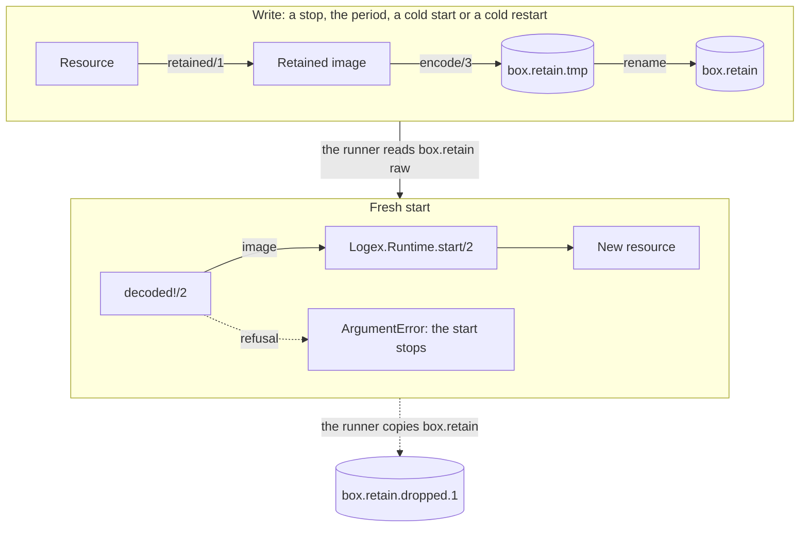

# The architecture of the store and its files

This page is for a contributor. It describes the
[retained image](../../guides/reference/glossary.md#retained-image), the text of the
[store](../../guides/reference/glossary.md#store), its digests and its versions, and the
refusals of a file that logex reads. Read it before you change a line of the store or a
rule of the image.

4 pages are near this one:

- [How a start reads the store](store-reading.md): the digests, the versions, the end
  line and the refusals of the store.
- [The writes and the copies of the store](store-writes.md): the atomic write, the
  numbered copies of the store and the
  [forces file](../../guides/reference/glossary.md#forces-file).
- [The file work of the runner](runner-files.md): the processes that read and write these
  files, the write limit and the table of paths.
- [The store](../../guides/reference/store.md):
  the rules as a user sees them.

## What the part does

A [runner](../../guides/reference/glossary.md#runner) with the option `retain:` keeps
the retained values of its [resource](../../guides/reference/glossary.md#resource) in 1
file. The store is not battery-backed memory, and it is not a safety memory. A person can
edit it, a cold start discards it and a crash can set it back to the last write.

These are the 3 starts of a runner, by what they do with the store:

- A fresh start is `Logex.Runner.start_link/1` with `retain:`. It reads the store and
  lays its values over a new resource.
- A cold start is a fresh start with `start: :cold`. It reads the store, but it lays no
  value over the resource. Then it writes a new store.
- `Logex.Runner.restart/2` starts a tripped runner again, and it reads no store. A
  [warm restart](../../guides/reference/glossary.md#warm-restart) keeps the retained
  values that the runner holds in memory.



Figure: the path of the retained values to the disk and back. The runner does each read,
write and copy. The dotted lines are the paths that do not occur on each start.

A write goes from the resource to the image, the text and the disk. A fresh start reads
the text, makes the image and lays it over a new resource. The runner copies the store
before its first write if the start dropped a value. A cold start copies a store that a
fresh start refuses. [The writes and the copies of the store](store-writes.md) gives the
rules of each copy.

## How it is built

`image.ex`, `retain.ex` and `refusal.ex` are hidden from the documentation
(`@moduledoc false`). Their documentation is the comment at the head of each file.

| Module or file | Holds |
|---|---|
| `Logex.Runtime` | The way in for a host. `retained/1` and `retained/2` take an image out. `start/2` and `instance/2` lay it over a new resource or instance |
| `Logex.Runner` | The options `retain:` and `start:`, and the report of the store in `Logex.Runner.status/1` |
| [`image.ex`](../../lib/logex/image.ex) | The image: taken out of an instance or a resource, checked, and laid over a new one |
| [`retain.ex`](../../lib/logex/retain.ex) | The text of the store: `encode/3`, the digests, `decoded!/2`, and the atomic write `written/2` |
| [`refusal.ex`](../../lib/logex/refusal.ex) | The bounds of each refusal of the store, of the forces file and of an image |

The writer and the table of paths are in [The file work of the runner](runner-files.md).
[How a start reads the store](store-reading.md) gives the digests, the versions, the end
line and the refusals.

### The retained image

The image is plain data that the [host](../../guides/reference/glossary.md#host) can
keep. `Logex.Runtime.retained/1` takes it out of a resource, and
`Logex.Runtime.retained/2` out of 1 [instance](../../guides/reference/glossary.md#instance).
The resource of `tally.logex` ([Example](#example)) gives this image after it counts 2
boxes:

<!-- unchecked: the image from a run of tally.logex over 5 cycles, eye 0, 1, 0, 1, 0, its keys put in the order of the text -->
```text
%{
  configuration: "tally",
  globals: %{"total_boxes" => {:dint, 2}},
  instances: %{
    "t1" => %{
      program: "tally",
      kinds: %{"boxes" => "ctu"},
      values: %{
        "boxes.cu" => {:bool, 0},
        "boxes.cv" => {:dint, 2},
        "boxes.ov" => {:bool, 0},
        "boxes.pv" => {:dint, 3},
        "boxes.q" => {:bool, 0},
        "boxes.r" => {:bool, 0},
        "full" => {:bool, 0}
      }
    }
  },
  triggers: %{}
}
```

- `values` holds each retained value by its path in the instance, with its
  [type](../../guides/reference/glossary.md#type). An
  [array](../../guides/reference/glossary.md#array) has its type `{:array, :int, [8]}`.
  Its value is a list, or a list of lists for more than 1 dimension.
- `kinds` holds each instance on the path to a value. The kind of an instance of a
  built-in type is its type word, for example `"ctu"`. The kind of an instance of a user
  block is the name of the block. An array of instances is `{:array, "ton", [4]}`.
- `triggers` holds the last sample of each retained
  [trigger](../../guides/reference/glossary.md#trigger), by the name of the
  [global](../../guides/reference/glossary.md#global). The configuration names a trigger
  with `single`, for example `task trip single estop`. A
  [task](../../guides/reference/glossary.md#task) can keep a last sample that is not the
  sample of its trigger. Then `triggers` also holds the sample of the task, by the name
  of the task.
- The image never holds the `last` of a [timer](../../guides/reference/glossary.md#timer),
  the time of its last scan. Each retained timer starts with `last` at the `now` of the
  start.

`Logex.Runtime.start/2` and `Logex.Runtime.instance/2` lay an image over a new resource
or instance. They keep a value only if all of these are true:

- The instance has the same name and runs the same
  [program type](../../guides/reference/glossary.md#program-type).
- The program declares the path retained, with exactly the same type, under instances
  of the same kinds.
- The value fits the type.

A path that the program retains and the image does not hold starts at its
[initial value](../../guides/reference/glossary.md#initial-value), with no report. A [preset](../../guides/reference/glossary.md#preset) follows the
program when an instruction gives it. The start returns each value that it does not
keep, with its reason:

| Reason | Example from a run | The stored value |
|---|---|---|
| `:undeclared` | `{"gone", :undeclared}` | Has a path that the program does not declare |
| `:unretained` | `{"k", :unretained}` | Has a path that the program declares, but does not retain |
| `{:retyped, stored, now}` | `{"t1.boxes", {:retyped, "ctu", "ctd"}}` | Has a different type or kind |
| `{:resized, from, to}` | `{"a", {:resized, [3], [4]}}` | Is an array of different sizes |
| `:misfit` | `{"n", :misfit}` | Has the right type, but the value does not fit, `1000` for a `sint` |
| `{:preset, stored, now}` | `{"boxes.pv", {:preset, 3, 5}}` | Is a preset that the instruction changed |

An image that is not of this shape is a wrong argument: 1 `ArgumentError`, with 1 line
for each problem.

### The text of the store

[Example](#example) gives this store of 16 lines:

<!-- unchecked: the first 16 lines of the output of this page's example -->
```text
logex retain 4
configuration tally written 2026-10-30T14:00:04Z
resource md5 013cc059392445fdcc1e84c9b0de6118
program tally md5 bd882e28a8159d8e8a4ea56ade7b36b6
global total_boxes dint 2
instance t1 tally
t1.boxes ctu
t1.boxes.cu bool 0
t1.boxes.cv dint 2
t1.boxes.ov bool 0
t1.boxes.pv dint 3
t1.boxes.q bool 0
t1.boxes.r bool 0
t1.full bool 0
digest md5 18a0b2493864f5e730cd41029aeaf91c
end 16 lines
```

Each line has 1 of these forms:

| Line | Form | Sequence |
|---|---|---|
| Header | `logex retain 4` | Line 1 |
| Configuration | `configuration <name> written <time>` | Line 2 |
| Resource | `resource <scheme> <digest>` | Line 3 |
| Program type | `program <type> <scheme> <digest>` | By the name of the type |
| Global | `global <name> <type> <value>` | By name |
| Sample of a trigger | `trigger <name> <sample>` | By name |
| Instance | `instance <name> <program type>` | By name |
| Instance on the path | `<instance>.<path> <kind>` | After its instance, in path order |
| Value | `<instance>.<path> <type> <value>` | After its instance, in path order |
| Digest | `digest <scheme> <digest>`, the MD5 of the value lines after the word `md5` | Before the end line |
| End line | `end <count> lines` | Last |

- The time is the wall clock of the host in UTC, to the second. The runner gets it from
  `c:Logex.Runner.Clock.wall_ms/1` of its
  [clock](../../guides/reference/glossary.md#clock). It is for a person and for
  `written_at` in `Logex.Runner.status/1`, never for a timer.
- An integer and a `bool` are in decimal. A real is the shortest text that reads back to
  the same value.
- The [elements](../../guides/reference/glossary.md#element) of an array are on 1 line, the rightmost
  [subscript](../../guides/reference/glossary.md#subscript) fastest.
- Only an instance whose program retains a value has an `instance` line.
- The count of the end line includes the header and the end line, as `wc -l` counts them.
- The value lines are each line after the `configuration` line, except the naming lines,
  the `digest` line and the end line. Each has LF at its end in the digest, whatever its
  line end in the file.
- Each digest comes after the word of its scheme, `md5`. The schemes are 1 table,
  `schemes/0` of `retain.ex`. [How a start reads the store](store-reading.md#the-schemes)
  gives the rules.
- The runner ends each line with LF. The reader also takes CRLF and a lone CR.

## Example

This example counts 2 boxes with the box counter of `tally.ld`, and stops. Then it cuts
the store and starts again. Then it starts cold.

<!-- file: tally.ld -->
```text
var_input eye bool
var_output retain full bool
var_external total_boxes dint
var retain boxes ctu
var e bool

xic eye ctu boxes 3
xic eye ons e add total_boxes 1 total_boxes
xic boxes.q otl full
```

<!-- file: tally.logex -->
```text
// tally.logex -- a box counter whose count and total survive a warm restart
var_global eye_1              bool at panel.i.0
var_global retain total_boxes dint 0
var_global case_full          bool

program t1 tally
  t1.eye  eye_1
  t1.full case_full
```

```elixir
alias Logex.IO.Sim
alias Logex.Runner
alias Logex.Runner.Clock.Manual

{:ok, plant} = Logex.Configuration.compile_file("tally.logex")
Enum.each(Path.wildcard("box.retain*"), &File.rm!/1)

# The manual clock, its wall clock 2026-10-30T14:00:00Z.
{:ok, clock} = Manual.start_link(now: 1_793_368_800_000)
{:ok, panel} = Sim.start_link(clock: clock)
io = %{"panel" => {Sim, sim: panel}}
opts = [configuration: plant, io: io, clock: {Manual, clock}, retain: "box.retain"]
wrap = fn text -> Regex.replace(~r/(.{1,56})( |$)/, text, "\\1\n") end

# Count 2 boxes, then stop: the stop writes the store.
{:ok, runner} = Runner.start_link(opts)

for eye <- [1, 0, 1, 0] do
  Sim.set(panel, "panel.i.0", eye)
  Manual.advance(clock, 1000)
end

:ok = Runner.stop(runner)
text = File.read!("box.retain")
IO.write(text)

# Cut the last 40 bytes off the store, as a lost tail of a file does.
File.write!("box.retain", binary_part(text, 0, byte_size(text) - 40))

try do
  Runner.start_link(opts)
rescue
  error in ArgumentError -> IO.write(wrap.(error.message))
end

# A cold start copies the refused store, then writes a new store.
{:ok, runner} = Runner.start_link(opts ++ [start: :cold])
IO.inspect(Runner.status(runner).retain.copy, label: "copy")
:ok = Runner.stop(runner)
IO.inspect(Enum.sort(Path.wildcard("box.retain*")), label: "files")
```

```console
$ mix run store-and-files.exs
logex retain 4
configuration tally written 2026-10-30T14:00:04Z
resource md5 013cc059392445fdcc1e84c9b0de6118
program tally md5 bd882e28a8159d8e8a4ea56ade7b36b6
global total_boxes dint 2
instance t1 tally
t1.boxes ctu
t1.boxes.cu bool 0
t1.boxes.cv dint 2
t1.boxes.ov bool 0
t1.boxes.pv dint 3
t1.boxes.q bool 0
t1.boxes.r bool 0
t1.full bool 0
digest md5 18a0b2493864f5e730cd41029aeaf91c
end 16 lines
box.retain: line 15: `digest md5 18a0b2` is the store's
last line, and no end line: a store of `logex retain 4`
ends with `end <count> lines`, its count of lines, so
this one was cut short, and a store cut short is not
read: start it with start: :cold to start over it, which
copies it first to the next `.dropped.<n>` beside it and
then writes a new store over it
copy: "box.retain.dropped.1"
files: ["box.retain", "box.retain.dropped.1"]
```

The store has 16 lines, and its end line counts them. The cut leaves part of line 15
last, and the start refuses the store ([The end line](store-reading.md#the-end-line)). The cold start keeps the cut store as
`box.retain.dropped.1`.

## Why it is built this way

Each number is a decision of [`docs/organisation.md`](../organisation.md) §7, the full
log. The design is in
[§4.13](../organisation.md#413-retained-values-and-a-true-warm-restart-milestone-6) of
that document.

- **Plain data first.** Decisions 282 and 307 make the image plain data that the core
  takes out and lays back. Decision 277 matches it by name and type. Decision 273 keeps
  the `last` of a timer out of it. Only the runner reads and writes the store. Decision
  310 reports a drop of each element of an array of instances as 1 entry, `g[*].k`.
- **Text a person can read.** Decision 276 makes the store text, as the forces file is
  (decision 140). Decision 284 lets a person repair a value by hand while the runner does
  not run. Decision 604 adds the `digest` line, so that a hand edit must mend it. Its
  header `logex retain 4` is provisional (PLAN.md's RV-34). Decision 641 puts the word of
  its scheme before each digest, so that a later logex can change the scheme.

## How to change it

> #### Caution {: .error}
>
> If you change the text of the store, keep the reader able to read `logex retain 1`,
> `logex retain 2`, `logex retain 3` and `logex retain 4`. A plant can hold a store that an earlier logex
> wrote. If the reader refuses it, the plant can start only cold, and each retained count
> and total goes back to its initial value.

1. Read the comment at the head of the file that you change.
2. If an earlier logex must refuse the new text, give the new text a new header.
3. Write a test case that fails without your change, and see it fail. For a new rule,
   `scripts/mutate.sh` reverts each rule of the diff and runs the suite.
4. Run `scripts/gate.sh`. It must print `GATE-OK`.

Each test file of this table is in `test/logex/`:

| If you change | The test file that fails if it is wrong |
|---|---|
| The text, a header, the end line, a digest, a refusal of the store | `retain_store_test.exs` |
| The image, its check or its drops | `retain_image_test.exs` |
| A retained global or the sample of a trigger | `retain_configuration_test.exs` |
| The bounds of a refusal of the forces file | `force_test.exs` |
| The life of a store across starts, stops and edits | `api_contract_test.exs` |

## See also

- [0017. The store on disk](../adr/0017-the-store-on-disk.md),
  [0018. File work with a limit](../adr/0018-file-work-with-a-limit.md) and the other
  [decision records](../adr/README.md).
- [How a start reads the store](store-reading.md): the digests, the versions and the
  refusals.
- [The writes and the copies of the store](store-writes.md): the atomic write, the copies
  and the forces file.
- [The file work of the runner](runner-files.md): the writer, the write limit and the
  table of paths.
- [The store](../../guides/reference/store.md):
  the rules for a user.
- [Recover from a refused store](../../guides/howto/recover-a-refused-store.md) and
  [Edit the store by hand](../../guides/howto/edit-the-store-by-hand.md): the steps for a
  user.
- [Glossary](../../guides/reference/glossary.md): the technical words of logex.
