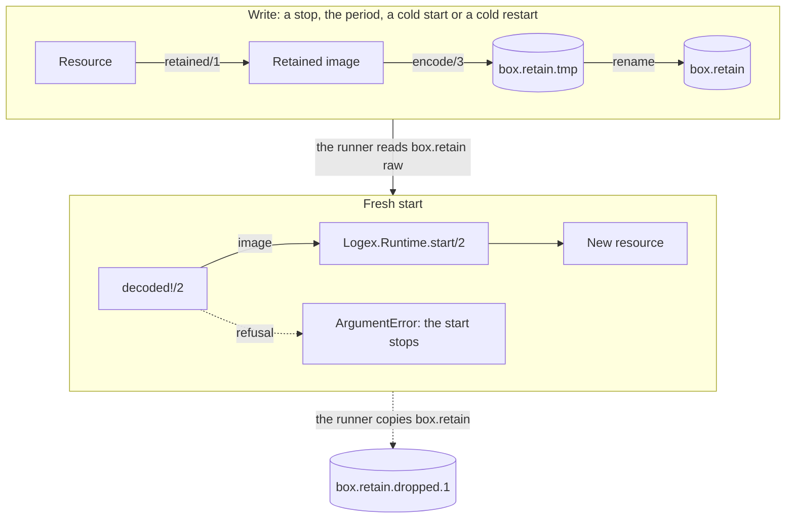

# The architecture of the store and its files

This page is for a contributor. It describes the
[retained image](../../guides/reference/glossary.md#retained-image), the text of the
[store](../../guides/reference/glossary.md#store), its digests and its versions, and the
refusals of a file that logex reads. Read it before you change a line of the store, a
rule of the image or a refusal.

3 pages are near this one:

- [The writes and the copies of the store](store-writes.md): the atomic write, the
  numbered copies of the store and the
  [forces file](../../guides/reference/glossary.md#forces-file).
- [The file work of the runner](runner-files.md): the processes that read and write these
  files, the write limit and the table of paths.
- [The store](../../guides/reference/store.md):
  the rules as a user sees them.

## What the part does

A [runner](../../guides/reference/glossary.md#runner) with the option `retain:` keeps
the retained values of its [resource](../../guides/reference/glossary.md#resource) in 1
file. The store is not battery-backed memory, and it is not a safety memory. A person can
edit it, a cold start discards it and a crash can set it back to the last write.

These are the 3 starts of a runner, by what they do with the store:

- A fresh start is `Logex.Runner.start_link/1` with `retain:`. It reads the store and
  lays its values over a new resource.
- A cold start is a fresh start with `start: :cold`. It reads the store, but it lays no
  value over the resource. Then it writes a new store.
- `Logex.Runner.restart/2` starts a tripped runner again, and it reads no store. A
  [warm restart](../../guides/reference/glossary.md#warm-restart) keeps the retained
  values that the runner holds in memory.



Figure: the path of the retained values to the disk and back. The runner does each read,
write and copy. The dotted lines are the paths that do not occur on each start.

A write goes from the resource to the image, the text and the disk. A fresh start reads
the text, makes the image and lays it over a new resource. The runner copies the store
before its first write if the start dropped a value. A cold start copies a store that a
fresh start refuses. [The writes and the copies of the store](store-writes.md) gives the
rules of each copy.

## How it is built

`image.ex`, `retain.ex` and `refusal.ex` are hidden from the documentation
(`@moduledoc false`). Their documentation is the comment at the head of each file.

| Module or file | Holds |
|---|---|
| `Logex.Runtime` | The way in for a host. `retained/1` and `retained/2` take an image out. `start/2` and `instance/2` lay it over a new resource or instance |
| `Logex.Runner` | The options `retain:` and `start:`, and the report of the store in `Logex.Runner.status/1` |
| [`image.ex`](../../lib/logex/image.ex) | The image: taken out of an instance or a resource, checked, and laid over a new one |
| [`retain.ex`](../../lib/logex/retain.ex) | The text of the store: `encode/3`, the digests, `decoded!/2`, and the atomic write `written/2` |
| [`refusal.ex`](../../lib/logex/refusal.ex) | The bounds of each refusal of the store, of the forces file and of an image |

The writer and the table of paths are in [The file work of the runner](runner-files.md).
The subsections of this part:

- [The retained image](#the-retained-image)
- [The text of the store](#the-text-of-the-store)
- [The digests](#the-digests)
- [The versions](#the-versions)
- [The end line](#the-end-line)
- [The refusals](#the-refusals)

### The retained image

The image is plain data that the [host](../../guides/reference/glossary.md#host) can
keep. `Logex.Runtime.retained/1` takes it out of a resource, and
`Logex.Runtime.retained/2` out of 1 [instance](../../guides/reference/glossary.md#instance).
The resource of `tally.logex` ([Example](#example)) gives this image after it counts 2
boxes:

<!-- unchecked: the image from a run of tally.logex over 5 cycles, eye 0, 1, 0, 1, 0, its keys put in the order of the text -->
```text
%{
  configuration: "tally",
  globals: %{"total_boxes" => {:dint, 2}},
  instances: %{
    "t1" => %{
      program: "tally",
      kinds: %{"boxes" => "ctu"},
      values: %{
        "boxes.cu" => {:bool, 0},
        "boxes.cv" => {:dint, 2},
        "boxes.ov" => {:bool, 0},
        "boxes.pv" => {:dint, 3},
        "boxes.q" => {:bool, 0},
        "boxes.r" => {:bool, 0},
        "full" => {:bool, 0}
      }
    }
  },
  triggers: %{}
}
```

- `values` holds each retained value by its path in the instance, with its
  [type](../../guides/reference/glossary.md#type). An
  [array](../../guides/reference/glossary.md#array) has its type `{:array, :int, [8]}`.
  Its value is a list, or a list of lists for more than 1 dimension.
- `kinds` holds each instance on the path to a value. The kind of an instance of a
  built-in type is its type word, for example `"ctu"`. The kind of an instance of a user
  block is the name of the block. An array of instances is `{:array, "ton", [4]}`.
- `triggers` holds the last sample of each retained
  [trigger](../../guides/reference/glossary.md#trigger), by the name of the
  [global](../../guides/reference/glossary.md#global). The configuration names a trigger
  with `single`, for example `task trip single estop`. A
  [task](../../guides/reference/glossary.md#task) can keep a last sample that is not the
  sample of its trigger. Then `triggers` also holds the sample of the task, by the name
  of the task.
- The image never holds the `last` of a [timer](../../guides/reference/glossary.md#timer),
  the time of its last scan. Each retained timer starts with `last` at the `now` of the
  start.

`Logex.Runtime.start/2` and `Logex.Runtime.instance/2` lay an image over a new resource
or instance. They keep a value only if all of these are true:

- The instance has the same name and runs the same
  [program type](../../guides/reference/glossary.md#program-type).
- The program declares the path retained, with exactly the same type, under instances
  of the same kinds.
- The value fits the type.

A path that the program retains and the image does not hold starts at its
[initial value](../../guides/reference/glossary.md#initial-value), with no report. A [preset](../../guides/reference/glossary.md#preset) follows the
program when an instruction gives it. The start returns each value that it does not
keep, with its reason:

| Reason | Example from a run | The stored value |
|---|---|---|
| `:undeclared` | `{"gone", :undeclared}` | Has a path that the program does not declare |
| `:unretained` | `{"k", :unretained}` | Has a path that the program declares, but does not retain |
| `{:retyped, stored, now}` | `{"t1.boxes", {:retyped, "ctu", "ctd"}}` | Has a different type or kind |
| `{:resized, from, to}` | `{"a", {:resized, [3], [4]}}` | Is an array of different sizes |
| `:misfit` | `{"n", :misfit}` | Has the right type, but the value does not fit, `1000` for a `sint` |
| `{:preset, stored, now}` | `{"boxes.pv", {:preset, 3, 5}}` | Is a preset that the instruction changed |

An image that is not of this shape is a wrong argument: 1 `ArgumentError`, with 1 line
for each problem.

### The text of the store

[Example](#example) gives this store of 15 lines:

<!-- unchecked: the first 15 lines of the output of this page's example -->
```text
logex retain 3
configuration tally written 2026-10-30T14:00:04Z
resource 013cc059392445fdcc1e84c9b0de6118
program tally bd882e28a8159d8e8a4ea56ade7b36b6
global total_boxes dint 2
instance t1 tally
t1.boxes ctu
t1.boxes.cu bool 0
t1.boxes.cv dint 2
t1.boxes.ov bool 0
t1.boxes.pv dint 3
t1.boxes.q bool 0
t1.boxes.r bool 0
t1.full bool 0
end 15 lines
```

Each line has 1 of these forms:

| Line | Form | Sequence |
|---|---|---|
| Header | `logex retain 3` | Line 1 |
| Configuration | `configuration <name> written <time>` | Line 2 |
| Resource | `resource <digest>` | Line 3 |
| Program type | `program <type> <digest>` | By the name of the type |
| Global | `global <name> <type> <value>` | By name |
| Sample of a trigger | `trigger <name> <sample>` | By name |
| Instance | `instance <name> <program type>` | By name |
| Instance on the path | `<instance>.<path> <kind>` | After its instance, in path order |
| Value | `<instance>.<path> <type> <value>` | After its instance, in path order |
| End line | `end <count> lines` | Last |

- The time is the wall clock of the host in UTC, to the second. The runner gets it from
  `c:Logex.Runner.Clock.wall_ms/1` of its
  [clock](../../guides/reference/glossary.md#clock). It is for a person and for
  `written_at` in `Logex.Runner.status/1`, never for a timer.
- An integer and a `bool` are in decimal. A real is the shortest text that reads back to
  the same value.
- The [elements](../../guides/reference/glossary.md#element) of an array are on 1 line, the rightmost
  [subscript](../../guides/reference/glossary.md#subscript) fastest.
- Only an instance whose program retains a value has an `instance` line.
- The count of the end line includes the header and the end line, as `wc -l` counts them.
- The runner ends each line with LF. The reader also takes CRLF and a lone CR.

### The digests

The `resource` and `program` lines name the program that the runner ran when it wrote
the store. A fresh start compares them with the program that it gets. Each digest is an
MD5 in 32 lowercase hexadecimal digits.

- The `resource` digest is of the tasks, globals, instances and connections of the
  [configuration](../../guides/reference/glossary.md#configuration), as
  `Logex.Configuration.Text.print/1` prints them with no line numbers.
- A `program` digest is of the text of the program type as `Logex.Printer` prints it.
  Then come the name and the printed text of each user block that it holds, in name
  order.
- Before the print, each keyword, mnemonic and type word is lowercase. For example,
  `XIC` becomes `xic`. A [tag](../../guides/reference/glossary.md#tag) name keeps its
  case.
- Each [literal](../../guides/reference/glossary.md#literal) is printed as its value:
  `16#ff` is `255`. A number in a name is also printed as its value: `arr[16#2]` is
  `arr[2]`, `w.03` is `w.3` and `w.[4]` is `w.4`.

A run of these changes on `tally.ld` and `tally.logex` gives this table:

| Change | Digest the same? |
|---|---|
| A comment or an empty line | Yes |
| CRLF line ends, or more spaces | Yes |
| `16#3` for `3` | Yes |
| `XIC` for `xic`, `DINT` for `dint` | Yes |
| The name `E` for the tag `e` | No: a tag name keeps its case |
| A different preset on a rung | No |
| A different initial value of a global | No: the `resource` digest changes |

This table gives what a fresh start does when the store and the start are different:

| The store and the start differ in | Result |
|---|---|
| The name on the `configuration` line | Refused, with the cold-start sentence |
| A `resource` or `program` digest | The start continues, and warns |
| A program type that only the store or only the start has | The start continues, and warns |
| A store of `logex retain 3` with no `resource` line or with no `program` line | Refused, with the cold-start sentence |

The warning is in `retain.warning` of `Logex.Runner.status/1`. The runner also sends it
as `{:retain, {:warning, message}}` to each subscriber that takes `:retain`. It starts
like this:

<!-- unchecked: the start of a warning, from a run with a changed program digest, wrapped at 56 columns -->
```text
box.retain: the store was written by another program
than the one this start was given: `tally`'s text
differs; ...
```

### The versions

The reader takes 3 headers. Each write makes a store of `logex retain 3`.

- **`logex retain 3`** has an end line and names its program by printed digests. The
  reader refuses it in these 3 cases:
  - It names no program.
  - It names program types and no `resource`.
  - It names its `resource` and no program type.

  The reader reads a store that has no `program` line for 1 type of several. Then the
  start warns that the type is not in the store.
- **`logex retain 2`** has an end line. It can name its program by the MD5 of the bytes
  of the files. The start then compares each `program` digest with an MD5. That MD5 is
  of the bytes of the source file of that program and of the files of its blocks. The
  reader reads a store with no naming lines, and the start gives no warning.
- **`logex retain 1`** has no end line. The reader reads each line, and it cannot find a
  cut. If the store has the naming lines, the reader reads them as those of version 2.

`encode/2`, which only the tests call, writes a store that names no program, under
`logex retain 2`.

A logex built before commit eb57b4a (decision 530) does not read `logex retain 3`. A run
of that logex on a store like the one of this page gives this refusal:

<!-- unchecked: a message of an earlier logex, built at the parent of commit eb57b4a, wrapped at 56 columns -->
```text
box.retain: line 1: the store is of version 3, which
this logex does not read: it reads `logex retain 2` and
`logex retain 1`
box.retain: line 15: `end 15 lines` is an end line,
which a store whose first line is `logex retain 2` ends
with, and this store's first line is not
```

That logex starts only with `start: :cold`, which copies the store to
`box.retain.dropped.1` first. The values that it counts after that are in its own store,
not in the copy. [Recover from a refused store](../../guides/howto/recover-a-refused-store.md)
gives the steps for a user.

### The end line

If a write stops early, the file keeps its first bytes and loses its end. The end line
is the last line, so each cut removes it or cuts it:

- A cut at the end of a line leaves a last line that is not an end line.
- A cut in a line before the end line also leaves a last line that is not an end line.
- A cut in the end line removes its last word `lines`, and can also shorten the count.
  A shorter count is less than the lines that the store has.
- If the cut removes only the last newline, each line stays whole, and the reader reads
  the store.

The count also finds a line that is lost or doubled. It also finds a line that a person
adds or removes without a change to the count. A test in `retain_store_test.exs` cuts a
store at each byte offset.

### The refusals

The reader collects each problem of a file, `{line, problem}`. Then the code in
[`refusal.ex`](../../lib/logex/refusal.ex) makes 1 `ArgumentError` from them, with these
bounds:

| Bound | Value |
|---|---|
| Problems shown | The first 50, then 1 line: `<path>: and <n> more problems, not listed` |
| Bytes of 1 line of the refusal, after the path at its start | 1,000, cut at a character and ended with `…` |
| Bytes of text that a problem quotes | 60, ended with `…` |
| A control byte or a byte past ASCII in a quoted text | Its escape, for example `\xC3`. A tab and a CR stay as they are |
| A control byte, DEL or a byte of no UTF-8 character in the path | Its escape. A UTF-8 character past ASCII stays as it is |
| A path of more than 4,096 bytes | `…` and its last 4,096 bytes |

The reader gives a missing `resource` or `program` line only when the count of the end
line is correct. If the end line is missing or its count is wrong, the refusal gives
that problem and each other problem. It does not give the missing naming line.

If only a cold start can clear a refusal, the refusal ends with 1 sentence that tells how
to start cold. It gives that sentence 1 time, also when it lists more than 1 problem.
These refusals give it:

- a store that is cut short
- a store of `logex retain 3` that names no program, names program types and no
  `resource`, or names its `resource` and no program type
- a store of a different configuration

<!-- unchecked: the end of a refusal, from the run of this page's example, wrapped at 56 columns -->
```text
start it with start: :cold to start over it, which
copies it first to the next `.dropped.<n>` beside it and
then writes a new store over it
```

A store refused for its naming lines also starts warm when a person puts the lines back.
A refusal for a problem that a hand edit can repair does not give the cold-start
sentence. Examples are a junk line, a wrong digest, a wrong count, a tab, a comment, a
byte past ASCII and a byte-order mark. The operator repairs the store and keeps the
values. A cold start sets each retained value back to its initial value.

## Example

This example counts 2 boxes with the box counter of `tally.ld`, and stops. Then it cuts
the store and starts again. Then it starts cold.

<!-- file: tally.ld -->
```text
var_input eye bool
var_output retain full bool
var_external total_boxes dint
var retain boxes ctu
var e bool

xic eye ctu boxes 3
xic eye ons e add total_boxes 1 total_boxes
xic boxes.q otl full
```

<!-- file: tally.logex -->
```text
// tally.logex -- a box counter whose count and total survive a warm restart
var_global eye_1              bool at panel.i.0
var_global retain total_boxes dint 0
var_global case_full          bool

program t1 tally
  t1.eye  eye_1
  t1.full case_full
```

```elixir
alias Logex.IO.Sim
alias Logex.Runner
alias Logex.Runner.Clock.Manual

{:ok, plant} = Logex.Configuration.compile_file("tally.logex")
Enum.each(Path.wildcard("box.retain*"), &File.rm!/1)

# The manual clock, its wall clock 2026-10-30T14:00:00Z.
{:ok, clock} = Manual.start_link(now: 1_793_368_800_000)
{:ok, panel} = Sim.start_link(clock: clock)
io = %{"panel" => {Sim, sim: panel}}
opts = [configuration: plant, io: io, clock: {Manual, clock}, retain: "box.retain"]
wrap = fn text -> Regex.replace(~r/(.{1,56})( |$)/, text, "\\1\n") end

# Count 2 boxes, then stop: the stop writes the store.
{:ok, runner} = Runner.start_link(opts)

for eye <- [1, 0, 1, 0] do
  Sim.set(panel, "panel.i.0", eye)
  Manual.advance(clock, 1000)
end

:ok = Runner.stop(runner)
text = File.read!("box.retain")
IO.write(text)

# Cut the last 40 bytes off the store, as a lost tail of a file does.
File.write!("box.retain", binary_part(text, 0, byte_size(text) - 40))

try do
  Runner.start_link(opts)
rescue
  error in ArgumentError -> IO.write(wrap.(error.message))
end

# A cold start copies the refused store, then writes a new store.
{:ok, runner} = Runner.start_link(opts ++ [start: :cold])
IO.inspect(Runner.status(runner).retain.copy, label: "copy")
:ok = Runner.stop(runner)
IO.inspect(Enum.sort(Path.wildcard("box.retain*")), label: "files")
```

```console
$ mix run store-and-files.exs
logex retain 3
configuration tally written 2026-10-30T14:00:04Z
resource 013cc059392445fdcc1e84c9b0de6118
program tally bd882e28a8159d8e8a4ea56ade7b36b6
global total_boxes dint 2
instance t1 tally
t1.boxes ctu
t1.boxes.cu bool 0
t1.boxes.cv dint 2
t1.boxes.ov bool 0
t1.boxes.pv dint 3
t1.boxes.q bool 0
t1.boxes.r bool 0
t1.full bool 0
end 15 lines
box.retain: line 13: `t1.box` is the store's last line,
and no end line: a store of `logex retain 3` ends with
`end <count> lines`, its count of lines, so this one was
cut short, and a store cut short is not read: start it
with start: :cold to start over it, which copies it
first to the next `.dropped.<n>` beside it and then
writes a new store over it
copy: "box.retain.dropped.1"
files: ["box.retain", "box.retain.dropped.1"]
```

The store has 15 lines, and its end line counts them. The cut leaves line 13 last, and
the start refuses the store. The cold start keeps the cut store as
`box.retain.dropped.1`.

## Why it is built this way

Each number is a decision of [`docs/organisation.md`](../organisation.md) §7, the full
log. The design is in
[§4.13](../organisation.md#413-retained-values-and-a-true-warm-restart-milestone-6) of
that document.

- **Plain data first.** Decisions 282 and 307 make the image plain data that the core
  takes out and lays back. Decision 277 matches it by name and type. Decision 273 keeps
  the `last` of a timer out of it. Only the runner reads and writes the store. Decision
  310 reports a drop of each element of an array of instances as 1 entry, `g[*].k`.
- **Text a person can read.** Decision 276 makes the store text, as the forces file is
  (decision 140). Decision 284 lets a person repair a value by hand while the runner does
  not run.
- **A store read whole or not at all.** Decision 355 adds the end line. Decision 410
  reads each line end. Decisions 419 and 457 bound each refusal.
- **The program that wrote the store.** Decisions 517 (c), 527 and 532 name the program
  by printed digests. Decision 530 gives that store the header `logex retain 3`, so that
  an earlier logex refuses it.
- **The naming lines.** Decision 534 reads a store of `logex retain 2` that names its
  program by bytes. Decisions 531, 535 and 539 refuse a store that names a part of its
  program. Decisions 538 and 544 make those refusals wait for the count. Decisions 540
  and 545 give the cold-start sentence.

## How to change it

> #### Caution {: .error}
>
> If you change the text of the store, keep the reader able to read `logex retain 1`,
> `logex retain 2` and `logex retain 3`. A plant can hold a store that an earlier logex
> wrote. If the reader refuses it, the plant can start only cold, and each retained count
> and total goes back to its initial value.

1. Read the comment at the head of the file that you change.
2. If an earlier logex must refuse the new text, give the new text a new header.
3. Write a test case that fails without your change, and see it fail. For a new rule,
   `scripts/mutate.sh` reverts each rule of the diff and runs the suite.
4. Run `scripts/gate.sh`. It must print `GATE-OK`.

Each test file of this table is in `test/logex/`:

| If you change | The test file that fails if it is wrong |
|---|---|
| The text, a header, the end line, a digest, a refusal of the store | `retain_store_test.exs` |
| The image, its check or its drops | `retain_image_test.exs` |
| A retained global or the sample of a trigger | `retain_configuration_test.exs` |
| The bounds of a refusal of the forces file | `force_test.exs` |
| The life of a store across starts, stops and edits | `api_contract_test.exs` |

## See also

- [0017. The store on disk](../adr/0017-the-store-on-disk.md),
  [0018. File work with a limit](../adr/0018-file-work-with-a-limit.md) and the other
  [decision records](../adr/README.md).
- [The writes and the copies of the store](store-writes.md): the atomic write, the copies
  and the forces file.
- [The file work of the runner](runner-files.md): the writer, the write limit and the
  table of paths.
- [The store](../../guides/reference/store.md):
  the rules for a user.
- [Recover from a refused store](../../guides/howto/recover-a-refused-store.md) and
  [Edit the store by hand](../../guides/howto/edit-the-store-by-hand.md): the steps for a
  user.
- [Glossary](../../guides/reference/glossary.md): the technical words of logex.
