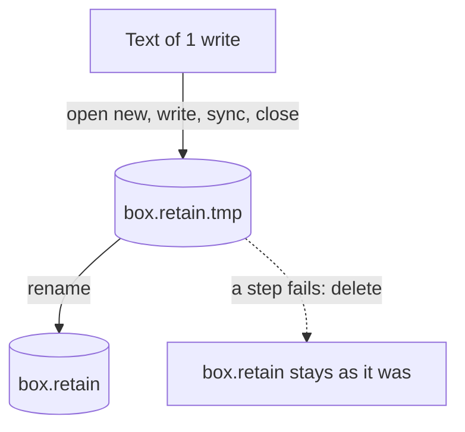

# The writes and the copies of the store

This page is for a contributor. It describes how logex writes the
[store](../../guides/reference/glossary.md#store) and the
[forces file](../../guides/reference/glossary.md#forces-file) to the disk, and how it
keeps a copy of a store. Read it before you change the atomic write, a rule of a copy or
the text of the forces file.

[The architecture of the store and its files](store-and-files.md) gives the
[retained image](../../guides/reference/glossary.md#retained-image), the text of the
store and the refusals. [The file work of the runner](runner-files.md) gives the
processes that do each write, the write limit and the table of paths.

> #### Caution {: .error}
>
> Write the store and the forces file only through `written/2` of
> [`retain.ex`](../../lib/logex/retain.ex). A write in place can leave a part of a file
> after a crash. A fresh start then refuses the store, and the plant starts only cold.

## What the part does

A [runner](../../guides/reference/glossary.md#runner) can have a store, `retain:`, and a
forces file, `forces:`. These are the files of 1 runner, for the store `box.retain` and
the forces file `box.forces`:

| File | Holds | Written by |
|---|---|---|
| `box.retain` | The retained values, as text | Each write of the store |
| `box.retain.tmp` | The text of 1 write before its rename | Each write of the store |
| `box.retain.dropped.<n>` | A copy of a store that a start dropped values from | A fresh start, or a later write that owes the copy |
| `box.retain.dropped.tmp` | The text of 1 copy before its rename | Each copy |
| `box.forces` | The forces, `name value` on each line | Each force and each unforce |
| `box.forces.tmp` | The text of 1 write before its rename | Each force and each unforce |



Figure: the atomic write. A dotted arrow is the path of a failed step.

The diagram shows that the file changes only at the rename. Before the rename, the old
file stays whole.

## How it is built

### The atomic write

`written/2` writes the text of 1 store or forces file. It does these steps:

1. It opens `<path>.tmp` as a new file, exclusive and raw. If something stands there, it
   deletes that and opens again.
2. It writes the whole text, syncs it to the disk and closes the file.
3. It renames `<path>.tmp` over the file, through the file server of the VM.
4. If a step fails, it deletes `<path>.tmp`. The file stays as it was.

Thus a crash at any time leaves the old file or the new file, never a mix. Each write
makes its `.tmp` new. Thus a write that the runner killed cannot write into the file of
the next write. The write removes a FIFO or a link at `<path>.tmp`. A directory there
fails the write with `{:error, :eisdir}`.

The rename is not durable. OTP 28 cannot open a directory to sync it: `:file.open/2` of a
directory gives `{:error, :eisdir}`. Thus on some file systems, a power failure after a
write can bring back the write before it.

A store or a forces file that is a symbolic link refuses the start. The rename puts a
file in the place of the link and does not change the file that the link names:

<!-- unchecked: a message from a run; the path is from the probe -->
```text
the runner's retain: "l.retain" is a symbolic link: the store is written whole beside it and renamed over it, which would put a file in the link's place and leave the file it names as it was: name that file itself
```

### The copies of the store

A copy keeps the values that a start drops. These events make a copy:

- A fresh start that drops a value from its store. It copies the store as it read it,
  before its first write over the store.
- A cold start over a store that a fresh start refuses. It writes the new store only
  after the copy.

The rules of a copy are in [`writer.ex`](../../lib/logex/runner/writer.ex):

| Rule | What occurs |
|---|---|
| The number | 1 more than the highest `<store>.dropped.<n>` that stands, file or directory. An unnumbered `<store>.dropped` does not count |
| The same bytes | If the highest copy holds the same bytes as the store, the start makes no new copy. `status/1` names that copy |
| The write | Through `<store>.dropped.tmp`, by the steps of the atomic write |
| A name taken | If anything stands at the name before the rename, the copy fails with `{:error, :eexist}` |
| A failed copy | The runner owes the copy. Each later write over the store makes the copy first, and writes the store only after it |

The check for a taken name and the rename are 2 calls. The copy replaces a file that a
[host](../../guides/reference/glossary.md#host) makes between them.

[The architecture of the store and its files](store-and-files.md#example) has an example
in which a cold start makes `box.retain.dropped.1`.

### The forces file

Each [force](../../guides/reference/glossary.md#force) and each unforce writes the whole
set, 1 line for each force:
`eye_1 1`. The write uses `written/2`, as the store does. The reader takes LF, CRLF and a
lone CR. It refuses a comment and an empty line:

<!-- unchecked: a message from a run with "# x" on line 1 of f.forces -->
```text
f.forces: line 1: `# x` is no force: a line holds an input point's name and its value, as `eye_1 1`
```

The refusals of the forces file have the same bounds as the refusals of the store.

The store and the forces file are 2 files. The runner refuses a start that names 1 file
for both:

<!-- unchecked: a message from a run with retain: and forces: both "f.retain" -->
```text
the runner's retain: and forces: name one file, "f.retain": the store and the forces file are two files
```

## Why it is built this way

Each number is a decision of [`docs/organisation.md`](../organisation.md) §7, the full
log.

- **The rename.** Decision 127 writes the forces file beside it and renames it over the
  file. Decision 275 writes the store by the same rule.
- **A new `.tmp` for each write.** Decision 392 keeps 1 name for the `.tmp` and makes its
  file new at each write. Thus a killed write cannot reach the next write.
- **No link.** Decision 413 refuses a store or a forces file that is a link.
- **The copies.** Decision 360 copies a store that a start drops values from. Decision 416
  makes a failed copy owed. Decision 417 copies a store before a cold start writes over
  it. Decision 418 numbers the copies.
- **The name of a copy.** Decisions 448 and 449 give the look before the rename and what
  it cannot see. Decision 450 lets an unnumbered copy stand. Decision 456 makes no copy
  that is the same as the highest copy.

## How to change it

1. Read the comment of `written/2` in `lib/logex/retain.ex`, or of `copy/3` in
   `lib/logex/runner/writer.ex`.
2. Write a test case that fails without your change, and see it fail.
3. Run `scripts/gate.sh`. It must print `GATE-OK`.

| If you change | The test file that fails if it is wrong |
|---|---|
| The atomic write, a `.tmp` on a stalled disk | `test/logex/stalled_disk_test.exs` |
| A copy, its number or its name | `test/logex/retain_store_test.exs` |
| The forces file | `test/logex/force_test.exs` |
| 2 runners on 1 file | `test/logex/runner_paths_test.exs` |

## See also

- [0017. The store on disk](../adr/0017-the-store-on-disk.md),
  [0018. File work with a limit](../adr/0018-file-work-with-a-limit.md) and the other
  [decision records](../adr/README.md).
- [The architecture of the store and its files](store-and-files.md): the image, the text
  and the refusals.
- [The file work of the runner](runner-files.md): the writer, the write limit and the
  table of paths.
- [Forcing](../../guides/reference/forcing.md): the forces file for a user.
- [Glossary](../../guides/reference/glossary.md): the technical words of logex.
