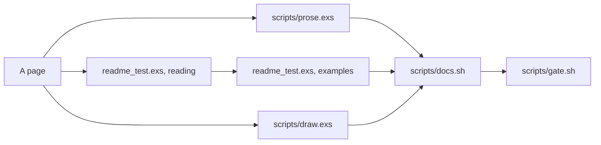

# Add and check a page

This page is for a person who writes a page of the logex documentation. It gives the
kinds of page, the steps to add a page and the commands that check it. The [style guide](style-guide.md)
gives the rules that the commands check.

## The kinds of page

A page is 1 of 7 kinds. The first 5 kinds are user pages. Do not mix the kinds on a page.
Link between them.

| Kind | Where | Job | Template |
|---|---|---|---|
| Tutorial | `guides/tutorials/` | A lesson: the reader learns by doing, on 1 safe path | [tutorial](templates/tutorial.md) |
| How-to guide | `guides/howto/` | A recipe for 1 task, for a reader who knows the basics | [howto](templates/howto.md) |
| Reference | `guides/reference/` | The exact rules, complete, for a reader who looks something up | [reference](templates/reference.md) |
| Explanation | `guides/explanation/` | The model and the reasons, for a reader who wants to understand | [explanation](templates/explanation.md) |
| First page | `README.md` | What logex is, 1 small program and the way to each other page | [readme](templates/readme.md) |
| Contributor page | `docs/` | How logex is built and how to work on it | [contributor](templates/contributor.md) |
| Decision record | `docs/adr/` | 1 decision: the problem, the choice and the results | [adr](templates/adr.md) |

Each template is a file that you copy. It has the sections of its kind in their sequence.

- A tutorial must work exactly as the page gives it. The suite runs its examples.
- A how-to guide has a title that is the task, and a table "If it does not work" with
  3 columns: `What you see`, `Cause` and `What to do`.
- A reference page has the same headings for each item of a kind. It has no steps and no
  history. Each rule on it must be true of the code.
- An explanation page has no steps. It can compare logex with IEC 61131-3 and Logix.
- A tutorial, a how-to guide, a reference and an explanation end with the section "See
  also".
- A contributor page and a decision record can cite a decision of
  [`docs/organisation.md`](organisation.md) by its number. A user page cannot.
- A page has about 1,500 words, and 2,000 at most. A reference page can have more. The
  [style guide](style-guide.md#format) gives the rule.

## Change a decision record

A later decision of `docs/organisation.md` can change a decision record. Find the case
in this table before you edit the record.

| The later decision | What to do |
|---|---|
| Keeps the choice of the record, and changes a rule | Edit the record in place, so that it states the new rule. In "Status", name the new decision and the decision that it changes. Add the new decision to the last section of the record |
| Changes the choice of the record | Write a new record for the new choice. Give the old record the status Replaced, with a link to the new record. Do not change its other sections |
| Drops the choice, and gives no new choice | Give the record the status Withdrawn, with the number of the decision that drops it |

The [index of the records](adr/README.md) lists each record and its status.

## Add a page

1. Copy the template of the kind to the directory of the kind.
2. Add 1 line for the page to `docs/pages.exs`: its path, its kind and its group. Put
   the line in the place of the page in its group.
3. Write the page.
4. Do the checks of [Check a page](#check-a-page).

The groups of the site are Tutorials, How-to guides, Reference, Explanation, Architecture
and implementation, Decision records and Project. The group `:github` keeps a page out
of the site. A reader then reads it on GitHub.

Do not give a page the kind `:legacy`. That kind is only for the 9 documents that are
older than these rules, and a test refuses each other page.

### The name of a page in the site

| Page | Name in the site | Example |
|---|---|---|
| `README.md` | `readme` | `readme.html` |
| A page under `guides/` | The name of its file | `guides/reference/runner.md` is `runner.html` |
| Each other page | Its path, with a hyphen for each slash | `docs/architecture/runner.md` is `docs-architecture-runner.html` |

Thus 2 pages under `guides/` cannot have the same file name. A page under `docs/` can
have the file name of a different page.

### Links and headings

- Write a link for GitHub: relative to the file of the page. The build changes it to the
  name of the page in the site.
- To link to a heading, use the anchor that GitHub gives the heading. The build changes
  it to the anchor of the site. A link to a heading of a site page works for level 2 and
  level 3 only.
- A link to a heading of a document on GitHub, such as `docs/organisation.md`, must name
  a heading of that document.
- No script follows a link to a different site. Open it and look.

## Check a page

Do these checks before you commit a page. Each command runs from the root of the
repository.

| Check | Command | Time |
|---|---|---|
| The writing rules | `elixir scripts/prose.exs guides/tutorials/first-program.md` | 1 s |
| The marks and the blocks | `mix test test/logex/readme_test.exs --only reading:guides/tutorials/first-program.md` | 5 s |
| The examples, run | `mix test test/logex/readme_test.exs --only page:guides/tutorials/first-program.md` | 5 s for each example |
| The pictures | `mix run scripts/draw.exs --check guides/tutorials/first-program.md` | 3 s |
| The links | `elixir scripts/site.exs stage` | 2 s |
| The site | `scripts/docs.sh` | 2 min |
| All tests | `scripts/gate.sh` | 10 min |

This diagram shows the sequence of the checks, from the fastest to the slowest.

Figure: the checks of a page. Each arrow goes to the check that you do after it.

The first check prints each failure with its file, its line, its rule and the words to
write. Add `--review` to see the places that a reviewer must read. Use `--kind tutorial`
for a file that is not in `docs/pages.exs`.

The second check also finds a block that is not closed and a fence that has more than a
language. It finds a script that reads a file that the page does not give. Each failure
names the page and the line.

## What the checker reads

The checker reads prose only. It does not read these things:

- a code block
- a code span, which it counts as 1 word of its sentence
- the target of a link or of a picture
- an HTML comment
- an attribute list such as `{: .warning}`

On a contributor page and in a decision record, text between double quotation marks is a
quotation. The checker does not apply the word rules to it, and counts the quotations of
the page. On a user page, the checker reads that text as each other text. No mark stops
the checker on a part of a page.

For the reviewer, the checker counts and `--review` lists:

- each possible passive verb
- each term of the glossary that has no link to the glossary
- each block with the mark `unchecked`
- each block that the suite compares with nothing

## What the checker does not find

The checker refuses the words and the forms of its lists. It does not know the meaning
of a sentence. It does not find these things:

- a word that the page uses for 2 things, or 2 words for 1 thing
- a group of 4 nouns or more
- a missing article
- a different form of the house manner
- a wrong claim

The checker also refuses some correct text. The table gives the frequent cases and the
way out.

| The checker refuses | Because | Write |
|---|---|---|
| "is scheduling", "is testing" | It reads `is` with an `-ing` form as a verb | "This page is about the schedule." |
| "below 10" | It reads "below" as a pointer to a place on the page | "less than 10" |
| "a leading zero" | It reads the word for a number | "a leading 0" |
| "now" as the name of a value | It reads "now" as history | The name as code |
| "The report says whether the edit is ready." | "whether" has a plainer word | "The report says if the edit is ready." |

## What the checker covers of ASD-STE100

| Part of ASD-STE100 | What the checker does |
|---|---|
| Words | Refuses the words of the tables of the style guide. It does not know the dictionary, the part of speech of a word or the meaning of a word |
| Noun groups | Nothing: a reviewer counts the nouns |
| Verbs | Refuses a perfect tense, the `-ing` form after "is" or "are", and the modal verbs. It counts each possible passive verb for the reviewer |
| Sentences | Refuses a sentence of more than 25 words. It does not find a missing article |
| Procedures | Refuses a sentence of more than 20 words in a numbered step |
| Descriptive writing | Refuses a paragraph of more than 6 sentences |
| Safety instructions | Refuses a callout with a class that the style guide does not list |
| Punctuation | Refuses a semicolon, a dash and an arrow in prose |

A script cannot tell a passive verb from a state: "the rung is true" and "the tag is
declared" have the same form. Thus the checker counts these places and a reviewer reads
them.

## What a writer gives back

For each page, give the reviewer this list:

- the file
- each part of another page or document that the page replaces
- each claim of another page or document that is wrong or old
- each claim that you did not check against the code
- each new word of the glossary
- each picture that the page needs and that the scripts cannot make
