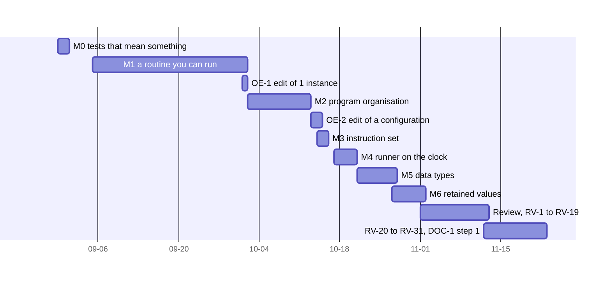

# Project history

This page is for a contributor who wants to know what logex has and what waits. It gives
the milestones in their sequence, what they changed for a program and the work that
waits. [The review after Milestone 6](project-history-review.md) gives the review of the
whole code and the items after it.

This page is a summary. The full record is in 3 documents:

| Document | What it holds |
|---|---|
| [`PLAN.md`](../../PLAN.md) | Each milestone and item, with its design, its review and its fixes |
| [`docs/organisation.md`](../organisation.md) §7 | Each decision, with its options and the day the maintainer took it |
| [`docs/review-2026-11-01.md`](../review-2026-11-01.md) | Each finding of the review, with its repro, and the close of the review |

> #### Note {: .info}
>
> If this page and `PLAN.md` are different, `PLAN.md` and §7 are correct. Change this
> page when an item merges into `main`. [How to change it](#how-to-change-it) gives
> the steps.

## The words of the plan

| Word | Meaning |
|---|---|
| Milestone | A numbered block of work in `PLAN.md`, from Milestone 0 to Milestone 13. The work of Milestones 0 to 6 is in `main`. The maintainer proposed Milestones 7 to 13. `M5` is Milestone 5 |
| Item | 1 piece of work in `PLAN.md`. `M5-2` is item 2 of Milestone 5. `OE-1` is an item of the online edit. `RV-22` is an item of the review. `DOC-1` is an item of the documentation |
| Decision | A numbered entry of `docs/organisation.md` §7, for example decision 146 |
| Done sentence | The acceptance sentence of a milestone. A test runs it, and the maintainer accepts it |

## What logex has, milestone by milestone

This chart shows each block of work against the calendar, from 2026-08-30 to
2026-11-23.



Figure: the blocks of work by date. Milestone 1 took 4 weeks. Each later block took 1
to 12 days.

The table gives the facts of the chart. The last column gives the decisions of the work,
then the first and the last day that the work merged into `main`, in 2026.

| Work | What it gives | Decisions |
|---|---|---|
| M0 | 5 fixes, so that a green run of the suite means something | None. Merged 08-30 to 08-31 |
| M1 | A [routine](../../guides/reference/glossary.md#routine) that you can run. The parse tree keeps the line of each token, so each diagnostic gives its line. The compiler checks each instruction and each tag. It also gives the function `compile/2` of `Logex`, the runtime, `ton`, `ons` and the comparisons | 1 to 14, the design, taken during M1. Merged 09-05 to 10-01 |
| OE-1 | A staged [online edit](../../guides/reference/glossary.md#online-edit) of 1 instance | 15 to 29. Merged 10-01 |
| M2 | Program organisation: a [configuration](../../guides/reference/glossary.md#configuration), its file, periodic and event tasks, globals and user [function blocks](../../guides/reference/glossary.md#function-block) | 30 to 54. Merged 10-02 to 10-12 |
| OE-2 | A staged online edit of a configuration | 55 to 66. Merged 10-13 to 10-14 |
| M3 | The counters, `tof`, `tp`, `rto`, integer arithmetic, `osr`, `osf` and a forward jump | 67 to 107. Merged 10-14 to 10-15 |
| M4 | The [runner](../../guides/reference/glossary.md#runner) on the clock, devices, [watchdogs](../../guides/reference/glossary.md#watchdog), the [trip](../../guides/reference/glossary.md#trip) and the [force](../../guides/reference/glossary.md#force) of an input | 108 to 143. Merged 10-17 to 10-20 |
| M5 | The data types | 144 to 265, 286 to 290. Merged 10-21 to 10-27 |
| M6 | Retained values and a true [warm restart](../../guides/reference/glossary.md#warm-restart) | 266 to 285, 291 to 346. Merged 10-27 to 11-01 |

### The items of Milestone 5

The maintainer closed Milestone 5 on 2026-10-26 (decision 265). Decisions 286 to 290,
on 2026-10-27, answered the questions of its close.

| Item | What it gives |
|---|---|
| M5-1 | 1 table of the [elementary types](../../guides/reference/glossary.md#elementary-type), with no change of behaviour |
| M5-2 | A `dint` result past its limit wraps |
| M5-3 | The integer widths `sint int lint usint uint udint ulint`, `move` by Figure 11 of IEC 61131-3, and the 56 integer conversions |
| M5-4 | Arithmetic and comparison at each integer width |
| M5-5 | The typed counters, `ctu_int` and the others. `ctu_dint` is a second name of `ctu` |
| M5-6 | The long timers in nanoseconds: `ton_ltime`, `tof_ltime`, `tp_ltime` and `rto_ltime` |
| M5-7 | Based literals, `16#ff` and `2#1010`, and `_` between digits, `1_000` |
| M5-8 | The bit strings `byte word dword lword`, the instructions `and or xor not shl shr rol ror`, bit access `word.3` and the 76 bit-string conversions |
| M5-9 | A bit number in a tag, `word.[n]`, and the [major fault](../../guides/reference/glossary.md#major-fault) `:bit_out_of_range` |
| M5-10 | `real` and `lreal`, the literals `37.5` and `1.5e3`, `sqrt`, the 34 real conversions and the 16 truncations |
| M5-11 | Arrays of elementary types, with 1 to 3 dimensions and literal subscripts |
| M5-12 | A subscript in a tag, `weights[slot]`, and the major fault `:index_out_of_range` |
| M5-13 | Located arrays: an array at I/O points, with 1 point for each element |
| M5-14 | Arrays of timers, counters and blocks, for example `var lane_t ton[4]` |
| M5-15 | The reach of the [contract walks](../implementation/testing-strategy.md#walks-and-their-reach) across each pair of types |
| M5-16 | The documents, and a test in `end_to_end_test.exs` that runs the done sentence on 1 plant |

### The items of Milestone 6

The maintainer closed Milestone 6 on 2026-11-01 (decision 346).

| Item | What it gives |
|---|---|
| M6-1 | The [qualifiers](../../guides/reference/glossary.md#qualifier) `retain` and `non_retain`. A program takes them on its `var` and its `var_output`. A block takes them on its `var_input`, its `var_output` and its `var`. A `var_input` of a program takes no qualifier |
| M6-2 | The warm restart in the core: `Logex.Runtime.restart/3` and `Logex.Runtime.restart/2` keep what the program marks. A runner that tripped restarts warm with `Logex.Runner.restart/2` and `:warm` |
| M6-3 | A retained global, `var_global retain total_boxes dint 0`. logex refuses `retain` on a [located global](../../guides/reference/glossary.md#located-global) |
| M6-4 | The [retained image](../../guides/reference/glossary.md#retained-image): `Logex.Runtime.retained/2` and `Logex.Runtime.retained/1`, and a new instance or resource made from it |
| M6-5 | The [store](../../guides/reference/glossary.md#store): the runner writes it at a trip, a stop and a [cold restart](../../guides/reference/glossary.md#cold-restart), and reads it at a start |
| M6-6 | A write of the store at each `retain_period:` |
| M6-7 | An online edit that adds or removes `retain` reports each path that changes |
| M6-8 | The contract walks over retained values |
| M6-9 | The documents, and a test in `end_to_end_test.exs` that runs the done sentence on 1 plant |

## What the milestones changed for a program

These changes stop a program or a configuration file that compiled before from
compiling, or change what it does. Most of them make a word a
[reserved word](../../guides/reference/glossary.md#reserved-word): a tag, a global or an
instance cannot have that name.

| Milestone | Change | Recorded in |
|---|---|---|
| 1 | The name of `mov` changed to `move`, its name in IEC 61131-3. logex refuses `mov` with a diagnostic that names `move` | Item M1-2 |
| 2 | `cal` and `var_external` are reserved words in a program | The rule of a new word, `CLAUDE.md` |
| 3 | Each new [mnemonic](../../guides/reference/glossary.md#mnemonic) is a reserved word in any case. The new mnemonics are `ctu`, `ctd`, `ctud`, `tof`, `tp`, `rto`, `add`, `sub`, `mul`, `div`, `mod`, `neg`, `abs`, `osr`, `osf`, `jmp` and `lbl` | The rule of a new word, `CLAUDE.md` |
| 4 | `watchdog` and `continuous` are reserved words in a configuration file. A configuration file that names a global, a task or an instance so does not compile | Decisions 110, 111 |
| 5 | The result of an arithmetic instruction past the limit of its integer type [wraps](../../guides/reference/glossary.md#wrap), with no power out of the instruction. Before, a `dint` stopped at its limit | Decision 146, replacing 77 |
| 5 | Each new type word and mnemonic is a reserved word in any case, for example `real`, `int`, `word` and `and` | Decision 144 |
| 6 | `retain` and `non_retain` are reserved words, in a program and in a configuration file | Decisions 267, 298 |

The milestones did not add these things:

- An instruction `res`. A counter and an `rto` reset through their member `.r`
  (decision 90). `res` is not a reserved word.
- A master control zone, `mcr`. The maintainer decided to never add one (decision 83).
- The qualifier `persistent`. It waits, and it stays a word that a tag can have
  (decision 280).
- `watchdog` and `continuous` in a program. They are words of the configuration file
  only, so a tag of a program can have either name.

This script shows each change on short programs of the box counter:

```elixir
# What the milestones changed for a program. Each text is a short program.
report = fn
  {:ok, _program} -> "compiles"
  {:error, [diagnostic | _]} -> Logex.Diagnostic.format(diagnostic)
end

compile = fn text -> report.(Logex.compile(text, name: "boxes")) end

# Milestones 1, 3, 5 and 6: words that a program can no longer use.
IO.puts("mov        " <> compile.("var_input a dint\nvar_output b dint\nmov a b\n"))
IO.puts("add        " <> compile.("var add bool\n"))
IO.puts("real       " <> compile.("var real bool\n"))
IO.puts("retain     " <> compile.("var retain bool\n"))
IO.puts("retain     " <> compile.("var_output lamp bool\nxic retain ote lamp\n"))

# Milestone 5: a result past the limit of its type wraps, and the add passes no power.
counter_text = """
var_input eye bool
var_output count dint 2147483646
var_output added bool
xic eye add count 1 count ote added
"""

{:ok, counter} = Logex.compile(counter_text, name: "counter")
state = Logex.Runtime.instance(counter)
state = Logex.Runtime.put_inputs(counter, state, %{"eye" => 1})
{outputs, state} = Logex.Runtime.scan(counter, state)
IO.puts("scan 1     #{inspect(outputs)}")
{outputs, _state} = Logex.Runtime.scan(counter, state)
IO.puts("scan 2     #{inspect(outputs)}")

# What the milestones did not add.
IO.puts("res        " <> compile.("var boxes ctu\nvar_input pb bool\nxic pb res boxes\n"))
IO.puts("mcr        " <> compile.("var_input stop bool\nxio stop mcr\n"))
IO.puts("persistent " <> compile.("var persistent dint\n"))
IO.puts("watchdog   " <> compile.("var watchdog bool\n"))
```

```console
$ mix run project-history.exs
mov        line 3: unknown instruction `mov` — did you mean `move`? (renamed to its IEC name)
add        line 1: `add` is an instruction and cannot name a tag
real       line 1: `real` is a type and cannot name a tag
retain     line 1: `var retain` needs a tag name before the type `bool`, as in `var retain fault bool`
retain     line 2: `xic` expects a tag, found the keyword `retain`
scan 1     %{"added" => 1, "count" => 2147483647}
scan 2     %{"added" => 0, "count" => -2147483648}
res        line 3: unknown instruction `res`
mcr        line 2: unknown instruction `mcr`
persistent compiles
watchdog   compiles
```

logex reads `retain` after `var` as the qualifier. Thus the line `var retain bool` has no
tag name, and logex refuses it. The second `retain` line shows the reserved word in a
rung. On scan 2 the count wraps to the lowest `dint`, and `added` is 0: the `add` passes
no power on the scan that wraps.

## The work that waits

`PLAN.md` gives this sequence. The column of decisions gives the decisions that the
entry of the item in `PLAN.md` names.

| Item | What it does | Decisions |
|---|---|---|
| RV-32 | Each refusal of the host contract that quotes a value of the host cuts a long value as a compile cuts one. A test of the cache of the PLT named for what it checks | 586 and 587 |
| DOC-1, steps 2, 3 | The pages of this site, a short README, then a review of the whole | 546 to 548, 556 to 572 |
| RV-23 | Each "provisional" mark traced to its decision, or put to the maintainer | 519 |
| RV-25 | The runner and the contract test file split by concern, with no change of behaviour | 515 |
| DOC-2 | The documentation of each module written again by the style guide | 546 |

logex has no release. `mix.exs` gives the version 0.1.0, and `CHANGELOG.md` has only
`## Unreleased` (decision 541).

The maintainer proposed Milestones 7 to 13 on 2026-10-27. Each gets a design and its
decisions before any code.

| Milestone | Subject |
|---|---|
| 7 | The time types `TIME` and `LTIME`, and the literals `T#5s` and `LT#` |
| 8 | Structures: the `STRUCT` of IEC 61131-3 |
| 9 | Copy and fill over an array, and the rounding functions |
| 10 | Forces on outputs |
| 11 | Strings |
| 12 | Backward jumps |
| 13 | More than 1 resource in a configuration |

2 more things wait in the backlog, with no milestone. They are an adapter for real I/O,
and an online edit that changes the type of a tag or the size of an array.

## Why the record has this shape

- §7 keeps each decision with its options, so the reasons stay with the rule. A page
  cites a decision by its number.
- `PLAN.md` keeps the history of each item: its design, its review and its fixes.
- `CHANGELOG.md` names each decision of §7 at each commit, for a host who upgrades
  (decision 542).
- This page and [The review after Milestone 6](project-history-review.md) took this
  history from README before DOC-1 made README short (decision 546).

## How to change it

Do these steps when an item merges into `main`:

1. Find the day that it merged. This command gives the day and the subject of each
   commit on `main`:

   ```console
   $ git log --first-parent --date=short --format='%ad %s' main
   ```

2. Add a row for the item to the table of its group, with its decisions and that day:
   - An M item goes into the table of its milestone on this page.
   - An RV item or a DOC item goes into
     [The items after the review](project-history-review.md#the-items-after-the-review).
3. Remove the item from [The work that waits](#the-work-that-waits).
4. If the item closes a milestone, add the decision that closes it.
5. Make the last bar of the chart end on the day after that day.
6. If the page gives a new subject after the change, change its line in
   [A map of the documents](../README.md).
7. Do the checks of [Add and check a page](../check-a-page.md#check-a-page) on this page.

No test compares this page with `PLAN.md`. A reviewer reads the 2 documents together.
`test/logex/prose_test.exs` fails if the page breaks a writing rule.
`test/logex/readme_test.exs` fails if the example of this page gives a different output.

## See also

- [The review after Milestone 6](project-history-review.md)
- [A map of the documents](../README.md)
- [The changelog and the release step](releasing.md)
- [The decision records](../adr/README.md)
- [The types of IEC 61131-3 and overflow](../adr/0006-iec-types-and-overflow.md)
- [Retained values and starts](../adr/0016-retained-values-and-starts.md)
