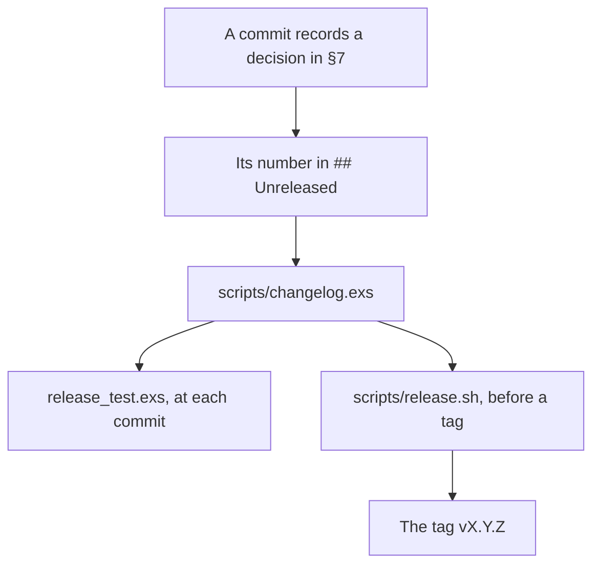

# The changelog and the release step

This page is for a contributor. It gives the rules of `CHANGELOG.md`, which the suite
checks at each commit, and the script that makes the tag of a release. Read it before you
record a decision in [`docs/organisation.md`](../organisation.md) §7.
[The toolchain and the gates](toolchain.md) gives the gates that the release step runs.

> #### Caution {: .error}
>
> Do not make or push a tag of logex. logex has no release, and the maintainer plans no
> release (decision 541). `mix.exs` says 0.1.0, and `## Unreleased` stays the newest
> entry of `CHANGELOG.md`. Nobody makes or pushes a tag. When a release is planned, the
> maintainer gives the number of the first version and decides if its tag goes to origin.
> The maintainer also settles what its entry lists.

## What the changelog and the release step do

This page uses these words:

| Word | Meaning |
|---|---|
| Tag | A Git tag that names a version, for example `v0.2.0`. On this page it is not a [tag](../../guides/reference/glossary.md#tag) of a program |
| Entry | 1 heading of level 2 of `CHANGELOG.md`, with its text |
| Origin | The repository on GitHub that the clone comes from |

`mix.exs` gives the version `0.1.0`. No tag names a version. The newest entry of
`CHANGELOG.md` is `## Unreleased`, and it names each decision of §7.

The suite and the release step read the same 2 files: the changelog and §7. This
diagram shows which script reads what.



Figure: the changelog at each commit and at a release. The suite and the release step
run the same script on the changelog.

## How it is built

### The changelog

Each heading of level 2 in `CHANGELOG.md` is 1 entry. The newest entry is first.

| Part | Form |
|---|---|
| Heading of a release | `## X.Y.Z — YYYY-MM-DD`: the version of `mix.exs` and the day of the release |
| Heading before a release | `## Unreleased`, before the newest release |
| First line of an entry | `Decisions:` and the numbers of the decisions that the entry carries, for example `Decisions: 1–14, 30, 41–54.` A range has an en dash |
| Sections under it | "What changes a running program's outputs", "What no longer compiles, loads or starts", "The host's API" and "Added" |

The head of `CHANGELOG.md` gives what each section holds.

`elixir scripts/changelog.exs` checks the file. The suite runs it in
`test/logex/release_test.exs`. It refuses these things:

- a heading of a different form, or an `## Unreleased` that is not the first entry
- a version that 2 headings name
- an entry whose first line is not a list of decisions
- a range that does not go up
- a decision that 2 entries name
- a decision of §7 that no entry names, and a decision that §7 does not record

Each refusal is a line that starts with `changelog:`, and the exit code is 1. On this
tree, the script prints this line and exits with 0:

<!-- unchecked: the output of scripts/changelog.exs on this tree -->
```text
changelog: every decision of §7, 1–574, named once
```

### The release step

`scripts/release.sh [--dry-run] [--push]` makes the annotated tag `vX.Y.Z` on the commit
of the clone. It does 6 checks:

1. The tree is clean: Git shows no changed or untracked file.
2. The commit is on the `main` branch of origin. The script fetches `main` first.
3. CI ran on the commit, and each run of `ci.yml` passed. The script reads the runs with
   `gh api`.
4. The newest entry of the changelog is the release of the version of `mix.exs`. Each
   decision of §7 is in an entry. The script runs `elixir scripts/changelog.exs
   --release` for this check.
5. The tag is not in the clone and not on origin.
6. `scripts/gate.sh` prints `GATE-OK`. Its log is `_build/release-gate.log`.

The script does each check, also after a check that failed. Each refusal is a line that
starts with `refused:`. If a check fails, the script makes no tag and exits with 1.

| Option | What the script does when each check passes |
|---|---|
| None | Makes the tag and prints the command that pushes it, `git push origin refs/tags/vX.Y.Z` |
| `--push` | Makes the tag and pushes it to origin |
| `--dry-run` | Makes no tag, pushes nothing and prints the tag that it can make |

Do not run the script with `--push` after a run with no option. The tag is then in the
clone, and check 5 refuses. If the push fails, the tag stays in the clone, and the
script prints the command that pushes it.

This is a run of `scripts/release.sh --dry-run` in a copy of the repository with no
origin and a stand-in gate. The page omits the first line and the line of `gh`:

<!-- unchecked: lines of a run in a copy of the repository; the line of gh is omitted -->
```text
release: origin's main, fetched now
refused: origin's main cannot be fetched (git fetch exited 128)
release: CHANGELOG.md, docs/organisation.md §7 and mix.exs
changelog: line 29: the newest entry is `## Unreleased`; a release names its version and date, `## X.Y.Z — YYYY-MM-DD`, the version mix.exs's
refused: CHANGELOG.md does not name this release (above)
release: the gate (scripts/gate.sh)
GATE-OK
release: refused; nothing tagged, nothing pushed
```

A publish to Hex comes only after the tag, as a separate step.

## Why it is built this way

- **A release step before a publish** (decision 515 (b)). A change can alter what a
  running program writes to its outputs. A host that upgrades must find each such
  change in 1 entry.
- **No release** (decision 541). The maintainer plans no release. The first
  number, the push of its tag and the check of the runs of CI stay open until the
  maintainer plans a release.
- **The changelog at each commit** (decision 542). The suite compares the changelog with
  §7 at each commit. Thus a release cannot omit a decision.

## How to change it

To record a decision:

1. Add the decision to §7 of `docs/organisation.md`.
2. Add its number to the line `Decisions:` of `## Unreleased`.
3. If the decision changes the outputs of a running program, add an item under "What
   changes a running program's outputs".
4. In the item, give the rule before and after the change and a plant that shows it.
   Also tell how to find a program that the change touches.
5. Run `elixir scripts/changelog.exs`. It prints `named once` and exits with 0.

These tests fail on a wrong change:

| Change | Test that fails |
|---|---|
| A decision of §7 that no entry names, or that 2 entries name | `release_test.exs`, through `scripts/changelog.exs` |
| A check of `scripts/release.sh` removed | `release_test.exs`, which runs the script in a scratch repository with a stand-in `gh` and gate |

## See also

- [The toolchain and the gates](toolchain.md): the gates and CI.
- [0021. A pinned toolchain and the gates](../adr/0021-pinned-toolchain-and-gates.md).
- [`CONTRIBUTING.md`, "Releasing"](../../CONTRIBUTING.md#releasing): the procedure of a
  release.
- [`CHANGELOG.md`](../../CHANGELOG.md): the entries and the form of an entry.
