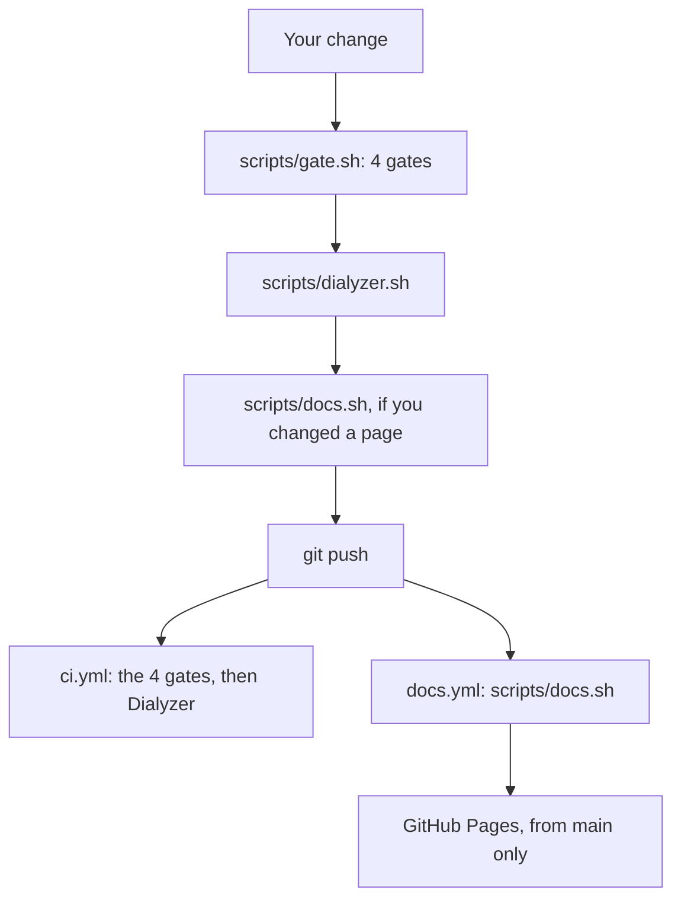
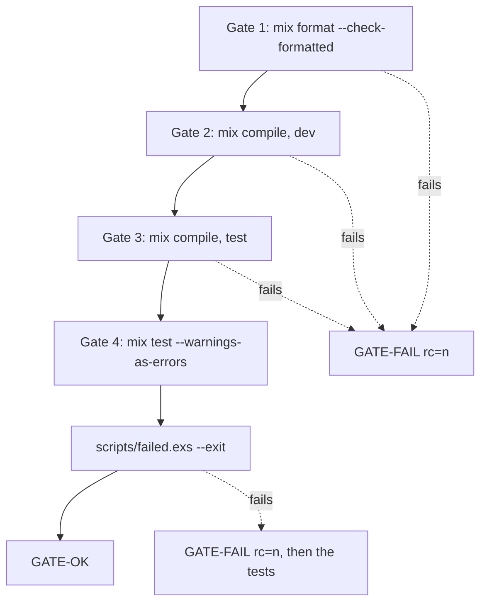

# The toolchain and the gates

This page is for a contributor. Read it before your first build of logex. It gives these
things:

- the versions of Erlang/OTP and Elixir that logex builds on, and how to install them
- the gates that each commit must pass, and the 2 workflows of CI

[The changelog and the release step](releasing.md) gives the changelog that the suite
checks at each commit. It also gives the script that makes the Git tag of a release.

> #### Caution {: .error}
>
> Install the pinned versions. Do not change the bound `elixir: "~> 1.20"` in `mix.exs`.
> CI builds and tests logex on Elixir 1.20.4 only. A lower bound lets Mix build logex on
> an Elixir that no check uses.

## What the toolchain and the gates do

This page uses these words:

| Word | Meaning |
|---|---|
| Toolchain | Erlang/OTP and Elixir, which build and run logex |
| Pin | A version that a file of the repository names |
| Gate | 1 command that must exit with 0 before you commit |
| Test | An ExUnit test in a file under `test/` |
| CI | The 2 workflows, `ci.yml` and `docs.yml`, that GitHub Actions runs on each push and each pull request |
| Failures manifest | The file of ExUnit that names the tests that failed: `_build/test/lib/logex/.mix/.mix_test_failures` |
| PLT | The file of Dialyzer that holds the types of the functions of the applications that logex calls |

A change goes through the same checks on your computer and in CI. This diagram shows the
path of a commit from your computer to the site of the documentation.



Figure: the checks of a commit. The 2 workflows of CI run the same commands that you run
on your computer.

## The pinned versions

logex builds on Elixir 1.20 on Erlang/OTP 28. These files name the versions:

| File | What it names |
|---|---|
| `mix.exs` | `elixir: "~> 1.20"` |
| `examples/mix.exs`, the project of the examples | `elixir: "~> 1.20"` |
| `.tool-versions` | `erlang 28.5.0.6` and `elixir 1.20.4-otp-28` |
| `shell.nix` | `erlang_28` and `elixir_1_20` of nixpkgs |
| `flake.nix` | nixpkgs of the channel `nixos-26.05` |
| `.github/workflows/ci.yml` and `docs.yml` | `OTP_VERSION: "28"` and `ELIXIR_VERSION: "1.20.4"` |

With the bound `~> 1.20`, Mix runs on Elixir 1.20.0 and on each later 1.x version. It
refuses 1.19 and 2.0. In CI, the action `erlef/setup-beam@v1.24.1` installs Elixir
1.20.4 and OTP `28`, at the patch release of OTP that it chooses.

Outside the `docs` environment, logex has no dependency. In the environments `dev` and
`test`, `mix deps` prints nothing, and Mix fetches nothing. The build generates no
code, so the package `erlang-parsetools` is not necessary. ExDoc and its 5 packages are
the only entries of `mix.lock`. `scripts/docs.sh` installs Hex if necessary and fetches
them, or `MIX_ENV=docs mix deps.get` fetches them. The first run needs the network.

On an Elixir that the bound refuses, Mix stops before it compiles a file. This message
is from Elixir 1.20.4, with the bound changed to `~> 1.21` in a copy of the repository:

<!-- unchecked: the message of Mix, from a run against a raised bound in a copy -->
```text
** (Mix) You're trying to run :logex on Elixir v1.20.4 but it has declared in its mix.exs file it supports only Elixir ~> 1.21
```

The message ends with `supports only Elixir ~> 1.21`. On an older Elixir, the message
names that version and ends with `supports only Elixir ~> 1.20`.

## Install the toolchain

Use 1 of these 4 ways. Before you start, read the line of your way:

- **Nix, with flakes.** `nix develop` needs the features `nix-command` and `flakes` of
  Nix. Without them, Nix stops with `error: experimental Nix feature 'nix-command' is
  disabled`. Turn them on in your Nix configuration, or use `nix-shell`. The committed
  `flake.lock` is older than the pin: it locks nixpkgs at a commit of `master` from
  January 2024. Thus the first `nix develop` writes `flake.lock` again. Commit the new
  `flake.lock`.
- **Nix, without flakes.** The nixpkgs of your channel must have `erlang_28` and
  `elixir_1_20`.
- **asdf.** The plugin `erlang` builds Erlang/OTP from its source. This takes a long
  time. It needs a C compiler and the libraries that the README of the plugin names.
- **mise.** mise reads the same file as asdf.

Do each command in the root directory of your clone:

| Way | Commands | File that it reads |
|---|---|---|
| Nix, with flakes | `nix develop` | `flake.nix`, then `shell.nix` |
| Nix, without flakes | `nix-shell` | `shell.nix`, with the nixpkgs of your channel |
| asdf | `asdf plugin add erlang`, `asdf plugin add elixir`, `asdf install` | `.tool-versions` |
| mise | `mise install` | `.tool-versions` |

With Nix, the shell also has `elixir-ls`, `rebar3` and, on Linux, `inotify-tools`. Its
files of Mix and Hex are in `.nix-mix` and `.nix-hex`, which Git ignores.

Another way to install is possible, for example a package of your system, if it gives
Elixir 1.20 on Erlang/OTP 28. CI checks only Elixir 1.20.4.

To make sure of the toolchain, do this command. The first line names the Erlang/OTP that
runs. The last line names the Elixir, and the Erlang/OTP that compiled it:

<!-- unchecked: what the command prints differs by machine -->
```console
$ elixir --version
Erlang/OTP 28 [erts-16.4.0.7] [source] [64-bit] [smp:4:4] [ds:4:4:10] [async-threads:1] [jit:ns]

Elixir 1.20.4 (compiled with Erlang/OTP 28)
```

## Build, test and format

Use these 3 commands while you work:

| Command | What it does |
|---|---|
| `mix compile` | Compiles `lib/` |
| `mix test --warnings-as-errors` | Compiles the tests and runs the suite. It exits with 1 if a test file has a warning. Plain `mix test` exits with 0 |
| `mix format` | Formats each file. CI refuses a file that `mix format` changes |

Judge each run of `mix test` by its exit code, not by a count in its output. [Why it is
built this way](#why-it-is-built-this-way) gives the reason.

If an edit to a file of `lib/` seems to have no effect, do `mix compile --force`. Mix
can miss a second edit of the same size in the same second as the build before it.

## The gates

A commit must pass 4 gates, in this order:

| Gate | Command | It refuses |
|---|---|---|
| 1 | `mix format --check-formatted` | A file that `mix format` changes |
| 2 | `mix compile --force --warnings-as-errors` | A warning in any module of `lib/`, also in a file that you did not change |
| 3 | `MIX_ENV=test mix compile --force --warnings-as-errors` | A warning in `lib/` when it compiles in the `test` environment |
| 4 | `mix test --warnings-as-errors` | A test that fails and a warning in a test file. With `scripts/failed.exs`, also a suite that does not finish |

### `scripts/gate.sh`

`scripts/gate.sh [log] [mix test args]` runs the 4 gates. You can start it from any
directory of the clone. It stops at the first gate that fails.



Figure: the steps of `scripts/gate.sh`. A dotted arrow is a step that exits with a code
that is not 0.

The script writes the output of each gate to the log, `_build/gate.log` if you give no
log. It prints the last 5 lines of the log, then `GATE-OK` or `GATE-FAIL rc=<n>`. It
exits with the code of the gate. A run of `scripts/gate.sh` takes 7 to 10 minutes.

Arguments after the log go to `mix test`, for example `--seed 0`.

> #### Caution {: .error}
>
> Do not commit on a run that has a test file or `--only` as an argument. Such a run
> does only those tests, and it still prints `GATE-OK`. Before a commit, run
> `scripts/gate.sh` with no argument after the log.

Before the suite, the script deletes the failures manifest. After the suite,
`elixir scripts/failed.exs --exit N` reads the manifest, with `N` the exit code of the
suite. It names each test that failed. This is the end of a red run. Its test file is an
example and is not in the repository:

<!-- unchecked: the last lines of a run of scripts/gate.sh, with a test file that fails, in a copy -->
```text
Result: 1/2 passed
Failed: 1 test
GATE-FAIL rc=2
mix test exited 2; the tests that failed:
test/logex/box_counter_probe_test.exs:4: Logex.BoxCounterProbeTest: test the box counter counts 1 box
```

The script also names the cause when it can name no test. Each of these causes gives
`GATE-FAIL rc=1`:

| Cause | What follows `GATE-FAIL rc=1` |
|---|---|
| A gate before the suite fails | Nothing. The log holds the output of Mix |
| A test file has a warning | 2 lines, block A |
| A test file does not compile | 2 lines, block B |
| A test stops the VM with `System.halt(0)` | 1 line, block C |

<!-- unchecked: the lines that scripts/failed.exs prints for each cause, from runs in a copy -->
```text
A:
mix test exited 1; the tests that failed:
none named: every test that ran passed, and mix test exited 1 for another reason, above: a warning under --warnings-as-errors, for one

B:
mix test exited 1; the tests that failed:
suite: no test ran: a test file failed to compile or load, so ExUnit marked the whole suite failed; mix test's output names the file

C:
mix test exited 0, and ExUnit wrote no failures manifest: the suite did not finish, a test having halted the VM, so the run is red; the output above names any test that failed before it stopped
```

Plain `mix test` exits with 0 when a test stops the VM. Only `scripts/gate.sh` and CI
find that run red.

`elixir scripts/failed.exs`, with no argument, names the tests that the manifest holds.
ExUnit keeps a failure in the manifest until a run passes that test. Thus, after runs by
hand, the manifest can name a failure of an earlier run.

## Dialyzer

`scripts/dialyzer.sh` runs `dialyzer`, the type checker of Erlang/OTP. It adds no
dependency. It compiles logex in the `dev` environment. Then Dialyzer compares each
module with its `@spec` declarations and with the PLT. The PLT holds `erts`, `kernel`,
`stdlib` and `elixir`. Its file is under `_build/dialyzer/`, and its name holds the
versions of the toolchain and the applications.

- The script uses the default warnings of Dialyzer and 5 more: `-Wextra_return`,
  `-Wmissing_return`, `-Wunderspecs`, `-Woverlapping_contract` and `-Wopaque_union`.
- It prints `DIALYZER-OK`, or `DIALYZER-FAIL rc=<n>`. Code 2 means that Dialyzer found
  a warning. Code 1 is a run of Dialyzer that failed for another cause. If the compile
  fails, the script exits with the code of Mix.
- The first run builds the PLT and takes about 1 minute. A later run takes about 15 s.

`scripts/gate.sh` does not run Dialyzer. `ci.yml` runs it after the 4 gates. Run
`scripts/dialyzer.sh` before you push a change to `lib/`. Correct a warning in the code.
Do not hide it with an `@dialyzer` attribute, a wider `@spec` or `no_return()`.

## CI

GitHub Actions runs 2 workflows on each push and each pull request. Each workflow uses
`ubuntu-latest`, Erlang/OTP 28 and Elixir 1.20.4.

`ci.yml`, the workflow "CI":

- Its steps are the 4 gates, 1 step each, then `scripts/dialyzer.sh`.
- It is red when a step exits with a code that is not 0.
- Its step of the suite does the same as `scripts/gate.sh`. It deletes the failures
  manifest, runs `mix test --warnings-as-errors` and then `elixir scripts/failed.exs
  --exit` with its code. Thus the log of a red run ends with each test that failed.
- No step of `ci.yml` has `if:` or `continue-on-error:`.
  `test/logex/scripts_test.exs` compares `ci.yml` with these rules and runs its step of
  the suite.

`docs.yml`, the workflow "Docs":

- Its steps are `scripts/docs.sh`, then the publish of the site.
- It is red when `scripts/docs.sh` fails. For example, the build gives a warning or a
  dead link that `docs/site-warnings.txt` does not list. Or `docs/site-warnings.txt`
  lists a warning that the build does not give.
- It publishes the site only on a push to `main`. It first asks GitHub for the source of
  Pages. If the source is not GitHub Actions, the run publishes nothing, shows a notice
  and stays green.

To publish the site from your fork, set Settings, Pages, Build and deployment, Source:
GitHub Actions. [Add and check a page](../check-a-page.md) gives `scripts/docs.sh`.

A push runs CI on its last commit only. Push each commit that you want CI to check, and
read its run. If the run of `ci.yml` is red, the commit is red. This is true also when
`scripts/gate.sh` was green on your computer.

## Why it is built this way

- **1 toolchain** (decision 359). The repository checks 1 pair of versions, the pair that
  CI uses. No check runs logex on an older Elixir, and nobody keeps it working there.
  Elixir 1.16 and older cannot run all of logex: the code calls `Process.set_label/1`,
  which Elixir 1.17 added.

  Until September 2026 the bound was `~> 1.15`. OTP 26 left support on 2026-05-26, and
  Elixir 1.15 left the window of security fixes on 2026-06-03.
- **Exit codes, not output** (decisions 337 and 515 (e)). Elixir 1.20 prints
  `Result: 1/2 passed` for a run of 2 tests with 1 failure. The line names no test, and a
  search for `[0-9]+ passed` reads it as a pass. Thus `scripts/gate.sh` and `ci.yml` read
  the failures manifest and name each test that failed.
- **`--force` and a second build for `test`.** `--force` compiles each module again, so
  a warning in a file that you did not change also fails. The suite compiles `lib/` in
  the `test` environment, into `_build/test`. The third gate checks that build for
  warnings.
- **Dialyzer of Erlang/OTP** (decision 515 (c)). It checks the `@spec` of the
  [host contract](../../guides/reference/glossary.md#host-contract) and adds no
  dependency. Correct the code until Dialyzer gives no warning (decision 551). No mark
  hides a warning.
- **`if:` and `continue-on-error:` in `ci.yml`** (decision 515 (e)). An `if:` can skip a
  step. With `continue-on-error: true`, a step that fails is green.
- **ExDoc only in `docs`** (decisions 546 and 548). Mix needs Hex to read an entry of
  Hex, in each environment. Thus an entry with `only: :docs` makes each build need Hex.
  A function `deps/1` of `mix.exs` gives ExDoc to the `docs` environment only.

## How to change it

To change the pinned versions:

1. Change `mix.exs`, `examples/mix.exs`, `.tool-versions`, `shell.nix` and `flake.nix`
   together.
2. Change `OTP_VERSION` and `ELIXIR_VERSION` in `ci.yml` and in `docs.yml`.
3. Do `nix develop`, and commit the new `flake.lock`.
4. Change the versions in the test `its toolchain is the pair CI pins` of
   `test/logex/docs_test.exs`.
5. Change the versions in `CLAUDE.md`, `CONTRIBUTING.md`, `README.md`, the comment at
   the head of `shell.nix` and each page that names them. Find them with
   `grep -rn '1\.20' --include=*.md .`.
6. Run `scripts/gate.sh` and `scripts/dialyzer.sh` on the new toolchain.

These tests fail on a wrong change:

| Change | Test that fails |
|---|---|
| `docs.yml` with versions that are not those of `ci.yml`, or not `28` and `1.20.4` | `docs_test.exs`: `its toolchain is the pair CI pins, set up as CI sets it up` |
| A step of `ci.yml` removed, or with `if:` or `continue-on-error:` | `scripts_test.exs`: `CI's workflow (decision 515 (e))` |

No test finds a stale version in the other files or in a page.

These problems can occur on a clone:

| Problem | What to do |
|---|---|
| Mix stops with `You're trying to run :logex on Elixir v...` | Install the pinned versions. Do not change `mix.exs` |
| `frontend_test.exs` fails with ``run `rm -rf src/*.erl _build` once`` | The clone has a build from before the lexer and the parser were Elixir files. Do that command 1 time |
| `nix develop` changes `flake.lock` | Commit the new lock |

## See also

- [0021. A pinned toolchain and the gates](../adr/0021-pinned-toolchain-and-gates.md)
  and [0022. Typespecs and Dialyzer](../adr/0022-typespecs-and-dialyzer.md).
- [The checks of a change](../implementation/testing-checks.md): the mutation tables, the
  examples of the pages and the gate.
- [The test strategy](../implementation/testing-strategy.md): the kinds of test.
- [The changelog and the release step](releasing.md): `CHANGELOG.md` and
  `scripts/release.sh`.
- [Install logex and run a program](../../guides/howto/install-and-run.md): the toolchain
  for a user of logex.
- [`CONTRIBUTING.md`](../../CONTRIBUTING.md): "Before you commit", "Releasing" and
  "Scripts".
- [A map of the documents](../README.md): each document, and who reads it.
