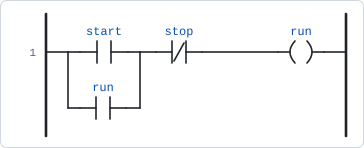
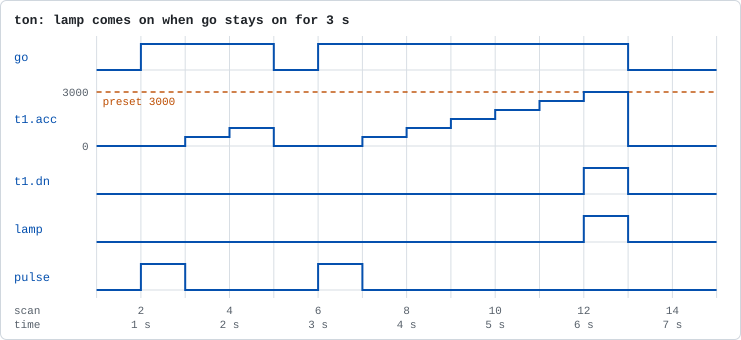

# Examples and pictures

This page is for a person who writes a page of the logex documentation. It gives the
marks that tell the suite what a code block is. It also gives the marks that name the
source of a picture. The [style guide](style-guide.md) gives the rules for the words.

## Code blocks

The suite reads each code block of each page. A mark is an HTML comment on the line
straight before a code block. A reader does not see it.

| What the page shows | How to write it | What the suite does |
|---|---|---|
| A file that an example reads | `<!-- file: motor.ld -->` before the block | Compares the block with `examples/motor.ld`, byte for byte, and gives the file to the later examples of the page |
| A script and its output | An `elixir` block, then a `console` block that starts with `$ mix run scan.exs` | Runs `examples/scan.exs` with the files of the page and compares the output |
| A part of a file | `<!-- part of: motor.ld -->` before the block | Makes sure that the block is whole lines of the file |
| Elixir code that is not a script | `<!-- fragment: the reason -->` before the `elixir` block | Makes sure that the code parses |
| A message or a form of the syntax | `<!-- unchecked: the reason -->` before the block | Nothing. The checker counts these blocks for the reviewer |
| Commands | A `console` block in which each line starts with `$` and a space | Nothing. The checker counts these blocks for the reviewer |
| A diagram, or data of a different tool | A block of the language `mermaid`, `markdown`, `yaml`, `json` or `diff` | Nothing. The checker counts these blocks for the reviewer |

Rules for each block:

- Open and close the block with 3 backticks. Do not use tildes, and do not indent a block
  by 4 spaces. No check reads those blocks.
- Write the language after the backticks, as 1 word.
- Give a `text` block a mark. A block with no mark and no language of the table is a
  failure.
- Show only commands in a `console` block. If the block shows the output of a command,
  make it the run of an example, or mark it `unchecked`.
- Do not mark an `elixir` block `unchecked`. It is a script or a fragment.
- Do not put a block or a mark in a callout. Put the block after the callout.
- To show Markdown that holds a block, use 4 backticks and the language `markdown`.

A tutorial step looks like this:

````markdown
<!-- file: motor.ld -->
```text
var_input start bool
```

```elixir
{:ok, motor} = Logex.compile_file("motor.ld")
```

```console
$ mix run scan.exs
start pressed   %{"motor" => 1}
```
````

## Examples

An example is a script that the suite runs. The suite compares what the script prints
with what the page shows.

- Each file and each script is a file under `examples/`. Change the page and the file
  together. `examples/` holds only the files that the pages show.
- An example gets the files that its page shows before it.
- If an example needs a file that a different page shows, link to that page before the
  example. The text of the link is the name of the file, as code. The reader then knows
  which file to get.

```markdown
Get [`conveyor.ld`](../tutorials/first-plant.md) and put it in the directory.
```

- More than 1 page can show the same file. Each block must be the same as the file.
- More than 1 page can run the same script. The suite runs it for each page.
- A project file that the reader writes, such as `mix.exs`, is a fragment. The suite
  does not run it. Run it and say that you did.

The test file `test/logex/readme_test.exs` has 3 tables for the examples that a page
describes in its prose: `@derived`, `@continues` and `@fragments`. A row of `@derived`
or `@fragments` names its page, and each row holds words of its page. If you move such an example to a different page, change the page of the row
and its words in the same commit.

## Pictures

A script makes each picture, from the program or from a run. Do not draw a picture by
hand. A mark before the picture names its source, and a test compares the picture with
the output of the script. Each picture is 1 file. 2 marks that name the same file must
name the same source.

### A ladder drawing

Show a ladder program 2 times: as text, and as a drawing of that text. Write the mark and
the picture, then run the script. The source is a `.ld` file under `examples/`.

```markdown
<!-- rung: seal.ld -->

```

```console
$ mix run scripts/draw.exs docs/examples-and-pictures.md
```

The script prints `drawn guides/assets/seal.svg`, and the page shows this picture:

<!-- rung: seal.ld -->


To draw only some rungs, give their numbers after the file: `<!-- rung: motor.ld 1 3 -->`.
Give that picture a different file name.

### A timing diagram

Show a timing diagram for each timer, counter, one-shot and pulse coil. The source is a
description in `guides/assets/`, with a name that ends in `.timing.exs`. The description
gives the program, the time of each scan, the inputs and the signals. The script runs
the program and reads each value from the run.

<!-- fragment: the description that the timing diagram of this page comes from -->
```elixir
%{
  title: "ton: lamp comes on when go stays on for 3 s",
  program: "delay.ld",
  step: 500,
  scans: 14,
  inputs: %{"go" => [{2, 1}, {5, 0}, {6, 1}, {13, 0}]},
  show: ["go", "t1.acc", "t1.dn", "lamp", "pulse"]
}
```

| Key | Value |
|---|---|
| `title` | The title of the diagram |
| `program` | A program file under `examples/` |
| `step` | The time that each scan gets, in ms |
| `scans` | The number of scans |
| `inputs` | For each input, a list of `{scan, value}`: the input gets the value before that scan |
| `show` | The signals from top to bottom: a tag, or a member such as `t1.acc` |

<!-- timing: delay.timing.exs -->


The diagram shows that the timer starts again when `go` goes off before 3 s.

### A Mermaid diagram

Use a Mermaid diagram for a flow, a sequence or a state. Examples are the compile
stages, a scan, a round of the runner and the steps of an online edit. GitHub and the
site draw a `mermaid` block. [Add and check a page](check-a-page.md#check-a-page) has an example with its
caption.

### Pictures that the scripts cannot make

The scripts draw a program and the run of 1 instance. They cannot draw these things:

| Picture | What to do |
|---|---|
| A watchdog, a trip or a round of the runner against time | Use a table of the events, or a Mermaid sequence diagram |
| A configuration with its tasks and devices | Use a Mermaid diagram |
| A program that is not a file under `examples/` | Add the file to `examples/` and show it on the page |

Give the reviewer a list of the pictures that your page needs and that no script makes.
