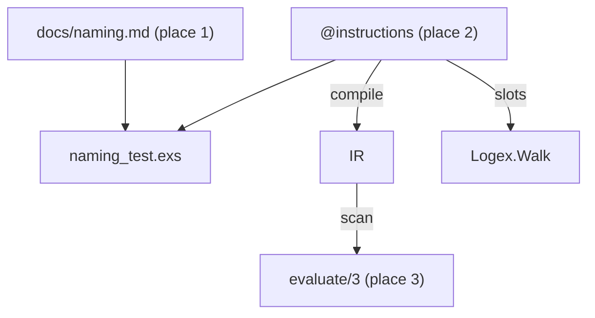
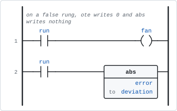

# Add an instruction

This page is for a contributor who adds an
[instruction](../../guides/reference/glossary.md#instruction) to logex. It gives the
changes after the [naming survey](naming-survey.md). Read
[The compile pipeline](../architecture/compile-pipeline.md) and
[The runtime and the evaluator](../architecture/runtime-and-evaluator.md) first.

> #### Caution {: .error}
>
> Give each new instruction 2 clauses of `evaluate/3`: 1 for a
> [true rung](../../guides/reference/glossary.md#true-rung) and 1 for a
> [false rung](../../guides/reference/glossary.md#false-rung). Without the second clause,
> the instruction works until the power that comes to it is false. A
> [contact](../../guides/reference/glossary.md#contact) that opens, a comparison that is
> false or arithmetic that [wraps](../../guides/reference/glossary.md#wrap) can do this.
> Then the [scan](../../guides/reference/glossary.md#scan) raises `FunctionClauseError`
> to the [host](../../guides/reference/glossary.md#host).

## What the part does

An instruction is in 3 places: a stanza, a row and 2 clauses. The compiler makes the IR
from each [rung](../../guides/reference/glossary.md#rung): the list of instructions that the runtime scans.
[The IR and the program type](../architecture/ir-and-program-type.md) gives its forms.



Figure: the 3 places of an instruction and the parts that read them.

| Place | What it holds |
|---|---|
| A stanza of `docs/naming.md` | The names of the operation, the choice and the sources |
| A row of `@instructions` in `lib/logex/compiler.ex` | The [mnemonic](../../guides/reference/glossary.md#mnemonic), its IR symbol and 1 slot for each [operand](../../guides/reference/glossary.md#operand) |
| 2 clauses of `evaluate/3` in `lib/logex/runtime.ex` | What the instruction does on a true rung and on a false rung |

## How it is built

### The naming survey

[The naming survey](naming-survey.md) gives the rules of a name, the stanza and the test.
Head the stanza ``### `mnemonic` — gloss``, in lowercase and in backticks. The test
does not see a heading of a different form.

### The row of the table

`@instructions` maps each mnemonic, in lowercase, to `{symbol, slots}`, with 1 slot for
each operand. The symbol is the first element of the instruction in the IR.
`Logex.Compiler.instructions/0` gives the table, and `Logex.Compiler.signature/2` the
slots of 1 instruction of the IR.

| Slot | The operand |
|---|---|
| `{:read, type}` | A [tag](../../guides/reference/glossary.md#tag) that it reads, not a [literal](../../guides/reference/glossary.md#literal) |
| `{:write, type}` | A tag that it writes, not a literal |
| `{:value, type}` | A tag or a literal that it reads |
| `{:instance, kinds}` | An [instance](../../guides/reference/glossary.md#instance) that it runs, of a kind in the list, for example `["ctu", "ctud"]` |
| `{:preset, :dint}` | A literal number, the [preset](../../guides/reference/glossary.md#preset) |
| `{:label, nil}` | A [label](../../guides/reference/glossary.md#label) of the [routine](../../guides/reference/glossary.md#routine) |

The kind of a built-in type is the word of its family, from `Logex.FbType.family/1`: a
`ctu_int` is of the kind `ctu`. A tag in a slot can also be a
[member](../../guides/reference/glossary.md#member), a
[bit](../../guides/reference/glossary.md#bit) or an
[element](../../guides/reference/glossary.md#element) of an
[array](../../guides/reference/glossary.md#array). The
[type](../../guides/reference/glossary.md#type) of a slot is 1 of these:

| Type | The operand |
|---|---|
| An [elementary type](../../guides/reference/glossary.md#elementary-type), for example `:bool` or `:dint` | A value of that type |
| `:any_int` | An integer |
| `:any_num` | An integer or a real |
| `:any_real` | A real |
| `:any_bitwise` | A bool, a [bit string](../../guides/reference/glossary.md#bit-string) or an integer |
| `:any_elementary` | A number or a bit string |
| `:any` | A value of an elementary type that [widens](../../guides/reference/glossary.md#widen) into the destination, as in `move` |

An instruction whose destination has a generic type computes in the type of the
destination (147). Each source of the same class widens into that type. A comparison has
no destination. The compiler does not compare the type of the count of a shift with a
different operand. The row of `cal` is
`{:cal, :block}`: the slots of a `cal` are those of its block.

Each walk of a program reads the slots through `signature/2`. Do not change `Logex.Walk`:
it finds the writes of the new instruction from its slots. The compiler also reads the
slots to refuse a rung that does nothing.

### The 2 clauses

`evaluate/3`, private in `Logex.Runtime`, takes `(instruction, {power, env}, scan)` and
gives `{power, env}`. These are the clauses of `ote`:

<!-- fragment: the 2 clauses of ote in lib/logex/runtime.ex -->
```elixir
defp evaluate({:ote, _, [operand]}, {true, env}, _scan) do
  {true, write(env, operand, 1)}
end

defp evaluate({:ote, _, [operand]}, {false, env}, _scan) do
  {false, write(env, operand, 0)}
end
```

- A clause that does not read the scan takes `_scan`.
- A routine with no real tag has `reals: nil` in its scan. A routine with no long timer
  has `units: nil`. If the instruction does less work in such a routine, put that clause
  first. The clauses of `move` do this.
- A record of the scan in the env, for example the faults, has an atom key in
  `@own_keys`. See
  [The records of a scan](../architecture/runtime-and-evaluator.md#the-records-of-a-scan).
- The power out is the power that the instruction gives to the next instruction on its
  path. Each clause must give the power out by a fixed rule. For arithmetic, the rule is
  the ENO output of IEC 61131-3: true, or false when the result wraps.

The [power flow](../../guides/reference/glossary.md#power-flow) of a timer or a counter
has no fixed rule. Thus the compiler ends the path after an instruction that runs a
built-in instance, `Logex.FbType.runners/0`. A compile of the 4 lines `var a bool`,
`var b bool`, `var t1 ton` and `xic a ton t1 100 ote b` gives this [diagnostic](../../guides/reference/glossary.md#diagnostic):

<!-- unchecked: a diagnostic of a compile of xic a ton t1 100 ote b, from a run -->
```text
line 4: `ote b` follows `ton t1` on its path: what passes on after a `ton` is not settled, so a `ton` ends its path; read the timer with `xic t1.dn` on a rung below
```

The compiler does not end the path after an instruction of a different kind. If the new
instruction does not run a built-in instance, its clauses must give a fixed power out.

### Instructions of a special kind

Make the changes for each item that applies to the new instruction:

- **It runs a built-in [timer](../../guides/reference/glossary.md#timer) or
  [counter](../../guides/reference/glossary.md#counter).** Add its symbol to the `runs`
  of the type in `lib/logex/fb_type.ex`. `Logex.FbType.rules/1` gives it. The compiler
  then ends its path and sets the preset.
- **It keeps an edge in a [storage bit](../../guides/reference/glossary.md#storage-bit),
  as the [one-shot](../../guides/reference/glossary.md#one-shot) `ons` does.** Make the
  storage bit its first operand. Add its symbol to `@one_shots` in `lib/logex/walk.ex`,
  which `Logex.Walk.one_shots/0` gives. The compiler, `Logex.Warnings`, the online edit
  and the runtime read that list. Its true-rung clause reads `first` and `ons_blocked`
  from the scan, as the clauses of `ons` do.
- **It is a [coil](../../guides/reference/glossary.md#coil).** In `lib/logex/warnings.ex`,
  add a clause of `coil_target/1` and of `virtual_coils/2` that names the bit it writes.
  Add its symbol to the 3 guards `when symbol in [:ote, :osr, :osf, :ons]`. Then 2 coils
  on 1 bit give a [warning](../../guides/reference/glossary.md#warning).
- **It acts with no `:write` slot and no `:instance` slot, as `jmp` does.** Add its
  symbol to `@doing` in `lib/logex/compiler.ex`, which holds `cal` and `jmp`. If you do
  not, the compiler refuses a rung that holds only this instruction.
- **It has more than 3 operands.** The runtime catches a [fault](../../guides/reference/glossary.md#fault) of a
  [subscript](../../guides/reference/glossary.md#subscript) or a bit number only in the first 3 operands. Add clauses of `element/3` in
  `lib/logex/runtime.ex` for each operand after the third. Without them, an index out of
  range in that operand escapes the scan to the host as a throw. The runtime records no
  fault.
- **It is like the instructions of a family of the runtime.** The families are
  `@comparisons`, `@sums`, `@divisions`, `@signs`, `@bitwise` and `@shifts` in
  `lib/logex/runtime.ex`. Each family has 1 true-rung clause and 1 false-rung clause.
  Add the symbol to the list, and a clause of the function that computes the family,
  for example `sum/3` for `@sums`.
- **It is a family of mnemonics, for example the
  [conversions](../../guides/reference/glossary.md#conversion).** Make the rows with a
  comprehension, as `@conversions` does. Write 1 family stanza, and add the family to
  [the test](naming-survey.md#the-test) that holds the families.

### An example

In this [program](../../guides/reference/glossary.md#program), `ote` writes `fan` and
`abs` writes the absolute value of `error` into `deviation`:

<!-- file: adding-an-instruction/fan.ld -->
```text
var_input  run       bool
var_input  error     dint
var_output fan       bool
var_output deviation dint

// on a false rung, ote writes 0 and abs writes nothing
xic run ote fan
xic run abs error deviation
```

<!-- rung: adding-an-instruction/fan.ld -->


The script [`examples/adding-an-instruction.exs`](../../examples/adding-an-instruction.exs)
prints the 2 rows, then does 1 scan with `run` on and 1 with `run` off. Run it from
`examples/`:

```elixir
# The rows of 2 mnemonics in the table of the compiler.
IO.puts("ote  " <> inspect(Logex.Compiler.instructions()["ote"]))
IO.puts("abs  " <> inspect(Logex.Compiler.instructions()["abs"]))

{:ok, fan} = Logex.compile_file("adding-an-instruction/fan.ld")

scan = fn state, label, inputs ->
  state = Logex.Runtime.put_inputs(fan, state, inputs)
  {outputs, state} = Logex.Runtime.scan(fan, state)
  IO.puts("#{label}  #{inspect(outputs)}")
  state
end

# A true rung, then a false rung.
Logex.Runtime.instance(fan)
|> scan.("run on ", %{"run" => 1, "error" => -40})
|> scan.("run off", %{"run" => 0, "error" => -75})

# A mnemonic is a reserved word, in each case of its letters.
{:error, [diagnostic]} = Logex.compile("var Abs dint\n", name: "fan")
IO.puts(Logex.Diagnostic.format(diagnostic))
```

```console
$ mix run adding-an-instruction.exs
ote  {:ote, [write: :bool]}
abs  {:abs, [value: :any_num, write: :any_num]}
run on   %{"deviation" => 40, "fan" => 1}
run off  %{"deviation" => 40, "fan" => 0}
line 1: `Abs` is an instruction and cannot name a tag
```

On the false rung, `ote` writes 0 to `fan`, and `abs` writes nothing.
The tag `deviation` keeps the value 40.
The last line shows that a mnemonic is a
[reserved word](../../guides/reference/glossary.md#reserved-word) in each case of its
letters. [Contacts and coils](../../guides/reference/instructions-contacts-and-coils.md)
and [Arithmetic and comparison](../../guides/reference/instructions-arithmetic-and-comparison.md)
give the rules of the 2 instructions.

## Why it is built this way

Each number is a decision of [`docs/organisation.md`](../organisation.md) §7, the full
log.

- **The evaluator has no default clause.** Each instruction thus gives its own rule for
  a false rung.
- **A fixed power out (73, 98).** Nothing follows a timer or a counter on its path. If
  logex later gives a timer a power out, no program changes: no program has an
  instruction after a timer. Arithmetic gives the ENO output of IEC 61131-3.
- **Reserved words (10).** logex reserves each mnemonic, in any case, in each program
  and each [function block](../../guides/reference/glossary.md#function-block) file, as IEC 61131-3 reserves its keywords. A configuration
  file can use a mnemonic as a name.
- **Typed conversions (148).** A conversion has the typed name of IEC 61131-3, such as
  `real_to_int`, and its family has 1 stanza.
- **Storage bits (21, 80).** On the next scan after a [switch](../../guides/reference/glossary.md#switch)
  of an [online edit](../../guides/reference/glossary.md#online-edit), each new or changed
  one-shot gives no power.

## How to change it

Do the survey first:

1. Do the steps of [The naming survey](naming-survey.md#how-to-change-it) for the
   mnemonic.
2. Search for tags of that name: `grep -rniw '<mnemonic>' test examples guides docs`.
   Each program among the hits stops compiling after code step 3. Rename its tag, or
   select a different name.

Then write the tests and the code:

1. Write the tests of the rules in the test file of the kind, for example
   `arithmetic_test.exs`, with a false rung. Write a test from source text in
   `end_to_end_test.exs`, and each new message in `validation_test.exs`.
2. Run them. Each compile fails with ``unknown instruction `<mnemonic>` ``.
3. Add the row to `@instructions` in `lib/logex/compiler.ex`. Run
   `mix test test/logex/naming_test.exs`: it passes only with the stanza of survey
   step 1.
4. Add the mnemonic to the program of the test "each instruction a compile gives has its
   mnemonic's signature" in `instructionize_test.exs`. Without it, that test fails.
5. Add the 2 clauses of `evaluate/3` in `lib/logex/runtime.ex`. The tests of steps 1
   and 2 pass. A clause can drop an answer on purpose. Write it as `_ = ...`. Add its
   line, with the reason, to the list of `test/logex/dropped_answers_test.exs` (decision
   550). Without the line, that test fails.
6. Make the changes of [Instructions of a special kind](#instructions-of-a-special-kind)
   that apply.
7. Run `mix test --warnings-as-errors`. Judge it by its exit code: it must be 0.
8. Make a mutation table, as [The checks of a change](testing-checks.md) gives. Each row
   must show a test that fails.
9. Change the pages:
   - The reference page of the instructions of the kind, for example
     [Arithmetic and comparison](../../guides/reference/instructions-arithmetic-and-comparison.md)
   - The [cheatsheet](../../guides/reference/cheatsheet.cheatmd)
   - The table [Instruction mnemonics](../../guides/reference/glossary.md#instruction-mnemonics)
     of the glossary, and its number of instructions
   - The numbers of mnemonics in
     [The dialect and IEC 61131-3](../../guides/explanation/the-dialect-and-iec.md)
   - The row of the reference tables of `docs/naming.md`, if it has the mark *(deferred)*
   - [Diagnostics](../../guides/reference/diagnostics.md), for each new message
   - [What logex does not have](../../guides/reference/not-supported.md), if the
     instruction is on it
10. Run `mix format`, then `scripts/gate.sh`. It must print `GATE-OK`. Its fifth step is
    Dialyzer.
11. Write in the commit message that the mnemonic is a reserved word. Name the programs
    and the function blocks that it breaks: each with a tag of that name.

No test of the suite scans each mnemonic. Thus only the tests of code step 1 find a
missing false-rung clause.

## See also

- [The naming survey](naming-survey.md): the rules of a name and the stanza.
- [The compile pipeline](../architecture/compile-pipeline.md): where the compiler checks
  each operand against its slot.
- [The runtime and the evaluator](../architecture/runtime-and-evaluator.md): the scan
  that calls `evaluate/3`.
- [The test strategy](testing-strategy.md) and [The checks of a change](testing-checks.md):
  the kinds of test and the mutation tables.
- The decision records
  [0002. A dialect for logex, and a survey for each word](../adr/0002-own-dialect-and-names.md),
  [The types of IEC 61131-3 and overflow](../adr/0006-iec-types-and-overflow.md),
  [Clauses, not conditionals](../adr/0009-clauses-not-conditionals.md) and
  [Verify by a run](../adr/0020-verify-by-executing.md).
- [Glossary](../../guides/reference/glossary.md): the technical words of logex.
