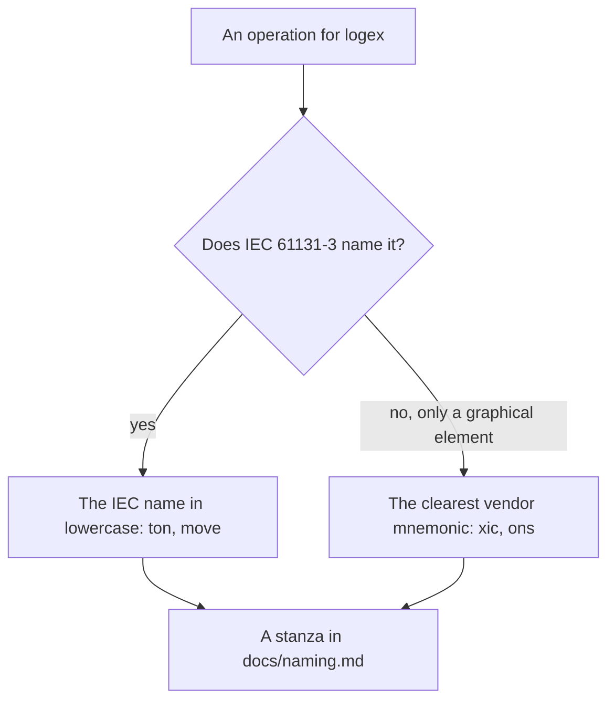

# The naming survey

This page is for a contributor who adds a word to logex. The word can be a
[mnemonic](../../guides/reference/glossary.md#mnemonic), a word of a [declaration](../../guides/reference/glossary.md#declaration) line, a
word that heads a file or a word of a
[configuration file](../../guides/reference/glossary.md#configuration-file). It gives the
rules of a name and the stanza of [`docs/naming.md`](../naming.md) for each word. It also
gives the test that reads the stanzas. [Add an instruction](adding-an-instruction.md) gives the
steps in the code after the survey.

## What the part does

The survey selects the name of a word before the code. A stanza is 1 entry of
`docs/naming.md`, for 1 word. It gives the names in
[IEC 61131-3](../../guides/reference/glossary.md#iec-61131-3), in the
[conventional set](../../guides/reference/glossary.md#conventional-set) and at the major
vendors. It also gives the reasons for the name in logex.



Figure: the rules of a name. The survey never makes a new readable word for an operation
that has a standard name.

## How it is built

### The rules of a name

Select the name by these 3 rules, in this sequence:

1. If IEC 61131-3 names the operation, use the IEC name in lowercase: `ton`, `move`,
   `add`, `shl`.
2. If IEC 61131-3 gives only a graphical element, use the clearest vendor mnemonic.
   Name the vendor in the `**Why:**` line of the stanza. Examples are `xic`, `ote`, `ons`
   and `rto`.
3. Do not make a new readable word for an operation that has a standard name. logex has
   no `on_delay`, `rising` or `equal`.

[The dialect and IEC 61131-3](../../guides/explanation/the-dialect-and-iec.md) gives the
reasons for the 3 rules.

### The stanza

Copy the template of a stanza from [Adding a stanza](../naming.md#adding-a-stanza) in
`docs/naming.md`. These rules apply to each stanza:

- Head the stanza ``### `word` — gloss``, with the word in lowercase and in backticks.
  The test reads only headings of this form under `## Stanzas`, and the `**Members:**`
  lines. It does not see a heading of a different form.
- Put the stanza at the end of `docs/naming.md`. The file is append-only. Do not change
  an old stanza: add an amendment under it.
- Fill each row of the table. Write `unverified` for each fact that you did not read in
  its source. Do not guess.
- Give the edition, the clause and the table of IEC 61131-3.
  [`docs/instruction-sets.md`](../instruction-sets.md) gives them, and the instructions of
  the free ladder tools.
- Do not name the vendor of the conventional set. The column is "Conventional".
- For a family of mnemonics, write 1 stanza. Head it with 1 member, and name each member
  in a `**Members:**` line. The stanza `dint_to_int` names the 56 integer conversions.

### The test

`test/logex/naming_test.exs` reads the stanzas. Each of its tests in this table refuses
a word with no stanza:

| Test | The words |
|---|---|
| "every implemented instruction has been surveyed" | Each key of `Logex.Compiler.instructions/0` |
| "every section and type word of a declaration line has been surveyed" | Each [section](../../guides/reference/glossary.md#section) word, [qualifier](../../guides/reference/glossary.md#qualifier) and type word of `Logex.Declarations.keywords/0`, with the built-in [timers](../../guides/reference/glossary.md#timer) and [counters](../../guides/reference/glossary.md#counter) |
| "every word that heads a file of another kind has been surveyed" | Each word of `Logex.Declarations.kinds/0`, for example `function_block` |
| "every word of a configuration file has been surveyed" | Each word of `Logex.Configuration.Text.keywords/0` |

The test is one-way: it refuses a word with no stanza, and it does not refuse a stanza
with no word. Thus a stanza can come before its code. 3 other tests hold lists:

- "a family stanza's members are read as data" holds each family stanza and the number
  of its members.
- "a declaration line's words are those of the items that have landed" holds each word
  of a declaration line.
- "a configuration file's words are those of the items that have landed" holds each word
  of a configuration file.

A run with the row of a mnemonic `expt` in `@instructions` and no stanza gave this
failure:

<!-- unchecked: a failure of naming_test.exs, from a run in a copy with a row added -->
```text
These instructions are in @instructions but have no stanza in docs/naming.md:

    expt

Survey the name before shipping it — see the recipe in CLAUDE.md. Copy the
template from the "Adding a stanza" section of docs/naming.md, fill every
dialect row, and mark anything you could not check `unverified`.
```

## Why it is built this way

- **The survey comes before the code.** A name is then a choice and not a habit. A
  controls engineer knows the IEC names, and each manual uses them. The test makes the
  survey a step that a change cannot miss.
- **logex has its own dialect.** IEC 61131-3 gives [contacts](../../guides/reference/glossary.md#contact) and
  [coils](../../guides/reference/glossary.md#coil) as graphical elements with no mnemonic, so a ladder language of mnemonics cannot conform. The survey
  records what logex differs from.
- **Each word is a reserved word (10).** logex reserves a mnemonic and a declaration
  word, in any case of their letters, in each [program](../../guides/reference/glossary.md#program) and each
  [function block](../../guides/reference/glossary.md#function-block) file. It reserves a word of a configuration
  file in a configuration file. Thus a new word can break a file with a name of that
  word, and the stanza records the choice.

## How to change it

1. Read the reference tables of `docs/naming.md` and the sections of
   `docs/instruction-sets.md` for the operation.
2. Select the name by [the rules of a name](#the-rules-of-a-name).
3. Add the stanza at the end of `docs/naming.md`, with the heading
   ``### `<word>` — gloss``. Write `unverified` for each fact that you did not check.
4. A test holds the list of each family, declaration word and word of a configuration
   file. Add a new one to that list.
5. Add the word to the code. Run `mix test test/logex/naming_test.exs`. It passes only
   when each new word has a stanza with a correct heading.

## See also

- [Add an instruction](adding-an-instruction.md): the steps in the code after the survey.
- [The dialect and IEC 61131-3](../../guides/explanation/the-dialect-and-iec.md): the
  source of each word and the reasons for the rules of a name.
- The decision record [Its own dialect and names](../adr/0002-own-dialect-and-names.md).
- [`docs/naming.md`](../naming.md): the survey, and
  [`docs/instruction-sets.md`](../instruction-sets.md): what IEC 61131-3 gives.
- [Glossary](../../guides/reference/glossary.md): the technical words of logex.
