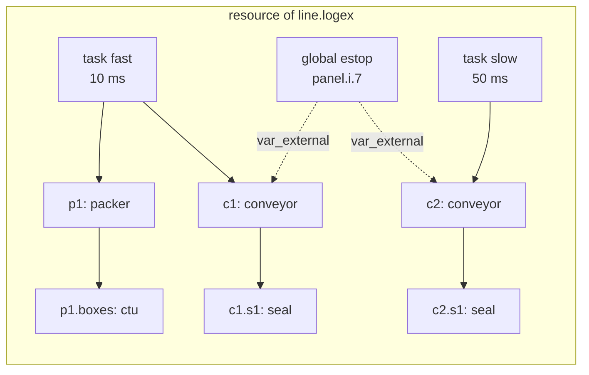
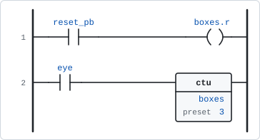

# Runs and tables of the records: the core

This page is for a contributor who reads a decision record about the software model, the time and the errors. It holds the
runs, the measurements and the long tables of records 0004, 0007 and 0008, so that each record stays
short. Each section names its record, and each record links to its section.

The suite runs each example of this page, as it runs the examples of each other page.
Each script and its files are under `examples/`.

## 0004. The software model of IEC 61131-3

This plant, its run and a measurement support
[0004. The software model of IEC 61131-3](../adr/0004-iec-software-model.md). The rules
that the run names are the 12 rules of that record.

### A plant in this model

> #### Warning {: .warning}
>
> Do not use logex for a safety function. In this plant, `estop` is a signal that a
> program reads. Hard-wire the e-stop that stops the machine, so that it works when logex
> stops, crashes or does not start. See
> [Safety and limits](../../guides/explanation/safety-and-limits.md).

This plant has 2 instances of the program type `conveyor` and 1 instance `p1` of `packer`.
Each conveyor holds 1 `seal`, and both read the global `estop`. The packer counts boxes
with its counter `boxes`.

<!-- file: 0004-iec-software-model/line.logex -->
```text
// line.logex -- 2 conveyors of 1 program type, and a packer
task fast interval 10 priority 1
task slow interval 50 priority 2

var_global estop      bool at panel.i.7
var_global pb_start_1 bool at panel.i.0
var_global pb_start_2 bool at panel.i.1
var_global eye        bool at panel.i.2
var_global pb_reset   bool at panel.i.3
var_global k1         bool at panel.q.0
var_global k2         bool at panel.q.1
var_global case_full  bool at panel.q.2

program c1 conveyor with fast
  c1.start pb_start_1
  c1.stop  0
  c1.motor k1

program c2 conveyor with slow
  c2.start pb_start_2
  c2.stop  0
  c2.motor k2

program p1 packer with fast
  p1.eye       eye
  p1.reset_pb  pb_reset
  p1.full_lamp case_full
```

<!-- file: 0004-iec-software-model/conveyor.ld -->
```text
// A conveyor: its motor runs from start until stop or the shared e-stop.
var_input start bool
var_input stop bool
var_output motor bool
var_external estop bool
var halt bool
var s1 seal

( xic stop | xic estop ) ote halt
cal s1 start halt motor
```

<!-- file: 0004-iec-software-model/seal.ld -->
```text
// A seal-in: `run` holds itself in from `start` until `stop`.
function_block seal
var_input start bool
var_input stop bool
var_output run bool

( xic start | xic run ) xio stop ote run
```

<!-- file: 0004-iec-software-model/packer.ld -->
```text
// A packer: it counts boxes at the eye and lights a lamp when a case holds 3.
var_input eye bool
var_input reset_pb bool
var_output full_lamp bool
var_output count dint
var boxes ctu

xic reset_pb ote boxes.r
xic eye ctu boxes 3
xic boxes.q ote full_lamp
move boxes.cv count
```



Figure: the resource of `line.logex`. A solid arrow goes from a task to an instance that
it runs, or from an instance to an instance that it holds. A dotted arrow goes from a
global to an instance that reads it. See that the 2 conveyors share 1 global, and hold 1
`seal` each.

On rung 1 of `packer.ld`, a [coil](../../guides/reference/glossary.md#coil) writes the
member `boxes.r`. The power flow of rung 2 is the count input of `boxes`.

<!-- rung: 0004-iec-software-model/packer.ld 1 2 -->


### A run of the plant

This script runs the plant 2 times, then shows 5 refusals. Run it from `examples/`, a Mix
project that has logex as its dependency.

```elixir
# The configuration file makes 3 instances of 2 program types and puts them on 2 tasks.
{:ok, line} = Logex.Configuration.compile_file("0004-iec-software-model/line.logex")

for {name, program} <- line.programs do
  IO.puts("program type #{name}, block types #{inspect(Map.keys(program.blocks))}")
end

# 1 cycle each 10 ms. The task fast runs c1 and p1 in each cycle, slow runs c2 each 50 ms.
cycle = fn {rt, now}, elapsed, inputs ->
  {rt, out, events} = Logex.Runtime.cycle(rt, elapsed, inputs)
  ran = for {:ran, _task, instance, _now} <- events, do: instance
  boxes = Logex.Runtime.get!(rt, "p1.boxes.cv")
  IO.puts("t=#{now + elapsed}  k1=#{out["k1"]} k2=#{out["k2"]}  boxes=#{boxes}  ran #{Enum.join(ran, " ")}")
  {rt, now + elapsed}
end

# Each instance has its own state: c1.s1 and c2.s1 are 2 instances of the block seal.
seals = fn {rt, now} ->
  IO.puts("       c1.s1.run=#{Logex.Runtime.get!(rt, "c1.s1.run")} c2.s1.run=#{Logex.Runtime.get!(rt, "c2.s1.run")}")
  {rt, now}
end

# Run 1: the e-stop goes to 1 at 40 ms and stays 1.
{Logex.Runtime.start(line), 0}
|> cycle.(0, %{"pb_start_1" => 1, "pb_start_2" => 1})
|> cycle.(10, %{"pb_start_1" => 0, "pb_start_2" => 0, "eye" => 1})
|> cycle.(10, %{"eye" => 0})
|> cycle.(10, %{"eye" => 1})
|> cycle.(10, %{"estop" => 1})
|> seals.()
|> cycle.(10, %{"pb_reset" => 1})
|> seals.()

# Run 2: the e-stop is 1 for 10 ms only, from 10 ms to 20 ms. The task slow does not run then.
IO.puts("run 2")

{Logex.Runtime.start(line), 0}
|> cycle.(0, %{"pb_start_1" => 1, "pb_start_2" => 1})
|> cycle.(10, %{"pb_start_1" => 0, "pb_start_2" => 0, "estop" => 1})
|> cycle.(10, %{"estop" => 0})
|> cycle.(10, %{})
|> cycle.(10, %{})
|> cycle.(10, %{})

print = fn {:error, [diagnostic | _]} -> IO.puts(Logex.Diagnostic.format(diagnostic)) end

# A rung writes the inputs r and pv of a counter, and never its count cv.
print.(Logex.compile("var e bool\nvar boxes ctu\nxic e ctu boxes 3\nmove 5 boxes.cv\n", name: "m"))

# A program has 1 routine, and no subroutine to call.
print.(Logex.compile("var e bool\nxic e jsr fill\n", name: "m"))

# A block reaches no global: it takes a value through a var_input.
block = "function_block b\nvar_input i bool\nvar_output o bool\nvar_external g bool\nxic i xic g ote o\n"
print.(Logex.compile(block, name: "b"))

# 2 instances share a value only through a global. Each var_input has a connection.
text = File.read!("0004-iec-software-model/line.logex")
linked = String.replace(text, "c2.start pb_start_2", "c2.start c1.motor")
print.(Logex.Configuration.compile("line", linked, line.programs))
unconnected = String.replace(text, "  c2.stop  0\n", "")
print.(Logex.Configuration.compile("line", unconnected, line.programs))
```

```console
$ mix run 0004-iec-software-model.exs
program type conveyor, block types ["seal"]
program type packer, block types []
t=0  k1=1 k2=1  boxes=0  ran c1 p1 c2
t=10  k1=1 k2=1  boxes=1  ran c1 p1
t=20  k1=1 k2=1  boxes=1  ran c1 p1
t=30  k1=1 k2=1  boxes=2  ran c1 p1
t=40  k1=0 k2=1  boxes=2  ran c1 p1
       c1.s1.run=0 c2.s1.run=1
t=50  k1=0 k2=0  boxes=0  ran c1 p1 c2
       c1.s1.run=0 c2.s1.run=0
run 2
t=0  k1=1 k2=1  boxes=0  ran c1 p1 c2
t=10  k1=0 k2=1  boxes=0  ran c1 p1
t=20  k1=0 k2=1  boxes=0  ran c1 p1
t=30  k1=0 k2=1  boxes=0  ran c1 p1
t=40  k1=0 k2=1  boxes=0  ran c1 p1
t=50  k1=0 k2=1  boxes=0  ran c1 p1 c2
line 4: `move` writes `boxes.cv`, but logic may write only `.r` and `.pv` of a ctu
line 2: unknown instruction `jsr`
line 4: `g` cannot be a var_external in a function block's file: a block reaches no global of a configuration, so it takes one through a var_input, which the `cal` that runs it fills
line 20: `c1.motor` is an instance's member: instances share a value only through a global, which one drives and the other reads
line 19: `c2` leaves its var_input `stop` unconnected: connect it to a global, a point or a constant, as in `c2.stop 0`
```

In run 1 at 40 ms, `c1.s1.run` is 0 and `c2.s1.run` is 1: the 2 seals are 2 instances. At
50 ms, `pb_reset` is 1, so rung 1 of `packer.ld` writes `boxes.r`. The counter goes to 0
in the same scan. In run 2, the task slow does not run while `estop` is 1, so `k2`
stays 1. The 5 refusals show rules 3, 12, 11, 10 and 9.

### The size of a program

In this measurement, each level has 2 block types, and each type holds both types of the level
under it.

| Where the program holds its block types | 6 levels | 12 levels |
|---|---|---|
| Each block type in each holder, measured for decision 53 | 36,405 | 2,354,805 |
| 1 table on the program, a run on 2026-11-21 | 4,642 | 9,082 |

The unit is the machine word of a flat copy, as `:erts_debug.flat_size(term)` counts it. The 2
rows come from 2 shapes of the same kind, so compare how each row grows.

## 0007. The host gives the time

These runs support [0007. The host gives the time](../adr/0007-the-host-gives-the-time.md).

### A timer that a jump skips

This program, `jog.ld`, is a motor with a manual part. In auto, the jump skips rungs 2
to 4, and `jog_t` with them.

<!-- file: jog.ld -->
```text
var_input manual bool
var_input jog_pb bool
var_input run_pb bool
var_output auto_lamp bool
var_output jog_lamp bool
var_output jog_long bool
var_output motor bool
var jog_t ton

// in auto, jump over the manual section
xio manual jmp auto ote auto_lamp
xic jog_pb ote jog_lamp
xic jog_pb ton jog_t 3000
xic jog_t.dn ote jog_long
lbl auto ( xic run_pb xio manual | xic manual xic jog_pb ) ote motor
```

<!-- rung: jog.ld -->


<!-- timing: 0007-the-host-gives-the-time-catch-up.timing.exs -->


The diagram shows that `jog_t.acc` stops while the jump skips its rung, and then gets to
its [preset](../../guides/reference/glossary.md#preset), 3000, in 1 scan. With a `dt` for
each instance, scan 9 adds only 1000 ms, and `jog_long` comes on 1 scan later.

### A timer across the switch of an online edit

Result 6 of the run shows this with `d2`, an instance on a task of 50 ms:

| Time | What occurs | `d2.t1.acc` |
|---|---|---|
| 50 ms | The original program scans `d2` | 50 |
| 70 ms | The test step gives `d2` to the candidate. The candidate has no rung that runs `t1` | 50 |
| 100 ms | The candidate scans `d2` | 50 |
| 130 ms | The untest step gives `d2` back, and reports `{:resumed, "d2.t1", 60}` | 50 |
| 150 ms | The original program scans `d2`. It adds 20 ms (50 to 70) and 20 ms (130 to 150) | 90 |

### The rules in a run

The script `examples/0007-the-host-gives-the-time.exs` shows each rule of this record as
a numbered result. It reads `delay.ld` and `jog.ld`. Run it from `examples/`. This table
gives the line of output that shows each rule:

| Result | Rule | The output to read |
|---|---|---|
| 1 | The same steps give the same outputs | The last step adds 3000 ms and `lamp` comes on. No 3 s of real time pass. The second run gives `true` |
| 2 | A time that goes back is a wrong argument | 2 lines of `ArgumentError` |
| 3 | A timer that a jump skips catches up | `jog_t.acc` stays at 1000 for 10 s, then gets to 3000 in 1 scan |
| 4 | A timer in a block whose `cal` is false catches up | `r1.t.acc` stays at 1000, then gets to 3000 in 1 scan |
| 5 | A timer counts the time, not the scans | The lamp comes on 3000 ms after `go`. With uneven steps, `go` rises at 1015 ms, and the lamp comes on at the first scan at 4015 ms or later: 4060 ms |
| 6 | A timer resumes from the switch of an online edit | The table in [A timer across the switch of an online edit](#a-timer-across-the-switch-of-an-online-edit) |
| 7 | The runner on the manual clock gives 1 round in each millisecond, and a run repeats | 11 rounds at 10 ms. `go` changes at 10 ms, the round at 11 ms reads it, and the lamp comes on at 3011 ms. The second run gives `true` |
| 8 | A runner with `retain:` refuses a clock without `wall_ms/1` | 1 line of `ArgumentError`, then a start with no store |
| 9 | A limit of real time applies on the manual clock | `{:error, {:io_init, "panel", :timeout}}` at 0 ms |

`delay.ld` also has a [one-shot](../../guides/reference/glossary.md#one-shot), `s1`. Its
memory is state too, so result 1 shows `pulse` on the same scans in both runs.

<!-- file: delay.ld -->
```text
var_input go bool
var_output lamp bool
var_output pulse bool
var_output waited dint
var t1 ton
var s1 bool

xic go ton t1 3000
xic t1.dn ote lamp
xic go ons s1 ote pulse
move t1.acc waited
```

```elixir
alias Logex.Runtime
alias Logex.Runner
alias Logex.Runner.Clock.Manual
alias Logex.IO.Sim

{:ok, delay} = Logex.compile_file("delay.ld")
{:ok, jog} = Logex.compile_file("jog.ld")

# Give each step's inputs and milliseconds to scan/3. Keep the time and the outputs.
run = fn program, steps ->
  {rows, _state} =
    Enum.map_reduce(steps, Runtime.instance(program), fn {ms, inputs}, state ->
      state = Runtime.put_inputs(program, state, inputs)
      {outputs, state} = Runtime.scan(program, state, ms)
      {{state.now, outputs, state.env}, state}
    end)

  rows
end

IO.puts("1. delay.ld: the same steps, 2 runs")

steps = [
  {0, %{}},
  {500, %{"go" => 1}},
  {1250, %{}},
  {2000, %{"go" => 0}},
  {100, %{"go" => 1}},
  {3000, %{}}
]

first = run.(delay, steps)
Enum.each(first, fn {now, outputs, _env} -> IO.puts("  #{now} ms  #{inspect(outputs)}") end)
IO.puts("  same outputs in the second run: #{run.(delay, steps) == first}")

IO.puts("2. A time that goes back")
state = Runtime.instance(delay)
{_outputs, state} = Runtime.scan(delay, state, 3000)

refused = fn call ->
  try do
    call.()
  rescue
    error in ArgumentError -> IO.puts("  ArgumentError: " <> Exception.message(error))
  end
end

refused.(fn -> Runtime.scan(delay, state, -5) end)
refused.(fn -> Runtime.call(delay, state, %{}, %Logex.Scan{now: 10, first: false}) end)

IO.puts("3. jog.ld: jog_t in the rungs that the jump skips")

jogged =
  run.(jog, [
    {0, %{"manual" => 1, "jog_pb" => 1}},
    {1000, %{}},
    {0, %{"manual" => 0}},
    {10_000, %{}},
    {0, %{"manual" => 1}}
  ])

Enum.each(jogged, fn {now, outputs, env} ->
  IO.puts("  #{now} ms  jog_t.acc #{env["jog_t"]["acc"]}  jog_long #{outputs["jog_long"]}")
end)

IO.puts("4. A timer in a block whose cal is false")

{:ok, run_on} =
  Logex.compile(
    """
    function_block run_on
    var_input go bool
    var_output done bool
    var t ton

    xic go ton t 3000
    xic t.dn ote done
    """,
    name: "run_on"
  )

{:ok, fan} =
  Logex.compile(
    """
    var_input enable bool
    var_input hot bool
    var_output fan bool
    var r1 run_on

    xic enable cal r1 hot fan
    """,
    name: "fan",
    types: [run_on]
  )

fan
|> run.([
  {0, %{"enable" => 1, "hot" => 1}},
  {1000, %{}},
  {0, %{"enable" => 0}},
  {10_000, %{}},
  {0, %{"enable" => 1}}
])
|> Enum.each(fn {now, outputs, env} ->
  IO.puts("  #{now} ms  r1.t.acc #{env["r1"]["t"]["acc"]}  fan #{outputs["fan"]}")
end)

IO.puts("5. delay.ld at 3 rates: go rises at 1000 ms")

# Scan until the lamp comes on. go is 1 from 1000 ms.
go = fn
  now when now >= 1000 -> 1
  _now -> 0
end

until_lamp = fn
  until_lamp, state, [ms | more], %{"lamp" => 0} ->
    state = Runtime.put_inputs(delay, state, %{"go" => go.(state.now + ms)})
    {outputs, state} = Runtime.scan(delay, state, ms)
    until_lamp.(until_lamp, state, more ++ [ms], outputs)

  _until_lamp, state, _steps, %{"lamp" => 1} ->
    state.now
end

Enum.each([[10], [50], [10, 25, 40, 70]], fn steps ->
  lamp = until_lamp.(until_lamp, Runtime.instance(delay), steps, %{"lamp" => 0})
  IO.puts("  steps of #{Enum.join(steps, ", ")} ms: lamp on at #{lamp} ms")
end)

IO.puts("6. An online edit gives back a timer")

# d2 runs on a task of 50 ms. The candidate has no rung that runs t1.
text = File.read!("delay.ld")
{:ok, no_timer} = Logex.compile(String.replace(text, "xic go ton t1 3000\n", ""), name: "delay")

slow = fn program ->
  {:ok, configuration} =
    Logex.Configuration.compile(
      "plant",
      """
      task fast interval 10 priority 1
      task slow interval 50 priority 2
      var_global go_i bool at panel.i.0
      var_global lamp_q bool at panel.q.0
      program d2 delay with slow
      d2.go go_i
      d2.lamp lamp_q
      """,
      %{"delay" => program}
    )

  configuration
end

cycles = fn runtime, n ->
  Enum.reduce(1..n, runtime, fn _cycle, runtime ->
    {runtime, _outputs, _events} = Runtime.cycle(runtime, 10, %{})
    runtime
  end)
end

{runtime, _outputs, _events} = Runtime.cycle(Runtime.start(slow.(delay)), 0, %{"go_i" => 1})
runtime = cycles.(runtime, 7)
IO.puts("  70 ms, d2 last scanned at 50 ms: d2.t1.acc #{Runtime.get!(runtime, "d2.t1.acc")}")
{:ok, edit, _forecast} = Logex.Configuration.Edit.accept(runtime, slow.(no_timer))
{edit, runtime, _report} = Logex.Configuration.Edit.test(edit, runtime)
runtime = cycles.(runtime, 6)
{_edit, runtime, report} = Logex.Configuration.Edit.untest(edit, runtime)
IO.puts("  untest at 130 ms: #{inspect(report)}, d2.t1.acc #{Runtime.get!(runtime, "d2.t1.acc")}")
runtime = cycles.(runtime, 2)
IO.puts("  150 ms, after the next scan: d2.t1.acc #{Runtime.get!(runtime, "d2.t1.acc")}")

IO.puts("7. The runner on the manual clock, 2 runs")

{:ok, plant} =
  Logex.Configuration.compile(
    "plant",
    """
    var_global go_i bool at panel.i.0
    var_global lamp_q bool at panel.q.0
    program d1 delay
    d1.go go_i
    d1.lamp lamp_q
    """,
    %{"delay" => delay}
  )

on_the_clock = fn say ->
  {:ok, clock} = Manual.start_link()
  {:ok, panel} = Sim.start_link(reports: true, clock: clock)

  {:ok, runner} =
    Runner.start_link(
      configuration: plant,
      io: %{"panel" => {Sim, sim: panel}},
      clock: {Manual, clock}
    )

  # This process moves the clock and calls the runner. That is safe here, because no
  # device in this run moves the clock with pass/2.
  status = fn label ->
    %{now: now, rounds: rounds} = Runner.status(runner)
    say.("  #{label}: now #{now}, rounds #{rounds}, lamp #{Sim.outputs(panel)["panel.q.0"]}")
  end

  status.("start")
  Manual.advance(clock, 10)
  status.("10 ms later")
  Sim.set(panel, "panel.i.0", 1)
  Manual.advance(clock, 3000)
  status.("go, then 3000 ms later")
  Manual.advance(clock, 1)
  status.("1 ms later")
  :ok = Runner.stop(runner)
  Sim.writes(panel)
end

writes = on_the_clock.(&IO.puts/1)
IO.puts("  the second run makes the same writes: #{on_the_clock.(fn _line -> :ok end) == writes}")

IO.puts("8. A clock with no wall_ms/1, and a store")

defmodule NoWall do
  @behaviour Logex.Runner.Clock
  defdelegate now_ms(clock), to: Manual
  defdelegate wake_at(clock, pid, message, at_ms), to: Manual
  defdelegate cancel(clock, timer), to: Manual
end

{:ok, clock} = Manual.start_link()
{:ok, panel} = Sim.start_link(clock: clock)
io = %{"panel" => {Sim, sim: panel}}

refused.(fn ->
  Runner.start_link(configuration: plant, io: io, clock: {NoWall, clock}, retain: "plant.retain")
end)

{:ok, runner} = Runner.start_link(configuration: plant, io: io, clock: {NoWall, clock})
IO.puts("  with no retain: the runner starts, rounds #{Runner.status(runner).rounds}")
:ok = Runner.stop(runner)

IO.puts("9. A limit of real time on the manual clock")
{:ok, slow} = Sim.start_link()
Sim.fail(slow, :init, {:delay, 300})

started =
  Runner.start_link(
    configuration: plant,
    io: %{"panel" => {Sim, sim: slow}},
    clock: {Manual, clock},
    open: 100
  )

IO.puts("  #{inspect(started)} at #{Manual.now_ms(clock)} ms on the manual clock")
```

```console
$ mix run 0007-the-host-gives-the-time.exs
1. delay.ld: the same steps, 2 runs
  0 ms  %{"lamp" => 0, "pulse" => 0, "waited" => 0}
  500 ms  %{"lamp" => 0, "pulse" => 1, "waited" => 0}
  1750 ms  %{"lamp" => 0, "pulse" => 0, "waited" => 1250}
  3750 ms  %{"lamp" => 0, "pulse" => 0, "waited" => 0}
  3850 ms  %{"lamp" => 0, "pulse" => 1, "waited" => 0}
  6850 ms  %{"lamp" => 1, "pulse" => 0, "waited" => 3000}
  same outputs in the second run: true
2. A time that goes back
  ArgumentError: elapsed_ms must be a non-negative integer of milliseconds, got: -5
  ArgumentError: time went backwards: this scan is at 10 ms, but the instance was last scanned at 3000 ms
3. jog.ld: jog_t in the rungs that the jump skips
  0 ms  jog_t.acc 0  jog_long 0
  1000 ms  jog_t.acc 1000  jog_long 0
  1000 ms  jog_t.acc 1000  jog_long 0
  11000 ms  jog_t.acc 1000  jog_long 0
  11000 ms  jog_t.acc 3000  jog_long 1
4. A timer in a block whose cal is false
  0 ms  r1.t.acc 0  fan 0
  1000 ms  r1.t.acc 1000  fan 0
  1000 ms  r1.t.acc 1000  fan 0
  11000 ms  r1.t.acc 1000  fan 0
  11000 ms  r1.t.acc 3000  fan 1
5. delay.ld at 3 rates: go rises at 1000 ms
  steps of 10 ms: lamp on at 4000 ms
  steps of 50 ms: lamp on at 4000 ms
  steps of 10, 25, 40, 70 ms: lamp on at 4060 ms
6. An online edit gives back a timer
  70 ms, d2 last scanned at 50 ms: d2.t1.acc 50
  untest at 130 ms: [{:resumed, "d2.t1", 60}], d2.t1.acc 50
  150 ms, after the next scan: d2.t1.acc 90
7. The runner on the manual clock, 2 runs
  start: now 0, rounds 1, lamp 0
  10 ms later: now 10, rounds 11, lamp 0
  go, then 3000 ms later: now 3010, rounds 3011, lamp 0
  1 ms later: now 3011, rounds 3012, lamp 1
  the second run makes the same writes: true
8. A clock with no wall_ms/1, and a store
  ArgumentError: the runner's clock `NoWall` has no wall_ms/1, which a runner given retain: writes its store's time by
  with no retain: the runner starts, rounds 1
9. A limit of real time on the manual clock
  {:error, {:io_init, "panel", :timeout}} at 0 ms on the manual clock
```

## 0008. Errors in the source and errors of the host

This run supports
[0008. Errors in the source and errors of the host](../adr/0008-source-mistakes-and-host-mistakes.md).

This script gives 13 wrong values to the motor, the box counter, the seal and the fan.
The script is `examples/0008-source-mistakes-and-host-mistakes.exs`. Run it from
`examples/`.

```elixir
# Print each diagnostic of a compile, or "compiles".
report = fn
  {:ok, _program_or_type} -> IO.puts("  compiles")
  {:error, diagnostics} -> Enum.each(diagnostics, &IO.puts("  " <> Logex.Diagnostic.format(&1)))
end

# Run a call, and print what it returns or the exception it raises, 1 line of its
# message on each line of output.
refused = fn call ->
  try do
    IO.puts("  returned " <> inspect(call.()))
  rescue
    error ->
      message = String.replace(Exception.message(error), "\n", "\n    ")
      IO.puts("  #{inspect(error.__struct__)}: " <> message)
  end
end

motor = """
var_input start bool
var_input stop bool
var_output motor bool
var_output speed_sp dint 1200
"""

IO.puts("1. A program with 2 errors in its text")
report.(Logex.compile(motor <> "xic strat ote motor\nxic speed_sp ote motor\n", name: "motor"))

IO.puts("2. A lex error stops the compile")
report.(Logex.compile(motor <> "xic st@rt ote motor\nxic strat ote motor\n", name: "motor"))

IO.puts("3. A number of 10001 digits")

report.(
  Logex.compile(motor <> "xic start move #{String.duplicate("1", 10_001)} speed_sp\n",
    name: "motor"
  )
)

IO.puts("4. An array of 65537 elements")
report.(Logex.compile(motor <> "var log int[65537]\nxic start move 1 log[0]\n", name: "motor"))

IO.puts("5. 102 names that are not declared")
eyes = for i <- 1..102, into: "var_output full_lamp bool\n", do: "var_input eye_#{i} bool\n"
rungs = for i <- 1..102, into: "", do: "xic eey_#{i} ote full_lamp\n"
{:error, diagnostics} = Logex.compile(eyes <> rungs, name: "boxes")
IO.puts("  #{length(diagnostics)} diagnostics, of which the 100th and the 101st are:")
diagnostics |> Enum.slice(99..100) |> Enum.each(&IO.puts("  " <> Logex.Diagnostic.format(&1)))

IO.puts("6. A program name that no file can give")
refused.(fn -> Logex.compile(motor <> "xic start ote motor\n", name: "1motor") end)

{:ok, program} = Logex.compile(motor <> "xic start ote motor\n", name: "motor")
state = Logex.Runtime.instance(program)

IO.puts("7. 2 wrong inputs in 1 call")
refused.(fn -> Logex.Runtime.put_inputs(program, state, %{"motor" => 1, "strat" => 1}) end)

IO.puts("8. A state with a value outside the type of its tag")
refused.(fn -> Logex.Runtime.scan(program, put_in(state.env["speed_sp"], 5_000_000_000)) end)
refused.(fn -> Logex.Runtime.scan(program, put_in(state.env["speed_sp"], 37.5)) end)

IO.puts("9. A program edited by hand after it compiled")

{:ok, boxes} =
  Logex.compile("var_input eye bool\nvar_output count dint\nxic eye add count 1 count\n",
    name: "boxes"
  )

edited = put_in(boxes.tags["count"].type, :bool)
refused.(fn -> Logex.Runtime.instance(edited) end)
checked = Logex.Runtime.instance(boxes)
refused.(fn -> Logex.Runtime.scan(edited, checked) |> elem(0) end)

refused.(fn ->
  Logex.Runtime.scan(edited, Logex.Runtime.put_inputs(boxes, checked, %{"eye" => 1}))
end)

IO.puts("10. A block type edited by hand, given in types:")

{:ok, seal} =
  Logex.compile(
    "function_block seal\nvar_input start bool\nvar_input stop bool\nvar_output run bool\n( xic start | xic run ) xio stop ote run\n",
    name: "seal"
  )

uses_seal = motor <> "var s1 seal\ncal s1 start stop motor\n"
report.(Logex.compile(uses_seal, name: "motor", types: [seal]))
edited_seal = put_in(seal.body.tags["run"].initial, 1)

try do
  Logex.compile(uses_seal, name: "motor", types: [edited_seal])
rescue
  # Print the message up to the type that it quotes, which is long.
  error in ArgumentError ->
    [start | _] = String.split(Exception.message(error), ", got: ")
    IO.puts("  ArgumentError: " <> start <> ", got: %Logex.FbType{...}")
end

IO.puts("11. A path that names nothing, to get/2 and to get!/2")

{:ok, fan} =
  Logex.compile("var_input hot bool\nvar_output fan bool\nxic hot ote fan\n", name: "fan")

plant =
  "task fast interval 10 priority 1\nvar_global hot_i bool\nprogram f1 fan with fast\nf1.hot hot_i\n"

{:ok, config} = Logex.Configuration.compile("plant", plant, %{"fan" => fan})
resource = Logex.Runtime.start(config)
IO.puts("  " <> inspect(Logex.Runtime.get(resource, "f1.fna")))
refused.(fn -> Logex.Runtime.get!(resource, "f1.fna") end)

IO.puts("12. A wrong initial value of a global, from text and from Elixir")

report.(
  Logex.Configuration.compile("plant", String.replace(plant, "hot_i bool", "hot_i bool 2"), %{
    "fan" => fan
  })
)

refused.(fn ->
  Logex.Configuration.new!(
    name: "plant",
    programs: [fan],
    tasks: [%Logex.Configuration.Task{name: "fast", interval: 10, priority: 1}],
    globals: [Logex.Configuration.Global.new!("hot_i", :bool, initial: 2)],
    instances: [%Logex.Configuration.Instance{name: "f1", type: "fan", task: "fast"}],
    connections: [%Logex.Configuration.Connection{instance: "f1", member: "hot", to: "hot_i"}]
  )
end)

IO.puts("13. A module outside the host contract")
refused.(fn -> Logex.Diagnostic.format(:motor) end)
```

```console
$ mix run 0008-source-mistakes-and-host-mistakes.exs
1. A program with 2 errors in its text
  line 5: `strat` is not declared — did you mean `start`?
  line 6: `xic` reads a bool, but `speed_sp` is a dint (declared on line 4)
2. A lex error stops the compile
  line 5, column 7: illegal character "@"
3. A number of 10001 digits
  line 5, column 16: "111111111111111111111111…" is no number logex reads: a number is written in at most 10000 characters, and this one has 10001
4. An array of 65537 elements
  line 5: `log` would hold 65537 elements, `[65537]`: an array holds 65536 at most
5. 102 names that are not declared
  102 diagnostics, of which the 100th and the 101st are:
  line 203: `eey_100` is not declared — did you mean `eye_100`?
  line 204: `eey_101` is not declared
6. A program name that no file can give
  ArgumentError: "1motor" cannot name a program: a name is a letter or `_`, then letters, digits or `_`
7. 2 wrong inputs in 1 call
  ArgumentError: input `motor` is a var_output (declared on line 3), not a var_input: only a var_input is set from outside
    input `strat` is not declared — did you mean `start`?
8. A state with a value outside the type of its tag
  ArgumentError: state.env holds `speed_sp` outside its type: it is a dint, and 5000000000 is outside -2147483648 to 2147483647
  ArgumentError: state.env holds `speed_sp` outside its type: it is a dint, and its value must be an integer, found 37.5
9. A program edited by hand after it compiled
  ArgumentError: `boxes`'s `add` on line 3 computes in the type of `count`, a bool, which is no integer type: `boxes` was edited by hand after it compiled
  returned %{"count" => 0}
  ArgumentError: a scan's `add` on line 3 computes in the type of `count`, a bool, which is no integer type: the program was edited by hand after it was handed in and checked
10. A block type edited by hand, given in types:
  compiles
  ArgumentError: types must be function block types from Logex.compile/2, got: %Logex.FbType{...}
11. A path that names nothing, to get/2 and to get!/2
  {:error, "`f1` is a program instance of `fan`, which declares no `fna`"}
  ArgumentError: `f1` is a program instance of `fan`, which declares no `fna`
12. A wrong initial value of a global, from text and from Elixir
  line 2: `hot_i` is a bool: its initial value must be 0 or 1, found `2`
  ArgumentError: `hot_i` is a bool: its initial value must be 0 or 1, found `2`
13. A module outside the host contract
  FunctionClauseError: no function clause matching in Logex.Diagnostic.format/1
```

Results 1 to 5 are errors in a source text. Each is a diagnostic with its line, and
results 2 and 3, lex errors, also give a column. Results 6 to 11 are errors of the host.
Each refusal is 1 `ArgumentError`, and result 7 gives its 2 errors as 2 lines.

- Result 9: `instance/1` refuses the changed program. A scan of it with `eye` at 0 runs,
  because no scan gets to `add`. With `eye` at 1, the scan gets to `add` and raises.
- Result 10: the script cuts the long type out of the message.
- Result 11: `get/2` returns the reason, and `get!/2` raises it.
- Result 12: the global from Elixir gets the words of the
  [configuration file](../../guides/reference/glossary.md#configuration-file).
  `Global.new!/3` raises them when it is called, before `new!/1` runs (decisions 555,
  575 and 577).

### Where each check runs

| What the host gives | Where logex checks it | Decisions |
|---|---|---|
| The values of a state | Each call that takes a state: `put_inputs/3`, `call/4`, `scan/2,3`, `restart/3` and each step of `Logex.Edit` | 171, 173, 184, 186, 188 |
| An instance of a resource | As each scan takes the instance in `cycle/3`, and in `restart/2`, warm or cold | 171, 174 |
| A [global](../../guides/reference/glossary.md#global) of a resource | As a scan in `cycle/3` takes an instance that reads the global. `restart/2` checks only a global that a `var_external` reads. It keeps a global that only a connection reads, and a global that no instance reads, as they are | 174 |
| A program | 1 time, where it comes in. `Logex.Runtime.instance/1,2`. `Logex.Edit.accept/3`, for the running program and the candidate. `Logex.Configuration.check/1`, and so `new!/1`, `compile/3` and `start/1`. `Logex.Configuration.Edit.accept/3`, for each program type that runs and the candidate | 190, 200 |
| A program that the host changes after that check | The scan that gets to a changed `add` or timer | 194 |
| A type in `types:` | Compiled again from its text, 1 time for each compile | 54 |
| A global from `Global.new!/3` | The errors of the 1 global at the call, in the words of `check/1`: its name, its type, its location and its value. First each argument that no line can give. Only with none of those, what a line can give wrong. A misspelled location gets both of its lines. What needs the other globals or the devices at `new!/1` and `check/1` | 555, 575 to 577, 588 |

### The bounds of a compile

A compile of any text gives a program, a type or diagnostics. It raises nothing, within
these bounds:

| Bound | Limit | What logex gives past it | Decisions |
|---|---|---|---|
| The length of a number, also in a name, a [subscript](../../guides/reference/glossary.md#subscript) or a [bit](../../guides/reference/glossary.md#bit) number | 10,000 characters | A lex error at its column (result 3) | 369 |
| The exponent of a real | 9,999 | A lex error at its column | 369 |
| A [declaration](../../guides/reference/glossary.md#declaration) | 65,536 tags, [elements](../../guides/reference/glossary.md#element) and instances. logex adds the count at each depth, and counts each instance as 1 more | A diagnostic at its line (result 4) | 370, 403, 429 |
| Suggestions of a near name | The first 100 names that a text cannot find, for each text | No suggestion for the later names (result 5) | 520, 522, 525 |
| A list in a message, such as the [members](../../guides/reference/glossary.md#member) of a type | The first 100 messages each give the list | After them, logex gives each list 1 time, in the first message that needs it | 526 |
| A relative path of a file | None. Condition: logex can read the working directory | A `:file` diagnostic: `cannot be located: the working directory cannot be read` | 478 |

### The cost of the checks

A compile with many errors costs little more than a compile with few. Only the first
100 names that a text cannot find get a suggestion. Take a box counter of 4,000 tags
with 1,000 to 16,000 names that it cannot find. Decision 522 measured 1.3 to 1.8 s,
close to flat. Before decision 520, 2,000 such names took 52 s.

Each call that takes a state examines each value of it. The check is linear, and each
scan pays it (decision 171). On 2026-11-23, `put_inputs/3` cost 5,088 reductions for
1,000 dints and 20,100 for 4,000, that is 5 for each more tag.

## See also

- [Decision records](../adr/README.md): the list of the records.
- [The checks of a change](testing-checks.md): how the suite runs the examples of a page.
