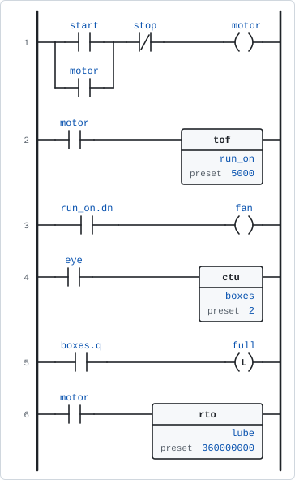

# Runs and tables of the records: retained values

This page is for a contributor who reads a decision record about retained values and starts. It holds the
runs, the measurements and the long tables of record 0016, so that each record stays
short. Each section names its record, and each record links to its section.

The suite runs each example of this page, as it runs the examples of each other page.
Each script and its files are under `examples/`.

## 0016. Retained values and starts

These tables, runs and this script support
[0016. Retained values and starts](../adr/0016-retained-values-and-starts.md).

### The words of the record

| Word | Meaning on this page |
|---|---|
| [Warm restart](../../guides/reference/glossary.md#warm-restart), [cold restart](../../guides/reference/glossary.md#cold-restart) | `Logex.Runtime.restart/2,3` or `Logex.Runner.restart/2`, with `:warm` or `:cold` |
| Fresh start | A new runner from `Logex.Runner.start_link/1` |
| Warm start | A warm restart, or a fresh start that reads a store |
| Start from an image | `Logex.Runtime.instance/2` or `Logex.Runtime.start/2` with a [retained image](../../guides/reference/glossary.md#retained-image) |
| Crash | An end of the runner with no orderly exit: a kill, a crash, the loss of its clock, the VM or the computer |
| Orderly exit | `Logex.Runner.stop/2`, or an exit with the reason `:normal`, `:shutdown` or `{:shutdown, term}`. The runner's own `{:shutdown, {:clock, reason}}` is a crash |
| Pre-scan | A pass before the first scan that resets some instructions. Logix calls it the prescan |
| Held on, at rest | A `tof` whose rung was true at the stop: `.en` 1, `.tt` 0. At rest: `.en`, `.tt` and `.dn` 0 |

### The pre-scan of Logix

The general instructions reference, 1756-RM018A, gives these rules for the pre-scan:

| Instruction | At the pre-scan | Page |
|---|---|---|
| OTE | Clears the bit | p.85 |
| OTL, OTU | Keeps the bit: a latched bit stays latched | pp.86-87 |
| TON | Clears `.ACC` | p.134 |
| RTO | Keeps `.ACC` and `.DN` | p.113 |
| CTU, CTD | Sets `.CU` or `.CD`, and keeps `.ACC` | pp.99, 95 |
| ONS, OSR | Sets the storage bit | pp.73, 80 |

### The table of starts

| Start | The retained values | The store |
|---|---|---|
| Cold restart of the core | Initial | None |
| Warm restart of the core | Kept in memory | None |
| Start from an image | From the image, each matched by path and type (decision 277) | None |
| Cold restart of a runner, after a [trip](../../guides/reference/glossary.md#trip) | Initial | Written before a device is released or read |
| Warm restart of a runner, after a trip | Kept, as the trip left them | Not written |
| A crash, then a fresh start | From the last write of the store | Read. The crash writes nothing |
| An orderly exit, then a fresh start | From the write of the exit | Read |
| A fresh start with `start: :cold`, or with no store file | Initial | Written before a device is opened |
| A start of a runner with no `retain:` | A warm restart keeps them in memory. Else initial | None |

### The retained paths of a block

<!-- file: 0016-retained-values-and-starts/seal.ld -->
```text
function_block seal
var_input go bool
var_output on bool
var retain n dint
var t ton
xic go ote on
xic go ton t 100
xic t.dn add n 1 n
```

The compiler writes the result into the field `retained` of `%Logex.Program{}`, a sorted
list of paths (decisions 297 and 379). 2 test runs show the rule:

- A program declares `var retain s1 seal` and `var s2 seal`. Then `retained` is
  `["s1", "s2.n"]`.
- The block marks `var non_retain n dint` in place of `var retain n dint`. Then
  `retained` is `["s1.go", "s1.on", "s1.t"]`, with no `s1.n`.

### The rules in a run

The script `examples/0016-retained-values-and-starts.exs` shows the table of starts as
numbered results. It runs 1 program on a
[simulated device](../../guides/reference/glossary.md#simulated-device), the panel, on
the manual clock.

The program marks the counter `boxes`, the lube timer `lube`, the run-on `run_on` of the
fan and the lamp `full` with `retain`. The tag `motor`, which the
[seal-in](../../guides/reference/glossary.md#seal-in) keeps on, has no qualifier. The
counter latches `full` at 2 boxes.

<!-- file: 0016-retained-values-and-starts/line.ld -->
```text
// line.ld -- the conveyor, its fan, the box counter, the lamp and the lube timer
var_input start bool
var_input stop bool
var_input eye bool
var_output motor bool
var_output fan bool
var_output retain full bool
var retain boxes ctu
var retain lube rto
var retain run_on tof

( xic start | xic motor ) xio stop ote motor
xic motor tof run_on 5000
xic run_on.dn ote fan
xic eye ctu boxes 2
xic boxes.q otl full
xic motor rto lube 360000000
```

<!-- rung: 0016-retained-values-and-starts/line.ld -->


The configuration connects the program to the panel. Its line 15 connects `l1.full`,
which is retained, to the output point `full_lamp`.

<!-- file: 0016-retained-values-and-starts/plant.logex -->
```text
// plant.logex -- the line of line.ld on the panel
var_global pb_start  bool at panel.i.0
var_global pb_stop   bool at panel.i.1
var_global eye       bool at panel.i.2
var_global k1        bool at panel.q.0
var_global fan_q     bool at panel.q.1
var_global full_lamp bool at panel.q.2

program l1 line
  l1.start pb_start
  l1.stop  pb_stop
  l1.eye   eye
  l1.motor k1
  l1.fan   fan_q
  l1.full  full_lamp
```

The script gives the store a period of 1 hour, so that only the events write it. It
kills the runner for a crash. Each result shows the state of the runner and the time of
its resource. It also shows the time of the last write of the store, 3 retained values
and the output points of the panel.

```elixir
alias Logex.IO.Sim
alias Logex.Runner
alias Logex.Runner.Clock.Manual

# A killed runner's device logs its end. The results do not need that log.
Logger.configure(level: :none)
Process.flag(:trap_exit, true)

{:ok, plant} = Logex.Configuration.compile_file("0016-retained-values-and-starts/plant.logex")
Enum.each(plant.warnings, &IO.puts(Logex.Diagnostic.format(&1)))
File.rm("line.retain")

# The manual clock, its wall clock 2026-10-30T14:00:00Z.
{:ok, clock} = Manual.start_link(now: 1_793_368_800_000)
{:ok, panel} = Sim.start_link(clock: clock)

opts = [
  configuration: plant,
  io: %{"panel" => {Sim, sim: panel}},
  clock: {Manual, clock},
  retain: "line.retain",
  retain_period: 3_600_000
]

show = fn runner, title ->
  %{status: status, now: now, retain: %{written_at: written}} = Runner.status(runner)

  [boxes, lube, run_on] =
    Enum.map(["l1.boxes.cv", "l1.lube.acc", "l1.run_on.acc"], &Runner.get!(runner, &1))

  out = Sim.outputs(panel)
  IO.puts(title)
  IO.puts("  #{status}, now #{now} ms, store written #{DateTime.to_time(written)}")
  IO.puts("  boxes=#{boxes} lube=#{lube} run_on=#{run_on}")

  IO.puts(
    "  panel: k1=#{out["panel.q.0"]} fan_q=#{out["panel.q.1"]} full_lamp=#{out["panel.q.2"]}"
  )
end

press = fn address ->
  Sim.set(panel, address, 1)
  Manual.advance(clock, 100)
  Sim.set(panel, address, 0)
  Manual.advance(clock, 100)
end

box = fn ->
  Sim.set(panel, "panel.i.2", 1)
  Manual.advance(clock, 500)
  Sim.set(panel, "panel.i.2", 0)
  Manual.advance(clock, 500)
end

crash = fn runner ->
  Process.exit(runner, :kill)
  receive do: ({:EXIT, ^runner, :killed} -> :ok)
end

{:ok, runner} = Runner.start_link(opts)
show.(runner, "1. A start with no store file")

press.("panel.i.0")
box.()
box.()
show.(runner, "2. The motor runs, and 2 boxes pass the eye")

Sim.set(panel, "panel.i.2", 1)
Sim.fail(panel, :read, {:error, :eio})
Manual.advance(clock, 100)
Manual.advance(clock, 10_000)
show.(runner, "3. A read fails, the runner trips, and 10 s pass. A box is at the eye")

:ok = Runner.restart(runner, :warm)
show.(runner, "4. A warm restart")

Sim.set(panel, "panel.i.2", 0)
press.("panel.i.0")
box.()
show.(runner, "5. The motor runs, and box 3 passes the eye")

crash.(runner)
{:ok, runner} = Runner.start_link(opts)
show.(runner, "6. A crash, then a fresh start")

press.("panel.i.0")
press.("panel.i.1")
Manual.advance(clock, 1_800)
:ok = Runner.stop(runner)
Manual.advance(clock, 60_000)
{:ok, runner} = Runner.start_link(opts)
show.(runner, "7. The stop button, Runner.stop/2 2 s later, a fresh start 60 s later")

Manual.advance(clock, 3_100)
show.(runner, "8. 3.1 s later")

:ok = Runner.stop(runner)
{:ok, runner} = Runner.start_link(opts ++ [start: :cold])
crash.(runner)
{:ok, runner} = Runner.start_link(opts)
show.(runner, "9. A start with start: :cold, a crash, then a fresh start")
:ok = Runner.stop(runner)
```

Run it from the directory `examples/`:

```console
$ mix run 0016-retained-values-and-starts.exs
0016-retained-values-and-starts/plant.logex: line 15: warning: `l1.full` is retained and drives the output `full_lamp`: after a warm start it is written in the first round
1. A start with no store file
  running, now 0 ms, store written 14:00:00
  boxes=0 lube=0 run_on=0
  panel: k1=0 fan_q=0 full_lamp=0
2. The motor runs, and 2 boxes pass the eye
  running, now 2200 ms, store written 14:00:00
  boxes=2 lube=2190 run_on=0
  panel: k1=1 fan_q=1 full_lamp=1
3. A read fails, the runner trips, and 10 s pass. A box is at the eye
  tripped, now 2209 ms, store written 14:00:02
  boxes=2 lube=2199 run_on=0
  panel: k1=0 fan_q=0 full_lamp=0
4. A warm restart
  running, now 2209 ms, store written 14:00:02
  boxes=2 lube=2199 run_on=0
  panel: k1=0 fan_q=0 full_lamp=1
5. The motor runs, and box 3 passes the eye
  running, now 3409 ms, store written 14:00:02
  boxes=3 lube=3389 run_on=0
  panel: k1=1 fan_q=1 full_lamp=1
6. A crash, then a fresh start
  running, now 0 ms, store written 14:00:02
  boxes=2 lube=2199 run_on=0
  panel: k1=0 fan_q=0 full_lamp=1
7. The stop button, Runner.stop/2 2 s later, a fresh start 60 s later
  running, now 0 ms, store written 14:00:15
  boxes=2 lube=2398 run_on=1990
  panel: k1=0 fan_q=1 full_lamp=1
8. 3.1 s later
  running, now 3100 ms, store written 14:00:15
  boxes=2 lube=2398 run_on=5000
  panel: k1=0 fan_q=0 full_lamp=1
9. A start with start: :cold, a crash, then a fresh start
  running, now 0 ms, store written 14:01:18
  boxes=0 lube=0 run_on=0
  panel: k1=0 fan_q=0 full_lamp=0
```

Each result shows these rules:

1. A start with no store file writes the store before the first round (decision 271).
2. The seal-in runs the motor, and `full` latches at 2 boxes.
3. The trip writes the store and sets each output point to 0. While the runner is
   tripped, the time of the resource stays at 2209 ms (decision 113).
4. The warm restart keeps `boxes`, `lube` and `full`. The motor waits for a press of the
   start button, because `motor` is not retained. The box at the eye does not count
   (decision 274). The fan does not start a run-on, because the restart set the held-on
   `tof` at rest (decision 385). The lamp comes on in the first round, with no action of
   an operator (decision 272). `lube` does not count the 10 s of the trip (decision 273).
5. Box 3 counts. The warm restart did not write the store.
6. The crash writes nothing. The fresh start brings back the write of the trip, so box 3
   is lost (decision 292). The lamp comes on again in the first round.
7. `Logex.Runner.stop/2` writes the store (decision 275). The fresh start continues the
   run-on of the fan from 1990 ms. The 60 s between the 2 runners do not count.
8. The run-on ends at its preset, 5000 ms, and the fan goes off.
9. `start: :cold` writes the initial values before its first round. After the crash, no
   start can bring back the old values (decision 291).

## See also

- [Decision records](../adr/README.md): the list of the records.
- [The checks of a change](testing-checks.md): how the suite runs the examples of a page.
