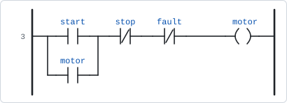

# Runs and tables of the records: the runner

This page is for a contributor who reads a decision record about the trip and the devices. It holds the
runs, the measurements and the long tables of records 0013 and 0014, so that each record stays
short. Each section names its record, and each record links to its section.

The suite runs each example of this page, as it runs the examples of each other page.
Each script and its files are under `examples/`.

## 0013. Watchdogs and the trip

This run supports [0013. Watchdogs and the trip](../adr/0013-watchdogs-and-the-trip.md).

### The rules in a run

The script `examples/0013-watchdogs-and-the-trip.exs` shows the trip, the restart and the
watchdog of a round as numbered results. It runs `0013-watchdogs-and-the-trip/plant.logex`
on a [simulated device](../../guides/reference/glossary.md#simulated-device), the panel.

The configuration runs the conveyor on a task of 10 ms with a watchdog of 100 ms. It
runs the box [counter](../../guides/reference/glossary.md#counter) in the continuous
task `main`, with a watchdog of 200 ms. The script also reads 2 program files from
`examples/`. Each link leads to the page that shows the file:

- [`conveyor.ld`](../../guides/howto/try-an-edit-on-a-simulated-device.md), the conveyor.
- [`boxes.ld`](../../guides/howto/try-an-edit-on-a-simulated-device.md), which counts
  the boxes.

<!-- file: 0013-watchdogs-and-the-trip/plant.logex -->
```text
// plant.logex -- the conveyor on a 10 ms task watched to 100 ms, the box counter in main
task fast interval 10 priority 1 watchdog 100
task main continuous watchdog 200

var_global estop      bool at panel.i.7
var_global pb_start_1 bool at panel.i.0
var_global pb_reset   bool at panel.i.2
var_global eye        bool at panel.i.8
var_global k1         bool at panel.q.0
var_global case_full  bool at panel.q.4

program c1 conveyor with fast
  c1.start pb_start_1
  c1.stop  0
  c1.reset pb_reset
  c1.motor k1

program b1 boxes
  b1.eye       eye
  b1.reset_pb  pb_reset
  b1.full_lamp case_full
```

The script runs the manual clock through a separate clock module, `Busy`. Each reading
of the time passes the ms that the agent `cost` holds, as on a busy computer. With a cost
of 60 ms, 2 readings of the clock fall in the scan of the conveyor, so the scan takes
120 ms.

```elixir
alias Logex.Runner
alias Logex.Runner.Clock.Manual
alias Logex.IO.Sim

# A manual clock on a busy machine: each reading of the time passes the milliseconds
# that the agent `cost` holds.
defmodule Busy do
  @behaviour Logex.Runner.Clock

  def now_ms({clock, cost}) do
    Manual.pass(clock, Agent.get(cost, & &1))
    Manual.now_ms(clock)
  end

  def wake_at({clock, _cost}, pid, message, at), do: Manual.wake_at(clock, pid, message, at)
  def cancel({clock, _cost}, timer), do: Manual.cancel(clock, timer)
end

programs =
  Map.new(~w(conveyor boxes), fn name ->
    {:ok, program} = Logex.compile_file(name <> ".ld")
    {name, program}
  end)

text = File.read!("0013-watchdogs-and-the-trip/plant.logex")
{:ok, plant} = Logex.Configuration.compile("plant", text, programs)

{:ok, clock} = Manual.start_link()
{:ok, cost} = Agent.start_link(fn -> 0 end)
{:ok, panel} = Sim.start_link(reports: true, clock: clock)

{:ok, runner} =
  Runner.start_link(
    configuration: plant,
    io: %{"panel" => {Sim, sim: panel}},
    clock: {Busy, {clock, cost}}
  )

# Prints the fields of status/1 that the list names, in its order.
status = fn keys ->
  IO.puts("  " <> inspect(for(key <- keys, do: {key, Map.fetch!(Runner.status(runner), key)})))
end

# Prints k1 in the resource, k1 at the panel and the number of writes to the panel.
k1 = fn ->
  IO.puts(
    "  k1 in the resource #{Runner.get!(runner, "k1")}, k1 at the panel " <>
      "#{Sim.outputs(panel)["panel.q.0"]}, writes to the panel #{length(Sim.writes(panel))}"
  )
end

# Runs the clock to 10 ms with each reading at `ms`, then sets the cost back to 0.
busy = fn ms ->
  Agent.update(cost, fn _ -> ms end)
  Manual.advance(clock, 10)
  Agent.update(cost, fn _ -> 0 end)
end

IO.puts("1. The conveyor's scan takes 120 ms, and its watchdog is 100 ms")
Manual.advance(clock, 9)
Sim.set(panel, "panel.i.0", 1)
busy.(60)
status.([:status, :trip, :rounds, :now])
k1.()

IO.puts("2. Tripped: 1000 ms pass")
Sim.set(panel, "panel.i.0", 0)
Manual.advance(clock, 1000)
status.([:status, :rounds, :now])
k1.()

IO.puts("3. A restart while a read of the panel fails")
Sim.fail(panel, :read, {:error, :eio})
IO.puts("  " <> inspect(Runner.restart(runner, :cold)))
status.([:status, :trip])
k1.()

IO.puts("4. A cold restart")
IO.puts("  " <> inspect(Runner.restart(runner, :cold)))
status.([:status, :trip, :rounds, :now])
k1.()

IO.puts("5. A round takes 210 ms, and the watchdog of main is 200 ms")
Sim.set(panel, "panel.i.0", 1)
Manual.advance(clock, 10)
Sim.set(panel, "panel.i.0", 0)
k1.()
busy.(30)
status.([:status, :trip])
k1.()
```

```console
$ mix run 0013-watchdogs-and-the-trip.exs
1. The conveyor's scan takes 120 ms, and its watchdog is 100 ms
  [status: :tripped, trip: {:watchdog, {:task, "fast", 120, 100}}, rounds: 10, now: 370]
  k1 in the resource 1, k1 at the panel 0, writes to the panel 3
2. Tripped: 1000 ms pass
  [status: :tripped, rounds: 10, now: 370]
  k1 in the resource 1, k1 at the panel 0, writes to the panel 3
3. A restart while a read of the panel fails
  {:error, {:io_init, "panel", {:error, :eio}}}
  [status: :tripped, trip: {:watchdog, {:task, "fast", 120, 100}}]
  k1 in the resource 1, k1 at the panel 0, writes to the panel 4
4. A cold restart
  :ok
  [status: :running, trip: nil, rounds: 11, now: 370]
  k1 in the resource 0, k1 at the panel 0, writes to the panel 5
5. A round takes 210 ms, and the watchdog of main is 200 ms
  k1 in the resource 1, k1 at the panel 1, writes to the panel 7
  [status: :tripped, trip: {:watchdog, {:round, "main", 210, 200, [{"fast", 60}, {"main", 60}]}}]
  k1 in the resource 1, k1 at the panel 0, writes to the panel 8
```

Each result shows these rules:

1. The scan that starts the conveyor trips. The resource has `k1` = 1, but the panel
   never gets it (decisions 110 and 113). The time of the resource is then 370 ms.
2. While the runner is tripped, it makes no round and writes nothing (decision 113).
3. The runner refuses a restart with a bad read. The first reason stays, and the panel
   gets the 0 again, 1 time (decisions 136 and 142).
4. A cold restart runs the first round immediately, and `k1` stays 0 (decisions 113
   and 142).
5. Each step is shorter than its own watchdog, but the round is not. The round counts its
   2 steps and the work of the runner around them, so it takes 210 ms. The reason names
   each step with its time (decisions 111 and 126).

The drawing shows the [seal-in](../../guides/reference/glossary.md#seal-in) of the
conveyor, which result 4 reads:

<!-- rung: conveyor.ld 3 -->


The drawing shows the [seal-in](../../guides/reference/glossary.md#seal-in) of the
conveyor: the [contact](../../guides/reference/glossary.md#contact) `motor` keeps the
[coil](../../guides/reference/glossary.md#coil) `motor` on after the operator releases
`start`. After a restart, `motor` is 0, so the conveyor waits for a new press of `start`.

## 0014. Devices are processes

These tables, measurements and this run support
[0014. Devices are processes](../adr/0014-devices-are-processes.md).

### The words of the record

| Word | What it means here |
|---|---|
| Device process | The process that holds the adapter of 1 device and calls its callbacks |
| Minder | A process for each device that kills the device process when it lives longer than the idle watchdog + 1 poll period after its runner |
| Poll | A read of the adapter by its device process, 1 time in each [poll period](../../guides/reference/glossary.md#poll-period) |
| Step | The run of 1 [task](../../guides/reference/glossary.md#task) in a [round](../../guides/reference/glossary.md#round). The runner times each step against the watchdog of its task |
| Refresh | A message from the runner to each device process that gives a deadline. It calls no adapter |
| Deadline | The time on the [clock](../../guides/reference/glossary.md#clock) of the runner by which the device process must get its next refresh |
| Notice | A message from a device process to the runner: back from the adapter, deadline passed, failure, or 0 taken |
| Heard | The runner got a notice "back" from the device, or an answer to a write in time |
| Look | A check by the runner for a device that it did not hear in time |
| Late wake | A wake of the runner that comes after its planned time. `Logex.Runner.status/1` gives the largest lateness of a wake as `latest_wake` |
| Turn | A time of 1 poll period after a late wake or a long step, in which the runner checks no device |
| Cap | 4 idle watchdogs + 1 poll period. A turn spares no device that is silent for longer |
| Gap | The time from the last look, or from the end of the last round, to this look |

### The plant of the run

The examples of this record use one [configuration](../../guides/reference/glossary.md#configuration),
`plant.logex`. The panel holds the `k1` and `estop` of the conveyor. The drive holds the
fan. The idle watchdog is 50 ms and the poll period 10 ms, so the deadline between rounds
is 60 ms. The configuration reads 2
[program](../../guides/reference/glossary.md#program) files from `examples/`. Each link
leads to the page that shows the file:

- [`conveyor.ld`](../../guides/howto/try-an-edit-on-a-simulated-device.md), the conveyor.
- [`fan.ld`](record-runs-faults.md), which computes the speed of the fan.

<!-- file: 0014-devices-are-processes/plant.logex -->
```text
// plant.logex -- the conveyor on the panel, watched to 50 ms; the fan on the drive, to 2 s
task fast interval 10 priority 1 watchdog 50
task slow interval 500 priority 2 watchdog 2000

var_global estop      bool at panel.i.7
var_global pb_start_1 bool at panel.i.0
var_global pb_reset   bool at panel.i.2
var_global k1         bool at panel.q.0
var_global hz         real at drive.i.0
var_global fan_rpm    int  at drive.q.0

program c1 conveyor with fast
  c1.start pb_start_1
  c1.stop  0
  c1.reset pb_reset
  c1.motor k1

program f1 fan with slow
  f1.hz  hz
  f1.rpm fan_rpm
```

### The deadlines and the reasons

| The runner sends a refresh | The deadline |
|---|---|
| Before a step | The watchdog of the task + 1 poll period, from the start of the step |
| Before the writes, before other work, and at each poll while the runner waits | The [idle watchdog](../../guides/reference/glossary.md#idle-watchdog) + 1 poll period, from the refresh |
| At the start of a write, if the clock moved | The idle watchdog + 1 poll period, from the start of the write |

| Where the runner is stuck | Each device writes 0 at | The reason of the trip |
|---|---|---|
| In a step of a round | The start of the step + the watchdog of its task + 1 poll period | `{:watchdog, {:task, task, ms, watchdog}}` |
| Between 2 rounds, or in its own work | The last refresh + the idle watchdog + 1 poll period | `{:watchdog, {:device, device, ms}}` |

### The limit of each call

| Call | Limit | Decisions |
|---|---|---|
| The open at a start: `init/3` and the first read | `open:`, 5000 ms by default, in real time | 398, 438 |
| The read of each device at a restart, and the open of a device that went down | `open:` of that device | 439 |
| The write of a round | The idle watchdog + 1 poll period, from the start of that write | 348 |
| The release of a restart, a 0 and a close | The idle watchdog + 1 poll period | 134, 290 |
| The notice "back" after each read and report | The idle watchdog + 1 poll period, 510 ms by default | 134 |

### Measurements outside the suite

- A burst of reports: in 1 run, 1,000 reports took 10 ms and 8,000 took 411 ms
  (decision 397).
- A stuck step: a run held the step of the conveyor for 3000 ms. The trip was
  `{:watchdog, {:task, "fast", 3000, 50}}`, and each device wrote 0 only 1 time.
- The cost of a stuck step: a run held the step of the conveyor, with a watchdog of
  50 ms, from 620 ms. The panel and the drive both wrote 0 at 680 ms. The same run held
  the step of the fan, with a watchdog of 2000 ms, from 1000 ms. `k1` then stayed 1 until
  3010 ms.
- A slow open: on the real clock with `idle: 50`, a drive whose connect takes 600 ms
  opened with the default `open:`. `open: 500` refused the start with
  `{:error, {:io_init, "drive", :timeout}}` after 502 ms.
- With `idle: 50`, the minder killed a hung drive 62 ms after the runner. A panel that
  hung in a read tripped `{:io, "panel", :timeout}` after 62 ms, and `k1` stayed 1 at the
  panel.

### The rules in a run

The script `examples/0014-devices-are-processes.exs` shows the rules of this record as
numbered results. It runs [the plant](#the-plant-of-the-run) on 2
[simulated devices](../../guides/reference/glossary.md#simulated-device), the panel and
the drive, on the manual clock. Each result starts a new runner with an idle watchdog of
50 ms.

When the runner reads the time, the clock module `Stalled` first moves the manual clock
on by the stall that the agent holds. No device gets a wake during that move. Thus the
runner and the devices see a VM that stopped. Result 2 suspends the runner with `:sys`,
as a runner stuck between 2 rounds. A host does not do these things.

```elixir
alias Logex.Runner
alias Logex.Runner.Clock.Manual
alias Logex.IO.Sim

# A manual clock on a computer that stalls. The next reading of the time by the runner
# passes the milliseconds that the agent holds, and no device gets a wake meanwhile.
defmodule Stalled do
  @behaviour Logex.Runner.Clock

  def now_ms({clock, agent}) do
    me = self()
    Manual.pass(clock, Agent.get_and_update(agent, &stall(&1, me)))
    Manual.now_ms(clock)
  end

  def wake_at({clock, _agent}, pid, message, at), do: Manual.wake_at(clock, pid, message, at)
  def cancel({clock, _agent}, timer), do: Manual.cancel(clock, timer)

  defp stall({runner, ms}, runner), do: {ms, {runner, 0}}
  defp stall(stalls, _reader), do: {0, stalls}
end

programs =
  Map.new(~w(conveyor fan), fn name ->
    {:ok, program} = Logex.compile_file(name <> ".ld")
    {name, program}
  end)

text = File.read!("0014-devices-are-processes/plant.logex")
{:ok, plant} = Logex.Configuration.compile("plant", text, programs)

# Starts the plant at 0 ms with an idle watchdog of 50 ms. The operator starts the
# conveyor at 9 ms, and the drive reads 25 Hz. At 10 ms, k1 is 1. At 500 ms the task of
# the fan runs, and fan_rpm is 1500.
started = fn ->
  {:ok, clock} = Manual.start_link()
  {:ok, stalls} = Agent.start_link(fn -> {nil, 0} end)
  {:ok, panel} = Sim.start_link(reports: true, clock: clock)
  {:ok, drive} = Sim.start_link(reports: true, clock: clock)

  {:ok, runner} =
    Runner.start_link(
      configuration: plant,
      io: %{"panel" => {Sim, sim: panel}, "drive" => {Sim, sim: drive}},
      clock: {Stalled, {clock, stalls}},
      idle: 50
    )

  Agent.update(stalls, fn _stalls -> {runner, 0} end)
  Manual.advance(clock, 9)
  Sim.set(panel, "panel.i.0", 1)
  Sim.set(drive, "drive.i.0", 25.0)
  Manual.advance(clock, 1)
  Sim.set(panel, "panel.i.0", 0)
  %{runner: runner, clock: clock, stalls: stalls, panel: panel, drive: drive}
end

# Prints the time, k1 at the panel and fan_rpm at the drive.
outputs = fn %{clock: clock, panel: panel, drive: drive} ->
  IO.puts(
    "  at #{Manual.now_ms(clock)} ms: k1 at the panel #{Sim.outputs(panel)["panel.q.0"]}, " <>
      "fan_rpm at the drive #{Sim.outputs(drive)["drive.q.0"]}"
  )
end

# Prints the fields of status/1 that the list names, in its order, from 1 call.
status = fn %{runner: runner}, keys ->
  status = Runner.status(runner)
  IO.puts("  " <> inspect(for(key <- keys, do: {key, Map.fetch!(status, key)})))
end

IO.puts("1. No output changes for 100 ms")
plant_1 = started.()
Manual.advance(plant_1.clock, 990)

{panel_writes, drive_writes} =
  {length(Sim.writes(plant_1.panel)), length(Sim.writes(plant_1.drive))}

Manual.advance(plant_1.clock, 100)

IO.puts(
  "  writes: panel #{length(Sim.writes(plant_1.panel)) - panel_writes}, " <>
    "drive #{length(Sim.writes(plant_1.drive)) - drive_writes}"
)

IO.puts("2. The runner is stuck between 2 rounds from 1000 ms")
plant_2 = started.()
Manual.advance(plant_2.clock, 990)
:sys.suspend(plant_2.runner)
Manual.advance(plant_2.clock, 59)
outputs.(plant_2)
Manual.advance(plant_2.clock, 1)
outputs.(plant_2)
:sys.resume(plant_2.runner)
status.(plant_2, [:status, :trip])

IO.puts("3. In the round at 1000 ms, the drive and the panel each take 59 ms to write")
plant_3 = started.()
Manual.advance(plant_3.clock, 980)
# The first delay of each device goes to its write at the poll of 1000 ms.
for sim <- [plant_3.drive, plant_3.panel],
    delay <- [0, 59],
    do: Sim.fail(sim, :write, {:delay, delay})

Sim.set(plant_3.drive, "drive.i.0", 30.0)
Sim.set(plant_3.panel, "panel.i.7", 1)
Manual.advance(plant_3.clock, 10)
outputs.(plant_3)
status.(plant_3, [:status, :trip])

IO.puts("4. In the round at 1000 ms, the drive takes 60 ms to write, and k1 stays 1")
plant_4 = started.()
Manual.advance(plant_4.clock, 980)
for delay <- [0, 60], do: Sim.fail(plant_4.drive, :write, {:delay, delay})
Sim.set(plant_4.drive, "drive.i.0", 30.0)
Manual.advance(plant_4.clock, 10)
status.(plant_4, [:status, :trip])
IO.puts("  the last 2 writes to the drive: #{inspect(Enum.take(Sim.writes(plant_4.drive), -2))}")
IO.puts("  the last write to the panel: #{inspect(List.last(Sim.writes(plant_4.panel)))}")

IO.puts("5. The drive refuses 3 writes: the write at its poll of 1000 ms, then 2 times its 0")
plant_5 = started.()
Manual.advance(plant_5.clock, 980)
for _write <- 1..3, do: Sim.fail(plant_5.drive, :write, {:error, :eio})

for _poll <- 1..3 do
  Manual.advance(plant_5.clock, 10)
  # status/1 answers after the runner handles the refusal of the drive and writes each 0.
  _status = Runner.status(plant_5.runner)
  outputs.(plant_5)
  status.(plant_5, [:trip, :unzeroed])
end

IO.puts("6. At 1010 ms the computer stalls the runner and the devices: 210 ms, then 211 ms")

for stall <- [210, 211] do
  plant_6 = started.()
  Manual.advance(plant_6.clock, 990)
  Agent.update(plant_6.stalls, fn {runner, 0} -> {runner, stall} end)
  Manual.advance(plant_6.clock, 10)
  status.(plant_6, [:status, :trip, :latest_wake])
end
```

```console
$ mix run 0014-devices-are-processes.exs
1. No output changes for 100 ms
  writes: panel 10, drive 10
2. The runner is stuck between 2 rounds from 1000 ms
  at 1059 ms: k1 at the panel 1, fan_rpm at the drive 1500
  at 1060 ms: k1 at the panel 0, fan_rpm at the drive 0
  [status: :tripped, trip: {:watchdog, {:device, "drive", 60}}]
3. In the round at 1000 ms, the drive and the panel each take 59 ms to write
  at 1118 ms: k1 at the panel 0, fan_rpm at the drive 1800
  [status: :running, trip: nil]
4. In the round at 1000 ms, the drive takes 60 ms to write, and k1 stays 1
  [status: :tripped, trip: {:io, "drive", :timeout}]
  the last 2 writes to the drive: [%{"drive.q.0" => 1800}, %{"drive.q.0" => 0}]
  the last write to the panel: %{"panel.q.0" => 0}
5. The drive refuses 3 writes: the write at its poll of 1000 ms, then 2 times its 0
  at 1000 ms: k1 at the panel 0, fan_rpm at the drive 1500
  [trip: {:io, "drive", {:error, :eio}}, unzeroed: ["drive"]]
  at 1010 ms: k1 at the panel 0, fan_rpm at the drive 1500
  [trip: {:io, "drive", {:error, :eio}}, unzeroed: ["drive"]]
  at 1020 ms: k1 at the panel 0, fan_rpm at the drive 0
  [trip: {:io, "drive", {:error, :eio}}, unzeroed: []]
6. At 1010 ms the computer stalls the runner and the devices: 210 ms, then 211 ms
  [status: :running, trip: nil, latest_wake: 210]
  [status: :tripped, trip: {:watchdog, {:late, 221}}, latest_wake: 211]
```

Each result shows these rules:

1. With no change, each device writes its outputs again at each poll: 10 writes in
   100 ms (decision 130).
2. Each device writes 0 by itself at its deadline, 1060 ms. The 2 devices passed their
   deadline in the same millisecond. The reason names the first by name, the drive
   (decisions 125 and 137).
3. Each write has its own limit of 60 ms, and nothing trips (decision 348). The estop of
   the panel is 1, so the round writes `k1` 0.
4. A write of 60 ms is too late, and the trip names the drive. The program keeps `k1` at
   1, so the 0 at the panel comes from the trip (decisions 135 and 348).
5. The drive refuses its 0 at 1000 ms and at 1010 ms, so `unzeroed` names it. The poll
   at 1020 ms writes the 0 (decisions 114 and 262).
6. After a stall of 210 ms, each device is silent for the cap exactly, and nothing
   trips. After 211 ms, the trip names the late computer (decisions 461, 484, 490, 491
   and 503).

## See also

- [Decision records](../adr/README.md): the list of the records.
- [The checks of a change](testing-checks.md): how the suite runs the examples of a page.
