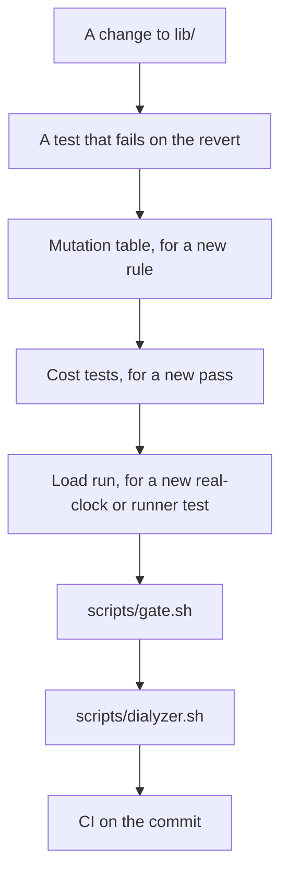

# The checks of a change

This page is for a contributor. It gives the checks that a change to logex must pass
before you commit it. These are the mutation tables, the examples of the pages, the tests
that read the source and the gate. [The test strategy](testing-strategy.md) gives the kinds of
test and the words of this page, for example mutant and walk.

> #### Caution {: .error}
>
> Judge each run of `mix test` by its exit code. Do not read its output for a count.
> Elixir 1.20 prints `Result: 139/140 passed` for a run with 1 failure.

## What the checks do

A test is useful only if it fails on a wrong rule. The checks make sure of this for each
change, and then run the whole suite. This diagram shows the checks of a change to
`lib/`, in order.



Figure: the checks of a change to `lib/`, from the first to the last. A check with "for"
in its box applies only to that kind of change.

[The cost of a stage](testing-cost.md) gives the cost tests, and
[Tests of time](testing-time.md) gives the load runs.

## How it is built

### Mutation tables

A fix comes with a test that fails when you revert the fix. New code has no fix to
revert. Revert each rule of the diff instead, 1 at a time: each clause, guard, fallback
and sort. Take the list from the diff, not from the tests. `scripts/mutate.sh` makes the
table.

> #### Caution {: .error}
>
> Commit your change before you make the mutants. `scripts/mutate.sh` applies each patch
> to your working tree. Step 3 removes each change to `lib/` that you did not commit. If
> you do not commit the change, the patch from `git diff` holds the change also.

Each patch runs the full suite 1 more time. Thus 10 mutants take about 10 runs of the
suite. To make a mutation table:

1. Change 1 rule in `lib/`.
2. Run `git diff lib/ > ../m1-ote-power.patch`. The patch holds the mutant only.
3. Run `git checkout -- lib/`. Then `git status` shows no change to `lib/`.
4. Do steps 1 to 3 again for each rule, with a new name for each patch.
5. Run `scripts/mutate.sh` with the test files of the rule and the patches. It prints 1
   row for each patch.
6. Read `<patch>.named.log` and `<patch>.full.log` beside a patch to see its failures.

```console
$ scripts/mutate.sh -t test/logex/end_to_end_test.exs -t test/logex/evaluation_test.exs ../m1-ote-power.patch
```

The mutant `m1-ote-power.patch` changes 1 clause of the evaluator. A de-energised `ote`
then passes on [power flow](../../guides/reference/glossary.md#power-flow). A run in a
copy of the repository printed a row with these 4 cells:

- Patch: `m1-ote-power.patch`.
- Named files: `rc=2 Result: 139/140 passed`.
- Full suite: `rc=2 Result: 3885/3890 passed (11/11 doctests, 3874/3879 tests)`.
- Failed tests: `test/logex/api_contract_test.exs (2), test/logex/end_to_end_test.exs (1), test/logex/readme_test.exs (2)`.

The totals change as the suite grows. `evaluation_test.exs` passes this mutant. No
public function gives the power that a rung passes on. Only a rung with an instruction
after the `ote` shows it. 1 end-to-end test, 2 walks and 1 example that 2 pages run have
such a rung, and they fail.

These rules apply to each mutation table:

- A mutant counts only by the exit code of the full suite. `-N` skips the full suite,
  for a quick look.
- A mutant that fails only a real-clock test, or only on a loaded machine, counts after
  a second run alone.
- A mutant that survives gets a test, or its rule goes. If you keep the rule with no
  test, say in the commit message that only reasoning supports it.
- Code that goes through the branches of a rung must go into nested groups also. Each
  mutation table for such code has 1 mutant that stops at the first group. A test must
  fail on that mutant.
- A commit that only moves tests has no fix to revert. Apply the mutants that the old
  tests caught, and see the new tests fail on them.

### The examples of the pages

`readme_test.exs` runs each example of `README.md` and of each page of `docs/pages.exs`
that is not `:legacy`. An example is an `elixir` block that a `$ mix run` block follows.
The test copies the files of the example from `examples/` to a directory under
`tmp/readme/`. It runs the script there in a fresh VM and compares the output with the
page.

The test also compares each block that a page marks as a file with that file, byte for
byte. An `elixir` block with no `$ mix run` after it is a fragment. The test parses a
fragment, and runs it in a setup where the test gives one.
[Examples and pictures](../examples-and-pictures.md) gives the marks.

### Tests that read the source

Some conventions have a test that reads files and not values:

- `clauses_test.exs` reads the syntax trees of `lib/`, the walks, the end-to-end tests,
  the examples and the scripts. It refuses a conditional where the clauses rule forbids
  it.
- `naming_test.exs` reads `docs/naming.md`. It refuses a mnemonic or a word of the
  language with no stanza there.
- `claude_md_test.exs` reads `CLAUDE.md`. It refuses a file of `lib/` or `test/` that
  `CLAUDE.md` does not name.

### The gate

`scripts/gate.sh` runs the gates of
[`CONTRIBUTING.md`, "Before you commit"](../../CONTRIBUTING.md#before-you-commit) in this
order:

1. `mix format --check-formatted`
2. `mix compile --force --warnings-as-errors`
3. `MIX_ENV=test mix compile --force --warnings-as-errors`
4. `mix test --warnings-as-errors`

The gate stops at the first step that fails. It judges the suite by its exit code, as CI
does. It takes 7 to 10 minutes. It prints `GATE-OK`, or `GATE-FAIL rc=<n>` and the tests
that failed. CI runs the same 4 steps and then `scripts/dialyzer.sh`. Run
`scripts/dialyzer.sh` also before you push a change to `lib/`.

## Why it is built this way

- A test can pass for a wrong reason. A mutant shows that the test reads the rule.
- A mutant counts by the full suite because a different test file can catch it. In the
  example of [Mutation tables](#mutation-tables), the named files catch 1 failure and the
  full suite 5.
- The suite runs the examples of the pages (decision 359). An output that a person
  copies into a page by hand becomes wrong when the code changes. The examples are files
  under `examples/` that a host can copy (decision 517).

## How to change it

To fix a defect:

1. Write a test that fails on the defect. Run it and see it fail.
2. Fix the defect. Run the test and see it pass.
3. Revert the fix, and see the test fail. Then put the fix back.
4. If source text can show the defect, add a test that starts from source text to
   `end_to_end_test.exs`.
5. Run `scripts/gate.sh`. It must print `GATE-OK`.

To add a rule to `lib/`:

1. Write the rule and its tests.
2. Make 1 mutant for each clause, guard, fallback and sort that the diff adds, as
   [Mutation tables](#mutation-tables) gives. Each mutant must fail the full suite.
3. If the rule is a new pass over a program, add a growth test. [The cost of a
   stage](testing-cost.md) gives the steps.
4. Run `scripts/gate.sh`. It must print `GATE-OK`.

To change the language:

1. Add each new syntax form to the generator of `printer_test.exs` and to its
   `@required_shapes`.
2. Run `mix test test/logex/printer_test.exs test/logex/frontend_golden_test.exs`. The
   golden record fails for each recorded source whose tree or error line changed.
3. If each of these changes is on purpose, run
   `mix run test/fixtures/generate_frontend_golden.exs`. It writes the golden record
   again.
4. Run `git diff test/fixtures/` and read each changed line. It must list only the
   sources whose meaning you changed. Commit the record with the change.

Do not write the golden record again to make a red test pass. Then the record does not
compare the front end with its earlier behaviour.

## See also

- [The test strategy](testing-strategy.md): the kinds of test, oracles and walks.
- [The cost of a stage in reductions](testing-cost.md): growth tests, twins and ceilings.
- [Tests of time](testing-time.md): the manual clock, the real clock and the load runs.
- [The toolchain and the gates](../contributing/toolchain.md): the gates and CI.
- [Add an instruction](adding-an-instruction.md): the tests that an instruction needs.
- [`CONTRIBUTING.md`](../../CONTRIBUTING.md): each practice with what broke it.
