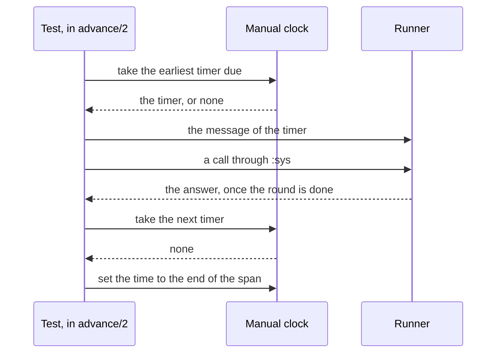

# Tests of time

This page is for a contributor. It describes how the suite tests the rules of time of
the [runner](../../guides/reference/glossary.md#runner). The tests run on the manual
clock, on the machine's [clock](../../guides/reference/glossary.md#clock) and on a loaded
machine. Read it before you add a test of the runner or of a device. [The test
strategy](testing-strategy.md) gives the other tests of the suite.

> #### Caution {: .error}
>
> Do not make a test wait for a time, and do not measure the time of a
> [round](../../guides/reference/glossary.md#round) in a test. A busy machine holds the
> VM off its cores for hundreds of milliseconds, and such a test then fails with no
> defect in logex.

## What the tests of time do

The runner reads time only through the behaviour `Logex.Runner.Clock`. A test gives the
runner 1 of 2 clocks:

| Clock | Time | A run | Use |
|---|---|---|---|
| `Logex.Runner.Clock.Manual` | The test moves it with `advance/2` | Occurs again exactly | Each timing rule of the runner |
| `Logex.Runner.Clock.Monotonic` | The clock of the machine | Different on each run | A few short tests that the runner runs, stops and trips |

A [simulated device](../../guides/reference/glossary.md#simulated-device),
`Logex.IO.Sim`, takes the manual clock too. With the 2, a run of the runner gives the
same rounds and the same writes each time.

## How it is built

### The manual clock

The manual clock is a process that holds a time and the timers set on it. It delivers no
timer until the test calls `advance/2`. `advance/2` runs in the process of the test. It
takes each timer that falls due, sends its message and waits until the receiver handles
it. This diagram shows 1 call:



Figure: 1 call of `advance/2` that delivers 1 timer. The test goes on only after the
runner handles the timer.

The order of the timers is the order of their times. Timers due at 1 time come in the
order of the calls that set them. Thus a test on the manual clock occurs again exactly, from
fresh processes. Each timing rule of the runner has a test on the manual clock.

### The tests on the real clock

The tests on `Logex.Runner.Clock.Monotonic` are few and short. Their bounds are wide, and
no test measures the time of a round (`docs/organisation.md` §4.11, "Risks"):

| Test | What it asserts |
|---|---|
| The plant runs for 2 s (`end_to_end_test.exs`) | 20 rounds or more, no trip, `rounds <= now + 1`, each [output](../../guides/reference/glossary.md#output) 0 after the stop, both devices closed |
| A [device](../../guides/reference/glossary.md#device) hung in its read (`trip_test.exs`) | The runner [trips](../../guides/reference/glossary.md#trip) with `{:io, "drive", :timeout}` |
| A device that waits for the runner (`trip_test.exs`) | The runner hears the device at each poll |
| A bad reading at a restart (`trip_test.exs`) | A device gives a bad reading while the restart reads the device before it. Nothing trips |
| A device that answers 700 ms late (`api_contract_test.exs`, on the manual clock) | The walk opens a device, or reads it again at a restart, 700 ms late in real time. Nothing trips, and the runner refuses nothing (decisions 398 and 439) |

The 2 s test asserts `rounds <= now + 1`. That count is over the whole run. It shows
1 round each millisecond or fewer on average, but not the rule round by round. A test on
the manual clock shows the rule for each round.

### Waits

A test on the real clock waits for a message, never for a time:

- Wait for the `DOWN` of a process before you ask another process about it. An exit
  signal and a later call to a different process can arrive in either order.
- To hold the read of a device at a restart while a different device runs, use
  `Logex.IO.Sim.hold/1`. Call `Logex.IO.Sim.let_go/1` after you see what you wait for.
  Do not sleep.
- Count what the rule is about. A wait for 1 message also passes a process that sends
  that message at only 1 poll in 30.
- Give each margin of real time hundreds of milliseconds if the rule lets you.

### Load runs

A busy machine makes a real-clock test fail where a quiet one passes. `scripts/load.sh`
runs `mix test` with your arguments while a busy loop runs on each core. It runs 10
times, or the number that `-n` gives. `-l` gives the number of busy loops:

```console
$ scripts/load.sh -n 50 test/logex/runner_test.exs
```

The script prints 1 line for each run, with its exit code, its `Result` line and the
tests that failed. Then it prints the count of the runs that failed. It keeps the log of
each run in `_build/load/`.

A mutation run is several suites at the same time, so it also loads the machine. A
mutant that fails only a real-clock test counts after a second run alone.

## Why it is built this way

- A run on the manual clock occurs again exactly, so a failure has a cause that you can
  find. Thus each timing rule has its test there.
- The BEAM runs on a general-purpose operating system and shares its schedulers. A
  round can be late by what the machine does. A real-clock test with a tight bound fails
  on a CI runner that shares its cores.
- A real-clock test shows that the runner runs, stops and trips with the clock of the
  machine. The manual clock does not use that clock.

## How to change it

To add a test of a timing rule:

1. Start the runner with `clock: {Logex.Runner.Clock.Manual, clock}`. Start each
   simulated device with `clock: clock`.
2. Move the clock with `Logex.Runner.Clock.Manual.advance/2`, and assert on each round.

To add a test on the real clock:

1. Make each bound wide, and assert on messages and counts, not on times.
2. Run `scripts/load.sh -n 50` on its file.
3. Make sure that each of the 50 runs passes before the test goes into `main`.

## See also

- [The test strategy](testing-strategy.md): the kinds of test and the checks of a change.
- [The architecture of the runner](../architecture/runner.md): the clock and the rounds.
- [The devices of the runner](../architecture/runner-devices.md): the polls and the
  deadlines that a device test meets.
- `Logex.Runner.Clock.Manual`: the rules of `advance/2` and `pass/2`.
