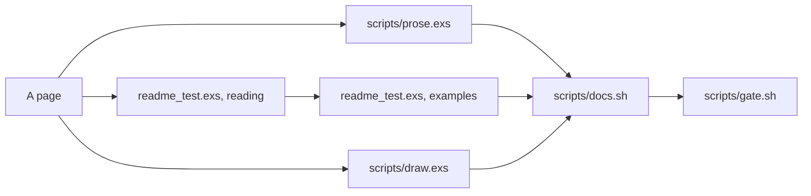
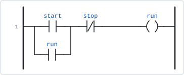
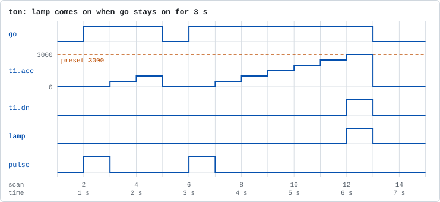

# Style guide for the documentation

This page is for a person who writes or changes a page of the logex documentation. It
gives the rules for the words, the page, the examples and the pictures. It also gives the
commands that check a page.

The rules apply to each page that `docs/pages.exs` lists with a kind that is not
`:legacy`. The older documents keep their manner until someone writes them again.

## The readers

Write each page for 1 of these 3 readers. Say in the first lines of the page who the
reader is and what the page gives.

| Reader | Knows | Does not know | Wants |
|---|---|---|---|
| The Elixir developer | Elixir, Mix, processes | Ladder logic and the words of controllers | To run ladder programs from an Elixir application |
| The controls engineer | Ladder logic, IEC 61131-3 or Logix, plant practice | Elixir and the BEAM | To know exactly what a rung does in logex |
| The contributor | Elixir | How logex is built, and why | To change logex and not break it |

Rules that help the reader:

- Say first what the page gives and what the reader must have. Link to the page that
  gives it.
- Define a word before you use it, or link its first use to the
  [glossary](../guides/reference/glossary.md).
- Show the result of each step. The reader must know if the step worked.
- Give a danger or a surprise before the step, not after it.
- State the rule of the present. Do not tell the history of the rule.
- Give a page 1 job. If a page has 2 jobs, make 2 pages.

## The kinds of page

A user page is 1 of 4 kinds. Do not mix the kinds on a page. Link between them.

| Kind | Directory | Job | Template |
|---|---|---|---|
| Tutorial | `guides/tutorials/` | A lesson: the reader learns by doing, on 1 safe path | [tutorial](templates/tutorial.md) |
| How-to guide | `guides/howto/` | A recipe for 1 task, for a reader who knows the basics | [howto](templates/howto.md) |
| Reference | `guides/reference/` | The exact rules, complete, for a reader who looks something up | [reference](templates/reference.md) |
| Explanation | `guides/explanation/` | The model and the reasons, for a reader who wants to understand | [explanation](templates/explanation.md) |
| Contributor page | `docs/` | How logex is built and how to work on it | [contributor](templates/contributor.md) |
| Decision record | `docs/adr/` | 1 decision: the problem, the choice and the results | [adr](templates/adr.md) |

Each template is a file that you copy. It has the sections of its kind in their sequence.

- A tutorial must work exactly as the page gives it. The suite runs its examples.
- A how-to guide has a title that is the task, and a table "If it does not work".
- A reference page has the same headings for each item of a kind. It has no steps and no
  history. Each rule on it must be true of the code.
- An explanation page has no steps. It can compare logex with IEC 61131-3 and Logix.
- A user page ends with the section "See also".
- A contributor page and a decision record can cite a decision of
  [`docs/organisation.md`](organisation.md) by its number. A user page cannot.

## Simplified Technical English

The pages follow the writing rules of ASD-STE100, Simplified Technical English. They
follow its principle for words: 1 word for 1 thing, and 1 meaning for 1 word.

> #### The pages are not certified {: .info}
>
> ASD-STE100 has 53 writing rules and a dictionary of about 900 approved words. The
> dictionary is the property of ASD and is not in this repository. No tool here compares
> a page with the dictionary. Do not write that a page conforms to ASD-STE100.

### Words

- Use 1 word for 1 thing on each page. If the page says "tag", it does not say
  "variable" for the same thing.
- Use a word in 1 meaning and as 1 part of speech. Write "do a test", not `test` as a
  verb.
- Use the plain word of this table.

| Do not write | Write |
|---|---|
| `utilize`, `employ` | use |
| `commence`, `initiate` | start |
| `cease`, `halt`, `terminate` | stop |
| `display`, `indicate`, `demonstrate` | show |
| `ensure`, `verify that` | make sure |
| `prior to` | before |
| `approximately`, `regarding` | about |
| `however` | but |
| `additionally`, `furthermore`, `moreover` | also |
| `whether`, `in the event that` | if |
| `since`, `due to the fact that` | because |
| `subsequently` | then |
| `perform`, `carry out`, `execute` | do |
| `obtain`, `retrieve` | get |
| `provide`, `supply` | give |
| `inform`, `notify` | tell |
| `allow`, `permit`, `enable` | let |
| `need to` | must, or "it is necessary to" |
| `should`, `shall` | must |
| `may`, `might`, `could`, `would` | can for an ability, possibly for a doubt |

- A technical word is a word of the [glossary](../guides/reference/glossary.md). Put a
  new technical word into the glossary before you use it.
- Write a mnemonic, a tag, a file name and a message as code.
- Do not use an idiom, a metaphor or humour.
- Do not use a Latin short form. Write "for example", "that is" and "and so on".
- Do not use a contraction.
- Write a number as digits, with its unit: 10 ms, 3 scans, 16 bits.
- Do not write `simply`, `just`, `obviously`, `easy` or `of course`.

### Sentences

- A sentence in a step of a procedure has 20 words or fewer. A sentence that describes
  has 25 words or fewer.
- Give 1 idea in 1 sentence. Give 1 instruction in 1 sentence, unless 2 actions occur
  together.
- Use the active voice. Say who or what does the action: "The runner writes 0 to each
  output."
- Use the simple tenses. Do not use a perfect tense or the `-ing` form of a verb as a
  verb. Write "the task runs".
- Write an instruction as a command: "Declare the tag." Put a condition first: "If the
  rung is false, the timer stops."
- Keep the articles. Do not remove words to make a sentence shorter.
- Use 3 nouns or fewer in a group of nouns. Write "the limit of the write time".
- Do not join clauses with a semicolon. Make 2 sentences. Use a colon only before a list
  or an example.
- Use a vertical list for more than 3 items, and for steps.

### Paragraphs

- A paragraph has 6 sentences or fewer and 1 topic. The first sentence gives the topic.
- A procedure is a numbered list. Each step has 1 action and its result.
- A safety message is a callout with a fixed form. It starts with the command, then
  gives the reason.

| Callout | Class | Use |
|---|---|---|
| Warning | `.warning` | A risk of injury or of damage to a machine |
| Caution | `.error` | A risk of lost data or a stopped plant, or a thing that does not work |
| Note | `.info` | Information that helps |
| Tip | `.tip` | A better way |

```markdown
> #### Warning {: .warning}
>
> Do not use logex for a safety function. logex can stop at any time.
```

## Forms that the pages do not have

The older documents of this repository have a house manner. A new page does not have it.
The checker refuses each form of this table.

| Do not write | Write |
|---|---|
| `a process of its own`, `a file of its own` | a separate process, a separate file |
| `is told`, `told its count first` | "logex reports", "the message says" |
| `held to`, `pinned`, `pins` | "the test compares A with B", "must be the same as" |
| `each a report`, `each with its line`, `every one reported` | A full sentence: "Each step returns a report." |
| `as built`, `as written`, `as it stands` | Say what the thing is |
| `the one table`, `the one place` | 1 table, the only place |
| `says so` | "its documentation states this" |
| `a runner whose store's copy's name` | Name each thing in a separate sentence |
| `gone`, `a write gone late` | a late write, a clock that gives a wrong value |
| `landed`, `has landed` | is available, or nothing |
| `nothing else escapes` | "logex returns no other error" |
| `a mistake`, `the host's mistake` | an error in the source text, a wrong argument |
| `honest about it`, `said plainly` | Nothing |
| `now`, `no longer`, `currently`, `so far` | The rule of the present only |
| `above`, `below` | A link to the section by its name, or "more than" and "less than" |
| A dash, an arrow or a chain of semicolons in prose | Full stops |
| A plan label or the number of a decision in a user page | Nothing |

An example from the README, before:

<!-- unchecked: a quotation of the older README, as an example of the manner -->
```text
A `var_input` is supplied from outside and no instruction may write it; a tag with no
initial value starts at 0. A timer, `var t1 ton`, is declared only with `var` and with no
initial value: its preset is the number on the `ton` that runs it.
```

After:

- The host gives the value of a `var_input` tag. An instruction cannot write to it.
- A tag with no initial value starts at 0.
- Declare a timer with `var` only, and with no initial value. Example: `var t1 ton`.
- The `ton` instruction sets the preset of the timer.

## Truth

The pages define the behaviour of the engine. A wrong sentence is a defect.

- Compare each claim with the code in `lib/` and with a test. The README has old
  sentences. If the README and the code are different, the code is correct.
- Run the claim if you can. A small script settles a claim faster than a long read.
- Quote a message exactly, in a code block.
- Do not invent a feature, an option, a default or a limit.
- Do not make a limit weaker. "logex is not a safety controller" stays as strong as it
  is.

## Format

The pages must read well on the site that ExDoc builds and in the Markdown view of
GitHub.

- Use a table for each thing that a reader looks up or compares.
- Use numbered steps for each procedure. Put the result straight after the step.
- Give each code block a language: `elixir`, `text` for a ladder program and for output,
  `console` for a command line.
- Use headings of level 2 and 3 only. Write a heading with letters, digits and single
  spaces, so that its link is the same on GitHub and on the site.
- Keep a page short. If a page that is not a reference has more than about 1,500 words,
  make 2 pages.
- Link to a module or a function with its name in a code span: ExDoc makes the link.
- Link to a page with a relative link from the file of the page, as GitHub reads it. The
  build makes the link correct for the site.
- Link to a file that is not a page with a relative link also. The build changes it to
  the address of the file on GitHub.
- Give each picture alt text, and put the facts of the picture in the text or in a table
  also.
- Use a Mermaid diagram for a flow, a sequence or a state. Keep it to 12 nodes or fewer.
  Give it a caption and 1 sentence that says what to see in it.

This diagram shows the checks of a page, from the fastest to the slowest.



## Examples and their marks

The suite runs each example of each page and compares its output with the page. A mark is
an HTML comment on the line straight before a code block. A reader does not see it.

| What the page shows | How to write it | What the suite does |
|---|---|---|
| A file that an example reads | `<!-- file: motor.ld -->` before the block | Compares the block with `examples/motor.ld`, byte for byte, and gives the file to the later examples of the page |
| A script and its output | An `elixir` block, then a `console` block that starts with `$ mix run scan.exs` | Runs `examples/scan.exs` with the files of the page and compares the output |
| A part of a file | `<!-- part of: motor.ld -->` before the block | Makes sure that the block is whole lines of the file |
| Elixir code that is not a script | `<!-- fragment: the reason -->` before the `elixir` block | Makes sure that the code parses |
| A message or a form of the syntax | `<!-- unchecked: the reason -->` before the `text` block | Nothing. The checker counts these blocks |

A tutorial step looks like this:

````markdown
<!-- file: motor.ld -->
```text
var_input start bool
```

```elixir
{:ok, motor} = Logex.compile_file("motor.ld")
```

```console
$ mix run scan.exs
start pressed   %{"motor" => 1}
```
````

Rules for the examples:

- Each file and each script is a file under `examples/`. Change the page and the file
  together.
- An example gets the files that its page shows before it.
- If an example needs a file that a different page shows, link to that page before the
  example. The text of the link is the name of the file, as code. The reader then knows
  which file to get.

```markdown
Get [`conveyor.ld`](../tutorials/first-plant.md) and put it in the directory.
```

- More than 1 page can show the same file. Each block must be the same as the file.
- More than 1 page can run the same script. The suite runs it for each page.
- On a page under these rules, each `text` block has a mark. A block of the language
  `console`, `mermaid`, `markdown`, `yaml`, `json` or `diff` has no mark, and the suite
  does not compare it with a file.

## Pictures

A script makes each picture, from the program or from a run. Do not draw a picture by
hand. A mark before the picture names its source, and a test compares the picture with
the output of the script.

### A ladder drawing

Show a ladder program 2 times: as text, and as a drawing of that text. Write the mark and
the picture, then run the script. The source is a `.ld` file under `examples/`.

```markdown
<!-- rung: seal.ld -->

```

```console
$ mix run scripts/draw.exs docs/style-guide.md
drawn guides/assets/seal.svg
```

<!-- rung: seal.ld -->


To draw only some rungs, give their numbers after the file: `<!-- rung: motor.ld 1 3 -->`.

### A timing diagram

Show a timing diagram for each timer, counter and one-shot. The source is a description
in `guides/assets/`, with a name that ends in `.timing.exs`. The description gives the
program, the time of each scan, the inputs and the signals. The script runs the program
and reads each value from the run.

<!-- fragment: the description that the next diagram comes from -->
```elixir
%{
  title: "ton: lamp comes on when go stays on for 3 s",
  program: "delay.ld",
  step: 500,
  scans: 14,
  inputs: %{"go" => [{2, 1}, {5, 0}, {6, 1}, {13, 0}]},
  show: ["go", "t1.acc", "t1.dn", "lamp", "pulse"]
}
```

| Key | Value |
|---|---|
| `title` | The title of the diagram |
| `program` | A program file under `examples/` |
| `step` | The time that each scan gets, in ms |
| `scans` | The number of scans |
| `inputs` | For each input, a list of `{scan, value}`: the input gets the value before that scan |
| `show` | The signals from top to bottom: a tag, or a member such as `t1.acc` |

<!-- timing: delay.timing.exs -->


The diagram shows that the timer starts again when `go` goes off before 3 s.

## Add a page

1. Copy the template of the kind to the directory of the kind.
2. Add 1 line for the page to `docs/pages.exs`: its path, its kind and its group.
3. Write the page.
4. Do the checks of the next section.

The groups of the site are Tutorials, How-to guides, Reference, Explanation, Architecture
and implementation, Decision records and Project. The group `:github` keeps a page out
of the site. A reader then reads it on GitHub.

Give each page of the site a file name that no other page of the site has. ExDoc finds a
page by its file name.

## Check a page

Do these checks before you commit a page. Each command runs from the root of the
repository.

| Check | Command | Time |
|---|---|---|
| The writing rules | `elixir scripts/prose.exs guides/tutorials/first-program.md` | 1 s |
| The marks and the blocks | `mix test test/logex/readme_test.exs --only reading:guides/tutorials/first-program.md` | 5 s |
| The examples, run | `mix test test/logex/readme_test.exs --only page:guides/tutorials/first-program.md` | 5 s for each example |
| The pictures | `mix run scripts/draw.exs --check guides/tutorials/first-program.md` | 3 s |
| The links and the site | `scripts/docs.sh` | 2 min |
| All tests | `scripts/gate.sh` | 10 min |

The first check prints each failure with its file, its line, its rule and the words to
write. Add `--review` to see the places that a reviewer must read. Use `--kind tutorial`
for a file that is not in `docs/pages.exs`.

### What the checker reads

The checker reads prose only. It does not read these things:

- a code block
- a code span, which it counts as 1 word of its sentence
- the target of a link or of a picture
- an HTML comment
- an attribute list such as `{: .warning}`

It does not apply the word rules to text between double quotation marks, because that
text is a quotation. It counts the quotations of each page. No mark stops the checker on
a part of a page.

### What the checker covers of ASD-STE100

| Part of ASD-STE100 | What the checker does |
|---|---|
| Words | Refuses the words of the tables on this page. It does not know the dictionary, the part of speech of a word or the meaning of a word |
| Noun groups | Nothing: a reviewer counts the nouns |
| Verbs | Refuses a perfect tense, the `-ing` form after "is" or "are", and the modal verbs. It counts each possible passive verb for the reviewer |
| Sentences | Refuses a sentence of more than 25 words. It does not find a missing article |
| Procedures | Refuses a sentence of more than 20 words in a numbered step |
| Descriptive writing | Refuses a paragraph of more than 6 sentences |
| Safety instructions | Refuses a callout with a class that this page does not list |
| Punctuation | Refuses a semicolon, a dash and an arrow in prose |

A script cannot tell a passive verb from a state: "the rung is true" and "the tag is
declared" have the same form. Thus the checker counts these places and a reviewer reads
them.

## What a writer gives back

For each page, give the reviewer this list:

- the file
- each part of the README that the page replaces
- each claim of the README that is wrong or old
- each claim that you did not check against the code
- each new word of the glossary
- each picture that the page needs and that the scripts cannot make
