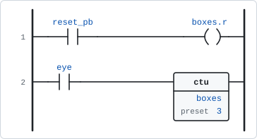

# How logex differs from IEC 61131-3

This page is for a controls engineer who knows
[IEC 61131-3](../reference/glossary.md#iec-61131-3). It shows where the
[dialect](../reference/glossary.md#dialect) of logex has the rules of the standard and
where its rules are different.

[The dialect and IEC 61131-3](the-dialect-and-iec.md) explains why logex has a dialect
and where each word comes from.
[How logex differs from Logix](differences-from-logix.md) compares logex with a
[Logix](../reference/glossary.md#logix) controller.

## The model: the names of the standard on a rung of text

The dialect has the names of IEC 61131-3 for its
[types](../reference/glossary.md#type), its [timers](../reference/glossary.md#timer),
its [counters](../reference/glossary.md#counter) and most of its
[instructions](../reference/glossary.md#instruction). But IEC 61131-3 defines ladder
logic as a drawing, and a [rung](../reference/glossary.md#rung) of logex is a line of
[mnemonics](../reference/glossary.md#mnemonic) and
[operands](../reference/glossary.md#operand). Thus the dialect has rules of logex for a
[declaration](../reference/glossary.md#declaration), for the run of a timer or a
counter, and for a time.

These 2 rungs are from [`boxes.ld`](the-dialect-and-iec.md), a
[program](../reference/glossary.md#program) that counts boxes. They show the rules for
a counter.

<!-- part of: boxes.ld -->
```text
xic reset_pb ote boxes.r
xic eye ctu boxes 3
```

<!-- rung: boxes.ld 1 2 -->


- The instruction `ctu` runs the counter `boxes`. The power of the rung is the input CU
  of IEC 61131-3, and the number 3 is the
  [preset](../reference/glossary.md#preset), the input PV.
- IEC 61131-3 gives an up counter the input R. In logex, R is the
  [member](../reference/glossary.md#member) `r`, and a
  [coil](../reference/glossary.md#coil) writes it. logex has no instruction that resets
  a counter.
- The counter is the last instruction of its rung. A different rung reads the result,
  for example `xic boxes.q ote full_lamp`.

## What is the same

- **The names.** logex has the function blocks TON, TOF, TP, CTU, CTD and CTUD, and
  their typed forms such as CTU_INT and TON_LTIME. It has 15
  [elementary types](../reference/glossary.md#elementary-type): BOOL, the 8 integer
  types, REAL, LREAL and the 4 [bit strings](../reference/glossary.md#bit-string).
  logex writes each name in lowercase.
- **The power through a coil.** A coil passes the power that it gets. Thus an
  instruction can follow a coil on a rung.
- **The reset of a counter.** A counter reads `r` when its instruction runs. Thus the
  reset of rung 1 of `boxes.ld` has its effect on rung 2, in the same
  [scan](../reference/glossary.md#scan).

## What is different

| Subject | IEC 61131-3 | logex |
|---|---|---|
| The languages | More than 1 language. A ladder program is a drawing | Ladder logic as text only |
| A declaration | A block from `VAR` to `END_VAR`, with `:` and `;` | 1 line for each [tag](../reference/glossary.md#tag), with no punctuation: `var boxes ctu` |
| The run of a timer, a counter or a [function block](../reference/glossary.md#function-block) | A call with the name of the [instance](../reference/glossary.md#instance), or a box in a drawing | An instruction: `ctu boxes 3`. The instruction `ton` also runs a `ton_ltime`, and `ctu` and `ctd` run a `ctud`. The instruction `cal` runs a function block that you write |
| A time | The type TIME, and a [literal](../reference/glossary.md#literal) such as `T#3s` | No type for a time. A preset is a plain integer in the unit of the timer: `ton t1 3000` is 3 s for a `ton` |
| The up counter | CTU counts in an INT | `ctu` counts in a `dint`, as CTU_DINT does. The type word `ctu_dint` gives the same type as `ctu`. For an INT, the type word is `ctu_int` |
| The power after a timer or a counter | The output Q of the box | No rule. A timer or a counter is the last instruction of its rung or of its [leg](../reference/glossary.md#leg), and no instruction comes after its [branch](../reference/glossary.md#branch) |
| An [array](../reference/glossary.md#array) | `ARRAY[1..8] OF INT` | `int[8]`. The first [subscript](../reference/glossary.md#subscript) is 0 |
| The address of a [point](../reference/glossary.md#point) | `%QX0.0` | The name of a [device](../reference/glossary.md#device), then `i` or `q`, then a number: `panel.q.0` |
| A [configuration](../reference/glossary.md#configuration) | 1 or more [resources](../reference/glossary.md#resource) | 1 resource |

logex has no Structured Text, no Function Block Diagram, no Sequential Function Chart
and no Instruction List. It also does not read the exchange format PLCopen XML. That
format holds a ladder program as a graph of connected symbols, with no mnemonics.
[What logex has](what-logex-has.md#what-logex-does-not-have) lists the other parts of
IEC 61131-3 that logex does not have.

### The members of a timer and of a counter

A timer of logex has the members of the
[conventional set](../reference/glossary.md#conventional-set). A counter of logex has
the members of IEC 61131-3. Thus logex refuses `t1.q` for a timer and `boxes.dn` for a
counter. The table gives each name of IEC 61131-3 with the member of logex.

| IEC 61131-3 | A timer | A counter |
|---|---|---|
| IN, CU, CD: the input that runs the box | The power of the rung | The power of the rung. The members are `cu` and `cd` |
| PT, PV: the preset | The number on the rung. The member is `pre` | The number on the rung. The member is `pv` |
| Q: done | `dn` | `q`. A `ctud` has `qu` and `qd` |
| ET, CV: the value | `acc` | `cv` |
| R, LD: the reset and the load of a counter | `r`, for an `rto` only | `r` for a `ctu` and a `ctud`. `ld` for a `ctd` and a `ctud` |
| Not in IEC 61131-3 | `tt`, `en` | `ov`, `un` |

### The unit of a preset

IEC 61131-3 gives the unit of a time in the literal, for example `T#2s`. In logex, the
unit comes from the type of the timer: milliseconds for a `ton`, nanoseconds for a
`ton_ltime`.

> #### Warning {: .warning}
>
> Make sure that each preset has the unit of its timer. A wrong preset can cause damage
> to a machine. The rung does not show the unit: `ton t 2000000` is about 33 minutes
> for a `ton` and 2 ms for a `ton_ltime`. If you change a declaration from `ton` to
> `ton_ltime`, logex reports no error. Each preset is then 1000000 times shorter.

## Why logex does it this way

- **A name of IEC 61131-3 comes first.** A controls engineer knows TON and CTU from the
  standard. The decision record is
  [Its own dialect and names](../../docs/adr/0002-own-dialect-and-names.md).
- **A rung writes the members `r` and `ld` of a counter.** IEC 61131-3 has no
  instruction that resets a counter, and logex has none. The decision record is
  [The software model of IEC 61131-3](../../docs/adr/0004-iec-software-model.md).
- **A timer has the model of the conventional set.** Its preset is a plain integer of
  milliseconds, as in the conventional set. Thus the dialect has no literal for a time.
- **No instruction follows a timer or a counter.** In IEC 61131-3, the output of the
  box is Q. In the conventional set, a counter passes the power that it gets. logex has
  neither rule. Thus a program of logex cannot depend on the rule of IEC 61131-3 or on
  the rule of the conventional set.

## See also

- [The dialect and IEC 61131-3](the-dialect-and-iec.md): the text form and the names of
  logex.
- [How logex differs from Logix](differences-from-logix.md): the behaviour of logex and
  of a Logix controller.
- [Port a program from Logix or IEC 61131-3](../howto/port-a-program.md): the steps for
  a program from a different tool.
- [Timers and counters](../reference/instructions-timers-and-counters.md): the exact
  rules of each timer and of each counter.
- [Declarations and types](../reference/declarations-and-types.md): each type and each
  form of a declaration.
- [Glossary](../reference/glossary.md): the technical words of logex.
