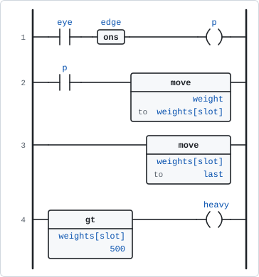
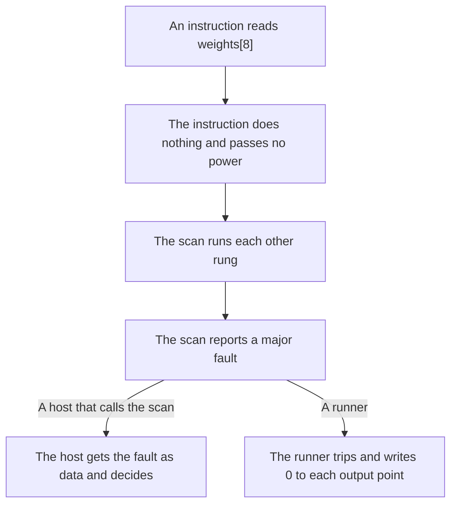

# How logex differs from Logix

This page is for a controls engineer who knows a
[Logix](../reference/glossary.md#logix) controller. It shows where logex behaves as a
Logix controller does and where it behaves differently.

[The dialect and IEC 61131-3](the-dialect-and-iec.md) explains the
[dialect](../reference/glossary.md#dialect) and the names of logex.

> #### Warning {: .warning}
>
> Do not use logex for a [safety function](../reference/glossary.md#safety-function).
> logex is a library on a general-purpose computer. It is not a controller, and it is
> not a safety controller. Read [Safety and limits](safety-and-limits.md) before you
> connect logex to a machine.

## The model: the same words, different rules

logex has the [contacts](../reference/glossary.md#contact), the
[coils](../reference/glossary.md#coil) and the
[one-shots](../reference/glossary.md#one-shot) of the
[conventional set](../reference/glossary.md#conventional-set). Thus a
[rung](../reference/glossary.md#rung) of logex reads as a rung of a Logix program. But
the rules of behaviour are the rules of logex. Where they are different, they follow 3
ideas.

- **logex refuses what it can find when it [compiles](../reference/glossary.md#compile)
  the text.** A
  [literal](../reference/glossary.md#literal) that does not fit its
  [type](../reference/glossary.md#type) is an error. logex does not write a
  different value.
- **An [instruction](../reference/glossary.md#instruction) that cannot give a correct
  result passes no power.** A coil after the instruction shows the problem to the
  program: `add count 1 total ote total_ok`.
- **A [fault](../reference/glossary.md#fault) is data, and the
  [scan](../reference/glossary.md#scan) continues.** The
  [host](../reference/glossary.md#host) or the
  [runner](../reference/glossary.md#runner) decides what the fault does to the
  [plant](../reference/glossary.md#plant).

## What is the same

| Subject | Logix and logex |
|---|---|
| A [bit](../reference/glossary.md#bit) of an integer | `status.3`. A [tag](../reference/glossary.md#tag) can hold the number of the bit: `faults.[sel]`. A literal can be in brackets: `faults.[4]` is the bit `faults.4` |
| An [array](../reference/glossary.md#array) | The sizes come after the type: `int[8]`, `int[2,8]`. An array has 1 to 3 dimensions, and the first [subscript](../reference/glossary.md#subscript) is 0 |
| An [element](../reference/glossary.md#element) | A tag can hold a subscript: `weights[slot]`. A bit of an element is `faults[2].3` |
| A rung must do something | In Logix, the last instruction of a rung is an output. logex refuses a rung that writes no value, runs no [instance](../reference/glossary.md#instance) and has no `jmp` |

## What is different in behaviour

| Subject | Logix | logex |
|---|---|---|
| A subscript in a tag that is out of range | A major fault of type 4, code 20. The controller stops the logic if no fault handler clears the fault | A [major fault](../reference/glossary.md#major-fault). The instruction does nothing and passes no power, and the scan continues. A runner [trips](../reference/glossary.md#trip) |
| A bit number in a tag that is out of range | The manuals tell you to keep the number in range. They do not give the fault | A major fault, with the same rules as for a subscript |
| `sqrt` of a negative value | The root of the absolute value | 0.0, no power and a [minor fault](../reference/glossary.md#minor-fault). logex refuses a negative literal |
| An integer result that is too large for its type | The value wraps. The instruction passes the power that it gets | The value wraps, and the instruction passes no power |
| `move 16#ffff i`, where `i` is an `int` | The tag gets −1 | A [diagnostic](../reference/glossary.md#diagnostic): `16#ffff` is the number 65535, and an `int` cannot hold it |
| A literal with a letter for its type: `5U`, `5L`, `1.5L` | A correct literal | A diagnostic |
| A value into a smaller integer type | The move keeps the low bits: 129 becomes −127 in a SINT | logex refuses the `move`. The typed conversion `dint_to_sint` gives the same value and passes no power |
| An array of timers | An instruction can get its element from a tag in the subscript | An instruction runs an element with a literal subscript only: `ton lane_t[2] 30`. A member can have a tag in its subscript: `lane_t[n].dn` |

The kind of the major fault is `index_out_of_range` for a subscript and
`bit_out_of_range` for a bit number.

The publication 1756-RM094N does not say in words that an instruction can run an
element of an array of timers through a tag. It says 2 things. Page 85 lists the types that an array cannot
have, and TIMER is not in the list. Page 86 says that an instruction can have a tag in
a subscript, and it gives no exception for a timer. IEC 61131-3 also has arrays of
function block instances, such as `ARRAY[1..50] OF TON`. Thus the rule for a literal
subscript is a rule of logex only.

### The sources for Logix

Each statement about Logix on this page is from a publication of its vendor.

| Publication | Statement, with its page |
|---|---|
| 1756-RM018A | A subscript (884). A bit number in a tag (885). `sqrt` (474). A result that is too large (868). `16#ffff` (869). A literal with a letter (870). A smaller type (872, 874) |
| 1756-RM094N | A bit of an integer (86). An array of timers (85, 86) |
| 1756-PM004L | An array (34 to 36). A bit of an element, and the range of a bit number (44) |
| 1756-PM014O | A major fault and its handler (9, 20) |
| The ladder manual of Logix | The last instruction of a rung |

## What is different in the vocabulary

logex has the 12 [mnemonics](../reference/glossary.md#mnemonic) of the conventional
set that [The dialect and IEC 61131-3](the-dialect-and-iec.md#the-source-of-each-word)
lists. A [timer](../reference/glossary.md#timer) of logex also has the
[members](../reference/glossary.md#member) of the conventional set, such as `acc` and
`dn`.
[How logex differs from IEC 61131-3](differences-from-iec.md#the-members-of-a-timer-and-of-a-counter)
gives each member.

The conventional set is a vocabulary, and a Logix controller is 1 controller that has
it. logex does not have each word of the conventional set.

| The conventional set | logex |
|---|---|
| The instruction RES resets a [counter](../reference/glossary.md#counter) or a retentive timer | A coil writes the member `r` of a `ctu`, a `ctud` or an `rto`: `xic reset_pb ote boxes.r`. A `ctd` has the member `ld` and no `r`. logex has no `res` |
| A counter has the members `.PRE`, `.ACC` and `.DN` | A counter has the members of IEC 61131-3: `pv`, `cv` and `q` |
| The function block CTUD rolls over at the limit of its type | A counter stops at the limit of its type, and sets its member `ov` or `un` |
| A [jump](../reference/glossary.md#jump) can go back | A jump goes forward only |
| A master control zone, MCR | None. Put a contact at the start of each rung of the zone |
| A subroutine and the instruction JSR | None. A [function block](../reference/glossary.md#function-block) and the instruction `cal` |

## An example: a subscript out of range

The [program](../reference/glossary.md#program) `scales.ld` keeps the weight of a box in each of 8 slots. The
[input](../reference/glossary.md#input) `slot` is the subscript of the slot.

<!-- file: scales.ld -->
```text
var_input  eye    bool
var_input  weight int
var_input  slot   int
var_output last   int
var_output heavy  bool
var weights int[8]
var edge    bool
var p       bool

xic eye ons edge ote p
xic p move weight weights[slot]
move weights[slot] last
gt weights[slot] 500 ote heavy
```

<!-- rung: scales.ld -->


The script `differences-from-logix.exs` runs 4 scans. In scan 3, `slot` is 8, and the
array has only the elements 0 to 7.

```elixir
{:ok, scales} = Logex.compile_file("scales.ld")

scan = fn state, label, inputs ->
  state = Logex.Runtime.put_inputs(scales, state, inputs)
  {outputs, state} = Logex.Runtime.scan(scales, state)
  IO.puts("#{label}  #{inspect(outputs)}")

  for fault <- state.faults do
    IO.puts("    #{fault.severity} fault #{fault.kind}: line #{fault.line}, #{fault.instruction}")
  end

  state
end

Logex.Runtime.instance(scales)
|> scan.("no box, slot 2    ", %{"slot" => 2})
|> scan.("box of 620, slot 2", %{"eye" => 1, "weight" => 620})
|> scan.("slot 8            ", %{"slot" => 8})
|> scan.("slot 2            ", %{"slot" => 2})
```

```console
$ mix run differences-from-logix.exs
no box, slot 2      %{"heavy" => 0, "last" => 0}
box of 620, slot 2  %{"heavy" => 1, "last" => 620}
slot 8              %{"heavy" => 0, "last" => 620}
    major fault index_out_of_range: line 12, move
    major fault index_out_of_range: line 13, gt
slot 2              %{"heavy" => 1, "last" => 620}
```

Scan 3 shows the rules of logex:

- The `move` of rung 3 is on line 12 of the file. It does nothing, thus `last` stays
  620.
- The `gt` of rung 4 is on line 13. It passes no power, thus `ote heavy` writes 0 to
  the [output](../reference/glossary.md#output) `heavy`.
- The scan runs each rung and reports 2 major faults. A Logix controller with no fault
  handler stops at the first fault.

Scan 4 runs with no [restart](../reference/glossary.md#restart). The instance keeps no
fault from scan 3.



Figure: a subscript out of range in logex. The scan always completes, and the fault
goes to the host or to the runner.

A runner trips after the run of the [task](../reference/glossary.md#task) that has the
fault. It does not write the outputs of that [round](../reference/glossary.md#round).
It writes 0 to each output [point](../reference/glossary.md#point) 1 time. Thus, with a
runner as with a Logix controller, the outputs get no value from a scan that has a
major fault. A trip is not a guarantee that each output is off.
[Safety and limits](safety-and-limits.md) gives the limits of a trip.

## Why logex does it this way

- **A scan always returns.** A fault is a report for the host, not an exception. A host
  with no runner can then decide what a fault does. The decision record is
  [A fault does not stop a scan](../../docs/adr/0010-a-fault-does-not-stop-a-scan.md).
- **A wrong value is worse than no value.** If `sqrt` gives the root of the absolute
  value, the root of −0.25 reads as 0.5. In logex, a program finds the problem
  because the instruction passes no power.
- **A literal is the number that its text gives.** `16#ffff` is 65535 in each place.
  logex has the types of [IEC 61131-3](../reference/glossary.md#iec-61131-3), and a
  change to a smaller type has a name, such as `dint_to_int`. The decision record is
  [The types of IEC 61131-3 and overflow](../../docs/adr/0006-iec-types-and-overflow.md).
- **The compiler knows the instruction that runs each timer and each counter.** An
  instruction with a tag in the subscript runs a different element in each scan. Then
  no element has 1 [preset](../reference/glossary.md#preset) and 1 run that a rule of the compiler or an
  [online edit](../reference/glossary.md#online-edit) can see.
- **A counter has the members of IEC 61131-3.** A rung writes the member `r` or `ld` as
  it writes each other bool. Thus logex does not have the instruction RES.

## See also

- [The dialect and IEC 61131-3](the-dialect-and-iec.md): the text form and the names of
  logex.
- [How logex differs from IEC 61131-3](differences-from-iec.md): the rules of the
  dialect, compared with the standard.
- [Port a program from Logix or IEC 61131-3](../howto/port-a-program.md): the steps for
  a program from a different tool.
- [Faults](../reference/faults.md): each fault, and what a scan and a runner do.
- [Types and overflow](types-and-overflow.md): why a value wraps and when an
  instruction passes no power.
- [What logex has](what-logex-has.md#what-logex-does-not-have): the parts of a
  controller that logex does not have.
- [Glossary](../reference/glossary.md): the technical words of logex.
