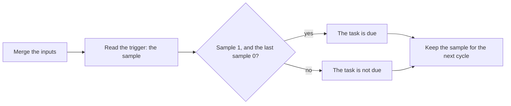
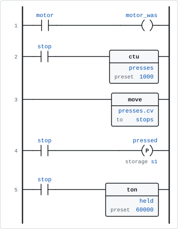

# Event tasks

This page is for a controls engineer who runs a
[program](../reference/glossary.md#program) on an [event
task](../reference/glossary.md#event-task). It answers 3 questions:

- When does an event task run?
- Which changes of its [trigger](../reference/glossary.md#trigger) does it not see?
- Why does logex give a [warning](../reference/glossary.md#warning) for a
  [timer](../reference/glossary.md#timer), a [counter](../reference/glossary.md#counter)
  or a [one-shot](../reference/glossary.md#one-shot) in an event task?

[Tasks and the schedule](tasks-and-scheduling.md) gives the rules for each kind of
[task](../reference/glossary.md#task).

> #### Warning {: .warning}
>
> Do not use logex for a [safety function](../reference/glossary.md#safety-function).
> The signal `estop` on this page is an [input](../reference/glossary.md#input) that a
> program reads. It is not the emergency stop of a machine. Make the emergency stop of a
> machine with hardwired circuits or with a safety-rated controller.

## The model: 1 sample of the trigger in each cycle

An event task names its trigger with the word `single` in the [configuration
file](../reference/glossary.md#configuration-file):

<!-- part of: event-tasks/line.logex -->
```text
task on_estop single estop priority 0
```

The trigger is a `bool` [global](../reference/glossary.md#global). In each
[cycle](../reference/glossary.md#cycle), logex reads the trigger 1 time. It reads it
after it merges the inputs, and before any [scan](../reference/glossary.md#scan). This
value is the sample. logex keeps the sample of each cycle for the next cycle.



Figure: how logex decides if an event task is due. Only a sample of 1 after a sample of
0 makes the task [due](../reference/glossary.md#due).

These rules follow from the model:

- **A trigger that stays at 1 runs the task 1 time.** The task runs again only after the
  trigger goes to 0 and then to 1.
- **A trigger that is 1 in the first cycle runs the task.** The last sample is 0 at the
  start.
- **A [cold restart](../reference/glossary.md#cold-restart) sets the last sample to 0.**
  Thus a trigger that is 1 runs the task again in the next cycle. [Warm and cold
  restarts](warm-and-cold-restarts.md) gives the rule of a [warm
  restart](../reference/glossary.md#warm-restart).
- **A pulse between 2 cycles does not run the task.** If the trigger goes to 1 and back
  to 0 before the next cycle, no sample is 1.
- **A trigger that a program writes runs the task in the next cycle.** The sample of
  this cycle comes before the scan that writes it.
- **The due time of an event task is the time of its cycle.** A late [periodic
  task](../reference/glossary.md#periodic-task) has an earlier due time. Thus it runs
  before an event task of the same [priority](../reference/glossary.md#priority).

A [runner](../reference/glossary.md#runner) runs a configuration on a
[clock](../reference/glossary.md#clock). A [device](../reference/glossary.md#device) can
report a change of a trigger to the runner. The runner then starts a
[round](../reference/glossary.md#round) with no wait, and the round takes a sample of
the change. If a device does not report its changes, the runner gets a change only when
it reads the device.

## An example: 2 records of the e-stop

The [configuration](../reference/glossary.md#configuration) `line.logex` runs a conveyor
`c1` on a task of 10 ms. It also runs 2 [instances](../reference/glossary.md#instance)
of the program `record.ld`. The instance `event_rec` runs on the event task `on_estop`.
The instance `fast_rec` runs on the task of 10 ms, after `c1`.

<!-- file: event-tasks/line.logex -->
```text
// line.logex -- a conveyor, and 2 records of the e-stop: 1 on an event task, 1 on 10 ms
task fast interval 10 priority 1
task on_estop single estop priority 0

var_global estop      bool at panel.i.7
var_global pb_start_1 bool at panel.i.0
var_global pb_reset   bool at panel.i.2
var_global k1         bool at panel.q.0

program c1 conveyor with fast
  c1.start pb_start_1
  c1.stop  0
  c1.reset pb_reset
  c1.motor k1

program event_rec record with on_estop
  event_rec.motor k1
  event_rec.stop  estop

program fast_rec record with fast
  fast_rec.motor k1
  fast_rec.stop  estop
```

The conveyor is the conveyor of the tutorial [Your first
plant](../tutorials/first-plant.md). It [latches](../reference/glossary.md#latch) a
[fault](../reference/glossary.md#fault) when `estop` is 1, and the fault stops the motor
`k1`.

<!-- file: event-tasks/conveyor.ld -->
```text
var_input start bool
var_input stop bool
var_input reset bool
var_output motor bool
var_external estop bool
var fault bool

xic estop otl fault
xic reset otu fault
( xic start | xic motor ) xio stop xio fault ote motor
```

The program `record.ld` keeps the value of `motor` and counts the e-stops. It also gives
a pulse at each e-stop and times how long the e-stop stays on.

<!-- file: event-tasks/record.ld -->
```text
var_input motor bool
var_input stop bool
var_output motor_was bool
var_output stops dint
var presses ctu
var held ton
var s1 bool
var pressed bool

xic motor ote motor_was
xic stop ctu presses 1000
move presses.cv stops
xic stop osr s1 pressed
xic stop ton held 60000
```

<!-- rung: event-tasks/record.ld -->


The script `event-tasks.exs` runs 7 cycles, 10 ms apart. The e-stop rises at 20 ms,
falls at 40 ms and rises again at 60 ms. The script prints 1 column for each cycle, and
then the warnings of the configuration.

```elixir
{:ok, line} = Logex.Configuration.compile_file("event-tasks/line.logex")

# Each cycle: the time since the last cycle, and the inputs that change.
steps = [
  {0, %{"pb_start_1" => 1}},
  {10, %{"pb_start_1" => 0}},
  {10, %{"estop" => 1}},
  {10, %{}},
  {10, %{"estop" => 0, "pb_reset" => 1}},
  {10, %{"pb_reset" => 0, "pb_start_1" => 1}},
  {10, %{"estop" => 1, "pb_start_1" => 0}}
]

# The tags to show: 2 globals, then 4 members of each record.
records =
  for name <- ~w(event_rec fast_rec), member <- ~w(motor_was stops pressed held.acc) do
    "#{name}.#{member}"
  end

paths = ["estop", "k1" | records]

# One cycle. It gives 1 column of the table: 1 if on_estop ran, then each path.
cycle = fn {elapsed, inputs}, {rt, now} ->
  {rt, _outputs, events} = Logex.Runtime.cycle(rt, elapsed, inputs)
  ran = Enum.count(events, &match?({:ran, "on_estop", _instance, _now}, &1))
  values = Enum.map(paths, &Logex.Runtime.get!(rt, &1))
  {[now + elapsed, ran | values], {rt, now + elapsed}}
end

{columns, _state} = Enum.map_reduce(steps, {Logex.Runtime.start(line), 0}, cycle)

names = ["t", "on_estop ran" | paths]

for {name, values} <- Enum.zip(names, Enum.zip_with(columns, & &1)) do
  cells = Enum.map_join(values, "  ", &String.pad_leading("#{&1}", 2))
  IO.puts(String.pad_trailing(name, 20) <> cells)
end

Enum.each(line.warnings, &IO.puts(Logex.Diagnostic.format(&1)))
```

```console
$ mix run event-tasks.exs
t                    0  10  20  30  40  50  60
on_estop ran         0   0   1   0   0   0   1
estop                0   0   1   1   0   0   1
k1                   1   1   0   0   0   1   0
event_rec.motor_was  0   0   1   1   1   1   1
event_rec.stops      0   0   0   0   0   0   0
event_rec.pressed    0   0   0   0   0   0   0
event_rec.held.acc   0   0   0   0   0   0  40
fast_rec.motor_was   1   1   0   0   0   1   0
fast_rec.stops       0   0   1   1   1   1   2
fast_rec.pressed     0   0   1   0   0   0   1
fast_rec.held.acc    0   0   0  10   0   0   0
event-tasks/line.logex: line 16: warning: `event_rec` runs under the event task `on_estop`, and `record` runs the timer `held` on line 14 of `record.ld`: a ton times across the task's runs, and one whose rung is true on two runs in a row counts the whole time between them
event-tasks/line.logex: line 16: warning: `event_rec` runs under the event task `on_estop`, and `record` runs the counter `presses` on line 11 of `record.ld`: a counter sees its rung only at the task's runs, so a pulse between two runs is never counted, and a rung that is the task's trigger is true at every run and never counts
event-tasks/line.logex: line 16: warning: `event_rec` runs under the event task `on_estop`, and `record` runs an `osr` on line 13 of `record.ld`, whose storage bit is `s1`: an osr sees its rung only at the task's runs, so a pulse between two runs is never seen, the pulse it sets stays on until the task's next run, and a rung that is the task's trigger is true at every run and never pulses
```

| Rows | The script shows | The reason |
|---|---|---|
| `on_estop ran` | The task runs at 20 ms and at 60 ms, and not at 30 ms | The trigger rises at 20 and 60 ms. At 30 ms, it stays at 1. |
| `motor_was` | At 20 ms, `event_rec` keeps 1 and `fast_rec` keeps 0 | `event_rec` runs before `c1`, at the priority 0. `fast_rec` runs after `c1` in the same task. `c1` stops the motor in this cycle. |
| `stops` | `event_rec` counts 0 e-stops, and `fast_rec` counts 2 | At each run of `on_estop`, `stop` is 1. The counter never sees the rung go from false to true. |
| `pressed` | `event_rec` never gives a pulse | The one-shot has the same problem as the counter. |
| `held.acc` | `event_rec` counts 40 ms at 60 ms | The timer adds the time between its 2 runs, 20 ms and 60 ms. The e-stop was off from 40 to 50 ms. |

## A timer, a counter or a one-shot in an event task

An instance on an event task runs only when its trigger rises. A timer, a counter and a
one-shot read their [rung](../reference/glossary.md#rung) only at these runs. Thus they
do not see what happens between 2 runs:

- **A timer** (`ton`) counts the time between 2 runs. If its rung is true at 2 runs in a
  sequence, it adds the whole time between them.
- **A counter** (`ctu`, `ctd`, `ctud`) does not count a pulse between 2 runs. If its
  rung reads only the trigger, the rung is true at each run, and the counter never
  counts.
- **A one-shot** (`ons`, `osr`, `osf`) keeps the value of its rung at the last run in
  its [storage bit](../reference/glossary.md#storage-bit). It does not see a pulse
  between 2 runs. If its rung reads only the trigger, it never gives a pulse. A pulse
  that it gives stays on until the next run of the task.

The program `record.ld` [compiles](../reference/glossary.md#compile) with no warning,
because it can run on a periodic task. Only the configuration knows that an event task
runs an instance. Thus the configuration gives the warnings, at the `program` line of
the instance. The configuration compiles with these warnings.

## A task with a trigger and an interval

A task line can have a trigger and an interval. The words come in this sequence:
`single`, `interval`, `priority`.

<!-- unchecked: a task line that no example of this page runs -->
```text
task on_estop single estop interval 10 priority 0
```

This task runs at most 1 time in a cycle:

- in a cycle where the trigger rises
- in a cycle where a due time of the interval comes and the trigger is 0

A due time that comes while the trigger is 1 does not run the task, and logex does not
count it as a missed period. A run at a rise of the trigger does not move the due times
of the interval.

## How it compares with IEC 61131-3 and Logix

- In [IEC 61131-3](../reference/glossary.md#iec-61131-3), a task with `SINGLE` runs at
  each [rising edge](../reference/glossary.md#rising-edge) of its input. logex does the
  same, and the input is a `bool` global.
- IEC 61131-3 does not say what a task does when its `SINGLE` is 1 at the start. logex
  runs it, as the `R_TRIG` block of IEC 61131-3 gives a pulse in its first run after a
  cold restart. A one-shot of logex does the opposite: it gives no pulse in the [first
  scan](../reference/glossary.md#first-scan).
- In IEC 61131-3, a task with `SINGLE` and `INTERVAL` does not run periodically while
  `SINGLE` is 1. logex does the same.
- A [Logix](../reference/glossary.md#logix) controller has a fixed list of triggers for
  an event task, for example a change at an input module. The source is 1756-PM005M,
  pages 37 to 46. logex has 1 kind of trigger:
  the rise of a `bool` global. A device that reports a change has the same result.
- In IEC 61131-3, a task can interrupt a task of a lower priority. In a Logix
  controller, an event task can interrupt the [continuous
  task](../reference/glossary.md#continuous-task) (1756-PM005M, page 13). In logex, an event task interrupts no
  scan. It runs in its cycle, in the sequence of the priorities.

## Why logex does it this way

- **1 sample in each cycle, before any scan.** A trigger can come from an input
  [point](../reference/glossary.md#point), from a program or from the
  [host](../reference/glossary.md#host). The sample is the only value that logex knows
  for each of them. Thus 1 rule is correct for each source.
- **A trigger that is 1 at the start runs the task.** For example, a
  [plant](../reference/glossary.md#plant) that starts with the e-stop pressed gets its
  record.
- **A due time while the trigger is 1 is not a missed period.** The task does not run
  periodically while its trigger is 1. Thus the task misses nothing.
- **A warning, not an error.** The same program is correct on a periodic task. Only the
  writer of the configuration knows if a timer in an event task does the correct work.

The decision record is [Tasks and rounds](../../docs/adr/0011-tasks-and-rounds.md).

## See also

- [Tasks and the schedule](tasks-and-scheduling.md): the sequence of the tasks in a
  cycle.
- [Use an event task](../howto/use-an-event-task.md): the steps to add an event task.
- [Configuration file](../reference/configuration-file.md): each word of a task line.
- [Execution model](../reference/execution-model.md): the exact rules of a cycle.
- [Short pulses on input points](short-pulses.md): a signal that a program does not see.
- [Glossary](../reference/glossary.md): the technical words of logex.
