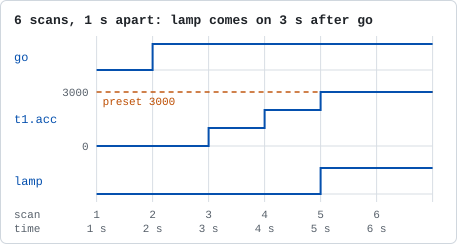
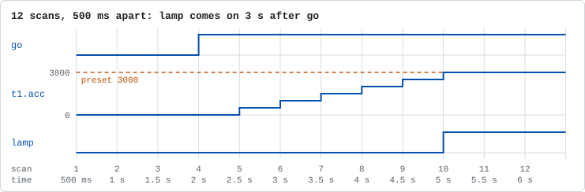

# How a timer counts time

This page is for an Elixir developer who runs a ladder
[program](../reference/glossary.md#program) that has a
[timer](../reference/glossary.md#timer). It answers 2 questions: how does a timer count
time if logex reads no clock, and how exact is a timer?

A timer counts the time that the [host](../reference/glossary.md#host) gives with each
[scan](../reference/glossary.md#scan). It does not count scans. A timer changes only
when a scan runs its [instruction](../reference/glossary.md#instruction).
[The scan, the cycle and time](scan-cycle-and-time.md) explains the scan.

> #### Warning {: .warning}
>
> Do not use a timer of logex where a late action is a danger. logex is not hard
> real-time, and it gives no maximum for the time that a scan is late.
> [Safety and limits](safety-and-limits.md) gives the full list of what logex does not
> do.

## The model: a timer adds the time since its last run

The host gives each scan the number of milliseconds since the last scan. The
[instance](../reference/glossary.md#instance) adds this number to its time. Each timer
keeps the time of its last run.

The instruction `ton` is an on-delay timer. A scan runs it in 1 of 3 ways:

| The [rung](../reference/glossary.md#rung) of the `ton` | What the timer does |
|---|---|
| It is true for the first time | The timer starts. It adds nothing in this scan. |
| It stays true | The timer adds the time since its last run to its [member](../reference/glossary.md#member) `acc`. When `acc` gets to the [preset](../reference/glossary.md#preset), it stops there, and the member `dn` goes to 1. |
| It is false | The timer resets: `acc` and `dn` go to 0. |

In `delay.ld`, the lamp comes on when `go` stays on for 3 s.

<!-- file: delay.ld -->
```text
var_input go bool
var_output lamp bool
var_output pulse bool
var_output waited dint
var t1 ton
var s1 bool

xic go ton t1 3000
xic t1.dn ote lamp
xic go ons s1 ote pulse
move t1.acc waited
```

The script `scan-cycle-and-time-timer.exs` holds `go` at 1. It prints 1 line for each
run. A run is a scan at 0 ms, then a number of scans with the same time between them.
The script runs in the project of [Your first program](../tutorials/first-program.md).

```elixir
{:ok, delay} = Logex.compile_file("delay.ld")

# One scan, `ms` milliseconds after the last scan.
scan = fn ms, {_outputs, state} -> Logex.Runtime.scan(delay, state, ms) end

pad = fn value, width -> String.pad_leading("#{value}", width) end

# Hold `go` at 1. Run 1 scan at 0 ms, then `count` scans that are `ms` apart.
run = fn count, ms ->
  state = Logex.Runtime.put_inputs(delay, Logex.Runtime.instance(delay), %{"go" => 1})
  {outputs, state} = Enum.reduce([0 | List.duplicate(ms, count)], {%{}, state}, scan)

  IO.puts(
    "#{pad.(count, 4)} x #{pad.(ms, 4)} ms  now=#{pad.(state.now, 4)}" <>
      "  waited=#{pad.(outputs["waited"], 4)}  lamp=#{outputs["lamp"]}"
  )
end

run.(3, 1000)
run.(300, 10)
run.(1, 2500)
run.(2, 2500)
run.(1000, 0)
```

```console
$ mix run scan-cycle-and-time-timer.exs
   3 x 1000 ms  now=3000  waited=3000  lamp=1
 300 x   10 ms  now=3000  waited=3000  lamp=1
   1 x 2500 ms  now=2500  waited=2500  lamp=0
   2 x 2500 ms  now=5000  waited=3000  lamp=1
1000 x    0 ms  now=   0  waited=   0  lamp=0
```

The value `now` is the time of the instance, and `waited` is the `acc` of the timer.

| Lines | The result shows |
|---|---|
| 1 and 2 | 3 scans and 300 scans give the same result at 3000 ms. |
| 3 and 4 | With 2500 ms between 2 scans, the lamp is off at 2500 ms and on at 5000 ms. No scan runs the timer at 3000 ms. |
| 5 | 1,000 scans with no time between them count nothing. |

The 2 timing diagrams show the rule of lines 1 and 2. In each diagram, `go` comes on at
2 s and the lamp comes on at 5 s. The first run has 6 scans, and the second run has 12.

<!-- timing: scan-cycle-and-time-slow.timing.exs -->


<!-- timing: scan-cycle-and-time-fast.timing.exs -->


The timers `tof`, `tp` and `rto` count time in the same way.
[Use timers](../howto/use-timers.md) gives each timer.

## How exact a timer is

A timer changes only when a scan runs its instruction. Thus the member `dn` comes on in
the first scan at or after the preset time. Lines 3 and 4 of the result show a lamp that
is 2 s late.

- **The result of a timer can be late by the time between 2 scans.** With 7 ms between
  the scans, the lamp of `delay.ld` comes on at 3003 ms.
- **A late scan makes the result later.** A late scan gets the time that passed, not the
  interval of its task. Thus the timer counts the correct time. But a
  [runner](../reference/glossary.md#runner) gives no maximum for the time that a
  [round](../reference/glossary.md#round) is late.
- **A timer that a scan does not run counts nothing in that scan.** When a later scan
  runs it, it adds the full time since its last run.
  [Rungs that a scan does not run](rungs-that-do-not-run.md) explains this.

## The unit of time

The time that a host gives is a whole number of milliseconds. Thus the smallest step of
each timer is 1 ms.

A long timer has a name that ends in `_ltime`: `ton_ltime`, `tof_ltime`, `tp_ltime` and
`rto_ltime`.

| Timer | Unit | 1 ms adds |
|---|---|---|
| `ton`, `tof`, `tp`, `rto` | Milliseconds | 1 to `acc` |
| A long timer | Nanoseconds | 1,000,000 to `acc` |

A long timer can have a preset that is not a whole number of milliseconds, for example
1,500,000 ns. The timer gets to this preset at the next whole millisecond, 2 ms. The
compiler gives a [warning](../reference/glossary.md#warning) for such a preset. It also
gives a warning for such a number that an instruction uses with the `pre` or the `acc`
of a long timer. These instructions give the warning: `move`, a conversion, a
comparison, `add` and `sub`.

## How it compares with IEC 61131-3 and Logix

- [IEC 61131-3](../reference/glossary.md#iec-61131-3) does not say where a timer gets
  its time. The `ton` of logex has the name of the TON of IEC 61131-3.
- A timer of a [Logix](../reference/glossary.md#logix) controller counts milliseconds.
  It adds the time since the last scan of its instruction (1756-RM018A, pages 112 and
  113). A timer of logex does the same.
- A controller reads its own clock. A timer of logex reads the time that the host gives.
  A runner does this work of a host. It reads a [clock](../reference/glossary.md#clock)
  and gives the time.

[How logex differs from IEC 61131-3](differences-from-iec.md) gives the members of a
timer.

## Why logex does it this way

- **Each timer keeps the time of its last run.** A different design gives each timer the
  time since the last scan of the instance. That design is correct only for a timer that
  runs in each scan. A timer in a
  [function block](../reference/glossary.md#function-block) that does not run, or in a
  rung that a [jump](../reference/glossary.md#jump) passes, then loses time.
- **A timer counts the time that passed, not the interval of its
  [task](../reference/glossary.md#task).** For example, a task with an interval of 10 ms
  runs each 25 ms. Its timer of 3 s sets `dn` at 3000 ms.
- **The host gives the time.** Thus an ExUnit test of a 10 s timer does not wait 10 s,
  and it gets the same result on each machine.

The decision record is
[The host gives the time](../../docs/adr/0007-the-host-gives-the-time.md).

## See also

- [The scan, the cycle and time](scan-cycle-and-time.md): what a scan does, and who
  gives the time to a scan, a cycle and a round.
- [Rungs that a scan does not run](rungs-that-do-not-run.md): a timer after a jump or in
  a function block that does not run.
- [A conveyor with a timer and a counter](../tutorials/timers-and-counters.md): a
  tutorial with a timer.
- [Use timers](../howto/use-timers.md): each timer, with its members.
- [Timing and capacity](timing-and-capacity.md): how late a round can be.
- [Glossary](../reference/glossary.md): the technical words of logex.
