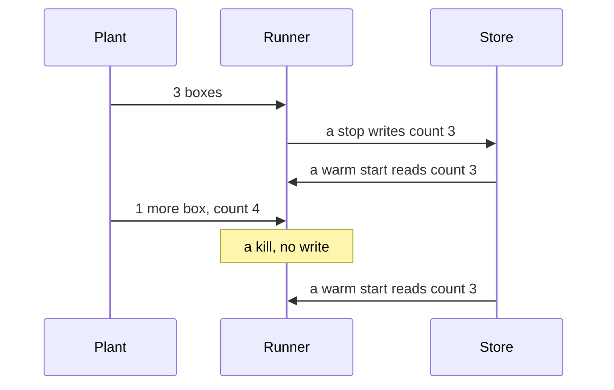
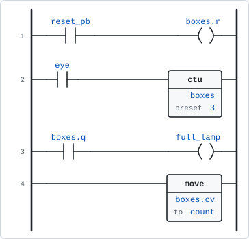

# The limits of retained values

This page is for a reader who wants to keep values after a
[restart](../reference/glossary.md#restart) or a crash. It answers 1 question: what does
a retained value in logex not give?
[Safety and limits](safety-and-limits.md) gives the other limits of logex.

> #### Warning {: .warning}
>
> Do not keep a value of a [safety function](../reference/glossary.md#safety-function)
> in logex. A person can edit the store, a cold start discards each retained value, and
> a crash can set a value back. Examples of such values are the lockout of a burner, a
> bit that an open guard sets and a count of trips.

## The model: memory, or 1 file on a disk

A [warm restart](../reference/glossary.md#warm-restart) keeps the value of each
[tag](../reference/glossary.md#tag) that has the
[qualifier](../reference/glossary.md#qualifier) `retain`: logex
[retains](../reference/glossary.md#retain) it. logex is not battery-backed memory. It
keeps a retained value in 1 of 2 places only.

| Place | What keeps the value there | The value stays after |
|---|---|---|
| Memory | A warm restart: `Logex.Runtime.restart/2`, `Logex.Runtime.restart/3` or `Logex.Runner.restart/2` with `:warm` | That restart only. A stop or a crash of the [host](../reference/glossary.md#host) discards it. |
| The [store](../reference/glossary.md#store), a file on the disk of the host | A [runner](../reference/glossary.md#runner) that has the option `retain:` | A stop, a crash or a kill of the runner, until a cold start |

On this page, a start is the start of a new runner, for example after a crash. A start
is warm unless the host gives the option `start: :cold`. A warm start reads the store.

## The runner does not write the store at each change

The runner writes the store at these events:

- a start with no store file, or with `start: :cold`
- each period of the option `retain_period:`, while the runner is not tripped
- a [trip](../reference/glossary.md#trip) and a stop
- a [cold restart](../reference/glossary.md#cold-restart)

It does not write the store at a warm start, at a warm restart, or at a crash or a kill.
[When the runner writes the store](../reference/store.md#when-the-runner-writes-the-store)
gives each event.

Thus the next start after a crash gets the values of the last write. The crash loses
each change after that write:

- If each write is successful and the disk is fast, the loss is at most 1 period and the
  write in progress.
- If the writes fail, for example on a full disk, the loss is each change after the last
  good write.
- While the runner is tripped, the loss includes each change that a step of an
  [online edit](../reference/glossary.md#online-edit) makes.



Figure: a plant that counts boxes, and a kill of the runner after the last write. The
store holds the count of the last write, and the next start loses the box that the
runner counted after it.
[A warm start can set an output to 1](#a-warm-start-can-set-an-output-to-1) runs this
sequence.

### A write is not a guarantee

- The runner syncs each write and then renames the new file over the store. It does not
  make the rename durable. On some file systems, a loss of power immediately after a
  write can bring back the write before it.
- A write at a start, a trip, a stop or a cold restart has the write limit. The limit
  is 5000 ms of real time, unless the host sets the option `write_limit:`. A write of a
  [force](../reference/glossary.md#force) has the same limit.
- If a disk is slower than the write limit, each write that has the limit fails. The
  runner reports each write of a period as late. The
  [plant](../reference/glossary.md#plant) continues to run with an old store.
- If the disk completes a write after the runner stops its wait for it, that write can
  still change the store.

### The store has little protection

- A runner has 1 store. A program [instance](../reference/glossary.md#instance) cannot
  have a separate store.
- The store has no encryption. logex examines its grammar, its count of lines and the
  digest of its value lines. Thus logex refuses a store that is cut short. It also
  refuses a value that a person or a program changes in the file, if the `digest` line
  is not mended. A person who mends the `digest` line can change any value.
- logex refuses a second runner on the same file in 1 virtual machine. It also refuses a
  store or a [forces file](../reference/glossary.md#forces-file) that is a symbolic
  link.
- logex cannot see a runner of a different virtual machine. It also cannot see that a
  second path, through a linked directory, goes to the same file. 2 such runners write
  over the store of each other. After a crash, 1 runner then starts with the values of
  the other runner.

## A warm start can set an output to 1

logex keeps no output. Each output [point](../reference/glossary.md#point) is 0 until
the first [round](../reference/glossary.md#round) after a start writes it. But a program
that reads a retained bit, count or [timer](../reference/glossary.md#timer) writes its
outputs from that value in the first round. Thus a warm start can set an output to 1
immediately. logex is not a guard against this.

- A [configuration](../reference/glossary.md#configuration) gives a warning only for 1
  case: a retained output that a
  [connection](../reference/glossary.md#connection) joins to an output point. It gives no
  warning for an output that a rung writes from a retained value.
- A store can be from a different [program](../reference/glossary.md#program). The cause
  is an online edit that is not in the files, or a deploy of changed files. logex
  refuses nothing. It puts the values of the store on the program by name and type, and
  runs the plant immediately.
  `Logex.Runner.status/1` gives a warning, and each subscription that takes `:retain`
  gets it.
- If the host starts a crashed runner again from a child spec with a store, that start
  is warm.

This example shows a kill of the runner and 2 warm starts. `boxes.ld` counts boxes and
sets a lamp at 3 boxes. Its [counter](../reference/glossary.md#counter) has the
qualifier `retain`, and its lamp does not.

<!-- file: limits-of-retained-values/boxes.ld -->
```text
var_input eye bool
var_input reset_pb bool
var_output full_lamp bool
var_output count dint
var retain boxes ctu

xic reset_pb ote boxes.r
xic eye ctu boxes 3
xic boxes.q ote full_lamp
move boxes.cv count
```

<!-- rung: limits-of-retained-values/boxes.ld -->


Rung 3 writes the lamp from `boxes.q`, a [member](../reference/glossary.md#member) of
the retained counter.

<!-- file: limits-of-retained-values/lane.logex -->
```text
// lane.logex -- a box counter that keeps its count
task slow interval 50 priority 1

var_global eye       bool at panel.i.8
var_global pb_reset  bool at panel.i.2
var_global case_full bool at panel.q.4

program b1 boxes with slow
  b1.eye       eye
  b1.reset_pb  pb_reset
  b1.full_lamp case_full
```

The script `limits-of-retained-values.exs` runs the configuration with the store
`lane.retain`. The manual [clock](../reference/glossary.md#clock) moves less than 1 s,
and thus no period writes the store.

```elixir
alias Logex.Runner
alias Logex.Runner.Clock.Manual
alias Logex.IO.Sim

Logger.configure(level: :none)              # show no crash report of the kill
{:ok, plant} = Logex.Configuration.compile_file("limits-of-retained-values/lane.logex")
{:ok, clock} = Manual.start_link()
File.rm("lane.retain")

start = fn options ->
  {:ok, panel} = Sim.start_link(reports: true, clock: clock)
  io = %{"panel" => {Sim, sim: panel}}
  fixed = [configuration: plant, io: io, clock: {Manual, clock}, retain: "lane.retain"]
  {:ok, runner} = Runner.start_link(fixed ++ options)
  {runner, panel}
end

box = fn panel ->
  Sim.set(panel, "panel.i.8", 1)              # a box at the eye for 60 ms
  Manual.advance(clock, 60)
  Sim.set(panel, "panel.i.8", 0)
  Manual.advance(clock, 40)
end

show = fn label, {runner, panel} ->
  lamp = Sim.outputs(panel)["panel.q.4"]
  IO.puts("#{label}  count=#{Runner.get!(runner, "b1.count")}  lamp=#{lamp}")
end

{runner, panel} = start.([])
for _box <- 1..3, do: box.(panel)
show.("3 boxes, then a stop   ", {runner, panel})
:ok = Runner.stop(runner)                   # the stop writes the store

{runner, panel} = start.([])
show.("a start                ", {runner, panel})
box.(panel)
show.("1 more box, then a kill", {runner, panel})
Process.unlink(runner)
down = Process.monitor(runner)
Process.exit(runner, :kill)                 # a kill writes no store

receive do
  {:DOWN, ^down, :process, _runner, :killed} -> :ok
end

{runner, panel} = start.([])
show.("a start                ", {runner, panel})
:ok = Runner.stop(runner)

{runner, panel} = start.(start: :cold)
show.("a start with :cold     ", {runner, panel})
:ok = Runner.stop(runner)
```

```console
$ mix run limits-of-retained-values.exs
3 boxes, then a stop     count=3  lamp=1
a start                  count=3  lamp=1
1 more box, then a kill  count=4  lamp=1
a start                  count=3  lamp=1
a start with :cold       count=0  lamp=0
```

- In lines 2 and 4, the lamp is on immediately after the start, because the first round
  writes it from the retained count.
- In line 4, the count is 3, not 4. The kill loses the box that the runner counted after
  the last write.
- In line 5, the cold start discards the count.

## How it compares with IEC 61131-3 and Logix

A controller keeps its retained values in battery-backed memory. logex keeps them in a
file that a person can read and change. logex also does not have these parts of
[IEC 61131-3](../reference/glossary.md#iec-61131-3) or of a controller.

| logex does not have | What logex does |
|---|---|
| Persistent values, which stay after a cold restart | A cold restart discards each retained value. `persistent` is not a [reserved word](../reference/glossary.md#reserved-word). |
| `PROGRAM RETAIN` on a line of a configuration | A program gives `retain` to its own tags. |
| A retained [located global](../reference/glossary.md#located-global) | At each start, logex reads an input point again, and an output point starts at 0. |
| 1 retained [element](../reference/glossary.md#element) of an [array](../reference/glossary.md#array) | logex retains a full array. |
| A count of the time of an outage | A retained timer continues as if no time passed. |
| A bit for the [first scan](../reference/glossary.md#first-scan) | A program makes its own bit. |
| A prescan | Nothing |
| A hot restart | A restart is cold or warm. |
| A warm restart that starts some tags cold | A warm restart keeps each retained value. |
| A retained force | The forces are in the forces file, not in the store. |

A program makes a bit for the first scan with the
[declaration](../reference/glossary.md#declaration) `var first bool 1` and a last
[rung](../reference/glossary.md#rung) that [unlatches](../reference/glossary.md#unlatch)
`first`. The bit is 1 in the first scan after each start. With a second bit,
`var retain ran bool`, that the program [latches](../reference/glossary.md#latch), the
program knows if a start is warm or cold.

## Why logex does it this way

- **A program selects what it keeps.** Only a tag with `retain` stays after a warm
  restart, and each other tag starts at its
  [initial value](../reference/glossary.md#initial-value). The decision record is
  [Retained values and starts](../../docs/adr/0016-retained-values-and-starts.md).
- **The store is text.** A person can read it, and can correct a retained value that
  trips the plant. The decision record is
  [The store on disk](../../docs/adr/0017-the-store-on-disk.md).
- **A slow disk does not stop the plant.** A write has a limit of time, and the rounds
  continue. The decision record is
  [File work with a limit](../../docs/adr/0018-file-work-with-a-limit.md).

## See also

- [Safety and limits](safety-and-limits.md): what logex is not.
- [Warm and cold restarts](warm-and-cold-restarts.md): what each restart keeps.
- [The store](../reference/store.md): the exact
  rules of the store.
- [Keep retained values on disk](../howto/keep-values-on-disk.md): the steps to give a
  runner a store.
- [Glossary](../reference/glossary.md): the technical words of logex.
