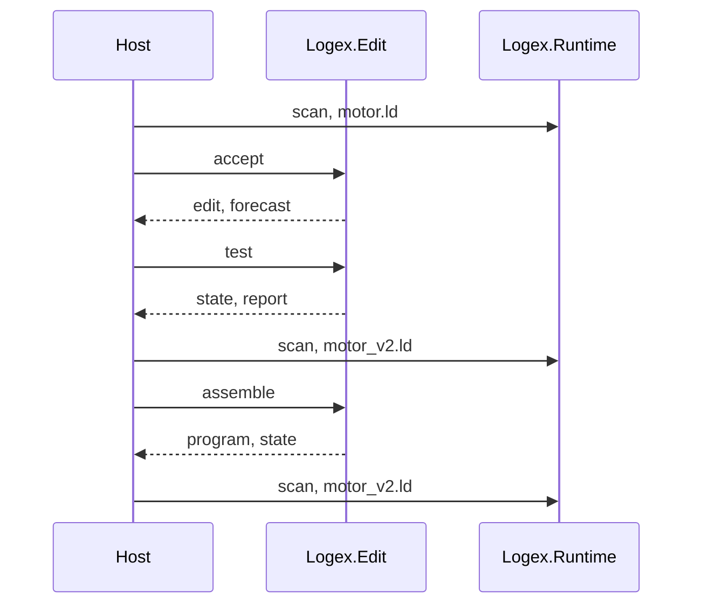
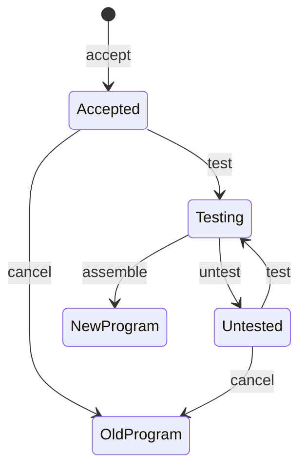
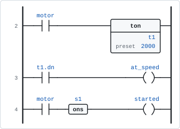

# The model of an online edit

This page is for a controls engineer or an Elixir developer who changes a
[program](../reference/glossary.md#program) while it runs. It answers 2 questions. What
does an [online edit](../reference/glossary.md#online-edit) do to the
[state](../reference/glossary.md#state) of an
[instance](../reference/glossary.md#instance)? Why is a plain swap, a change of program
with no edit, different?

> #### Warning {: .warning}
>
> Do not use logex for a [safety function](../reference/glossary.md#safety-function).
> An online edit changes the logic while the machine runs. Before each step, make sure
> that a wrong [output](../reference/glossary.md#output) cannot cause injury or damage.
> [Safety and limits](safety-and-limits.md) gives the limits of logex.

## The model: 1 state and 2 programs

A [program type](../reference/glossary.md#program-type) holds no values. The state of an
instance holds them, 1 value for each [tag](../reference/glossary.md#tag), by the name of
the tag. The state belongs to 1 program type, by its name. Thus logex refuses an edit to
a program of another name. [Programs as data](programs-as-data.md) explains this split.

An online edit keeps the old program and the new program beside 1 state. For each
[scan](../reference/glossary.md#scan), the [host](../reference/glossary.md#host) runs
1 of the 2 programs over the state. `Logex.Edit.running/1` returns it: the new program
during a [test](../reference/glossary.md#test), and the old program at all other times.

A test or an [untest](../reference/glossary.md#untest) is a
[switch](../reference/glossary.md#switch). Between 2 scans, logex moves the state from the
program that stops to the program that starts. It moves each value by its name. The
instance does no [restart](../reference/glossary.md#restart), and no part of the edit goes
through the Elixir compiler. A switch does not change the time of the instance, its field
`now`. It makes no scan a [first scan](../reference/glossary.md#first-scan).



Figure: an online edit of 1 instance. The host keeps the state between all calls.

The diagram shows that each step occurs between 2 scans, never during a scan. The
[accept](../reference/glossary.md#accept) changes nothing and returns a
[forecast](../reference/glossary.md#forecast).



Figure: the stages of an online edit. The host scans the new program in `Testing` and
`NewProgram`, and the old program in the other stages.

In this diagram, the host can do a test and an untest many times. The untest gives the
instance to the old program again, with no restart. The
[assemble](../reference/glossary.md#assemble) keeps the new program, and the
[cancel](../reference/glossary.md#cancel) keeps the old program. Each of them ends the
edit.

Each step returns a report: a list of entries, `{kind, name, value}`. An entry gives a
change to the state, or a fact for the host. `Logex.Configuration.Edit` does the same
steps for a full [plant](../reference/glossary.md#plant):
[An online edit of a plant](online-edit-of-a-plant.md) explains it.

> #### Caution {: .error}
>
> For 1 instance, logex does not detect a step on an old edit. It does not detect a scan
> of the program that `Logex.Edit.running/1` does not return. The values of the state can
> then be wrong. [Edit a running program](../howto/edit-a-running-program.md) gives the
> order of the calls.

## A change of program with no edit

A host can also scan a new program of the same name over the old state, with no edit.
This is a plain swap. logex does not refuse a plain swap. A plain swap changes no value in
the state, and the host gets no report:

- A tag that the new program adds reads 0, not its initial value.
- A [timer](../reference/glossary.md#timer) that the new program adds has a
  [preset](../reference/glossary.md#preset) of 0. It keeps that preset until a restart,
  or until the test of a later online edit.
- A timer that the new program runs again, after a program that did not run it, adds all
  the time that it missed.

The script on this page compares a plain swap and an online edit. It uses
[`motor.ld`](../tutorials/first-program.md) and a new program, `motor_v2.ld`.

<!-- file: motor_v2.ld -->
```text
var_input start bool
var_input stop bool
var_input overtemp bool
var_input reset bool
var_output motor bool
var_output at_speed bool
var_output started bool
var_output speed_sp dint 1200
var fault bool
var t1 ton
var s1 bool

( xic start | xic motor ) xio stop ote motor
xic motor ton t1 2000
xic t1.dn ote at_speed
xic motor ons s1 ote started
xic overtemp otl fault
xic reset otu fault
xic fault move 0 speed_sp
```

Rung 2 of `motor.ld` sets the lamp `run_lamp` while the motor runs. `motor_v2.ld` has 3
rungs in place of that rung. The 3 new rungs set `at_speed` when the motor runs for
2000 ms. They set `started` for 1 scan when the motor starts:

<!-- rung: motor_v2.ld 2 3 4 -->


The script starts the motor with `motor.ld`. From that state, it runs 2 scans of
`motor_v2.ld` after a plain swap, and 2 scans after an online edit.

```elixir
alias Logex.Runtime

{:ok, motor} = Logex.compile_file("motor.ld")
# logex refuses an edit to a program of another name. compile_file/1 names this
# program `motor_v2`, so the script gives it the name `motor`.
{:ok, v2} = Logex.compile(File.read!("motor_v2.ld"), name: "motor")

# 1 line for each scan: the time, then 3 outputs.
# A dash is an output that the program does not have.
columns = [{"motor", 6}, {"at_speed", 9}, {"started", 8}]

scan = fn state, program, inputs, elapsed, label ->
  state = Runtime.put_inputs(program, state, inputs)
  {outputs, state} = Runtime.scan(program, state, elapsed)

  cells =
    Enum.map_join(columns, fn {name, width} ->
      String.pad_leading("#{Map.get(outputs, name, "-")}", width)
    end)

  IO.puts(String.pad_trailing(label, 11) <> String.pad_leading("#{state.now}", 5) <> cells)
  state
end

IO.puts(
  String.pad_trailing("", 11) <>
    "    t" <> Enum.map_join(columns, fn {name, width} -> String.pad_leading(name, width) end)
)

# motor.ld runs. The start button starts the motor, and the seal-in keeps it on.
running =
  Runtime.instance(motor)
  |> scan.(motor, %{"start" => 1}, 10, "motor.ld")
  |> scan.(motor, %{"start" => 0}, 10, "motor.ld")

# A plain swap: motor_v2.ld scans the same state, with no edit.
running
|> scan.(v2, %{}, 10, "plain swap")
|> scan.(v2, %{}, 2000, "plain swap")

# An online edit: the same state, moved to motor_v2.ld by a test.
{:ok, edit, _forecast} = Logex.Edit.accept(motor, v2, running)
{edit, state, report} = Logex.Edit.test(edit, running)

state
|> scan.(Logex.Edit.running(edit), %{}, 10, "online edit")
|> scan.(Logex.Edit.running(edit), %{}, 2000, "online edit")

# The report of the test, 1 entry on each line: the kind, then the name and the value.
# For a timer, the script shows only the preset.
value = fn
  name, %{"pre" => preset} -> "#{name}.pre=#{preset}"
  name, value -> "#{name}=#{value}"
end

IO.puts("the report of the test:")

Enum.each(report, fn {kind, name, detail} ->
  IO.puts("  " <> String.pad_trailing("#{kind}", 12) <> value.(name, detail))
end)
```

```console
$ mix run online-edit-model.exs
               t motor at_speed started
motor.ld      10     1        -       -
motor.ld      20     1        -       -
plain swap    30     1        1       1
plain swap  2030     1        1       0
online edit   30     1        0       0
online edit 2030     1        1       0
the report of the test:
  added       at_speed=0
  added       s1=0
  added       started=0
  added       t1.pre=2000
  held        run_lamp=1
  ons_blocked s1=0
```

- **The pulse.** After the plain swap, `started` is 1 at 30 ms, but the motor runs from
  10 ms. The [storage bit](../reference/glossary.md#storage-bit) `s1` reads 0 and `motor`
  is 1, thus the [one-shot](../reference/glossary.md#one-shot) finds an edge that did not
  occur. The test blocks `s1`, and `started` stays 0.
- **The timer.** After the plain swap, `at_speed` is 1 in the first scan, because `t1`
  has a preset of 0. The test starts `t1` with the preset 2000. `at_speed` comes on
  after 2000 ms.
- **The lamp.** `motor_v2.ld` does not write `run_lamp`. Only the edit tells the host,
  with the entry `held run_lamp=1`. The host then keeps the lamp at its last value, 1.

## What a switch does to the state

A switch has 1 rule for each kind of value. It keeps each value that is still correct,
and it reports each change. The run of the script shows 3 of the rules. In this table, the new
program is the program that the switch starts. The old program is the program that it
stops.

| In the state | After the switch | Why |
|---|---|---|
| A tag of both programs, with the same type | Keeps its value | Each value has the name of its tag |
| A tag of the new program only | Starts at its [initial value](../reference/glossary.md#initial-value), `:added`. A timer gets the preset of its `ton` | The new program reads a value that it defines |
| A tag of the old program only | Stays in the state, unused. The assemble or the cancel removes it, `:pruned` | An untest finds it again |
| An output that the new program does not write | Keeps its last value, `:held` | An output that goes to 0 can stop or start a machine |
| A one-shot that the edit adds, or whose [rung](../reference/glossary.md#rung) it changes, or whose bit the old program writes in another way | Passes no power at the next scan that runs it, `:ons_blocked` | A true condition at the switch is not a [rising edge](../reference/glossary.md#rising-edge) |
| A one-shot on a rung that the edit does not change | No change | It sees each real edge |
| A [counter](../reference/glossary.md#counter) | Keeps its count. If the edit adds the counter or changes its rung, logex blocks its edge as a one-shot | A true condition at the switch is not a new count |
| A timer of both programs that only the new program runs, if it counted time at its last run | Continues from its accumulated time. The time of the old program does not count, `:resumed` | A timer that counts that time can reach its preset at the first scan after the switch |
| The preset of a timer or a counter | Moves to the new preset, `:preset`. A preset that a rung wrote stays, `:preset_kept`. The done bit can then change at the next run, `:dn_drops` or `:dn_rises` | A value that the logic wrote belongs to the logic. The report names an output that the new preset changes |
| A reset or a preset that the old program writes and the new program does not, for example the reset `r` of an `rto` timer | Keeps its value, `:unwritten` | A reset that goes to 0 at the switch lets the timer count again |
| An [input](../reference/glossary.md#input) that only the new program reads | Keeps the value of the state, `:input` | Only the host knows the real value |
| An input that only the old program reads | Stays in the state, `:unread` | The new program refuses an input that it does not declare |
| A tag whose initial value changes | Keeps its value, `:initial_changed` | An initial value applies at a start |
| A tag whose [type](../reference/glossary.md#type) changes | The accept refuses the edit. Only a restart changes a type | An old value does not always fit the new type |

The report has other kinds also, for example a change of `retain`.
[Online edit](../reference/online-edit.md) lists each kind, and what the host does for
each kind.

In an instance of a
[function block](../reference/glossary.md#function-block), the same rules apply to each
[member](../reference/glossary.md#member) by its path, for example `s1.edge`.

### Why logex blocks a one-shot and does not set its storage bit

logex can stop a false pulse in 2 ways. It can set the storage bit to 1, or it can block
the one-shot for 1 scan. A storage bit set to 1 also changes each other rung that reads
the bit. Thus a switch writes no storage bit, and logex blocks the one-shot.

logex keeps a list of blocked one-shots in the instance. The next scan that runs each
one-shot passes no power through it, as a first scan does. The blocked one-shot still
writes its storage bit. Thus the scan after it sees real edges again. A one-shot on a rung
that a [jump](../reference/glossary.md#jump) skips stays blocked until a scan runs the
rung. In a function block, a one-shot stays blocked until a `cal` instruction on a
[true rung](../reference/glossary.md#true-rung) runs the block.

A blocked one-shot costs 1 real edge: a button that rises in the scan after the switch
gives no pulse. This cost is smaller than the risk, because a pulse with no real edge can
move a machine.

An edit must know each bit that a one-shot writes. Thus logex refuses a storage bit or a
[pulse bit](../reference/glossary.md#pulse-bit) whose bit number a tag holds, for
example `flags.[n]`. For the same reason, an
[instruction](../reference/glossary.md#instruction) that runs a timer or a counter must
name 1 fixed timer or counter. logex refuses `ton lane_t[i] 30`, because the tag `i` can
name a different [element](../reference/glossary.md#element) at each scan.

## How it compares with IEC 61131-3 and Logix

[IEC 61131-3](../reference/glossary.md#iec-61131-3) does not define an online edit. A
[Logix](../reference/glossary.md#logix) controller has one, with the same 5 steps:
accept, test, untest, assemble and cancel. In Logix, an output keeps its last state if the
old logic writes it and the edits under test do not. logex keeps such an output in the
same way.

In logex, the accept also returns a forecast. Thus a person sees the result of a test
before the test.

## Why logex does it this way

- **An online edit has 5 separate steps.** A person can run the new logic on the machine
  and go back with no restart. The decision record is
  [The staged online edit](../../docs/adr/0012-staged-online-edit.md).
- **A program is data.** An error in the new text changes nothing in the program that
  runs. The decision record is
  [A program is data](../../docs/adr/0001-a-program-is-data.md).

## See also

- [Online edit](../reference/online-edit.md): the exact rules of each step and each
  kind of entry.
- [Change a running program](../tutorials/change-a-running-program.md): a tutorial that
  does each step.
- [Edit a running program](../howto/edit-a-running-program.md) and
  [Edit a running plant](../howto/edit-a-running-plant.md): the procedures.
- [An online edit of a plant](online-edit-of-a-plant.md): an edit of a
  [configuration](../reference/glossary.md#configuration), and an edit through the
  [runner](../reference/glossary.md#runner).
- [Programs as data](programs-as-data.md): why a program holds no values.
- [Glossary](../reference/glossary.md): the technical words of logex.
