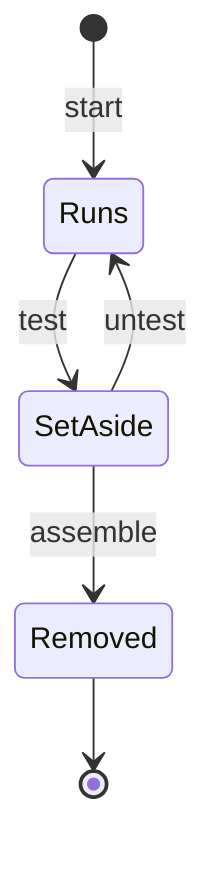

# An online edit of a plant

This page is for a reader who changes a [plant](../reference/glossary.md#plant) while it
runs. It answers 2 questions: what does an
[online edit](../reference/glossary.md#online-edit) add for a full
[configuration](../reference/glossary.md#configuration), and what does the
[runner](../reference/glossary.md#runner) do with an edit?
[The model of an online edit](online-edit-model.md) gives the model for 1
[instance](../reference/glossary.md#instance). Read it first.

> #### Warning {: .warning}
>
> Do not use logex for a [safety function](../reference/glossary.md#safety-function).
> An online edit changes the logic of each instance of a program while the machine runs.
> Before each step, make sure that a wrong [output](../reference/glossary.md#output)
> cannot cause injury or damage.

## The model: 1 resource and 2 configurations

`Logex.Configuration.Edit` changes a plant as 1 configuration: its
[tasks](../reference/glossary.md#task), its [globals](../reference/glossary.md#global)
and its instances. It has the 5 steps and the report of an edit of 1 instance. Each step
takes the [resource](../reference/glossary.md#resource) and returns it, switched between
2 [cycles](../reference/glossary.md#cycle). `Logex.Runtime.cycle/3` then runs what the
step put in the resource. The [host](../reference/glossary.md#host) selects no program.

An instance that both configurations run with the same
[program type](../reference/glossary.md#program-type) moves by the rules of 1 instance.
The report names each value in it by its path, for example `c1.t1`.

The edit of a plant adds these rules:

- **An instance that the new configuration does not run** stays in the resource, set
  aside. logex keeps its [state](../reference/glossary.md#state) and does not scan it. An
  [untest](../reference/glossary.md#untest) brings it back as it was, and its
  [timers](../reference/glossary.md#timer) do not add the time aside. The
  [assemble](../reference/glossary.md#assemble) removes it.
- **A new global** starts at its [initial value](../reference/glossary.md#initial-value).
- **No [switch](../reference/glossary.md#switch) writes a global.** A
  [tag](../reference/glossary.md#tag) that becomes a `var_external` loses its own value.
  It reads the global from its next scan, `:joined`.
- **A global that nothing writes after the switch** keeps its value, `:held`. The report
  also names the output of the instance that wrote it, by its path.
- **A new interval** makes the task [due](../reference/glossary.md#due) at its old due
  time or 1 new interval after the switch, at the earlier time.
- **No switch starts an [event task](../reference/glossary.md#event-task).** Each
  [trigger](../reference/glossary.md#trigger) keeps its last value. The task runs at the
  next real [rising edge](../reference/glossary.md#rising-edge).
- **Each step but the [accept](../reference/glossary.md#accept) adds 1 to the
  generation** of the resource. logex refuses a
  step on an edit that ended. It also refuses a step on an edit when a different edit
  did a step after it.
- **A second accept replaces the open edit.** At its first
  [test](../reference/glossary.md#test), logex removes each
  instance and each global that only the replaced edit kept.

This diagram shows the life of an instance that only the old configuration runs.



Figure: an instance that only the old configuration runs. A test sets it aside, and the
assemble removes it.

A step on an old edit raises an `ArgumentError` with this message.
[Edit a running plant without the runner](../howto/edit-a-plant-without-the-runner.md)
shows the run that prints it:

<!-- unchecked: the message of an ArgumentError, from a run of edit_plant.exs, which a different page shows -->
```text
this edit expects the resource at generation 3, but it is at generation 4: the edit has ended, or another edit has stepped since
```

### The host has fewer duties

An edit of 1 instance gives the host duties. The host scans the program of
`Logex.Edit.running/1`, and it sends only the inputs of that program. It sends again each
input of an `:input` entry, and it stops each input of an `:unread` entry. It keeps the
[point](../reference/glossary.md#point) of each `:held` entry at its value.

A resource does these duties itself. Each cycle copies each `var_input` from its
[connection](../reference/glossary.md#connection). Each cycle also returns each held
point at its value. The host keeps the resource that each step returns, and it ignores
an entry of a kind that it does not know.

### Changes that need a restart

The accept refuses a change that only a [restart](../reference/glossary.md#restart) can
make. Examples are a task that the new configuration adds or removes, and an instance
that moves to a different task. A new [type](../reference/glossary.md#type) of a global
or of a tag, and a change of located I/O, are also examples.
[Edit a running plant](../howto/edit-a-running-plant.md) gives the full list.

An edit can change the [rungs](../reference/glossary.md#rung). It can add or remove
instances, and globals with no location. It can also change the interval, the
[priority](../reference/glossary.md#priority) and the
[watchdog](../reference/glossary.md#watchdog) of a task.

## An edit through the runner

The runner holds 1 edit. It does each step between 2
[rounds](../reference/glossary.md#round), and the next round runs what the step
selected. The accept does its work in the process that calls it. Thus the accept of a
large plant does not delay a round.

After each step, the rounds use the watchdogs of the configuration that runs. A new
interval counts from the time of the step, on the clock of the runner. Thus a task
misses no period. For example, a step at 1 ms changes the interval of a task from 10 ms
to 5 ms. The task then runs at 6 ms and at 11 ms.

A step is possible during a [trip](../reference/glossary.md#trip). Thus a person can
correct a program and then restart the runner. A restart keeps the stage of the edit.

> #### Caution {: .error}
>
> Write each assembled edit to the files of the plant. An online edit changes the
> runner and its [store](../reference/glossary.md#store), not the files. A later start
> from the old files runs the old program, with the retained values of the store, and
> gives a warning in `Logex.Runner.status/1`. A crash or a kill during a trip also
> loses each change that an edit makes during the trip.

## How it compares with IEC 61131-3 and Logix

[IEC 61131-3](../reference/glossary.md#iec-61131-3) does not define an online edit. A
[Logix](../reference/glossary.md#logix) controller does not let a person move a program
to a different task in Run mode (1756-RM094N, page 65). logex refuses this change also.

Logic in a Logix controller can write the interval and the priority of a task while it
runs (1756-RM018A, the TASK object, page 276). In logex, no [instruction](../reference/glossary.md#instruction) writes a task.
Only an edit changes the interval or the priority.

## Why logex does it this way

- **A switch writes no global.** A global belongs to the full plant. An edit that writes
  a global can release an emergency stop for each instance that reads it.
- **An instance set aside keeps its state.** An untest then brings back the plant that
  the test stopped. The edit stopped the instance, not its logic. Thus its timers do not
  add the time aside.
- **The generation refuses an old edit.** A step on an edit that ended, or that a
  different step passed, cannot change the resource. This matters when 2 persons do
  steps on 1 plant.
- **A new interval counts from the step.** A task does not wait for its old due time,
  and it misses no period.
- **The host selects nothing.** The resource holds the configuration that runs. A host
  cannot scan the wrong program.

The decision record is
[The staged online edit](../../docs/adr/0012-staged-online-edit.md).

## See also

- [Online edit](../reference/online-edit.md): the exact rules of each step and each
  kind of entry.
- [Edit a running plant](../howto/edit-a-running-plant.md): an edit through the runner.
- [The model of an online edit](online-edit-model.md): the model for 1 instance.
- [Glossary](../reference/glossary.md): the technical words of logex.
