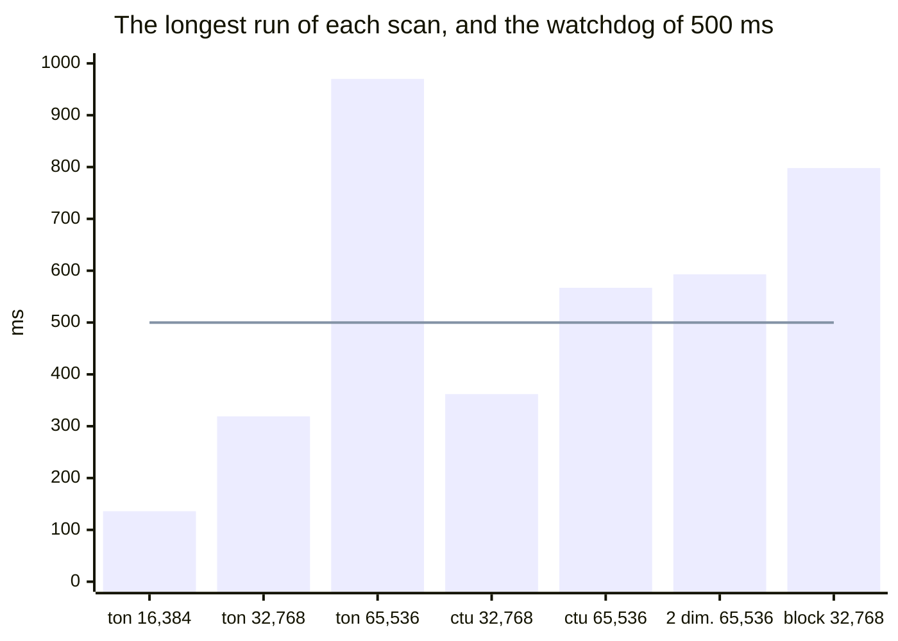

# How large a plant can be

This page is for a reader who plans a large [plant](../reference/glossary.md#plant),
with large [arrays](../reference/glossary.md#array) of
[timers](../reference/glossary.md#timer), [counters](../reference/glossary.md#counter)
or [function block](../reference/glossary.md#function-block)
[instances](../reference/glossary.md#instance). It answers 2 questions. How large can
the plant be with the defaults of the [runner](../reference/glossary.md#runner)? What
happens past that size?

> #### Note {: .info}
>
> Each figure on this page is from 1 computer: a Linux computer with 4 cores, which other
> software also used. A different computer gives different figures. Measure your plant on
> the computer that runs it.

## The model

The runner has a limit of time for each kind of work. A large array makes 4 kinds of
work longer:

- **A [scan](../reference/glossary.md#scan).** The [task](../reference/glossary.md#task)
  that runs the array must end within the [watchdog](../reference/glossary.md#watchdog)
  of the task, 500 ms by default.
- **The work between [rounds](../reference/glossary.md#round).** The
  [test](../reference/glossary.md#test) step of an
  [online edit](../reference/glossary.md#online-edit) moves each value to the new
  [program](../reference/glossary.md#program). It must end within `idle:`, 500 ms by
  default.
- **A write of the [store](../reference/glossary.md#store).** A retained array makes the
  store large. Each write must end within `write_limit:`, 5,000 ms by default.
- **A warm start.** The start reads the store and puts its values into the plant. No
  limit of time stops this work.

[Timing and capacity](timing-and-capacity.md) gives each part of the work of the runner
and its limit.

## The measurements

These measurements use the defaults: `idle: 500`, `poll: 10`, `write_limit: 5000` and a
watchdog of 500 ms for the task. The task is a
[periodic task](../reference/glossary.md#periodic-task) of 100 ms. For a scan, the
program has 1 [rung](../reference/glossary.md#rung) for each
[element](../reference/glossary.md#element). A
[declaration](../reference/glossary.md#declaration) has 65,536 elements at most.

The load average of the computer was between 1 and 20. Some sizes have more than 1
measurement, at different loads. Each table gives the time of each measurement.

### A scan

| Array | Elements | Longest run of the task, each measurement | Result |
|---|---|---|---|
| `ton[n]` | 16,384 | 136 ms | Runs |
| `ton[n]` | 32,768 | 289 ms, 319 ms | Runs |
| `ton[n]` | 65,536 | 451 ms, 455 ms, 575 ms, 970 ms | Runs 2 times, trips 2 times |
| `ctu[n]` | 32,768 | 298 ms, 362 ms | Runs |
| `ctu[n]` | 65,536 | 567 ms | Trips |
| `ton[128, n]` | 32,768 | 335 ms | Runs |
| `ton[128, n]` | 65,536 | 593 ms | Trips |
| Instances of a block | 10,922 | 141 ms | Runs |
| Instances of a block | 21,844 | 272 ms, 296 ms | Runs |
| Instances of a block | 32,768 | 435 ms, 480 ms, 503 ms, 798 ms | Runs 2 times, trips 2 times |

Each trip of a scan has the reason `{:watchdog, {:task, "t", took_ms, 500}}`. The field
`took_ms` is the time of the run.

Figure: the longest run of the task for 7 scans of the table. The line is the watchdog
of the task. The 4 bars that pass the line are the plants that tripped.

### The test step of an online edit

| Array | Elements | Time of the call, each measurement | Result |
|---|---|---|---|
| `ton[n]` | 32,768 | 216 ms, 265 ms | Runs |
| `ton[n]` | 65,536 | 847 ms | Trips |
| Instances of a block | 10,922 | 235 ms, 251 ms, 328 ms, more than 516 ms | Runs 3 times, trips 1 time |
| Instances of a block | 21,844 | 624 ms, more than 1,129 ms | Trips |

The reasons of the 4 trips:

- `ton[65536]`: `{:watchdog, {:idle, 733, {:edit, :test}}}`
- 10,922 instances: `{:watchdog, {:idle, 516, {:edit, :test}}}`
- 21,844 instances: `{:watchdog, {:idle, 516, {:edit, :test}}}` and
  `{:watchdog, {:idle, 1129, {:edit, :test}}}`

The time of the call is the time of the host's call to `Logex.Runner.test/1`. The call
also waits for the runner to end its round. The runner's own time of the step is
shorter, and the reason of a trip gives it.

### The store

| Work, a retained `ton[n]` | Elements | Time, each measurement | Result |
|---|---|---|---|
| A write of the store | 32,768 | About 2.6 s | Writes a store of 3.6 MB |
| A start with no store file | 65,536 | 5,239 ms, 5,414 ms | The runner does not start, `{:error, {:retain, :timeout}}` |
| A warm start that reads the store | 32,768 | 13.4 s, 36.9 s | The runner starts |
| A warm start that reads the store | 65,536 | 28.1 s, 28.4 s, 28.6 s | The runner starts. The runner reports each write past the limit |

During a warm start, `Logex.Runner.start_link/1` does not return, and the runner opens
no [device](../reference/glossary.md#device). The time of a warm start grew with the
load. It was 13.4 s at a load average of about 4. It was 36.9 s while the load average
went up to 20.

## What the measurements show

- The defaults carried a scan of 32,768 timers or counters at each load. A scan of
  65,536 timers, or of 32,768 block instances, ran at one load and tripped at a higher
  load. Near a limit, the load decides the result.
- An array of 2 dimensions costs more than an array of 1 dimension with the same number
  of elements.
- A scan that is longer than the interval of its task makes the next run of the task
  late. The task can then miss periods. The scan does not trip the runner while it is
  shorter than the watchdog.
- Over the instances of a block, the test step of an online edit trips at fewer elements
  than a scan. At 10,922 instances, it ran or tripped by the load.
- At 32,768 retained timers, a write of the store takes longer than the period of the
  store, 1,000 ms. While 1 write runs, the next write waits, and the newest values
  replace the values that wait. Thus the runner writes the store less often than 1 time
  in each period.
- A start with no store file, or with `start: :cold`, writes the store first. If that
  write takes longer than `write_limit:`, the runner does not start.
- A warm start writes nothing first, so the runner starts. A write in a period that
  takes longer than `write_limit:` does not trip the runner. The runner reports
  `{:retain, {:error, :timeout}}` and runs on, and the write can end later. Until a later
  write ends, `status/1` gives the file in the key `unknown` of `retain`. A stop whose
  write takes longer than `write_limit:` returns `{:error, {:retain, :timeout}}`.

## Past the limit

A plant past the watchdog of a task or past `idle:` trips. The runner writes 0 to each
output [point](../reference/glossary.md#point) 1 time, as for each
[trip](../reference/glossary.md#trip). The reason names the work that took too long. To
carry a larger plant, give `idle:`, the watchdog of a task or `write_limit:` a larger
value. For example, with `write_limit: 15000`, the runner with 65,536 retained timers
starts with no store file. Its start takes about 6.2 s, and its store is 7.3 MB.

Before you set a limit, make a long run on the computer that runs the plant. Make it at
the highest load that the computer can have. `Logex.Runner.status/1` gives 3 figures of
that run:

| Key | What it gives |
|---|---|
| `runs` | For each task, its longest run and its watchdog, in ms |
| `latest_wake` | The most that the runner was late for a wake, in ms |
| `refresh_gap` | The longest time between 2 deadlines that the runner sends to the devices, in ms |

Keep the longest run well under each limit. [Set watchdogs](../howto/set-watchdogs.md)
gives the steps.

## How it compares with IEC 61131-3 and Logix

- [IEC 61131-3](../reference/glossary.md#iec-61131-3) gives no limit for the size of an
  array.
- A [Logix](../reference/glossary.md#logix) controller limits an array to 2 MB of data.
  Its manual says that an array of 1 dimension runs faster than an array of 2 or 3
  dimensions (1756-RM094N, page 85).
- logex limits an array to 65,536 elements. In logex also, an array of 2 dimensions
  costs more.

## Why logex does it this way

- **A trip, not a hang.** A plant past a limit stops with each output at 0. It does not
  keep its outputs while the runner is too slow. The decision record is
  [Watchdogs and the trip](../../docs/adr/0013-watchdogs-and-the-trip.md).
- **Long work is not in the runner.** A separate process makes the text of the store
  and writes it, within `write_limit:`. Thus a large store does not stop the rounds. The
  decision record is
  [File work with a limit](../../docs/adr/0018-file-work-with-a-limit.md).
- **An accept runs in the process of the host.** The
  [accept](../reference/glossary.md#accept) step of an online edit grows with the
  programs. It runs in the process of the [host](../reference/glossary.md#host) that
  calls it, not in the runner. The decision record is
  [The staged online edit](../../docs/adr/0012-staged-online-edit.md).

## See also

- [Timing and capacity](timing-and-capacity.md): how late a round can be, and what a
  scan costs.
- [Trips and watchdogs](trips-and-watchdogs.md): each watchdog and what a trip does.
- [Use arrays of timers, counters and function blocks](../howto/use-arrays-of-instances.md):
  the steps to declare a large array.
- [Set watchdogs](../howto/set-watchdogs.md): the steps to set each limit.
- [The store](../reference/store.md): the rules
  of the store.
- [Runner](../reference/runner.md): the options and the keys of `status/1`.
- [Glossary](../reference/glossary.md): the technical words of logex.
