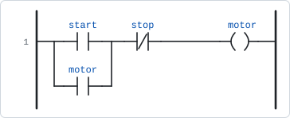
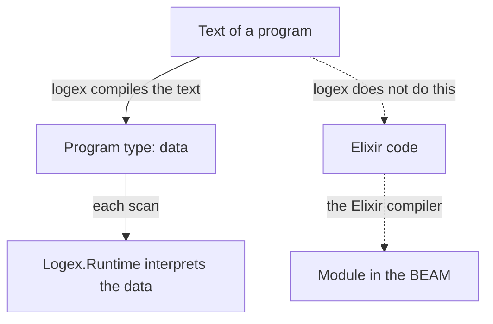
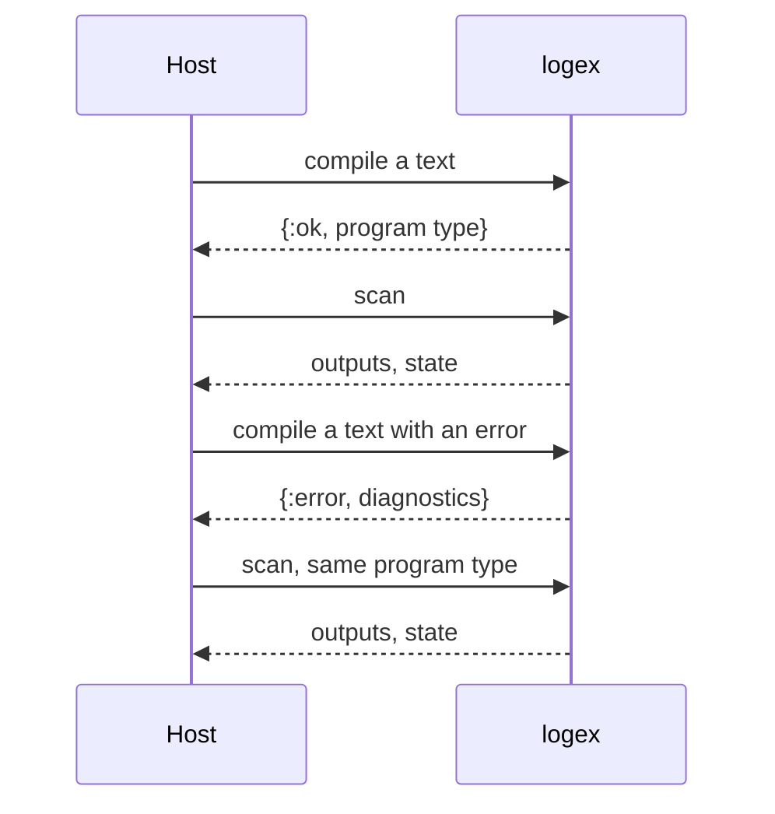

# Programs as data

This page is for an Elixir developer who wants to know what logex makes from a ladder
program. It answers 2 questions: what a compiled program is, and why logex makes no code
for the BEAM from it. The BEAM is the virtual machine that runs Elixir code.

logex [compiles](../reference/glossary.md#compile) the text of a
[program](../reference/glossary.md#program) into a
[program type](../reference/glossary.md#program-type). A program type is plain Elixir
data. `Logex.Runtime` [interprets](../reference/glossary.md#interpret) this data. For
each [scan](../reference/glossary.md#scan), it reads
[rungs](../reference/glossary.md#rung) from the data and does the operation of each
[instruction](../reference/glossary.md#instruction) in them.

logex makes no Elixir code and no module from a program. The Elixir compiler has no part
when logex compiles a program, runs it or changes it with an
[online edit](../reference/glossary.md#online-edit).

logex does this for 3 reasons. A change to a program must not stop the program. A text
must not run code in the [host](../reference/glossary.md#host). Each instruction must
have 1 definition.

## The model: text, data, interpreter

A person writes a rung as 1 line of text. This line is rung 1 of
[`motor.ld`](../tutorials/first-program.md), a program that starts and stops a motor.

<!-- part of: motor.ld -->
```text
( xic start | xic motor ) xio stop ote motor
```

This drawing shows the same rung.

<!-- rung: motor.ld 1 -->


A compile makes data from the text. The script `programs-as-data.exs` compiles
`motor.ld` and prints the data of rung 1. The scripts of this page run in the project of
[Your first program](../tutorials/first-program.md).

> #### Caution {: .error}
>
> Do not write a host that reads the data in `rungs`. Do not make a program type by
> hand, and do not change one. The
> [host contract](../reference/glossary.md#host-contract) does not define the data in
> `rungs`. `Logex.Runtime` checks only a part of a program type, and a scan of wrong
> data can raise an exception.

The script reads `rungs` only to show the data.

```elixir
{:ok, motor} = Logex.compile_file("motor.ld")

# Rung 1 of the program type.
[{:rung, rung_1} | _] = motor.rungs
IO.puts("rung 1 of #{motor.name}:")
IO.inspect(rung_1, width: 70)
```

```console
$ mix run programs-as-data.exs
rung 1 of motor:
[
  {:branches,
   [
     [{:xic, 10, [{:name, 10, "start"}]}],
     [{:xic, 10, [{:name, 10, "motor"}]}]
   ]},
  {:xio, 10, [{:name, 10, "stop"}]},
  {:ote, 10, [{:name, 10, "motor"}]}
]
```

Lines 2 to 10 that the script prints are the data of rung 1. Compare them with the text
and with the drawing.

| In the data | What it is |
|---|---|
| The list | The rung. Its 3 elements are in series, from left to right. |
| `{:branches, [...]}` | The [branch](../reference/glossary.md#branch). It holds 2 [legs](../reference/glossary.md#leg), and each leg is a list of instructions. |
| `{:xio, 10, [...]}` | An instruction: its [mnemonic](../reference/glossary.md#mnemonic), the line of the rung in `motor.ld` (line 10) and its [operands](../reference/glossary.md#operand). |
| `:xio` | A mnemonic, as an atom. The set of mnemonics is a part of logex, and a program cannot add to it. |
| `{:name, 10, "stop"}` | An operand that names a [tag](../reference/glossary.md#tag). The name is a string. |

A program type is a struct, `%Logex.Program{}`. It holds the rungs, the tags, the name
of the program and the text. It holds no [state](../reference/glossary.md#state). The
values of the tags are in the state of an
[instance](../reference/glossary.md#instance), and the state is data also.

To interpret an instruction, `Logex.Runtime` finds the operation of the mnemonic and
does it on the state. logex has no other way to run a program.



Figure: the path of a program in logex, and the path that logex does not have. A dotted
line is a step that logex does not do.

## What the model gives a host

The script `no-new-atoms.exs` is a small host. It compiles a program with 1,000 tag
names, makes an instance and runs 1 scan. No atom in the BEAM has these names. The
script counts the modules and the atoms in the BEAM before and after.

```elixir
# The text of a program: 1 output and 1 rung for each name.
text = fn names ->
  tags = Enum.map_join(names, "\n", &"var_output #{&1} bool")
  rungs = Enum.map_join(names, "\n", &"xio #{&1} ote #{&1}")
  tags <> "\n\n" <> rungs <> "\n"
end

# A small host: compile the text, make an instance, run 1 scan.
run = fn names ->
  {:ok, lamps} = Logex.compile(text.(names), name: "lamps")
  state = Logex.Runtime.instance(lamps)
  {outputs, _state} = Logex.Runtime.scan(lamps, state)
  map_size(outputs)
end

# The modules and the atoms that the BEAM holds.
beam = fn ->
  {length(:code.all_loaded()), :erlang.system_info(:atom_count)}
end

# The first run loads the modules of logex.
run.(["lamp_a", "lamp_b"])

# The 1,000 names are strings.
names = for n <- 1..1000, do: "lamp_#{n}"

{modules, atoms} = beam.()
outputs = run.(names)
{modules_after, atoms_after} = beam.()

IO.puts("a program with #{outputs} new names:")
IO.puts("#{modules_after - modules} new modules")
IO.puts("#{atoms_after - atoms} new atoms")
```

```console
$ mix run no-new-atoms.exs
a program with 1000 new names:
0 new modules
0 new atoms
```

The last 2 lines that the script prints show the first 2 of these 4 facts.

- **A program adds no code to the BEAM.** The BEAM has the same number of modules before
  and after. A program type is a value in the memory of the host. The BEAM frees this
  memory when the host does not hold the value.
- **A name is a string, not an atom.** The 1,000 names add no atom. The BEAM never frees
  an atom. If its table of atoms is full, the BEAM stops. The default limit is 1,048,576
  atoms.
- **A compile runs no code from the text.** The text holds
  [declarations](../reference/glossary.md#declaration) and rungs only. A compile reads
  them and makes data.
- **An error in a new text changes nothing.** The compile returns `{:error, diagnostics}`
  and no program type. The [diagnostics](../reference/glossary.md#diagnostic) say where
  the error is. The host holds the old program type, and the scans continue with it.



Figure: a host compiles a new text while a program runs. The second compile returns no
program type, and the next scan uses the same program type as before.

Each value that a host gets from logex and gives back to logex is plain data.

| Value | The host gets it from |
|---|---|
| Program type | `Logex.compile/2` or `Logex.compile_file/1` |
| State of an instance | `Logex.Runtime.instance/1` and then each scan |
| [Configuration](../reference/glossary.md#configuration) | `Logex.Configuration` |
| [Resource](../reference/glossary.md#resource) | `Logex.Runtime.start/1` and then each [cycle](../reference/glossary.md#cycle) |
| The value of an online edit | `Logex.Edit.accept/3` |
| [Retained image](../reference/glossary.md#retained-image) | `Logex.Runtime.retained/2` for an instance, `Logex.Runtime.retained/1` for a resource |

None of these values holds a pid, a function or a reference. Thus a host can print each
value, compare 2 values and send a value to a different process. `Logex.Runtime` starts
no process and keeps nothing between 2 calls. The host keeps each value. `Logex.Runner`
is a process of logex that keeps a resource in the same way.

A change to a program that runs is a change of data. The host compiles the new text and
gets a second program type. `Logex.Edit` reads the old one and the new one, and makes a
plan for the state. Before the change, it reports what the change does to the state.
[The model of an online edit](online-edit-model.md) explains the steps.

## What the model costs

An interpreter does work that compiled code does not do. In each scan, for each
instruction, `Logex.Runtime` finds the operation from the data. The state comes from the
host in each call. Thus `Logex.Runtime` checks the state in each call.

These figures are from measurements on 1 machine.

| Call of `Logex.Runtime.scan/2` | Time |
|---|---|
| The 5 rungs of `motor.ld` | 2 µs to 3 µs |
| 1 rung, with a state that holds an `int[65536]` array | About 0.4 ms |
| 1 rung, with a state that holds a `real[65536]` array | About 9 ms |

Compare each figure with the time between 2 scans. An interval of 10 ms is 10,000 µs.

A state holds an [array](../reference/glossary.md#array) as a tuple. A scan checks each
[element](../reference/glossary.md#element) of each array that the state holds. It does
this check also if no rung writes to the array. The time of the check depends on the
[type](../reference/glossary.md#type) of the elements.
[Timing and capacity](timing-and-capacity.md) explains what a scan costs.

## How it compares with IEC 61131-3 and Logix

- The words program type and instance are the words of
  [IEC 61131-3](../reference/glossary.md#iec-61131-3). Only logex reads the data of a
  program type. It is not a format of the standard or of a vendor.
- A [Logix](../reference/glossary.md#logix) controller changes a program while it runs,
  in steps. An online edit of logex has steps of the same kind. In logex, each step is
  an operation on data.

## Why logex does it this way

A person can change a ladder program while it runs. logex holds a program as data for 3
reasons.

- **A change must not stop the program that runs.** An error in a new text must not
  change the program that the scans use.
- **A text must not run code in the host.** A compile must only read the text.
- **Each instruction has 1 definition.** The interpreter is the only code that runs an
  instruction. A generator of code is a second definition, and 2 definitions can give
  different results for the same rung.

The table shows the first 2 reasons. It compares 2 ways to hold a program that changes.
The column for a BEAM module is from the compiler of Elixir 1.20.4.

| A compile | As data | As a BEAM module |
|---|---|---|
| Adds to the BEAM | No module and no atom | A module, and an atom for its name |
| Runs code from the text | No. logex only reads the text. | Yes. Code in the body of the module runs during the compile. |
| Of a text with an error | Changes nothing. The host holds the old program type. | An error of syntax changes nothing. A different error in the body of the module removes the old module from the BEAM. |

logex also has no generated code and no dependencies. The lexer and the parser are
Elixir modules that a person wrote. Thus a host that adds logex adds no other package.

`Logex.compile/2` takes only a text. logex has no macro that declares a program in
Elixir code. [The study of a `defladder` macro](../../docs/defladder.md) is a proposal
for such a macro, and logex does not have it.

The decision records are [A program is data](../../docs/adr/0001-a-program-is-data.md)
and
[No dependencies and no generated code](../../docs/adr/0003-no-dependencies-no-generated-code.md).

## See also

- [What logex is](what-logex-is.md): the program type, the instance and the scan.
- [The model of an online edit](online-edit-model.md): how an edit changes a program
  that runs.
- [Timing and capacity](timing-and-capacity.md): what a scan costs.
- [Host contract](../reference/host-contract.md): the modules that a host calls.
- [Read a diagnostic](../howto/read-diagnostics.md): how to read an error of a compile.
- [Glossary](../reference/glossary.md): the technical words of logex.
