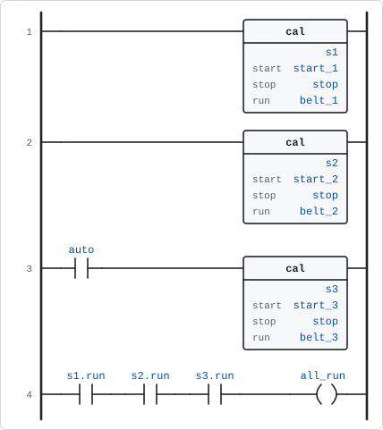
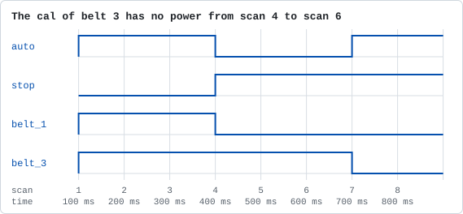

# Rungs that a scan does not run

This page is for a reader who writes a ladder
[program](../reference/glossary.md#program) with a [jump](../reference/glossary.md#jump)
or a [function block](../reference/glossary.md#function-block). It answers 1 question:
what happens to a [rung](../reference/glossary.md#rung) that a
[scan](../reference/glossary.md#scan) does not run?

Nothing happens to it. The scan writes no [tag](../reference/glossary.md#tag) of the
rung, not a 1 and not a 0. Each output, [timer](../reference/glossary.md#timer) and
[counter](../reference/glossary.md#counter) of the rung keeps its value. A timer that is
in operation adds the full time when a later scan runs it again.

> #### Warning {: .warning}
>
> Do not put the stop of a machine only in a rung that a jump can pass. Do not make the
> stop of a machine only a contact before a `cal`. A rung or a function block that does
> not run cannot write 0 to its output, and a motor that runs continues to run. Put a
> stop that must always work in a rung that each scan runs, or in the function block. Do
> not use logex for a [safety function](../reference/glossary.md#safety-function).

## The model: 2 ways to not run a rung

A scan runs the rungs of a program from the first rung to the last rung. But 2
[instructions](../reference/glossary.md#instruction) can stop the run of some rungs:
`jmp` and `cal`.

- **A `jmp auto` with power.** The scan completes the rung of the `jmp`. Then it goes to
  the rung with the [label](../reference/glossary.md#label) `auto`, which starts with
  `lbl auto`. It does not run the rungs between them. With no power, the scan runs each
  rung.
- **A `cal s3` with power.** The scan copies the
  [inputs](../reference/glossary.md#input) into the
  [instance](../reference/glossary.md#instance) `s3`, runs the rungs of the function
  block and copies the [outputs](../reference/glossary.md#output) out. With no power,
  the scan does none of these 3 things.

The 2 ways have 1 rule: an instruction that does not run changes nothing.

- **A [coil](../reference/glossary.md#coil)** keeps the value of its tag. An `ote`
  writes no 1 and no 0. Thus an output that is 1 stays 1.
- **A timer** keeps its [members](../reference/glossary.md#member) and the time of its
  last run. It does not count, and it does not reset. A later scan runs it again with a
  true rung. If the timer was in operation at its last run, it adds the full time since
  that run. If it was at rest, it starts and adds nothing.
- **A counter or a [one-shot](../reference/glossary.md#one-shot)** keeps the
  [power flow](../reference/glossary.md#power-flow) of its last run. It finds a
  [rising edge](../reference/glossary.md#rising-edge) only between 2 of its runs. It
  does not count a signal that comes and goes while it does not run.
- **A counter or a one-shot with no earlier run** has no power flow to compare. After a
  jump or a `cal` with no power, it finds a rising edge at its first run if its rung is
  true. For example, a button that a person holds from the start gives 1 pulse. This is
  not the rule of the [first scan](../reference/glossary.md#first-scan), and not the
  rule of an [online edit](../reference/glossary.md#online-edit). An instruction finds
  no rising edge in the first scan, or at its first run after an online edit adds it.
- **A `div` with the divisor 0** keeps the value of its destination. The scan reports no
  [fault](../reference/glossary.md#fault).
- **The inputs and the outputs of a `cal`** keep the values of the last run. The
  function block does not read a new value of an input.

## A jump: the lamp stays on and the timer adds the full time

The program `jog.ld` has 2 modes. In the automatic mode, `manual` is 0, and the `jmp` of
rung 1 has power. The scan then does not run rungs 2, 3 and 4, the rungs of the manual
mode.

<!-- file: jog.ld -->
```text
var_input manual bool
var_input jog_pb bool
var_input run_pb bool
var_output auto_lamp bool
var_output jog_lamp bool
var_output jog_long bool
var_output motor bool
var jog_t ton

// in auto, jump over the manual section
xio manual jmp auto ote auto_lamp
xic jog_pb ote jog_lamp
xic jog_pb ton jog_t 3000
xic jog_t.dn ote jog_long
lbl auto ( xic run_pb xio manual | xic manual xic jog_pb ) ote motor
```

<!-- rung: jog.ld -->


The timing diagram shows 12 scans that are 500 ms apart. The program is in the automatic
mode from scan 5 to scan 8.

<!-- timing: rungs-that-do-not-run-jog.timing.exs -->


| Scans | What the diagram shows | The reason |
|---|---|---|
| 6 to 8 | `jog_lamp` stays 1, but `jog_pb` is 0 | The scan does not run rung 2. Thus `ote jog_lamp` does not write 0. |
| 5 to 8 | `jog_t.acc` stays 1000 | The scan does not run rung 3. The timer does not count, and it does not reset. |
| 9 | `jog_t.acc` goes from 1000 to 3000, and `jog_long` comes on | The scan runs rung 3 again, with `jog_pb` at 1. The timer adds the 2500 ms since its last run and stops at the [preset](../reference/glossary.md#preset). |

The button `jog_pb` is 0 in scans 6 to 8. The timer does not run in these scans, and
thus it does not reset. In scan 9, it counts as if the button stayed pressed.

The `jmp` passes its power to the next instruction. Thus `ote auto_lamp`, which comes
after the `jmp` on rung 1, runs in each scan.

## A function block: a stop that the block does not read

The function block `seal` is a [seal-in](../reference/glossary.md#seal-in) with a start
and a stop. The program `belts.ld` runs 3 belts with 3 instances of `seal`. Rung 3 runs
the instance `s3` only while `auto` is 1.

<!-- file: seal.ld -->
```text
// A seal-in: `run` holds itself in from `start` until `stop`.
function_block seal
var_input start bool
var_input stop bool
var_output run bool

( xic start | xic run ) xio stop ote run
```

<!-- file: belts.ld -->
```text
var_input start_1 bool
var_input start_2 bool
var_input start_3 bool
var_input stop bool
var_input auto bool
var_output belt_1 bool
var_output belt_2 bool
var_output belt_3 bool
var_output all_run bool
var s1 seal
var s2 seal
var s3 seal

cal s1 start_1 stop belt_1
cal s2 start_2 stop belt_2
xic auto cal s3 start_3 stop belt_3
xic s1.run xic s2.run xic s3.run ote all_run
```

<!-- rung: belts.ld -->


In the timing diagram, belts 1 and 3 start in scan 1. In scan 4, `auto` goes to 0 and
`stop` goes to 1.

<!-- timing: rungs-that-do-not-run-belts.timing.exs -->


| Scans | What the diagram shows | The reason |
|---|---|---|
| 4 | `belt_1` stops | The `cal` of `s1` has power. The instance reads `stop`. |
| 4 to 6 | `belt_3` runs, but `stop` is 1 | The `cal` of `s3` has no power. The scan does not copy `stop` into the instance, and it does not write `belt_3`. |
| 7 | `belt_3` stops | `auto` is 1 again. The instance `s3` runs and reads `stop`. |

Thus a condition before a `cal` is not a stop. In `belts.ld`, the stop is an input of
the function block, and the function block stops its belt only while it runs.

## How it compares with IEC 61131-3 and Logix

- [IEC 61131-3](../reference/glossary.md#iec-61131-3) gives the same rule for a function
  block whose input EN is false. The body does not run, and the outputs keep their
  values. The standard lets a controller copy the inputs or not. logex does not copy
  them.
- A timer of a [Logix](../reference/glossary.md#logix) controller adds the time since its
  last scan when the controller scans it again (1756-RM018A, pages 112 and 113). logex
  does the same.
- logex refuses a `jmp` to an earlier rung and to its own rung.

## Why logex does it this way

- **A jump goes forward only.** A jump back can make a loop that never ends. With no
  jump back, a scan passes the rungs 1 time and always ends.
- **The 2 ways have 1 rule.** A reader of a program learns 1 rule for a `jmp` and for a
  `cal` with no power.
- **A timer adds the full time.** Each timer keeps the time of its last run, and the
  [host](../reference/glossary.md#host) gives the time.
  [How a timer counts time](how-a-timer-counts-time.md) explains this. The decision
  record is [The host gives the time](../../docs/adr/0007-the-host-gives-the-time.md).
- **A `cal` with no power follows IEC 61131-3.** The decision record is
  [The software model of IEC 61131-3](../../docs/adr/0004-iec-software-model.md).

## See also

- [The scan, the cycle and time](scan-cycle-and-time.md): what a scan does.
- [Jump over rungs](../howto/jump-over-rungs.md): how to write a `jmp` and a `lbl`.
- [Write a function block](../howto/write-a-function-block.md): how to write a function
  block and run it with `cal`.
- [Execution model](../reference/execution-model.md): the exact rules of a scan.
- [Safety and limits](safety-and-limits.md): what logex is not.
- [Glossary](../reference/glossary.md): the technical words of logex.
