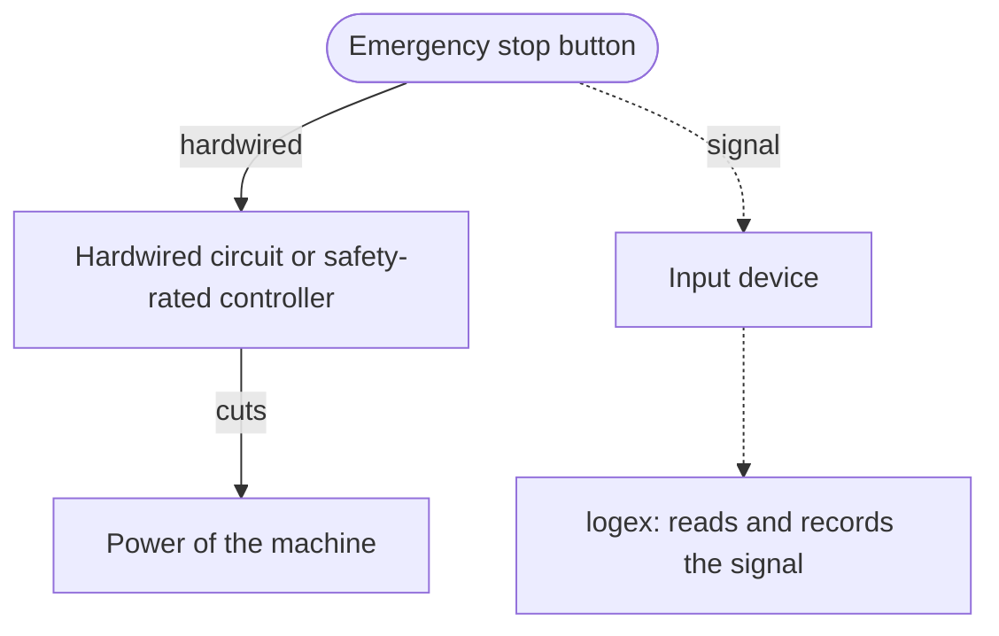

# Safety and limits

This page is for a reader who must decide if logex can do a job. It answers 1 question:
what is logex not, and what must the [plant](../reference/glossary.md#plant) do with no
help from logex?

> #### Warning {: .warning}
>
> Do not use logex for a [safety function](../reference/glossary.md#safety-function).
> logex can stop at any time, and then no part of logex sets an output
> [point](../reference/glossary.md#point) to 0. Make each safety function with hardwired
> circuits or with a safety-rated controller.

## The limits in 1 table

| The limit | What this means |
|---|---|
| [Not a safety controller](#logex-is-not-a-safety-controller) | An emergency stop must work with no part of logex. |
| [Not certified](#logex-is-not-a-safety-controller) | logex has no certificate for any industrial use. |
| [Not hard real-time](#logex-is-not-hard-real-time) | A round can be late. logex can miss a short pulse. |
| [No guarantee that the output points are at 0](#output-points-after-a-trip-a-stop-or-a-crash) | If the Elixir virtual machine (the BEAM) or the computer stops, logex sets no output point to 0. |
| [No adapter for real I/O](#limits-of-io-and-of-the-dialect) | The [host](../reference/glossary.md#host) writes the [adapter](../reference/glossary.md#adapter) for each real [device](../reference/glossary.md#device). |
| [No compiled code](#limits-of-io-and-of-the-dialect) | logex interprets each program. It makes no code of the Elixir virtual machine from it. |
| [No IEC 61131-3 text, no importer](#limits-of-io-and-of-the-dialect) | logex reads only its own dialect. |
| [Not each part of a controller](what-logex-has.md#what-logex-does-not-have) | logex does not have each part of IEC 61131-3 or of a controller. |
| [No battery-backed memory, no safety memory](limits-of-retained-values.md) | A crash can set a retained value back. Do not keep a value of a safety function in logex. |
| [No guard against a warm restart](limits-of-retained-values.md#a-warm-start-can-set-an-output-to-1) | A start that reads retained values can set an output point to 1 in its first round. |

## logex is not a safety controller

A safety function protects persons from a machine. These are examples:

- an emergency stop
- a guard interlock
- a light curtain
- a 2-hand control
- the protection of a burner
- the protection against pressure

logex must not do a safety function. Each safety function belongs in hardwired circuits
or in a safety-rated controller. Design and validate it to the functional-safety
standards that apply. logex does not claim that it conforms to any of these standards.
logex has no certificate for any industrial use.

The examples of this documentation have a signal with the name `estop`. A
[program](../reference/glossary.md#program) reads this signal and records it. It is not
the emergency stop of a machine. The emergency stop that cuts the power of a machine
must work in each of these 3 cases:

- logex stopped.
- logex crashed.
- logex never started.

Figure: an emergency stop and logex. The path that cuts the power has no part of logex
in it. logex only reads a signal from the button.

A stop that a program does is control, not safety. It also has these 2 limits:

- If a [`cal`](../reference/glossary.md#instruction-mnemonics) instruction is on a
  [false rung](../reference/glossary.md#false-rung), its
  [function block](../reference/glossary.md#function-block) does not run. A stop in the
  logic of the block then does not run.
  [Function blocks](../reference/function-blocks.md) gives the rules.
- A [warm restart](../reference/glossary.md#warm-restart), or the start of a new runner
  that reads its [store](../reference/glossary.md#store), can set an output point to 1
  in its first round.
  [The limits of retained values](limits-of-retained-values.md#a-warm-start-can-set-an-output-to-1)
  shows this.

## logex is not hard real-time

A hard real-time controller guarantees that its work is never later than a known limit.
logex gives no such limit. logex runs on the BEAM, the virtual machine that Elixir runs
on, on a general-purpose operating system. Other programs run on the same computer.
Their work can make a [round](../reference/glossary.md#round) late.

- logex gives no limit for how late a round is.
- logex gives no limit for how much the time between 2 rounds changes.
- A [watchdog](../reference/glossary.md#watchdog) is a backstop. The
  [runner](../reference/glossary.md#runner) [trips](../reference/glossary.md#trip)
  after a [task](../reference/glossary.md#task) runs too long. It is not a guarantee
  that a task never runs too long.

### logex can miss a short pulse on an input point

A pulse is a change of an input point to 1 and back to 0. The runner keeps only the
latest value of each input point. Thus a program can miss a pulse that is shorter than
the interval of its task. A signal that a program must not miss must hold its new value
until the program reads it.
[Short pulses on input points](short-pulses.md) shows a program that misses a pulse, and
gives the time that a signal must hold.

## Output points after a trip, a stop or a crash

When a runner trips, stops or crashes, logex writes 0 to each output point 1 time. It
writes the 0 again only if the adapter of a device refuses it. It writes the 0 only
through a device that answers, and only while the virtual machine runs.

| What occurs | What logex does to the output points |
|---|---|
| The runner trips, for example because of a watchdog, a [major fault](../reference/glossary.md#major-fault) or a failure of a device. | The runner writes 0 to each output point 1 time, through each device that answers. Then it runs no round until a [restart](../reference/glossary.md#restart). |
| The host stops the runner. | The runner writes 0 to each output point 1 time and closes each device. |
| The runner crashes, or a process kills it. | logex writes 0 to each output point 1 time and closes each device. |
| The runner is stuck. | If a device gets no message from the runner before a deadline, logex writes 0 to its output points 1 time. |
| The adapter of a device refuses the 0. | logex writes the 0 again at each read of the device until the adapter takes it. |
| A device does not answer. | The runner trips and stops its work with that device. logex cannot set its output points to 0. The device does what its hardware does when it loses its master. |
| The virtual machine stops, the operating system stops or the computer loses its power. | No part of logex runs. logex sets no output point to 0. |

With the default options, the deadline of a device is 510 ms after the last message
from the runner. After a trip,
`Logex.Runner.status/1` names in `unzeroed` each device whose output points are possibly
not at 0. [Runner](../reference/runner.md) gives each rule.

Thus the plant must do these things with no help from logex:

- The hardware of each device must set its output points to a safe state when it gets
  no write from its master.
- A part that is not logex must find that the virtual machine or the computer stopped.

> #### Caution {: .error}
>
> Do not let the computer sleep while a runner runs. No test of logex shows what the
> [clock](../reference/glossary.md#clock) of the runner does after a sleep.

## Limits of I/O and of the dialect

- **logex has no adapter for real I/O.** The only adapter in logex is `Logex.IO.Sim`, a
  [simulated device](../reference/glossary.md#simulated-device) for tests and examples.
  For a real device, the host writes a module with the behaviour `Logex.IO`. The script
  `line_device.exs` in `examples/` is an example to copy, not an adapter of logex. The
  protocol of a real device, its limits of time and the way it connects again are the
  work of the host.
- **logex makes no BEAM code from a program.** A program
  [compiles](../reference/glossary.md#compile) to data, a `%Logex.Program{}`, and
  `Logex.Runtime` interprets this data. The Elixir compiler has no part in the run of a
  program or in a change to it.
- **logex does not read IEC 61131-3 text.** logex has its own ladder
  [dialect](../reference/glossary.md#dialect) as text. It has no Structured Text, no
  Function Block Diagram, no Sequential Function Chart, no Instruction List and no
  graphical editor. A text form of [IEC 61131-3](../reference/glossary.md#iec-61131-3)
  does not compile in logex.
- **logex does not import a program from the controller of a vendor, and it will not.**
  It has [mnemonics](../reference/glossary.md#mnemonic) of the
  [conventional set](../reference/glossary.md#conventional-set), but not its
  [operands](../reference/glossary.md#operand), such as `I:003/4` or `T4:5/DN`.

## How it compares with IEC 61131-3 and Logix

A [Logix](../reference/glossary.md#logix) controller is hardware with its own operating
system. logex is a library. The computer and its operating system are the work of the
host. As in a controller, the runner trips after a task runs too long.

logex does not have each part of IEC 61131-3 or of a controller. For example, it has no
type for a time, no strings and no [force](../reference/glossary.md#force) of an output
point. [What logex has](what-logex-has.md#what-logex-does-not-have) lists each part.

## Why logex does it this way

- **logex is a library on a general-purpose computer.** It does not control the
  processor or the operating system. Thus it gives no limit of time, and a watchdog can
  only trip the runner after the work is late. The decision record for the watchdogs is
  [Watchdogs and the trip](../../docs/adr/0013-watchdogs-and-the-trip.md).
- **Each device has a separate process in logex.** Thus, if the runner crashes or is
  stuck, this process can write 0 to the output points of the device without the
  runner.
  [Output points after a trip, a stop or a crash](#output-points-after-a-trip-a-stop-or-a-crash)
  gives the limits of this. The decision record is
  [Devices are processes](../../docs/adr/0014-devices-are-processes.md).
- **A program is data.** Thus an [online edit](../reference/glossary.md#online-edit)
  changes a program while it runs, and the Elixir compiler has no part in the change.
  The decision record is
  [A program is data](../../docs/adr/0001-a-program-is-data.md).
- **A ladder language as text is a dialect.** IEC 61131-3 defines a
  [contact](../reference/glossary.md#contact) and a
  [coil](../reference/glossary.md#coil) as drawings, not as text. The decision record is
  [Its own dialect and names](../../docs/adr/0002-own-dialect-and-names.md).

## See also

- [The limits of retained values](limits-of-retained-values.md): what a retained value
  is not.
- [Short pulses on input points](short-pulses.md): why a program can miss a pulse.
- [What logex has](what-logex-has.md): the parts of logex, and the parts that it does
  not have.
- [Trips and watchdogs](trips-and-watchdogs.md): what a trip does.
- [The dialect and IEC 61131-3](the-dialect-and-iec.md): why logex has its own dialect.
- [Timing and capacity](timing-and-capacity.md): how late a round can be.
- [Write a device adapter](../howto/write-a-device-adapter.md): the steps for a real
  device.
- [Glossary](../reference/glossary.md): the technical words of logex.
