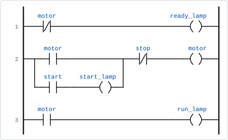
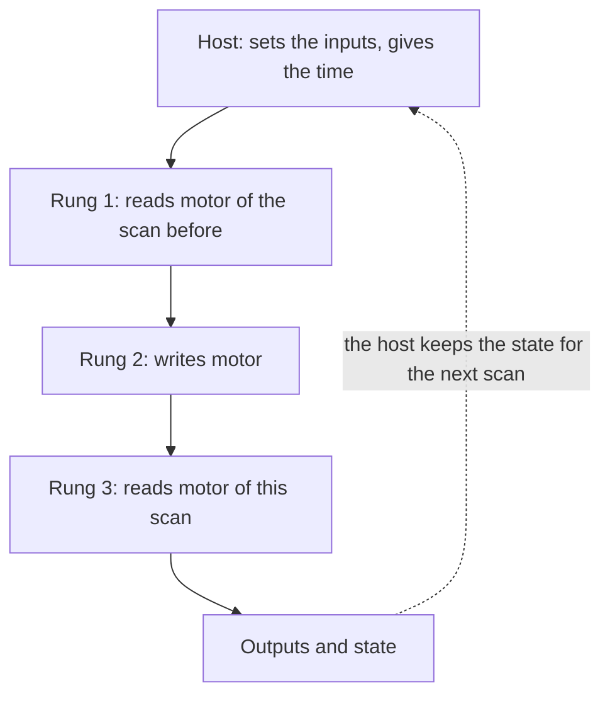

# The scan, the cycle and time

This page is for an Elixir developer who writes a [host](../reference/glossary.md#host)
for a ladder [program](../reference/glossary.md#program). It answers 3 questions:

- What does logex do in 1 [scan](../reference/glossary.md#scan)?
- Where does a [timer](../reference/glossary.md#timer) get its time?
- What are a [cycle](../reference/glossary.md#cycle) and a
  [round](../reference/glossary.md#round)?

A scan runs the [rungs](../reference/glossary.md#rung) of 1
[instance](../reference/glossary.md#instance) in sequence, from the first rung to the
last rung. A scan reads no clock. The host gives the time to each scan, as a number of
milliseconds. A cycle and a round are larger steps that hold scans.

> #### Warning {: .warning}
>
> Do not use logex for a [safety function](../reference/glossary.md#safety-function), or
> where a late scan is a danger. logex is not hard real-time. It runs on the BEAM, on a
> general-purpose operating system. It gives no maximum for the time that a scan or a
> round is late. It also gives no maximum for the change of the time between 2 rounds.
> [Safety and limits](safety-and-limits.md) gives the full list of what logex does not
> do.

## The model: a scan runs the rungs in sequence

Before a scan, the host sets the [inputs](../reference/glossary.md#input). The scan runs
rung 1, then rung 2, and each next rung to the last rung. After the last rung, the scan
returns the [outputs](../reference/glossary.md#output) and the new
[state](../reference/glossary.md#state). The host keeps the state and gives it to the
next scan.

A scan never goes back to an earlier rung. A [jump](../reference/glossary.md#jump) goes
to a later rung only, and logex refuses a program that jumps back. Thus a scan runs each
rung at most 1 time, and each scan ends. The scan does not run the rungs that a jump
passes. [Rungs that a scan does not run](rungs-that-do-not-run.md) explains this.

The program `lamps.ld` starts and stops a motor, and it sets 3 lamps. The file is in the
directory `scan-cycle-and-time` of the project. [Power flow in a rung](power-flow.md)
explains how logex runs the [instructions](../reference/glossary.md#instruction) of each
rung.

<!-- file: scan-cycle-and-time/lamps.ld -->
```text
var_input start bool
var_input stop bool
var_output ready_lamp bool
var_output start_lamp bool
var_output motor bool
var_output run_lamp bool

xio motor ote ready_lamp
( xic motor | xic start ote start_lamp ) xio stop ote motor
xic motor ote run_lamp
```

<!-- rung: scan-cycle-and-time/lamps.ld -->




Figure: 1 scan of `lamps.ld`. Rung 1 reads `motor` before rung 2 writes it, and rung 3
reads `motor` after rung 2 writes it.

An instruction changes a [tag](../reference/glossary.md#tag) when the scan runs the
instruction. These 4 rules follow from the sequence:

- A rung reads the values that an earlier rung wrote in the same scan.
- A rung reads the values that a later rung wrote in the scan before.
- An input does not change during a scan.
- The host gets the value that each output has after the last rung. It does not see a
  value that a later rung replaced.

The script `scan-cycle-and-time.exs` runs 6 scans of `lamps.ld`, in the project of
[Your first program](../tutorials/first-program.md). Before each scan,
`Logex.Runtime.put_inputs/3` changes only the inputs that its map names. The program has
no timer. Thus the script calls `Logex.Runtime.scan/2`, which gives 0 ms to the scan.

```elixir
{:ok, lamps} = Logex.compile_file("scan-cycle-and-time/lamps.ld")

# The inputs that change before each scan.
changes = [
  %{},
  %{"start" => 1},
  %{"start" => 0},
  %{"start" => 1},
  %{"start" => 0, "stop" => 1},
  %{}
]

# One scan. The state holds the inputs.
scan = fn changed, state ->
  state = Logex.Runtime.put_inputs(lamps, state, changed)
  {outputs, state} = Logex.Runtime.scan(lamps, state)
  inputs = Map.take(state.env, ["start", "stop"])
  {Map.merge(inputs, outputs), state}
end

state = Logex.Runtime.instance(lamps)
{scans, _state} = Enum.map_reduce(changes, state, scan)

row = fn name, values ->
  IO.puts(String.pad_trailing(name, 12) <> Enum.join(values, "  "))
end

row.("scan", 1..6)

for tag <- ~w(start stop ready_lamp start_lamp motor run_lamp) do
  row.(tag, Enum.map(scans, & &1[tag]))
end
```

```console
$ mix run scan-cycle-and-time.exs
scan        1  2  3  4  5  6
start       0  1  0  1  0  0
stop        0  0  0  0  1  1
ready_lamp  1  1  0  0  0  1
start_lamp  0  1  0  1  0  0
motor       0  1  1  1  0  0
run_lamp    0  1  1  1  0  0
```

The script prints 1 column for each scan. The rows `start` and `stop` are the inputs. In
scan 6, the map names no input, and `stop` stays 1.

| Scan | The result shows | The reason |
|---|---|---|
| 2 | `run_lamp` comes on in the same scan as `motor` | Rung 3 runs after rung 2. It reads the `motor` of the same scan. |
| 2 and 3 | `ready_lamp` goes off 1 scan after the motor starts | Rung 1 runs before rung 2. In scan 2, it reads the `motor` of scan 1, which is 0. |
| 3 and 4 | `start_lamp` goes to 0 and then to 1 | [Leg](../reference/glossary.md#leg) 1 of the [branch](../reference/glossary.md#branch) of rung 2 is true in these scans. logex runs leg 2 also. |
| 5 and 6 | `ready_lamp` comes on 1 scan after the motor stops | In scan 5, rung 1 reads the `motor` of scan 4, which is 1. |

Thus the sequence of the rungs is a part of the program. If rung 1 comes after rung 2,
`ready_lamp` is never 1 together with `motor`.

### The first scan finds no edge

The [first scan](../reference/glossary.md#first-scan) is the first scan of an instance
after it starts or [restarts](../reference/glossary.md#restart). A
[counter](../reference/glossary.md#counter), a
[one-shot](../reference/glossary.md#one-shot) and the pulse timer `tp` look for an edge
of their rung. For most of them, this is a
[rising edge](../reference/glossary.md#rising-edge). In the first scan, they find no
edge.

If the rung is true in the first scan, a counter does not count and a one-shot gives no
pulse. For example, a counter counts boxes at a photo-eye. A box that is at the
photo-eye when the program starts is not a new box. The counter counts the next box.

This rule is for the first scan of the instance. An
[online edit](../reference/glossary.md#online-edit) has the same rule for a counter or a
one-shot that it adds. [Rungs that a scan does not run](rungs-that-do-not-run.md) gives
the result for an instruction that runs for the first time in a later scan.

## The host gives the time

`Logex.Runtime` reads no clock. The host gives the time with each scan. The third
argument of `Logex.Runtime.scan/3` is the number of milliseconds since the last scan.

<!-- fragment: 1 call of scan/3, which gives 100 ms to the scan -->
```elixir
{outputs, state} = Logex.Runtime.scan(program, state, 100)
```

The time of an instance is the field `now` of its state. It starts at 0, and each scan
adds its number to it. After this call, `state.now` is 100 more. A call of
`Logex.Runtime.scan/2` gives 0 ms.

- **The time is a whole number of milliseconds, 0 or more.** Thus the time of an
  instance never goes back. If the host gives a negative number or a number that is not
  whole, logex raises an `ArgumentError`.
- **A timer reads this time, and no clock.** Thus a timer counts the time that the host
  gives, not the scans. [How a timer counts time](how-a-timer-counts-time.md) shows this
  with an example.

## From a scan to a cycle and a round

A [configuration](../reference/glossary.md#configuration) is a set of instances and
[tasks](../reference/glossary.md#task) that run together. A
[resource](../reference/glossary.md#resource) is a configuration while it runs. A
[runner](../reference/glossary.md#runner) is a process of logex that does the work of a
host for a resource.

- **Scan.** The rungs of 1 instance run. The host gives the time to
  `Logex.Runtime.scan/3`.
- **Cycle.** Each task of a resource that is due runs, with 1 scan for each of its
  instances. The host gives the time to `Logex.Runtime.cycle/3`, and the resource adds
  it to its time. Each scan of the cycle reads the time of the resource. The values that
  the host gives for the input [points](../reference/glossary.md#point) do not change
  during the cycle. But an instance reads a [global](../reference/glossary.md#global)
  that an earlier instance of the same cycle wrote.
- **Round.** A runner does 1 cycle. Before the cycle, it takes the newest values that
  the [devices](../reference/glossary.md#device) gave for the inputs. After the cycle,
  it writes the outputs to the devices. It reads its
  [clock](../reference/glossary.md#clock) and gives the time since the last round.

A runner has 3 rules for the time:

- **A runner starts a round when a task is due or a
  [trigger](../reference/glossary.md#trigger) changes.** If a program has no timed task,
  the rounds follow each other with no wait, at most 1 round in each millisecond of the
  clock. [Runner](../reference/runner.md) gives the exact rule.
- **A program reads a new value of an input when its task runs, not before.** For
  example, a device reports a change at 22 ms. A task with an interval of 10 ms reads
  the new value at 30 ms. [Short pulses on input points](short-pulses.md) gives the
  result for a short signal.
- **A late round gets the time that passed, not the interval of the task.** Thus a timer
  counts the correct time, but the program sees the result late.

## How it compares with IEC 61131-3 and Logix

- In [IEC 61131-3](../reference/glossary.md#iec-61131-3), a controller runs the rungs
  from the first to the last, as logex does. The standard does not say where a timer
  gets its time.
- A timer of a [Logix](../reference/glossary.md#logix) controller adds the time since
  the last scan of its instruction, as a timer of logex does.
- A controller reads its own clock and starts its own scans. In logex, the host does
  these 2 things.
- IEC 61131-3 and Logix let a program jump back. logex does not.
- A Logix controller does a prescan, a step that prepares each instruction, before its
  first scan. logex has no prescan. The first scan runs each rung. Only the instructions
  that look for an edge are different in it.

## Why logex does it this way

- **A scan is a function of its arguments.** The same state, inputs and time always give
  the same outputs. A host that records the time and the inputs of each cycle can run
  the same cycles again and get the same outputs.
- **An ExUnit test does not wait.** A test of a 10 s timer gives 10,000 ms to its scans
  as a number. It gets the same result on a fast machine and on a slow machine.
- **Only 1 part of logex reads a clock.** That part is the runner. A test gives the
  runner a manual clock and moves the time.

The decision record is
[The host gives the time](../../docs/adr/0007-the-host-gives-the-time.md).

## See also

- [How a timer counts time](how-a-timer-counts-time.md): a timer with different times
  between the scans.
- [Rungs that a scan does not run](rungs-that-do-not-run.md): what a jump and a
  [function block](../reference/glossary.md#function-block) that does not run keep.
- [Tasks and the schedule](tasks-and-scheduling.md): when a task is due, and what a
  cycle does.
- [Execution model](../reference/execution-model.md): the exact rules of a scan, a cycle
  and the time.
- [Do a test of a plant on the manual clock](../howto/test-on-the-manual-clock.md): how
  a test moves the time of a runner.
- [Timing and capacity](timing-and-capacity.md): how late a round can be.
- [Glossary](../reference/glossary.md): the technical words of logex.
