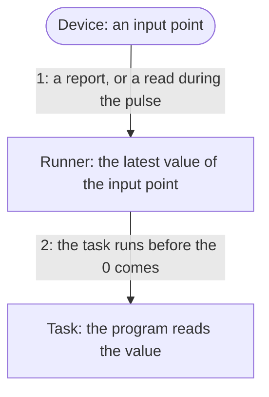
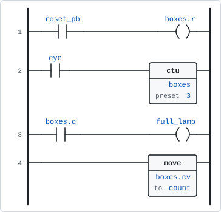

# Short pulses on input points

This page is for a reader who connects a signal to logex. It answers 1 question: why
can a program miss a short pulse, and how long must a signal hold its value?

> #### Warning {: .warning}
>
> Do not use logex for a [safety function](../reference/glossary.md#safety-function).
> logex can stop at any time, and a round can be late.
> [Safety and limits](safety-and-limits.md) gives each limit.

## The model: 2 stages from a device to a program

A pulse is a change of an input [point](../reference/glossary.md#point) to 1 and back
to 0. A pulse must pass 2 stages to get to a
[program](../reference/glossary.md#program).

First, the [runner](../reference/glossary.md#runner) must get the 1. It gets the 1 from
a report of the [device](../reference/glossary.md#device), or from a read of the device
during the pulse. The runner reads each device at an interval, 10 ms with the default
options. Some devices also report each change.

Then the [task](../reference/glossary.md#task) of the program must run before the
runner gets the 0. The runner keeps only the latest value of each input point. A
[round](../reference/glossary.md#round) takes this value when it starts.



Figure: the 2 stages of a pulse. A pulse that does not pass a stage does not get to the
program.

| The pulse | What the program sees |
|---|---|
| The device does not report it, and it rises and falls between 2 reads of the device. | Nothing. The runner never gets the 1. |
| The runner gets the 1, and the [global](../reference/glossary.md#global) at the input point is the [trigger](../reference/glossary.md#trigger) of an [event task](../reference/glossary.md#event-task). | The event task runs. |
| The runner gets the 1, and the task of the program runs before the runner gets the 0. | The program reads 1. |
| The runner gets the 1, and the task of the program does not run before the runner gets the 0. | Nothing. |

## An example: a box that the program does not count

This example shows the last row of the table. The program `boxes.ld` counts the boxes
that pass a photo-eye. The [configuration](../reference/glossary.md#configuration)
`lane.logex` runs it on a task of 50 ms.

<!-- file: short-pulses/lane.logex -->
```text
// lane.logex -- a box counter on a task of 50 ms
task slow interval 50 priority 1

var_global eye       bool at panel.i.8
var_global pb_reset  bool at panel.i.2
var_global case_full bool at panel.q.4

program b1 boxes with slow
  b1.eye       eye
  b1.reset_pb  pb_reset
  b1.full_lamp case_full
```

<!-- file: short-pulses/boxes.ld -->
```text
var_input eye bool
var_input reset_pb bool
var_output full_lamp bool
var_output count dint
var boxes ctu

xic reset_pb ote boxes.r
xic eye ctu boxes 3
xic boxes.q ote full_lamp
move boxes.cv count
```

<!-- rung: short-pulses/boxes.ld -->


The script `short-pulses.exs` runs the configuration on a manual
[clock](../reference/glossary.md#clock), with a
[simulated device](../reference/glossary.md#simulated-device) that reports each change.
3 boxes pass the photo-eye. Box 2 is at the photo-eye for only 20 ms.

```elixir
alias Logex.Runner
alias Logex.Runner.Clock.Manual
alias Logex.IO.Sim

{:ok, plant} = Logex.Configuration.compile_file("short-pulses/lane.logex")
{:ok, clock} = Manual.start_link()
{:ok, panel} = Sim.start_link(reports: true, clock: clock)

{:ok, runner} =
  Runner.start_link(
    configuration: plant,
    io: %{"panel" => {Sim, sim: panel}},
    clock: {Manual, clock}
  )

box = fn ms ->
  from = Manual.now_ms(clock)
  # A box comes to the photo-eye.
  Sim.set(panel, "panel.i.8", 1)
  Manual.advance(clock, ms)
  # The box is past the photo-eye.
  Sim.set(panel, "panel.i.8", 0)
  Manual.advance(clock, 100 - ms)
  count = Runner.get!(runner, "b1.count")
  IO.puts("a box at the eye from #{from} ms to #{from + ms} ms  count=#{count}")
end

Manual.advance(clock, 10)
box.(60)
box.(20)
box.(60)
:ok = Runner.stop(runner)
```

```console
$ mix run short-pulses.exs
a box at the eye from 10 ms to 70 ms  count=1
a box at the eye from 110 ms to 130 ms  count=1
a box at the eye from 210 ms to 270 ms  count=2
```

The task runs each 50 ms. This table shows box 2 and the runs of the task.

| Time | The photo-eye | The task `slow` | `count` |
|---|---|---|---|
| 100 ms | 0 | Runs and reads 0 | 1 |
| 110 ms | Box 2 comes | Does not run | 1 |
| 130 ms | Box 2 leaves | Does not run | 1 |
| 150 ms | 0 | Runs and reads 0 | 1 |

The runner gets the 1 of box 2 and then the 0, and no run of the task is between them.
Thus the program counts 2 boxes, not 3.

## How long a signal must hold

A program can miss a signal that holds a value for less time than the longest interval
of the tasks that read it. If the device does not report its changes, add the interval
between 2 reads of the device. This time is a minimum, not a guarantee, because a round
can be late.

Thus a signal that a program must not miss must hold its new value until the program
reads it. The signal `estop` in the examples of this documentation is such a signal. An
emergency stop button that stays pressed until a person releases it holds its signal.

## How it compares with IEC 61131-3 and Logix

[IEC 61131-3](../reference/glossary.md#iec-61131-3) does not say when a controller reads
the signals of its [plant](../reference/glossary.md#plant). In a
[Logix](../reference/glossary.md#logix) controller, the data of an I/O module changes
while the logic runs. In logex, a round takes the value of each input point 1 time, when
it starts. Thus the value of an input point does not change during a round.

An input module of a Logix controller sends its data at an interval, and it can also
send its data at a change. logex does the same. The runner reads each device at an
interval, and a device can also report a change.

## Why logex does it this way

- **A round takes 1 sample of each device.** Thus the value of an input point does not
  change while a program of the round runs. The decision record is
  [Tasks and rounds](../../docs/adr/0011-tasks-and-rounds.md).
- **logex reads each device and also takes its reports.** A report makes the wait for a
  change shorter. The read at an interval finds a change if the report does not come,
  and it shows that the device answers. The decision record is
  [Devices are processes](../../docs/adr/0014-devices-are-processes.md).

## See also

- [Safety and limits](safety-and-limits.md): what logex is not.
- [Runner](../reference/runner.md): the options of the runner and the rules of a round.
- [Tasks and the schedule](tasks-and-scheduling.md): when a task runs.
- [Timing and capacity](timing-and-capacity.md): how late a round can be.
- [Glossary](../reference/glossary.md): the technical words of logex.
