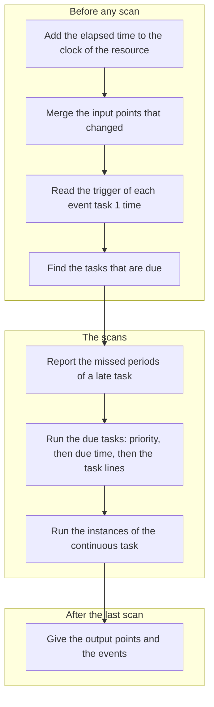
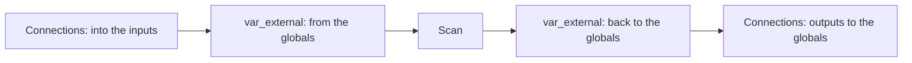

# Tasks and the schedule

This page is for a controls engineer who puts
[programs](../reference/glossary.md#program) on tasks in a
[configuration](../reference/glossary.md#configuration). It answers 3 questions:

- When is each kind of [task](../reference/glossary.md#task)
  [due](../reference/glossary.md#due)?
- In which sequence do the due tasks run in a [cycle](../reference/glossary.md#cycle)?
- What does logex do when a cycle comes late?

[Event tasks](event-tasks.md) gives the rules that are only for an [event
task](../reference/glossary.md#event-task).

> #### Warning {: .warning}
>
> Do not use logex for a [safety function](../reference/glossary.md#safety-function). A
> task can run late when the computer is busy, and logex gives no maximum for the delay.
> A task with a high priority does not interrupt a
> [scan](../reference/glossary.md#scan). It waits until the current
> [round](../reference/glossary.md#round) ends.
> [Safety and limits](safety-and-limits.md) gives each limit.

## The model: a task tells when its instances run

A configuration puts each [instance](../reference/glossary.md#instance) on 1 task. When
a task becomes due, the next cycle runs its instances. logex has 3 kinds of task.

| Kind | When the task is due |
|---|---|
| [Periodic task](../reference/glossary.md#periodic-task) | At the start and after each interval. For 10 ms: at 0, 10, 20 ms and so on |
| Event task | In a cycle where its [trigger](../reference/glossary.md#trigger) is 1 and its last sample was 0. At the start, the last sample counts as 0 |
| [Continuous task](../reference/glossary.md#continuous-task) | Never. Its instances run 1 time in each cycle, after the due tasks |

A `program` line of the
[configuration file](../reference/glossary.md#configuration-file) with no `with` puts
its instance in the continuous task. A configuration has 1 continuous task at most. If
the configuration has no continuous task, each instance with no `with` still runs 1
time in each cycle, after the due tasks.

The configuration `line.logex` has 4 tasks: 2 periodic tasks, an event task and the
continuous task. Each task runs 1 instance of `runs.ld`.

<!-- file: tasks-and-scheduling/line.logex -->
```text
// line.logex -- 4 instances of runs.ld, on 4 tasks
task fast interval 10 priority 1
task slow interval 50 priority 2
task on_estop single estop priority 0
task main continuous

var_global estop bool at panel.i.7

program conveyor runs with fast
program fan      runs with slow
program alarm    runs with on_estop
program sorter   runs
```

The program `runs.ld` counts its scans in its [output](../reference/glossary.md#output)
`runs`.

<!-- file: tasks-and-scheduling/runs.ld -->
```text
var_output runs dint

add runs 1 runs
```

## What a cycle does

The [host](../reference/glossary.md#host) calls `Logex.Runtime.cycle/3` with the time
since the last cycle and the input [points](../reference/glossary.md#point) that
changed. A [runner](../reference/glossary.md#runner) does 1 cycle in each round.
`cycle/3` gives back the output points and a list of events:
`{:ran, task, instance, now}` for each run, and `{:overlap, task, missed}` for a late
task. An instance with no task gives `:none` as its task.



Figure: 1 cycle of a resource. The 3 groups show that logex reads the inputs and the
triggers before any scan, and gives the outputs after the last scan.

A cycle has 3 rules:

- **An input point does not change during a cycle.** Each scan of the cycle reads the
  same value. A program sees a new value of an input point when its task runs.
- **A task runs its instances in the sequence of their `program` lines.** The continuous
  task runs its instances last, in the same sequence.
- **A cycle reads no [clock](../reference/glossary.md#clock).** The host gives the
  time. The runner, not the cycle, compares the time of each task, and of each round of
  the continuous task, with a [watchdog](../reference/glossary.md#watchdog).

### The sequence of the due tasks

If more than 1 task is due, logex uses 3 rules, in this sequence:

1. The task with the higher [priority](../reference/glossary.md#priority) runs first.
   The priority 0 is the highest, and 65535 is the lowest.
2. If 2 tasks have the same priority, the task with the earlier due time runs first. The
   due time of an event task is the time of the cycle. Thus a late periodic task runs
   before an event task of the same priority. The periodic task was due first.
3. If 2 tasks also have the same due time, the task whose line comes first in the
   configuration runs first.

### What an instance sees

The [resource](../reference/glossary.md#resource) holds 1 value for each
[global](../reference/glossary.md#global). logex copies the values in and out of an
instance around its scan, in this sequence:



Figure: the 4 copies around the scan of 1 instance. A
[connection](../reference/glossary.md#connection) gives an
[input](../reference/glossary.md#input) a global or a constant.
A `var_external` [declaration](../reference/glossary.md#declaration) gives the instance
the global itself.

- An instance reads what an earlier instance of the same cycle wrote.
- An instance does not read what a later instance writes. It reads that value in its
  next run.
- If an instance writes a global through `var_external`, and its connection also writes
  that global, the value of the connection stays. The connection writes last. logex
  gives a [warning](../reference/glossary.md#warning) for this configuration.

[Configuration file](../reference/configuration-file.md) gives the form of a connection.
[Share a global between programs](../howto/share-a-global.md) shows a global that 2
programs read.

## An example run

The script `examples/tasks-and-scheduling.exs` runs 7 cycles of `line.logex`. The
e-stop rises at 20 ms and falls at 40 ms. The last cycle comes 35 ms after the cycle
before it. The output and the list after it give the result. The script is for a reader
who knows Elixir.

```elixir
{:ok, line} = Logex.Configuration.compile_file("tasks-and-scheduling/line.logex")

# Each cycle: the time since the last cycle, and the inputs that change.
steps = [
  {0, %{}},
  {10, %{}},
  {10, %{"estop" => 1}},
  {10, %{}},
  {10, %{"estop" => 0}},
  {10, %{}},
  {35, %{}}
]

tasks = ["fast", "slow", "on_estop", "main"]
IO.puts("time  estop  " <> Enum.join(tasks, "  "))

# A cell gives the place of the task's run in the cycle: 1 runs first. "." is no run.
place = fn
  nil -> "."
  index -> "#{index + 1}"
end

cycle = fn {elapsed, inputs}, {rt, now, estop} ->
  {rt, _outputs, events} = Logex.Runtime.cycle(rt, elapsed, inputs)
  ran = for {:ran, task, _instance, _now} <- events, do: task
  estop = Map.get(inputs, "estop", estop)

  cells =
    for task <- tasks do
      cell = ran |> Enum.find_index(&(&1 == task)) |> place.()
      String.pad_leading(cell, byte_size(task))
    end

  time = String.pad_leading("#{now + elapsed}", 4)
  IO.puts("#{time}      #{estop}  " <> Enum.join(cells, "  "))
  {rt, now + elapsed, estop}
end

{rt, _now, _estop} = Enum.reduce(steps, {Logex.Runtime.start(line), 0, 0}, cycle)

IO.puts("missed periods: #{inspect(Logex.Runtime.overlaps(rt))}")
IO.puts("next due in: #{Logex.Runtime.next_due_in(rt)} ms")

for name <- ~w(conveyor fan alarm sorter) do
  IO.puts("#{name}.runs = #{Logex.Runtime.get!(rt, name <> ".runs")}")
end
```

```console
$ mix run tasks-and-scheduling.exs
time  estop  fast  slow  on_estop  main
   0      0     1     2         .     3
  10      0     1     .         .     2
  20      1     2     .         1     3
  30      1     1     .         .     2
  40      0     1     .         .     2
  50      0     1     2         .     3
  85      0     1     .         .     2
missed periods: %{"fast" => 2, "main" => 0, "on_estop" => 0, "slow" => 0}
next due in: 5 ms
conveyor.runs = 7
fan.runs = 2
alarm.runs = 1
sorter.runs = 7
```

Each row is 1 cycle. A number is the place of the run of the task in the cycle: 1 runs
first. A dot is no run.

- **0 ms:** each periodic task is due in the first cycle.
- **10 to 40 ms:** `slow` does not run. Its next due time is 50 ms.
- **20 ms:** `estop` rises, and `on_estop` runs first. The priority 0 is the highest.
- **30 and 40 ms:** `on_estop` does not run. `estop` stays 1 and then falls. Neither is
  a rise.
- **85 ms:** `fast` runs 1 time and misses 2 periods. [A late cycle](#a-late-cycle)
  gives the rule.
- **Each cycle:** `main` runs last, after the due tasks.
- **After the cycles:** the next due time of `fast` is 90 ms, 5 ms after the last cycle.
  `conveyor` ran 7 times, 1 time in each cycle.

## A late cycle

A periodic task is due at the start and then at each multiple of its interval: 0, 10,
20 ms and so on. The start is the call of `Logex.Runtime.start/1`. A
[restart](../reference/glossary.md#restart) starts the count again at the time of the
restart. An [online edit](../reference/glossary.md#online-edit) that changes the
interval also moves the due times. In the example run, `fast` was due at 60 ms, but the
next cycle came at 85 ms.

| Due time of `fast` | What logex does |
|---|---|
| 60 ms | The cycle at 85 ms runs `fast` 1 time. |
| 70 ms and 80 ms | logex does not run `fast` for these times. It counts them as 2 missed periods. |
| 90 ms | The next due time. It is the next multiple of 10 ms, 5 ms after the late cycle. |

logex calls a missed period an overlap. It reports the missed periods in the event
`{:overlap, "fast", 2}`, before the run of the task. `Logex.Runtime.overlaps/1` gives
the total of the missed periods of each task. The continuous task never misses a period,
and an event task with no interval never misses a period. [Event tasks](event-tasks.md)
shows a task with a trigger and an interval.

The first cycle obeys the same rule. If it comes at 35 ms, a task with an interval of
10 ms runs 1 time. It misses 3 periods: 10, 20 and 30 ms.

## On the clock

A runner does not stop a round when a task becomes due. The task runs at the start of
the next round. Thus a long round makes a due task late. The runner keeps the due times
on its clock and does not count each interval from the last run. Thus the due times do
not drift, also after a late round.

[The scan, the cycle and time](scan-cycle-and-time.md) tells when a round comes.
[Runner](../reference/runner.md) gives the exact rules of the rounds.

## How it compares with IEC 61131-3 and Logix

The same:

- [IEC 61131-3](../reference/glossary.md#iec-61131-3) has the periodic task
  (`INTERVAL`), the event task (`SINGLE`) and the priority.
- A [Logix](../reference/glossary.md#logix) controller has 1 continuous task at most,
  and starts it again when a scan of it ends (1756-PM005M, page 8). The runner of logex does the same, at most
  1 time in each millisecond of its clock.
- A Logix controller counts the overlaps of a task, as logex does (1756-RM018A, the
  TASK object, page 275).

Different:

- IEC 61131-3 lets a task interrupt a task of a lower priority, and a Logix controller
  interrupts its continuous task (1756-PM005M, page 13). logex never interrupts a scan. The priority gives only
  the sequence of the tasks in a cycle.
- IEC 61131-3 makes a missed deadline an error that the system reports. logex reports
  it as an `{:overlap, ...}` event and continues.
- IEC 61131-3 does not give the sequence of the programs in a task. logex runs them in
  the sequence of their `program` lines.
- In IEC 61131-3, `SINGLE` and `INTERVAL` can be a constant or any variable. In logex, a
  trigger is a `bool` global, and an interval is a whole number of milliseconds.

## Why logex does it this way

- **A cycle is a function of its arguments.** The same elapsed times and inputs always
  give the same outputs and events. A host that records them can run the same cycles
  again and get the same result.
- **A scan takes no time in the model.** Thus logex has nothing to interrupt, and the
  priority sets only the sequence.
- **A late task runs 1 time.** A run for each missed period gives a burst of outputs
  after a pause, and the work after a long pause has no limit.

The decision record is [Tasks and rounds](../../docs/adr/0011-tasks-and-rounds.md).

## See also

- [Event tasks](event-tasks.md): the trigger of an event task, and what it does to a
  [timer](../reference/glossary.md#timer), a [counter](../reference/glossary.md#counter)
  or a [one-shot](../reference/glossary.md#one-shot).
- [The scan, the cycle and time](scan-cycle-and-time.md): a scan, a cycle and a round.
- [Short pulses on input points](short-pulses.md): how long a signal must hold.
- [Execution model](../reference/execution-model.md): the exact rules of a cycle.
- [Use an event task](../howto/use-an-event-task.md): the steps to add an event task.
- [Trips and watchdogs](trips-and-watchdogs.md): the
  [trip](../reference/glossary.md#trip) of the runner when a task runs too long.
- [Timing and capacity](timing-and-capacity.md): how late a round can be.
- [Glossary](../reference/glossary.md): the technical words of logex.
