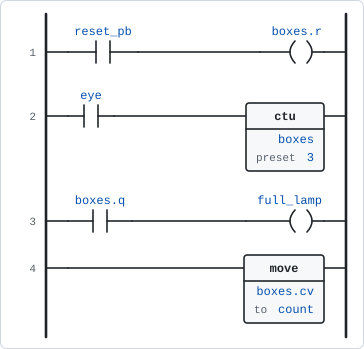
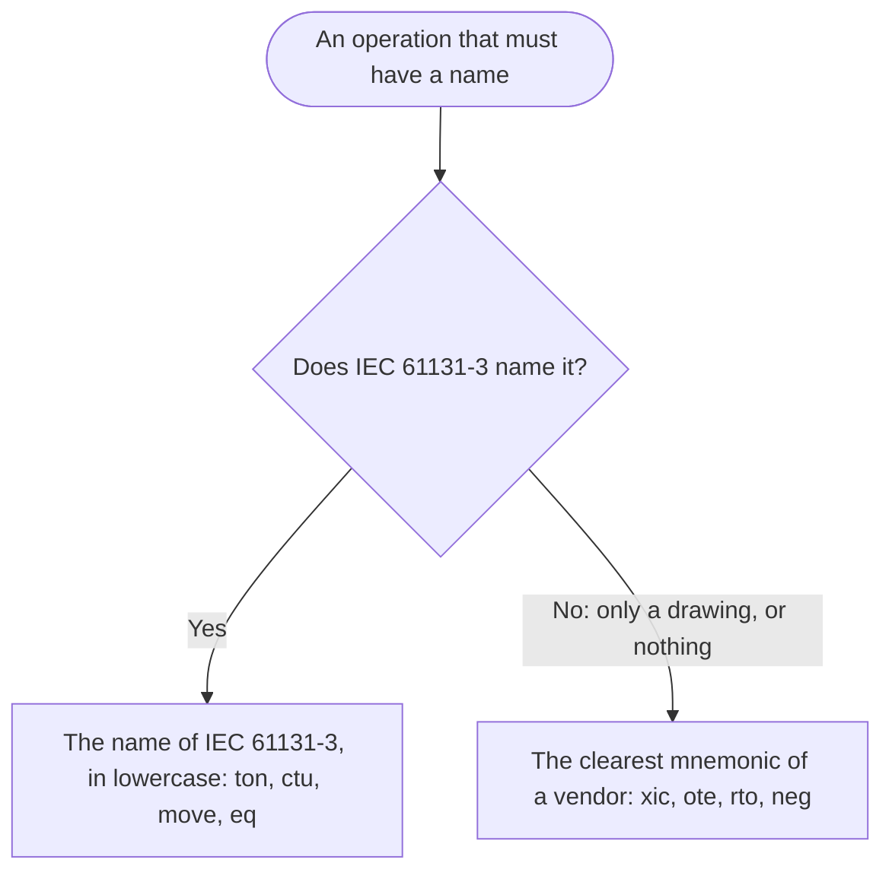

# The dialect and IEC 61131-3

This page is for a controls engineer who knows
[IEC 61131-3](../reference/glossary.md#iec-61131-3) or the ladder language of a vendor.
It answers 2 questions. Why does logex have its own text form for ladder logic, the
[dialect](../reference/glossary.md#dialect)? Where does each word of the dialect come
from?

IEC 61131-3 defines ladder logic as a drawing. It has no text form of a rung with
mnemonics. Thus each ladder language in text is a dialect. Where IEC 61131-3 names an
operation, the dialect of logex has that name.

[What logex is](what-logex-is.md) explains the model of a program and of a
[scan](../reference/glossary.md#scan).
[How logex differs from IEC 61131-3](differences-from-iec.md) compares the rules of the
dialect with the standard.
[How logex differs from Logix](differences-from-logix.md) compares logex with a
[Logix](../reference/glossary.md#logix) controller.

> #### Caution {: .error}
>
> Do not give logex a program from a different tool. logex reads only its own dialect.
> It does not read a text form of IEC 61131-3, and it does not read the export format
> of a vendor. logex has no function that imports a program, and it will not have one.
> To move a program to logex, write it again in the dialect.
> [Port a program from Logix or IEC 61131-3](../howto/port-a-program.md) gives the
> steps.

## The model: 1 rung, 1 line

A [program](../reference/glossary.md#program) in logex is a text file. Each
[declaration](../reference/glossary.md#declaration) is 1 line, and each
[rung](../reference/glossary.md#rung) is 1 line. An
[instruction](../reference/glossary.md#instruction) is a
[mnemonic](../reference/glossary.md#mnemonic) and then its
[operands](../reference/glossary.md#operand). A space separates each word from the next
word. An operand has no parentheses. The end of the line is the end of the rung.

This program counts the boxes that pass a photo-eye. The lamp `full_lamp` comes on at 3
boxes.

<!-- file: boxes.ld -->
```text
var_input eye bool
var_input reset_pb bool
var_output full_lamp bool
var_output count dint
var boxes ctu

xic reset_pb ote boxes.r
xic eye ctu boxes 3
xic boxes.q ote full_lamp
move boxes.cv count
```

<!-- rung: boxes.ld -->


logex has words from 3 sources, and `boxes.ld` has words from 2 of them.

| Word in `boxes.ld` | Source |
|---|---|
| `var_input`, `var_output`, `var` | IEC 61131-3: the [section](../reference/glossary.md#section) words VAR_INPUT, VAR_OUTPUT and VAR |
| `bool`, `dint` | IEC 61131-3: the [type](../reference/glossary.md#type) words BOOL and DINT |
| `ctu` | IEC 61131-3: CTU, the function block of an up [counter](../reference/glossary.md#counter). In logex, `ctu` is a type word and a mnemonic |
| `boxes.r`, `boxes.q`, `boxes.cv` | IEC 61131-3: R is an input of the CTU, and Q and CV are its outputs. In logex, they are [members](../reference/glossary.md#member) |
| `move` | IEC 61131-3: MOVE |
| `xic`, `ote` | The [conventional set](../reference/glossary.md#conventional-set): XIC and OTE. IEC 61131-3 has only a drawing for a [contact](../reference/glossary.md#contact) and for a [coil](../reference/glossary.md#coil) |

Rung 1 resets the counter. A coil writes the member `r`, and logex has no instruction
that resets a counter.

logex also reads a mnemonic, a section word and a type word in uppercase:
`VAR_INPUT eye BOOL`, `XIC eye CTU boxes 3`. The name of a
[tag](../reference/glossary.md#tag) and the name of a member are case-sensitive. Write
`boxes.q`. logex refuses `boxes.Q`.

### The source of each word

| Kind of word | Source | Examples |
|---|---|---|
| 28 of the 40 mnemonics, and the typed conversions such as `int_to_dint` | IEC 61131-3 | `ton`, `ctu`, `move`, `eq`, `shl` |
| 12 of the 40 mnemonics | The conventional set | `xic`, `xio`, `ote`, `otl`, `otu`, `ons`, `osr`, `osf`, `rto`, `neg`, `jmp`, `lbl` |
| The type words, the section words and the [qualifiers](../reference/glossary.md#qualifier) | IEC 61131-3. The type words `rto` and `rto_ltime` are the mnemonic of the conventional set, and `_ltime` is the suffix of IEC 61131-3 | `dint`, `var_input`, `retain` |
| The members of a counter | IEC 61131-3. The members `ov` and `un` are from the conventional set | `cu`, `pv`, `q`, `cv` |
| The members of a [timer](../reference/glossary.md#timer) | The conventional set. The member `r` of an `rto` has the name of the reset of a counter | `pre`, `acc`, `dn` |
| The words of a [configuration file](../reference/glossary.md#configuration-file) | IEC 61131-3. The words `continuous` and `watchdog` are from the conventional set | `task`, `interval` |
| The 3 punctuation characters of a [branch](../reference/glossary.md#branch), and the address of a [point](../reference/glossary.md#point) | logex only | `panel.q.0` |

[How logex differs from IEC 61131-3](differences-from-iec.md#the-members-of-a-timer-and-of-a-counter)
gives each member with its name in IEC 61131-3. The
[glossary](../reference/glossary.md#instruction-mnemonics) gives the name of each
mnemonic in IEC 61131-3 and in the conventional set.

## How logex selects a name

logex selects each name with 2 rules, in this sequence.



Figure: the 2 rules for a name. A name of IEC 61131-3 comes before a mnemonic of a
vendor.

- **If IEC 61131-3 names the operation, logex has that name in lowercase.** IEC 61131-3
  names each function and each function block.
- **If IEC 61131-3 has only a drawing, or has nothing, logex has the clearest mnemonic
  of a vendor.** Each of the 12 mnemonics of this rule is from the conventional set.

logex does not make a new readable word for an operation that has a standard name. It
has no `on_delay` and no `equal`. A controls engineer knows TON and EQ, and each manual
has these names.

2 facts about IEC 61131-3 are the reason for the second rule:

- IEC 61131-3 defines a contact and a coil as drawings with English names, such as
  "Normally open contact". Thus a contact and a coil have no standard mnemonic.
- Edition 4 of IEC 61131-3, from 2025, does not have Instruction List. Instruction List
  was the only language of the standard with mnemonics. The mnemonic `cal` is the word
  CAL of Instruction List in Editions 2 and 3.

Thus IEC 61131-3 has no text form with mnemonics for ladder logic. Each ladder language
with mnemonics is a dialect.

The survey [`docs/naming.md`](../../docs/naming.md) is the record of the names. It has 1
entry for each word of logex, with the name in IEC 61131-3 and in the tools of the major
vendors.

## Why a branch is punctuation

Rule 2 gives a branch the 3 words BST, NXB and BND of the conventional set. logex makes
1 exception to this rule: a branch is punctuation. The character `(` opens the branch,
`|` is between 2 [legs](../reference/glossary.md#leg), and `)` closes the branch.

<!-- part of: motor.ld -->
```text
( xic start | xic motor ) xio stop ote motor
```

<!-- rung: motor.ld 1 -->


The conventional set has 2 text forms for a branch, and logex has neither of them.

- **The 3 words BST, NXB and BND.** Each word has letters only, and the name of a tag
  can have the same letters. If 1 space is missing, the word becomes part of a name.
- **Brackets and commas, with each operand between parentheses: `XIC(start)`.** This
  form needs parentheses around each operand. In logex, only a space separates 2 words.

These 2 lines are in the form with words, which logex does not read. Line 2 is line 1
with 1 space missing.

<!-- unchecked: a rung in a form that logex does not read, 2 times, the second with 1 space missing -->
```text
bst xic start nxb xic motor bnd xio stop ote motor
bst xic startnxb xic motor bnd xio stop ote motor
```

In line 2, `startnxb` has the form of the name of a tag, and no word separates the 2
legs. The line then reads as 1 leg with 2 contacts in series.

A punctuation character cannot be part of a name. Thus the rung of `motor.ld` is the
same rung with no spaces at the punctuation:

<!-- unchecked: the rung of motor.ld with no spaces at the punctuation -->
```text
(xic start|xic motor)xio stop ote motor
```

If a rung has 1 of the 3 words in the position of a mnemonic, logex reports a
[diagnostic](../reference/glossary.md#diagnostic) for that word. The diagnostic gives
the form to write:

<!-- unchecked: the diagnostic for the word bst on line 4 of a program -->
```text
line 4: `bst` is no longer a keyword — branches are written `( … | … )`
```

## How it compares with IEC 61131-3 and Logix

The dialect has the names of IEC 61131-3, and it has the contacts and the coils of the
conventional set. Its rules are the rules of logex.

- [How logex differs from IEC 61131-3](differences-from-iec.md) compares a declaration,
  a timer, a counter and a time with the standard.
- [How logex differs from Logix](differences-from-logix.md) compares the behaviour of
  logex with the behaviour of a Logix controller.

## Why logex does it this way

- **IEC 61131-3 has no text form of a rung.** Thus logex cannot conform to one. The
  decision record is
  [Its own dialect and names](../../docs/adr/0002-own-dialect-and-names.md).
- **logex has the words of the conventional set, not its formats.** It does not have
  its addresses, such as `I:003/4` or `T4:5/DN`, or its file formats.

## See also

- [Instruction cheatsheet](../reference/cheatsheet.cheatmd): each instruction of logex
  on 1 page.
- [Your first program](../tutorials/first-program.md): run a program and see each scan.
- [Source syntax](../reference/source-syntax.md): the exact rules of the text of a
  program.
- [How logex differs from IEC 61131-3](differences-from-iec.md): the rules of the
  dialect, compared with the standard.
- [How logex differs from Logix](differences-from-logix.md): the behaviour of logex and
  of a Logix controller.
- [Port a program from Logix or IEC 61131-3](../howto/port-a-program.md): the steps for
  a program from a different tool.
- [Glossary](../reference/glossary.md): the technical words of logex.
