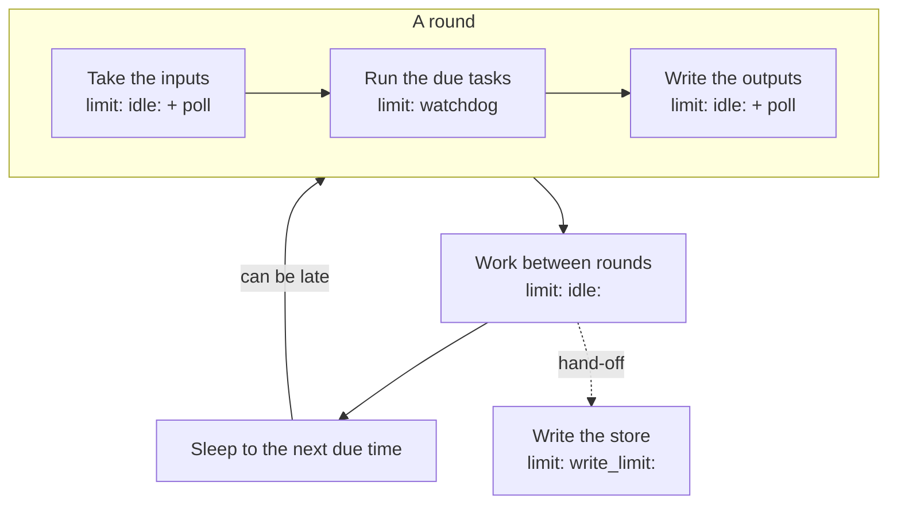

# Timing and capacity

This page is for a reader who decides if logex is fast enough and steady enough for a
[plant](../reference/glossary.md#plant). It also helps a reader who sets the
[watchdogs](../reference/glossary.md#watchdog) of a
[runner](../reference/glossary.md#runner). It answers 3 questions:

- How late can a [round](../reference/glossary.md#round) be?
- What does a [scan](../reference/glossary.md#scan) cost?
- How large can a plant be before the runner [trips](../reference/glossary.md#trip)?

> #### Warning {: .warning}
>
> Do not use logex where an output [point](../reference/glossary.md#point) that changes
> late can cause injury or damage to a machine. logex is not hard real-time, and it gives
> no limit for how late a round is. A watchdog finds late work only after the limit. Make
> each [safety function](../reference/glossary.md#safety-function) with hardwired
> circuits or with a safety-rated controller.

> #### Note {: .info}
>
> Each figure on this page is from 1 computer: a Linux computer with 4 cores, which other
> software also used. A different computer gives different figures. Measure your plant on
> the computer that runs it.

## The model

### Where the time of the runner goes

Each [periodic task](../reference/glossary.md#periodic-task) has fixed
[due](../reference/glossary.md#due) times on the [clock](../reference/glossary.md#clock)
of the runner. For a task with an interval of 10 ms, they are 0, 10, 20 ms and so on
after the start. The runner sleeps until the next due time, and then it does a round.
Between 2 rounds, it does other work.

With a [continuous task](../reference/glossary.md#continuous-task), or a
[program](../reference/glossary.md#program) with no task, the runner does not sleep
between rounds. It runs the rounds back to back, 1 round in each millisecond of its clock
at most. It does the other work in a share of the time, the option `overhead:`.

Before each [task](../reference/glossary.md#task) and before other work, the runner sends each
[device](../reference/glossary.md#device) a deadline. The deadline is the watchdog of the
task, or `idle:` for other work, and 1 [poll period](../reference/glossary.md#poll-period).
If the deadline passes, the device writes 0 to each output point. Thus a run that is too
long cannot keep the outputs on.
[The runner and each device watch each other](trips-and-watchdogs.md#the-runner-and-each-device-watch-each-other)
gives the rule.

Figure: the work of the runner and the limit of each part. Only the sleep has no limit,
and the wake after it can be late.

The time of each part grows with a different thing. This table gives each part of the
figure, what makes it longer and its limit.

| Part | It takes longer with | Limit, by default |
|---|---|---|
| Sleep to the next due time | The other work of the computer | None. The deadline of each device can pass |
| Take the inputs | A device whose [adapter](../reference/glossary.md#adapter) is slow | A device that is silent for `idle:` and 1 poll period, 510 ms |
| Run the due tasks | The [instances](../reference/glossary.md#instance), [rungs](../reference/glossary.md#rung) and array [elements](../reference/glossary.md#element) that the task runs, and a busy computer | The watchdog of the task, 500 ms. For the continuous task, the watchdog of its round |
| Write the outputs | A device whose adapter is slow | `idle:` and 1 poll period for each device, 510 ms |
| Work between rounds | The size of the [resource](../reference/glossary.md#resource), the values that an [online edit](../reference/glossary.md#online-edit) moves, the retained values | `idle:`, 500 ms |
| Write the store | The retained values and the disk | `write_limit:`, 5,000 ms |

The work between rounds is, for example:

- a request of the [host](../reference/glossary.md#host)
- a step of an online edit
- the copy of the retained values that the runner gives to the writer of the
  [store](../reference/glossary.md#store)

When a part other than the store passes its limit, the runner trips and writes 0 to each output point.
[A watchdog is a limit of time](trips-and-watchdogs.md#a-watchdog-is-a-limit-of-time)
gives the reason of each trip.

A write of the store does not trip the runner when it passes `write_limit:`. The runner
reports `{:retain, {:error, :timeout}}` and runs on. But a fresh start that must write
the store first does not start, and a [cold restart](../reference/glossary.md#cold-restart)
stays tripped. [The store](plant-size.md#the-store) gives each case.

### A late round

The runner runs on a general-purpose operating system, and other software shares the
cores of the computer. When the computer is busy, the runner can wake late.

- A late periodic task runs 1 time. It does not run 1 time for each period that it
  missed.
- The runner sends the missed periods in the event `{:overlap, task, missed}` to each
  process that subscribes to `:overlap` with `Logex.Runner.subscribe/2`.
  `Logex.Runner.status/1` gives the total in `overlaps`.
- A task never runs before its due time.
- A late round does not move the due times. They stay at 0, 10, 20 ms and so on, until a
  [restart](../reference/glossary.md#restart) or an online edit that changes the
  interval.
- A [timer](../reference/glossary.md#timer) in a late round adds the time that passed.
  Thus the result of the timer is late, but the timer counts the correct time.
- A runner that is late by more than 4 × `idle:` and 1 poll period can trip with
  `{:watchdog, {:late, ms}}`.

[Tasks and the schedule](tasks-and-scheduling.md#a-late-cycle) shows a late
[cycle](../reference/glossary.md#cycle) step by step.

## How late a round can be

These measurements show a conveyor, [`conveyor.ld`](../../examples/conveyor.ld), on a
periodic task of 10 ms with a watchdog of 50 ms. Each measurement has 1
[simulated device](../reference/glossary.md#simulated-device) and the defaults of
`Logex.Runner.start_link/1`. Each measurement runs the conveyor for 60 s or until a
trip. The lateness of a run of the task is the time from its due time to its start. The
clock of the runner counts whole milliseconds.

Other software used the computer in each measurement. The load average is the mean
number of processes that run on a core or wait for one. A busy loop is a process that
keeps 1 core busy all the time. The last 3 measurements also had busy loops.

| Load on the computer | Length | Most late run | Missed periods | Result |
|---|---|---|---|---|
| Load average 1 | 60 s | 6 ms | 0 | Runs |
| Load average 4 to 9 | 60 s | 5 ms | 0 | Runs |
| Load average 6 to 15 | 60 s | 28 ms | 2 | Runs |
| 4 busy loops | 8.6 s | 463 ms | 784 | Trips, the task |
| 4 busy loops | 0.9 s | 567 ms | 91 | Trips, the device |
| 2 busy loops | 2.0 s | 956 ms | 163 | Trips, the device |

The reasons of the 3 trips:

- the task: `{:watchdog, {:task, "fast", 58, 50}}`
- the device, 2 times: `{:watchdog, {:device, "panel", 510}}`

In each of the first 3 measurements, 99 runs of the task in 100 were late by 1 ms or
less.

The last 3 measurements show that a busy computer can trip a plant whose program and
devices are correct. The conveyor needs about 3 µs for a scan. But in the fourth
measurement, its task took 58 ms, more than its watchdog of 50 ms. The operating system
did not run the virtual machine for most of that time. In the last 2 measurements, the
device got no new deadline from the runner for 510 ms. The device then wrote 0 to each
output point, and the runner tripped.

On your computer, `Logex.Runner.status/1` gives the most late wake in `latest_wake` and
the longest run of each task in `runs`. [Set watchdogs](../howto/set-watchdogs.md) gives
the steps to measure a plant and set each limit.

## What a scan costs

logex keeps a program as data, not as machine code. A scan reads each
[instruction](../reference/glossary.md#instruction) and does what it says. Thus the time
of a scan grows with the rungs and the instances.
[Programs as data](programs-as-data.md) gives the reason.

These figures are for `Logex.Runtime.cycle/3`, with instances of
[`motor.ld`](../../examples/motor.ld), a program of 5 rungs, on 1 task. 1 cycle runs 1
scan of each instance. These figures have no runner, no device and no clock.

| Instances of `motor.ld` | Time of a cycle, median | 99 cycles in 100 take at most |
|---|---|---|
| 1 | 3 µs | 16 µs |
| 10 | 36 µs | 93 µs |
| 100 | 0.39 ms | 0.77 ms |
| 1,000 | 4.4 ms | 10.2 ms |

Thus an instance of `motor.ld` costs about 4 µs a scan.

The runner also takes the inputs and writes the outputs in each round. For the conveyor
on a task of 10 ms, the virtual machine was busy for about 0.15 ms in each round. The
operating system counted 0.3 ms to 0.6 ms of processor time in each round, 3 % to 6 % of
1 core.

## How large a plant can be

A plant of small programs is far from the limits of time. A large
[array](../reference/glossary.md#array) of timers,
[counters](../reference/glossary.md#counter) or
[function block](../reference/glossary.md#function-block) instances can pass them. On
this computer, with the defaults:

- A scan of 32,768 timers or counters ran at each load. A scan of 65,536 timers, or of
  32,768 block instances, ran at one load and tripped at a higher load.
- The [test](../reference/glossary.md#test) step of an online edit over 10,922 block
  instances ran 3 times and tripped 1 time.
- A warm start with 32,768 retained timers took 13 s or more.

[How large a plant can be](plant-size.md) gives the measurements and what to change.

## How it compares with IEC 61131-3 and Logix

- [IEC 61131-3](../reference/glossary.md#iec-61131-3) defines no watchdog. It makes a
  task that misses its deadline an error, which a system reports or documents as not
  reported (edition 2, subclauses 2.7.2 and 1.5.1).
- A [Logix](../reference/glossary.md#logix) controller gives each task a watchdog,
  500 ms by default (1756-PM005M, page 34). It counts the overlaps of a task
  (1756-RM018A, the TASK object, page 275).
- logex has the same default watchdog. It counts and reports the missed periods, and
  runs on.

## Why logex does it this way

- **The due times do not move.** The runner sleeps to the next due
  time, not for an interval after the last run. Thus the due times do not drift. The
  decision record is [Tasks and rounds](../../docs/adr/0011-tasks-and-rounds.md).
- **A late task runs 1 time.** A run for each missed period gives a burst of outputs
  after a pause. After a long pause, the number of runs to catch up has no limit.
- **A trip, not a hang.** When work passes its limit, the runner trips and writes 0 to
  each output point. During a long run, the deadline of each device writes the 0. The
  decision record is
  [Watchdogs and the trip](../../docs/adr/0013-watchdogs-and-the-trip.md).

## See also

- [How large a plant can be](plant-size.md): the measurements of large arrays against
  the defaults.
- [Safety and limits](safety-and-limits.md): what logex is not.
- [Trips and watchdogs](trips-and-watchdogs.md): each watchdog and what a trip does.
- [Tasks and the schedule](tasks-and-scheduling.md): when a task is due, and a late
  cycle.
- [How a timer counts time](how-a-timer-counts-time.md#how-exact-a-timer-is): a timer in
  a late scan.
- [Programs as data](programs-as-data.md): why a scan reads the program as data.
- [Runner](../reference/runner.md): the options and the keys of `status/1`.
- [Set watchdogs](../howto/set-watchdogs.md): the steps to set each limit.
- [Glossary](../reference/glossary.md): the technical words of logex.
