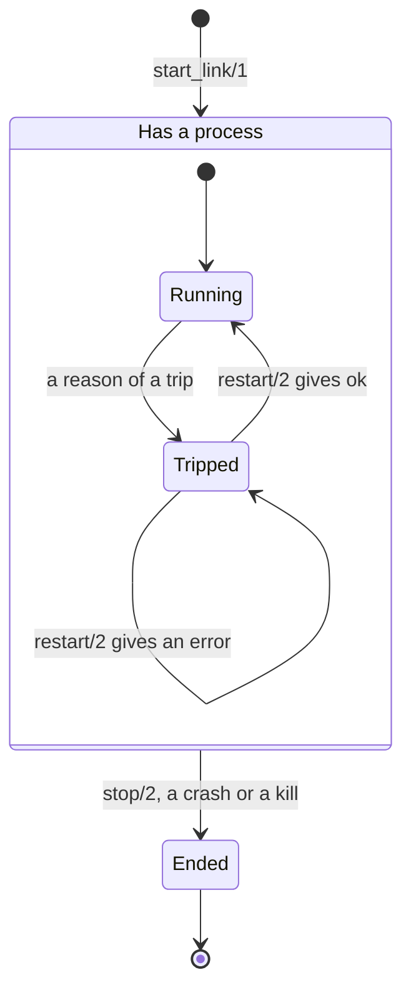
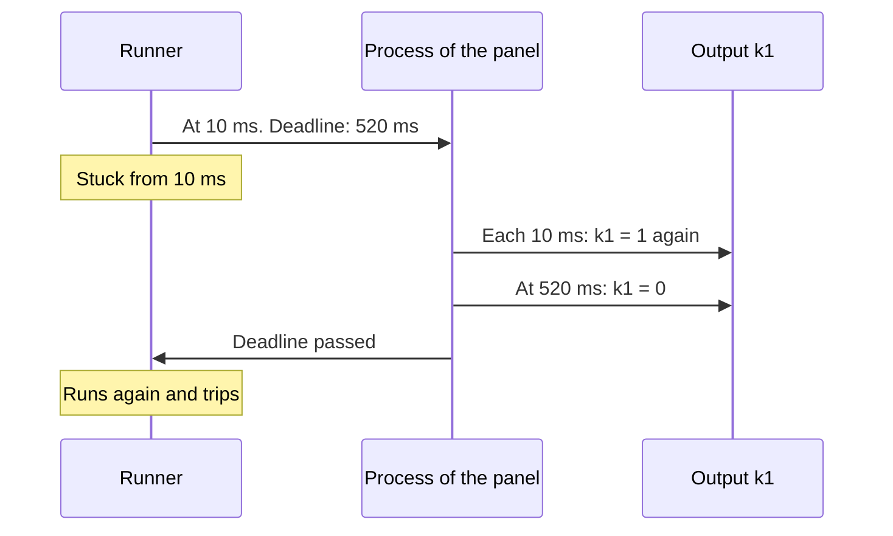

# Trips and watchdogs

This page is for a reader who runs a [plant](../reference/glossary.md#plant) on the
[runner](../reference/glossary.md#runner). It answers 3 questions: what is a
[watchdog](../reference/glossary.md#watchdog) for, what does a
[trip](../reference/glossary.md#trip) do, and what can a trip not do?

> #### Warning {: .warning}
>
> Do not use logex for a [safety function](../reference/glossary.md#safety-function).
> A trip writes 0 only through a [device](../reference/glossary.md#device) that answers,
> and only while the Elixir virtual machine runs. Make each safety function with
> hardwired circuits or with a safety-rated controller.

## The model

### A watchdog is a limit of time

logex runs on a general-purpose computer, and its work can be late. A watchdog is a
limit of time for 1 kind of work. When the work takes longer than the limit, the runner
trips. A watchdog finds late work after the limit. It is not a guarantee that the work
is never late.

Only the runner has watchdogs, because `Logex.Runtime` reads no
[clock](../reference/glossary.md#clock). A [host](../reference/glossary.md#host) that
calls `Logex.Runtime.cycle/3` itself has no watchdog and no trip. It gets each
[major fault](../reference/glossary.md#major-fault) as an event and decides what to do.

The options `idle:` and `poll:` of `Logex.Runner.start_link/1` set 2 of the limits.

| What the runner watches | The limit | The reason of the trip |
|---|---|---|
| The run of a [periodic task](../reference/glossary.md#periodic-task) or an [event task](../reference/glossary.md#event-task) | `watchdog` on the line of the [task](../reference/glossary.md#task), 500 ms by default | `{:watchdog, {:task, task, took_ms, limit_ms}}` |
| A [round](../reference/glossary.md#round) of the [continuous task](../reference/glossary.md#continuous-task), with the runs of the other tasks in it | `watchdog` on the line of the continuous task, 500 ms by default. With no continuous task, 500 ms and the name `:none` | `{:watchdog, {:round, task, took_ms, limit_ms, steps}}` |
| The work of the runner between rounds, for example a request of the host | `idle:`, 500 ms by default | `{:watchdog, {:idle, ms, work}}` |
| A device that gets no message from the runner | The watchdog of the task that runs, or `idle:`, and 1 [poll period](../reference/glossary.md#poll-period), 510 ms by default | `{:watchdog, {:device, device, ms}}` |
| A device that does not answer the runner | `idle:` and 1 poll period, 510 ms by default | `{:io, device, :timeout}` |

### What else trips the runner

- An [adapter](../reference/glossary.md#adapter) that fails: `{:io, device, cause}`.
- The process of a device that stops: `{:io, device, {:down, reason}}`.
- A major fault in a [scan](../reference/glossary.md#scan):
  `{:fault, task, instance, fault}`.
- A clock that gives no usable time: `{:clock, {:now_ms, answer}}` or
  `{:clock, {:wall_ms, answer}}`.

[Runner](../reference/runner.md) gives each reason with its fields.

### The runner and each device watch each other

Each device runs in a separate process. Before the runner runs each task of a round, it
sends each device a deadline: the watchdog of that task and 1 poll period. Before the
runner does other work, or waits for the next round, the deadline is `idle:` and 1 poll
period.

If a device gets no message before its deadline, it writes 0 to each output
[point](../reference/glossary.md#point) 1 time and tells the runner. Then it
writes nothing more except that 0, until a [restart](../reference/glossary.md#restart).
Example: the runner is stuck in a task with a watchdog of 50 ms. Each device that runs
writes 0 at most 60 ms after the task starts.

Each device also tells the runner each time its adapter finishes a read or gives values.
A device that hangs in a read gives no new inputs, and a stop button can then read as not
pressed. Because of this, a device that is silent for `idle:` and 1 poll period trips the
runner, and the runner kills its process.

At each poll period, each device writes its last outputs again. Some drives set their
outputs to 0 when the controller stops sending. Such a drive stays on while the runner
runs on time.

### When the computer is late

A busy computer can delay the runner and the processes of the devices. A runner that
wakes late waits 1 poll period more before it trips for a silent device. The limit of
this silence is 4 × `idle:` + 1 poll period, 2,010 ms by default. A device that is silent
for longer trips the runner at the next check. If the runner itself is late by more than that limit, and each
device is silent as long, the reason is `{:watchdog, {:late, ms}}`. The operator then
looks at the computer, not at a healthy device.

## What a trip does

Whatever the reason, a trip does these things:

- The runner runs no more rounds.
- It writes 0 to each output point 1 time, through each device that answers. Then
  the device writes nothing more except that 0, until a restart.
- If the option `retain:` names a [store](../reference/glossary.md#store), it writes the
  store after each output is 0.
- It sends `{:trip, reason}` to each process that called `Logex.Runner.subscribe/2`, and
  `Logex.Runner.status/1` gives the reason. A later failure does not change it.
- It keeps the [resource](../reference/glossary.md#resource) as the last round left it.
  `Logex.Runner.get/2` reads it.
- It waits for `Logex.Runner.restart/2` with `:cold` for a
  [cold restart](../reference/glossary.md#cold-restart) or `:warm` for a
  [warm restart](../reference/glossary.md#warm-restart).
  [Restart after a trip](../howto/restart-after-a-trip.md) gives the steps.

The runner checks the watchdogs, the major faults and the devices before it writes the
outputs of a round. If a check fails, the outputs of that round never get to the plant.
The runner writes the devices in the order of their names. If a device fails in that
write, the devices before it keep the outputs of the round until the trip writes 0.

After a restart, a device writes nothing until the first round writes its outputs.
Because of this, a restart never sends the outputs that the plant had before the trip.



Figure: the life of a runner. Only a call of `restart/2` takes a tripped runner back
to `Running`.

A restart that fails gives `{:error, reason}`, and the runner stays tripped with its
first reason. A call of `restart/2` while the runner runs raises an `ArgumentError`.
If a running runner stops, crashes or loses its clock, each device writes 0 to each
output point 1 time. Then it closes its adapter.

## 3 failures and who writes the 0

The [configuration](../reference/glossary.md#configuration) `line.logex` runs the
conveyor on a task of 10 ms with a watchdog of 50 ms. The motor contactor `k1` is at
the point `panel.q.0`. The script `trips-and-watchdogs.exs` starts the conveyor 3 times
on a [simulated device](../reference/glossary.md#simulated-device), `panel`, and makes 1
failure each time.

| Case | What writes the 0 to `k1` | `k1` at the panel |
|---|---|---|
| 1. A read fails | The trip, through the panel, which still answers | 0 |
| 2. The runner is stuck between rounds | The process of the panel, at its deadline | 0 |
| 3. The panel hangs | Nothing. The runner kills the process of the panel | 1 |

In each case, the resource keeps `k1` at 1, the value of the last round. Only the panel
shows if the plant got the 0.

<!-- file: trips-and-watchdogs/line.logex -->
```text
// line.logex -- a conveyor on a 10 ms task that must finish within 50 ms
task fast interval 10 priority 1 watchdog 50

var_global estop      bool at panel.i.7
var_global pb_start_1 bool at panel.i.0
var_global pb_reset   bool at panel.i.2
var_global k1         bool at panel.q.0

program c1 conveyor with fast
  c1.start pb_start_1
  c1.stop  0
  c1.reset pb_reset
  c1.motor k1
```

<!-- file: trips-and-watchdogs/conveyor.ld -->
```text
var_input start bool
var_input stop bool
var_input reset bool
var_output motor bool
var_external estop bool
var fault bool

xic estop otl fault
xic reset otu fault
( xic start | xic motor ) xio stop xio fault ote motor
```

Cases 1 and 2 run on the manual clock. Case 3 runs on the real clock. The manual clock
waits for each device to answer, and a device that hangs inside its adapter does not
answer.

```elixir
alias Logex.Runner
alias Logex.Runner.Clock.Manual
alias Logex.IO.Sim

{:ok, plant} = Logex.Configuration.compile_file("trips-and-watchdogs/line.logex")

# A runner on a manual clock. The operator presses start at 0 ms, and k1 comes on.
started = fn ->
  {:ok, clock} = Manual.start_link()
  # reports: true: the panel tells the runner of each change of an input.
  {:ok, panel} = Sim.start_link(reports: true, clock: clock)

  {:ok, runner} =
    Runner.start_link(
      configuration: plant,
      io: %{"panel" => {Sim, sim: panel}},
      clock: {Manual, clock}
    )

  Sim.set(panel, "panel.i.0", 1)
  Manual.advance(clock, 10)
  Sim.set(panel, "panel.i.0", 0)
  {runner, clock, panel}
end

panel_k1 = fn panel -> Sim.outputs(panel)["panel.q.0"] end

show = fn runner, panel ->
  %{trip: trip, unzeroed: unzeroed} = Runner.status(runner)
  IO.puts("  trip:            #{inspect(trip)}")
  IO.puts("  k1 in resource:  #{Runner.get!(runner, "k1")}")
  IO.puts("  k1 at the panel: #{panel_k1.(panel)}")
  IO.puts("  unzeroed:        #{inspect(unzeroed)}")
  :ok = Runner.stop(runner)
end

IO.puts("1. A read of the panel fails")
{runner, clock, panel} = started.()
Sim.fail(panel, :read, {:error, :eio})
Manual.advance(clock, 15)
show.(runner, panel)

IO.puts("2. The runner is stuck between rounds from 10 ms")
{runner, clock, panel} = started.()
:sys.suspend(runner)
Manual.advance(clock, 509)
IO.puts("  at 519 ms, k1 at the panel: #{panel_k1.(panel)}")
Manual.advance(clock, 1)
IO.puts("  at 520 ms, k1 at the panel: #{panel_k1.(panel)}")
:sys.resume(runner)
show.(runner, panel)

IO.puts("3. The panel hangs in a read (on the real clock)")
{:ok, panel} = Sim.start_link(reports: true)
{:ok, runner} = Runner.start_link(configuration: plant, io: %{"panel" => {Sim, sim: panel}})
:ok = Runner.subscribe(runner, [:trip])
Sim.set(panel, "panel.i.0", 1)

on = fn
  _on, 1 ->
    :ok

  on, _k1 ->
    Process.sleep(10)
    on.(on, panel_k1.(panel))
end

on.(on, panel_k1.(panel))
Sim.set(panel, "panel.i.0", 0)
Sim.fail(panel, :read, :hang)

receive do
  {Runner, ^runner, {:trip, _reason}} -> :ok
end

show.(runner, panel)
```

```console
$ mix run trips-and-watchdogs.exs
1. A read of the panel fails
  trip:            {:io, "panel", {:error, :eio}}
  k1 in resource:  1
  k1 at the panel: 0
  unzeroed:        []
2. The runner is stuck between rounds from 10 ms
  at 519 ms, k1 at the panel: 1
  at 520 ms, k1 at the panel: 0
  trip:            {:watchdog, {:device, "panel", 510}}
  k1 in resource:  1
  k1 at the panel: 0
  unzeroed:        []
3. The panel hangs in a read (on the real clock)
  trip:            {:io, "panel", :timeout}
  k1 in resource:  1
  k1 at the panel: 1
  unzeroed:        ["panel"]
```

In case 2, the runner stops between 2 rounds, not in a task. The deadline is then
`idle:` and 1 poll period after the last message: 10 + 500 + 10 = 520 ms. In the reason,
510 is the time in ms from that message to the deadline. Until then, the panel writes
`k1` = 1 again at each poll period. At 520 ms it writes 0 by itself. The runner trips
when it runs again.



Figure: case 2. The process of the panel sets `k1` to 0 with no help from the runner.

In case 3, the panel is silent for 510 ms, and no process writes the 0. A real device
then does what its hardware does when the controller stops sending to it. The field
`unzeroed` of `Logex.Runner.status/1` names each device whose outputs are possibly not
at 0. [Restart after a trip](../howto/restart-after-a-trip.md) gives the steps for such a
device.

## What a trip cannot do

- **It cannot set a device that does not answer to 0.** Case 3 shows this.
- **It cannot make an adapter take the 0.** If an adapter refuses the 0, the process of
  its device writes the 0 again at each poll period. Until the adapter takes it,
  `unzeroed` names the device.
- **It cannot act when the virtual machine, the operating system or the computer
  stops.** Then no part of logex runs, and no part of logex writes a 0.
- **It cannot act on a run that ends within its watchdog.** A run of 50 ms on a task
  with a watchdog of 50 ms does not trip. The plant gets the outputs of that run.
- **It cannot stop a run while it runs.** The runner trips when the long run ends.
  Before then, only the deadline of each device writes the 0, as in case 2.
- **It cannot start the plant again.** Only the host can, with a restart, or with a new
  runner after a crash.

## How it compares with IEC 61131-3 and Logix

[IEC 61131-3](../reference/glossary.md#iec-61131-3) defines no watchdog. A
[Logix](../reference/glossary.md#logix) controller gives each task a watchdog, 500 ms by
default, and the time includes the tasks that interrupt the task (1756-PM005M, page 34).
logex has the same default.

| Subject | Logix | logex |
|---|---|---|
| A major fault in a scan | The logic stops if no fault handler clears the [fault](../reference/glossary.md#fault) (1756-PM014O, pages 9 and 20) | The scan runs to its end. The runner trips before the write of the round |
| Outputs to a module | Sent at each RPI, the requested packet interval, also with no change (1756-UM058L, pages 24 and 25) | Written again at each poll period |
| A module that gets nothing from the controller | The module sets its outputs as its configuration gives for a fault (1756-PM015Q, page 12) | The device writes 0 at its deadline, if its process runs |
| A module that is silent | A timeout of at least 100 ms, longer for a longer RPI (1756-UM001Q, page 158) | A trip after `idle:` and 1 poll period, or after 2,010 ms or more on a late computer |

## Why logex does it this way

- **The core reads no clock.** The same inputs and times give the same outputs each time.
  Only the runner can time work. The decision record is
  [The host gives the time](../../docs/adr/0007-the-host-gives-the-time.md).
- **Each reason gives the same trip.** Each cause gives the same 0 to each output, and
  the reason tells the operator where to look. The decision record is
  [Watchdogs and the trip](../../docs/adr/0013-watchdogs-and-the-trip.md).
- **Each device is a separate process with its own deadline.** Because of this, a stuck
  runner cannot keep an output on. The decision record is
  [Devices are processes](../../docs/adr/0014-devices-are-processes.md).
- **The runner writes its files in separate processes.** The option `write_limit:`
  limits each read and each write of a file. A slow disk then does not stop a round.
  The decision record is
  [File work with a limit](../../docs/adr/0018-file-work-with-a-limit.md).

## See also

- [Runner](../reference/runner.md): each reason of a trip and each option, with its
  rules.
- [Restart after a trip](../howto/restart-after-a-trip.md): the steps to start the
  plant again.
- [Set the watchdogs](../howto/set-watchdogs.md): the steps to give each task its
  watchdog.
- [Safety and limits](safety-and-limits.md): what logex is not.
- [Warm and cold restarts](warm-and-cold-restarts.md): what a restart keeps.
- [Faults](../reference/faults.md): the major faults that cause a trip.
- [Glossary](../reference/glossary.md): the technical words of logex.
