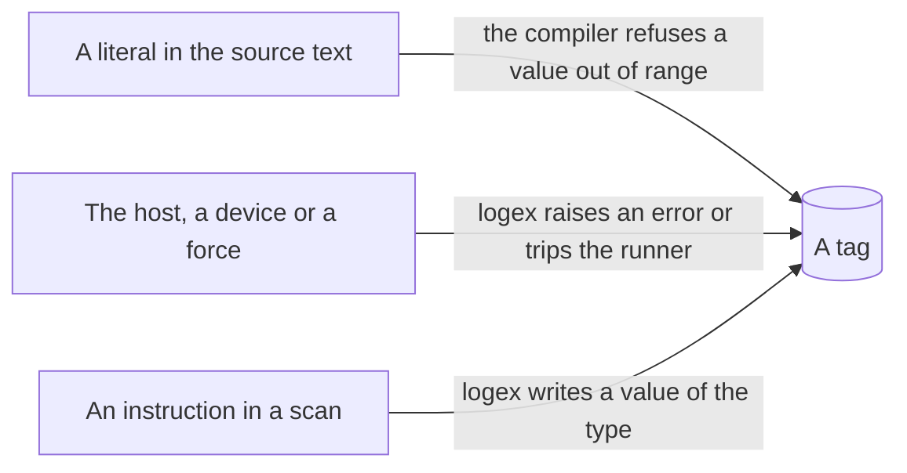
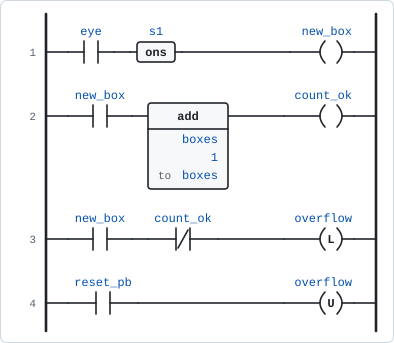

# Types and overflow

This page is for a controls engineer or an Elixir developer who writes a
[program](../reference/glossary.md#program) that counts or calculates. It answers 3
questions:

- In which [type](../reference/glossary.md#type) does an
  [instruction](../reference/glossary.md#instruction) calculate?
- What does logex write when a result is out of the range of its type?
- Why does the instruction then pass no [power](../reference/glossary.md#power-flow)?

For the exact rules, read
[Instructions: arithmetic and comparison](../reference/instructions-arithmetic-and-comparison.md).

> #### Caution {: .error}
>
> Do not use a [fault](../reference/glossary.md#fault) to find a
> [wrap](../reference/glossary.md#wrap). logex gives no fault for a result that is out of
> the range of its type, and a [runner](../reference/glossary.md#runner) does not trip.
> The only sign is that the instruction passes no power in that
> [scan](../reference/glossary.md#scan). If the program must remember the overflow,
> [latch](../reference/glossary.md#latch) it on a [rung](../reference/glossary.md#rung)
> after the instruction.

## The model: each value fits its type

A [tag](../reference/glossary.md#tag) that holds a bool, a number or a
[bit string](../reference/glossary.md#bit-string) has 1
[elementary type](../reference/glossary.md#elementary-type). So does each
[element](../reference/glossary.md#element) of an array of them. The type sets the
values that the tag can hold.

| Kind | Types | A value is |
|---|---|---|
| Bool | `bool` | 0 or 1 |
| Signed integer | `sint`, `int`, `dint`, `lint` | An integer of 8, 16, 32 or 64 bits, in 2's complement |
| Unsigned integer | `usint`, `uint`, `udint`, `ulint` | An integer of 8, 16, 32 or 64 bits that is 0 or more |
| Bit string | `byte`, `word`, `dword`, `lword` | A pattern of 8, 16, 32 or 64 bits. It is not a number |
| Real | `real`, `lreal` | A floating-point number of 32 or 64 bits |

A value goes into a tag in 3 ways, and logex checks each way.



Figure: the 3 ways into a tag, and the check on each way.

The diagram shows that no value out of range goes into a tag. The compiler refuses a
[literal](../reference/glossary.md#literal) out of range, for example `move 70000 hz` if
`hz` is a `uint`. If the [host](../reference/glossary.md#host) puts 65536 into the `uint`
[input](../reference/glossary.md#input) `hz`, logex raises an `ArgumentError`:

<!-- unchecked: the message of the ArgumentError for 65536 into the uint input hz -->
```text
input `hz` is a uint: 65536 is outside 0 to 65535
```

If the host [forces](../reference/glossary.md#force) a value out of range, logex also
raises an `ArgumentError`. A [device](../reference/glossary.md#device) value out of range
[trips](../reference/glossary.md#trip) the runner. Thus only an instruction in a scan
can make a result that is out of the range of its type.

## The type of a calculation

An arithmetic instruction calculates in the type of its destination, the tag that it
writes. Each source must have that type, or [widen](../reference/glossary.md#widen) into
it. A type widens only into a type that holds each value of the first type. Thus a
`uint` widens into a `dint`, but a `dint` does not widen into a `uint`.

This rule has 3 results:

- **An `add` of 2 `int` values into a `dint` does not wrap.** 32767 + 1 gives 32768
  and passes power.
- **A narrower type needs a [conversion](../reference/glossary.md#conversion).** The
  compiler refuses `move level i` if `level` is a `dint` and `i` is an `int`. The
  [diagnostic](../reference/glossary.md#diagnostic) names `dint_to_int`.
- **A bit string is not a number.** The compiler refuses `add` with a `word`. The
  diagnostic names `word_to_uint`, the conversion that reads the pattern as a number.

The bitwise instructions `and`, `or` and `xor` also calculate in the type of the
destination. `not` and the shifts `shl`, `shr`, `rol` and `ror` calculate in the type of
their source, and then widen the result. Thus `not` of a `usint` 5 into an `int` is 250,
not -6.

A comparison, such as `eq` or `gt`, has no destination. It compares the 2 values
exactly, also if their types are different.

logex changes each value that it writes into a `real` to the nearest value that a `real`
can hold. This is also true for a value from the host, a device or a force. Thus 0.1 in
a `real` is `0.10000000149011612`. A real literal in an operand of the type `real`
changes in the same way. Thus, if `sp` is a `real`, `eq sp 37.1` passes power after
`move 37.1 sp`.

## What logex writes for a result out of range

Each value in this table comes from a run of logex. The sources are tags, because the
compiler refuses a literal divisor of 0 and a literal negative source of `sqrt`.

| Result and example | logex writes | Power and fault |
|---|---|---|
| **An integer out of range:** `add` of 127 and 1 into an `sint` | -128 | No power, no fault |
| **An integer conversion that does not fit:** `dint_to_sint` of 129 | -127 | No power, no fault |
| **A real into an integer that does not fit:** `real_to_int` of 40000.7 | -25535, that is, 40001 wrapped | No power, no fault |
| **A bit string conversion that does not fit:** `dint_to_word` of 70000 | 4464, the low 16 bits | Power, no fault |
| **A real out of range:** `mul` of 2.0e38 and 2.0 into a `real` | `3.4028234663852886e38`, the largest `real` | No power, no fault |
| **A real too near to 0.0:** `mul` of 1.0e-20 and 1.0e-30 into a `real` | `0.0` | Power, no fault |
| **A real that the type cannot hold exactly:** `add` of 16777216.0 and 1.0 into a `real` | `16777216.0`, the nearest `real` | Power, no fault |
| **A divisor of 0:** `div` of 5 by a tag that holds 0 | 0, or `0.0` in a real | No power, the fault `:divide_by_zero` |
| **A negative source of `sqrt`:** `sqrt` of a tag that holds -0.25 | `0.0` | No power, the fault `:negative_sqrt` |

The table shows 3 rules:

- **An integer wraps.** logex keeps the low bits of the result. A result 1 past the
  limit goes to the other end of the range. A larger result can go to the middle: `mul`
  of 1000 and 1000 into an `int` writes 16960.
- **A real stops at the largest value of its type,** or at the most negative value. A
  real tag never holds an infinity, a NaN, `-0.0` or a subnormal value. A result nearer
  to 0.0 than 1.1754943508222875e-38, the smallest normal `real`, becomes `0.0`. For an
  `lreal`, this limit is 2.2250738585072014e-308.
- **An arithmetic instruction or a number conversion passes no power when it writes a
  value that is not the result.** A bit string conversion passes power. A real that
  changes to the nearest value of its type, or to `0.0`, also passes power.

The 2 faults are [minor faults](../reference/glossary.md#minor-fault). The scan reports
them and continues. A runner does not trip for a minor fault.

A [counter](../reference/glossary.md#counter) does not wrap. Its count stops at the
limit of its type, for example 32767 for a `ctu_int`. At the next
[rising edge](../reference/glossary.md#rising-edge), the counter sets its
[member](../reference/glossary.md#member) `ov`. A count down sets `un`. The member stays
on until a reset or a load.

## An example: a box counter that wraps

In the program `types-and-overflow/boxes.ld`, the tag `boxes` is a `usint` that counts
the boxes at a sensor. It starts at 253, so that the third box makes it wrap. A real
counter starts at 0. `count_ok` is the power out of the `add`. Rung 3 latches
`overflow`.

<!-- file: types-and-overflow/boxes.ld -->
```text
var_input eye bool
var_input reset_pb bool
var_output boxes usint 253
var_output count_ok bool
var_output overflow bool
var new_box bool
var s1 bool

xic eye ons s1 ote new_box
xic new_box add boxes 1 boxes ote count_ok
xic new_box xio count_ok otl overflow
xic reset_pb otu overflow
```

<!-- rung: types-and-overflow/boxes.ld -->


Rung 3 reads `count_ok` only when `new_box` is on. Thus `overflow` latches only when the
`add` wraps. In a scan with no new box, rung 2 is false, and `count_ok` is 0.

<!-- timing: types-and-overflow-run.timing.exs -->


| Scans | `boxes` | The result shows |
|---|---|---|
| 2 and 4 | 254, then 255 | The `add` counts a box and passes power. |
| 6 | 0 | 255 + 1 wraps to 0. The `add` passes no power, and rung 3 latches `overflow`. No fault occurs. |
| 8 | 1 | The `add` passes power again. `overflow` stays on until `reset_pb` in scan 9. |

## How it compares with IEC 61131-3 and Logix

- [IEC 61131-3](../reference/glossary.md#iec-61131-3) calls an integer overflow an
  error, and the implementer decides what occurs. It calculates `INT + INT` in `INT`,
  also into a `DINT`. Thus a program from such a controller can get a different value
  in logex.
- A [Logix](../reference/glossary.md#logix) controller wraps an integer result, passes
  the power that it gets and sets the status bit `S:V`. It gives a minor fault only if a
  setting of the controller tells it to.
- A Logix `CTUD` wraps to -2147483648. An IEC 61131-3 counter stops at a limit that the
  implementer sets.
- Logix puts -1 into an `INT` for `move 16#ffff i`. logex refuses this `move`, because
  `16#ffff` is 65535. In logex, `word_to_int` of `16#ffff` gives -1.

[How logex differs from Logix](differences-from-logix.md) gives the other differences,
for example `sqrt` of a negative value.

## Why logex does it this way

- **A value wraps as it does in Logix and the S7-1200.** logex writes the same low bits
  as those controllers. The type of the calculation can be different, because logex
  calculates in the type of the destination.
- **The program sees the overflow in the same scan, with no fault.** In IEC 61131-3, the
  power out of a function is its output ENO, enable out. The Siemens S7-1200 also sets
  ENO to 0 when a result wraps. logex has no setting that makes an overflow a fault.
- **A program shows each narrowing.** logex narrows a value only with a conversion.
  Thus a reader of the program sees each place where a value goes into a narrower type.
- **A real holds no infinity and no NaN.** The BEAM, the machine that runs Elixir, has
  neither. An operation that gives one stops with an error. logex writes the largest
  value, and the scan continues.
- **A wrong root is worse than no root.** If `sqrt` gives the root of the absolute
  value, the program gets 0.5 for the root of -0.25, a value that looks correct. In
  logex, the instruction passes no power.

The decision record is
[The types of IEC 61131-3 and overflow](../../docs/adr/0006-iec-types-and-overflow.md).

## See also

- [Declarations and types](../reference/declarations-and-types.md): the range of each
  type, and each type that a type widens into.
- [Instructions: arithmetic and comparison](../reference/instructions-arithmetic-and-comparison.md):
  each instruction, and each result that a type cannot hold.
- [Conversions](../reference/conversions.md): each conversion between 2 types.
- [Instructions: timers and counters](../reference/instructions-timers-and-counters.md):
  the limits of a counter and of the preset of a timer.
- [Do arithmetic](../howto/do-arithmetic.md): a total, a division and a comparison in a
  program.
- [How logex differs from Logix](differences-from-logix.md): the other differences in
  behaviour.
- [Glossary](../reference/glossary.md): the technical words of logex.
