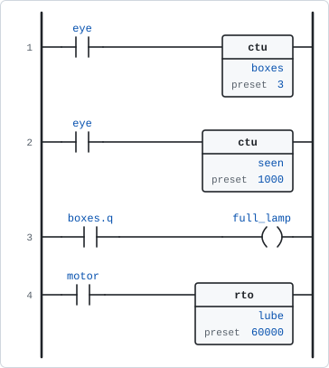
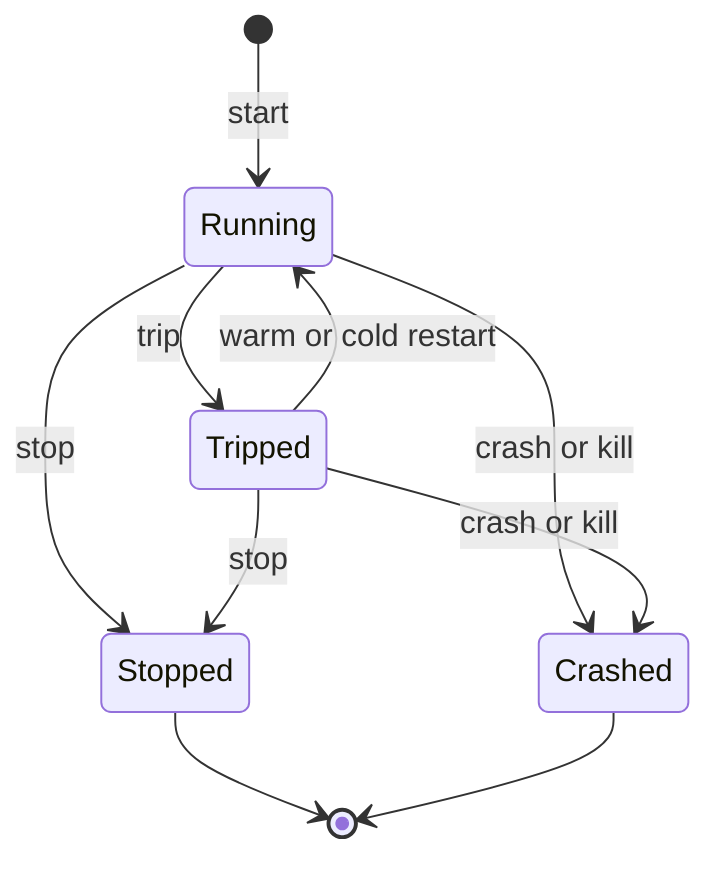

# Warm and cold restarts

This page is for a reader who restarts a [program](../reference/glossary.md#program)
or a [plant](../reference/glossary.md#plant) and wants to know what comes back. It
answers 2 questions: what does each [restart](../reference/glossary.md#restart) keep,
and why does logex keep only that?

> #### Warning {: .warning}
>
> Before a [warm restart](../reference/glossary.md#warm-restart), find each
> [output](../reference/glossary.md#output) that a [rung](../reference/glossary.md#rung)
> writes from a retained value. A warm restart can set such an output to 1 in the
> [first scan](../reference/glossary.md#first-scan), with no action of an operator. logex
> gives a [warning](../reference/glossary.md#warning) only for a retained `var_output`
> that a [connection](../reference/glossary.md#connection) joins to an output point.
> Make each such output safe, or do a cold restart.
> [Restart after a trip](../howto/restart-after-a-trip.md) gives the steps.

## The model: the program selects what it keeps

logex keeps only what the program marks. A [tag](../reference/glossary.md#tag) with the
[qualifier](../reference/glossary.md#qualifier) `retain` keeps its value through a warm
restart: logex [retains](../reference/glossary.md#retain) it. Each other tag starts again
at its [initial value](../reference/glossary.md#initial-value). A
[cold restart](../reference/glossary.md#cold-restart) starts each tag at its initial
value, a retained tag also. In both restarts, an input keeps the value of the host.

Thus a program that marks no tag `retain` restarts warm exactly as it restarts cold.

| Value | Warm restart | Cold restart |
|---|---|---|
| A tag with `retain` | Keeps its value | Initial value |
| A tag with `non_retain`, or with no qualifier | Initial value | Initial value |
| An [input](../reference/glossary.md#input), `var_input` | Keeps the value of the [host](../reference/glossary.md#host) | Keeps the value of the host |
| A [global](../reference/glossary.md#global) with `retain` | Keeps its value | Initial value |
| A global at an input [point](../reference/glossary.md#point) | Keeps the value of the host. A runner reads the [device](../reference/glossary.md#device) again before the first round | Keeps the value of the host. A runner reads the device again before the first round |
| Each other global | Initial value | Initial value |
| The last value of a retained [trigger](../reference/glossary.md#trigger), from which logex finds its [rising edge](event-tasks.md) | Keeps its value | 0 |
| The last value of each other trigger | 0 | 0 |
| An output point of a runner | 0 until the first [round](../reference/glossary.md#round) writes it | 0 until the first round writes it |
| The time of the instance or the resource (`now`) | Keeps its value | Keeps its value |
| A [force](../reference/glossary.md#force) on an input point of a runner | Stays | Stays |

A retained [timer](../reference/glossary.md#timer),
[counter](../reference/glossary.md#counter) or [array](../reference/glossary.md#array)
keeps its values: the accumulated time, the count and the hidden members. For a counter,
this includes `cu`, the memory of its last input. A retained `tof` that is on at the
restart is the exception, in
[The first scan finds no edge](#the-first-scan-finds-no-edge).
[Retained values](../reference/retained-values-and-store.md) gives the
rules for a [member](../reference/glossary.md#member) of a
[function block](../reference/glossary.md#function-block).

A warm restart also keeps a wrong retained value, for example a
[subscript](../reference/glossary.md#subscript) out of range. The first scan then gets
the same [major fault](../reference/glossary.md#major-fault) again, and a runner trips
again. [Restart after a trip](../howto/restart-after-a-trip.md) gives the actions that
remove the value.

### An example: a box counter

`line.ld` counts boxes at a photo-eye and times the motor for its lubrication. The
counter `boxes` and the timer `lube` have `retain`. The counter `seen` counts the same
boxes, but it has no qualifier.

<!-- file: warm-and-cold-restarts/line.ld -->
```text
var_input eye bool
var_input motor bool
var_output full_lamp bool
var retain boxes ctu
var seen ctu
var retain lube rto

xic eye ctu boxes 3
xic eye ctu seen 1000
xic boxes.q ote full_lamp
xic motor rto lube 60000
```

<!-- rung: warm-and-cold-restarts/line.ld -->


Rung 3 writes the output `full_lamp` from `boxes.q`, a member of the retained counter.

The script `warm-and-cold-restarts.exs` counts 3 boxes. The third box stays at the eye.
Then the script restarts the same [state](../reference/glossary.md#state) warm, and then
cold. Each scan is 10 ms. The columns `boxes` and `seen` show the count `.cv`, `lube`
shows `lube.acc`, and `lamp` shows `full_lamp`.

```elixir
alias Logex.Runtime

{:ok, line} = Logex.compile_file("warm-and-cold-restarts/line.ld")

# The columns: eye, boxes.cv, seen.cv, lube.acc and full_lamp.
columns = ["eye", "boxes", "seen", "lube", "lamp"]

show = fn state, label ->
  env = state.env

  values = [
    env["eye"],
    env["boxes"]["cv"],
    env["seen"]["cv"],
    env["lube"]["acc"],
    env["full_lamp"]
  ]

  cells = Enum.zip_with(columns, values, &String.pad_leading("#{&2}", String.length(&1) + 2))
  IO.puts(String.pad_trailing(label, 13) <> Enum.join(cells))
  state
end

# Each scan is 10 ms after the last. The host gives that time.
scan = fn state, inputs ->
  state = Runtime.put_inputs(line, state, inputs)
  {_outputs, state} = Runtime.scan(line, state, 10)
  state
end

IO.puts(String.pad_trailing("", 13) <> Enum.map_join(columns, &("  " <> &1)))

# The motor runs, and 3 boxes pass the eye. The third box stays at the eye.
before =
  Runtime.instance(line)
  |> scan.(%{"motor" => 1})
  |> scan.(%{"eye" => 1})
  |> scan.(%{"eye" => 0})
  |> scan.(%{"eye" => 1})
  |> scan.(%{"eye" => 0})
  |> scan.(%{"eye" => 1})
  |> show.("3 boxes")

Runtime.restart(line, before, :warm)
|> show.("warm restart")
|> scan.(%{})
|> show.("first scan")

Runtime.restart(line, before, :cold)
|> show.("cold restart")
|> scan.(%{})
|> show.("first scan")
|> scan.(%{})
|> show.("second scan")
```

```console
$ mix run warm-and-cold-restarts.exs
               eye  boxes  seen  lube  lamp
3 boxes          1      3     3    50     1
warm restart     1      3     0    50     0
first scan       1      3     0    60     1
cold restart     1      0     0     0     0
first scan       1      0     0     0     0
second scan      1      0     0    10     0
```

- **Retained and not retained.** The warm restart keeps `boxes` and `lube`. It starts
  `seen` and `full_lamp` again at 0.
- **The input.** Both restarts keep `eye` at 1, because the host gives its value.
- **No edge in the first scan.** The box at the eye is not a new box. No counter counts
  it after either restart.
- **The output in the first scan.** After the warm restart, rung 3 sets `full_lamp` to 1
  in the first scan. The lamp comes on with no new box. logex gives no warning for this
  rung, because `full_lamp` has no `retain`.
- **The time.** After the warm restart, `lube` adds the 10 ms of the first scan. After
  the cold restart, the first scan only starts the timer, and the second scan adds 10 ms.

### The first scan finds no edge

Each start and each restart, warm or cold, makes the next
[scan](../reference/glossary.md#scan) a first scan. A counter, a
[one-shot](../reference/glossary.md#one-shot) and the pulse timer `tp` find no edge in
it, rising or falling. Thus a counter does not count
a box that is at the eye at the restart.

The off-delay timer `tof` has 1 more rule. Its run-on is the time that it stays on after
its rung goes false. A retained `tof` whose rung was true in the last scan before the
restart goes to rest: `.dn` is 0. Without this rule, a [false rung](../reference/glossary.md#false-rung)
in the first scan starts a run-on. For example, a `tof` that runs a fan after a motor stops then runs the
fan for its [preset](../reference/glossary.md#preset) with no reason. A retained `tof` that is in its run-on at the restart
continues its run-on.

The restart puts the `tof` at rest. The first scan does not. A start from the retained
values, for example from the store, does the same. Thus the rule also applies to a `tof`
that does not run in the first scan, for example on a rung that a
[jump](../reference/glossary.md#jump) skips.

### A timer does not count the time of a stop

A retained timer keeps its accumulated time. A scan adds only the time that the host
gives that scan. Thus the timer does not count the time of the stop.

- In a [resource](../reference/glossary.md#resource), a warm restart starts each retained
  timer at the time of the resource. The time since a slow task last ran the instance
  does not count.
- After `Logex.Runner.restart/2`, the first [round](../reference/glossary.md#round) of
  the [runner](../reference/glossary.md#runner) gets 0 ms. The time of the
  [trip](../reference/glossary.md#trip) does not count.
- A new runner that reads a [store](../reference/glossary.md#store) starts the time of
  its resource at 0. The time between the 2 runners does not count.

## Where the retained values are

A restart of `Logex.Runtime` keeps the retained values in memory only. Only a runner that has
the option `retain:` keeps them in a file, the store, on the disk of the host.

| Function | Where the retained values come from | What it restarts |
|---|---|---|
| `Logex.Runtime.restart/3` | The state that the host gives | 1 program [instance](../reference/glossary.md#instance) |
| `Logex.Runtime.restart/2` | The resource that the host gives | Each instance and each global of the resource |
| `Logex.Runner.restart/2` | The resource at the trip | The resource of a tripped runner |
| `Logex.Runner.start_link/1` | The last write of the store. With `start: :cold`, none | A new runner with the option `retain:` |

`Logex.Runtime.retained/2` and `Logex.Runtime.retained/1` give the retained values as plain
data, the [retained image](../reference/glossary.md#retained-image).
`Logex.Runtime.instance/2` and `Logex.Runtime.start/2` put each value back by its name and
type. A value that does not fit the program starts at its initial value.

This diagram shows the life of a runner that has a store.



Figure: the life of a runner with a store.

The runner writes the store at a cold start, at each period, at a trip, at a stop and at
a cold restart. It does not write the store at a warm start, at a warm restart or at a
crash.
[When the runner writes the store](../reference/store.md#when-the-runner-writes-the-store)
gives each event.

Thus after a crash, the next runner starts from the last write of the store. It does not
get the values of the last scan.
[The limits of retained values](limits-of-retained-values.md) gives what a crash loses.

A crashed runner does not start again by itself. Its child spec has
`restart: :temporary`. If the host starts a new runner with the same store, that start is
warm, unless the host gives the option `start: :cold`.

> #### Caution {: .error}
>
> Copy the store before a cold restart, and before you start a runner with
> `start: :cold`. Each of them writes the initial values to the store before the first
> round. After that write, no crash and no restart can bring back the old values. A cold
> restart that a device refuses keeps the old values. A cold restart does not remove a
> force.

## How it compares with IEC 61131-3 and Logix

logex takes the qualifiers `retain` and `non_retain` from
[IEC 61131-3](../reference/glossary.md#iec-61131-3). A
[Logix](../reference/glossary.md#logix) controller has no qualifier. Its prescan resets
some instructions before the first scan (1756-RM018A, pages 73 to 134, and 1756-RM094N,
page 47). No publication that logex cites says in 1 sentence that its tags keep their
values through a loss of power.

| Subject | IEC 61131-3 | Logix | logex |
|---|---|---|---|
| A tag with no qualifier at a warm restart | The implementer decides | The prescan resets some instructions | Initial value |
| `retain` on an input | Yes | No qualifier | Refused. Each restart keeps the value of the host |
| A prescan | None | Yes | None |
| A bit for the first scan | None | `S:FS` | None. A program can make its own bit |
| A hot restart, which continues in the middle of a scan | None | None | None. A restart is warm or cold |
| A retentive timer after a loss of power | No retentive timer | `RTO` keeps `.ACC` | A retained timer keeps its time and does not count the stop |

[The limits of retained values](limits-of-retained-values.md) shows how a program makes
its own bit for the first scan.

## Why logex does it this way

- **A value comes back only if the program marks it.** A tag with no qualifier gets
  its initial value, as in a cold restart. The decision record is
  [Retained values and starts](../../docs/adr/0016-retained-values-and-starts.md).
- **No prescan is necessary.** The program selects what logex keeps. A prescan resets
  what a controller keeps by default.
- **No edge in the first scan.** A signal that is on at the restart is not a new event.
- **The host gives the time.** `Logex.Runtime` reads no clock. No timer counts while the
  plant does not run. The decision record is
  [The host gives the time](../../docs/adr/0007-the-host-gives-the-time.md).
- **The inputs belong to the host.** A `var_input` holds the value of the host, not the
  state of the program. Thus each restart keeps it.
- **logex reads a point again and does not retain it.** It refuses `retain` on a global
  at a point. An input point gets a new value at each start. An output point is 0 until
  the first round writes it.

## See also

- [Retained values](../reference/retained-values-and-store.md) and [The store](../reference/store.md): the exact
  rules of `retain` and of the store.
- [Keep values across a restart](../howto/keep-values-across-a-restart.md): the steps to
  mark a tag and restart warm.
- [Restart after a trip](../howto/restart-after-a-trip.md): the steps to restart a
  tripped runner.
- [The limits of retained values](limits-of-retained-values.md): what a retained value
  does not give.
- [Glossary](../reference/glossary.md): the technical words of logex.
