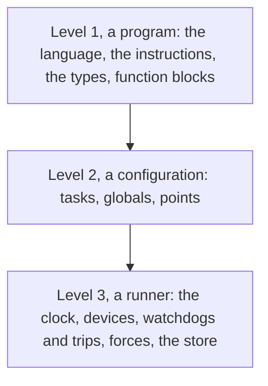

# What logex has

This page is for a reader who wants to know which parts logex has. It answers 1
question: what can a program, a configuration and a runner do in logex?
[What logex is](what-logex-is.md) explains the model that these parts belong to.

> #### Warning {: .warning}
>
> Do not use logex for a [safety function](../reference/glossary.md#safety-function).
> logex is not a safety controller, and a [trip](../reference/glossary.md#trip) is not a
> guarantee that each output is off. Read [Safety and limits](safety-and-limits.md)
> before you connect logex to a machine.

## The parts at each level

A [host](../reference/glossary.md#host) uses logex at 1 of 3 levels. At level 1, the
host runs [instances](../reference/glossary.md#instance) of a program. At level 2, the
host runs a [configuration](../reference/glossary.md#configuration) as a
[resource](../reference/glossary.md#resource). At level 3, a
[runner](../reference/glossary.md#runner) runs the resource. Each level adds parts to
the level before it.

Figure: the parts of logex at each level. A host at level 1 has only the parts of the
first box.

Each of these parts works, and the tests of logex run it from source text to outputs.
Online edits and retained values are available at more than 1 level, and they have
separate sections.

## A program

- **The language.** [Branches](../reference/glossary.md#branch) nest to any depth. Each
  [tag](../reference/glossary.md#tag) has a
  [declaration](../reference/glossary.md#declaration) with a
  [type](../reference/glossary.md#type). A [latch](../reference/glossary.md#latch) holds
  across [scans](../reference/glossary.md#scan).
  [Power flow](../reference/glossary.md#power-flow) starts again at each
  [rung](../reference/glossary.md#rung). [Source syntax](../reference/source-syntax.md)
  gives the rules.
- **The instructions.** logex has 40
  [instructions](../reference/glossary.md#instruction). The
  [Instruction cheatsheet](../reference/cheatsheet.cheatmd) lists them.
    - 2 [contacts](../reference/glossary.md#contact), 3
      [coils](../reference/glossary.md#coil), `move` and `cal`
    - 4 [timers](../reference/glossary.md#timer), and 2 instructions that run the 3
      [counters](../reference/glossary.md#counter) of
      [IEC 61131-3](../reference/glossary.md#iec-61131-3)
    - 7 instructions for arithmetic, `sqrt` and 6 comparisons
    - 8 instructions for bits and shifts
    - 1 [one-shot](../reference/glossary.md#one-shot) and 2 pulse coils
    - a [jump](../reference/glossary.md#jump) forward and its
      [label](../reference/glossary.md#label)
- **[Function blocks](../reference/glossary.md#function-block).** You write a function
  block 1 time, in a separate file. A program declares as many instances as it needs and
  runs each with `cal`. [Write a function block](../howto/write-a-function-block.md)
  gives the steps.
- **[Diagnostics](../reference/glossary.md#diagnostic).** logex reports each error of a
  program or of a configuration with its file and its line. It raises no exception for
  such an error. A tag with a wrong spelling is 1 of these errors.
  [Read a diagnostic](../howto/read-diagnostics.md) gives the steps.
- **The printers.** `Logex.Printer` prints the declarations and the rungs of a program
  again as text, 1 rung on each line. `Logex.Configuration.Text` prints a configuration
  file again. A print keeps no comment. The print of a program compiles to the same
  instructions, and the print of a configuration file reads back as the same
  configuration. These 2 modules are not part of the
  [host contract](../reference/glossary.md#host-contract).

The host compiles a program with `Logex.compile/2`, `Logex.compile_file/1` or
`Logex.compile_files/1`, and runs it with `Logex.Runtime`.

### The types

- `bool`, and the 8 integer types of IEC 61131-3 from `sint` to `ulint`, signed and
  unsigned. If a result is too large for its type, the value wraps and the instruction
  passes no power.
- The 4 [bit strings](../reference/glossary.md#bit-string) `byte`, `word`, `dword` and
  `lword`, with access to 1 bit: `status.3`. A tag can hold the number of the bit:
  `status.[n]`.
- The reals `real` and `lreal`.
- [Arrays](../reference/glossary.md#array) of 1 to 3 dimensions: `weights[3]`,
  `grid[1,7]`. A tag can hold a [subscript](../reference/glossary.md#subscript):
  `weights[slot]`. An array can be at consecutive points of a device. An array can also
  hold timers, counters or function blocks: `var lane_t ton[4]`. An instruction runs an
  element of such an array only by a literal subscript: `ton lane_t[2] 1000`.
- Integer [literals](../reference/glossary.md#literal) with a base or with `_`: `16#ff`,
  `1_000`.
- Counters for more integer types, such as `ctu_int`, and long timers in nanoseconds,
  such as `ton_ltime`.
- 182 typed conversions: 56 between the integer types, 76 with a bit string, 34 with a
  real, and 16 that truncate a real.

If a bit number or a subscript in a tag is out of range, the scan reports a
[major fault](../reference/glossary.md#major-fault). A runner then trips.
[Types and overflow](types-and-overflow.md) explains these rules.

## A configuration

`Logex.Configuration` describes instances of many programs that run together.

- **[Tasks](../reference/glossary.md#task).** A
  [periodic task](../reference/glossary.md#periodic-task) is due at an interval. An
  [event task](../reference/glossary.md#event-task) is due on the
  [rising edge](../reference/glossary.md#rising-edge) of a bool global. The
  [continuous task](../reference/glossary.md#continuous-task) runs each instance that
  has no timed task. [Tasks and the schedule](tasks-and-scheduling.md) explains them.
- **[Globals](../reference/glossary.md#global).** Programs share a global by name
  through `var_external`, for example the signal `estop`. A global can be at an input
  [point](../reference/glossary.md#point) or at an output point of a device.
  [Share a global between programs](../howto/share-a-global.md) gives the steps.
- **The 2 forms.** A configuration is a `.logex` file that names its `.ld` files, or it
  is Elixir data. [Write a configuration file](../howto/write-a-configuration-file.md)
  gives the steps.

## A runner

`Logex.Runner` runs 1 configuration on a [clock](../reference/glossary.md#clock).

- **The clock.** The runner reads the time from a clock. The manual clock moves only
  when a test moves it.
  [Write ExUnit tests on the manual clock](../howto/test-on-the-manual-clock.md) gives
  the steps.
- **Devices.** The runner reads and writes each
  [device](../reference/glossary.md#device) through an
  [adapter](../reference/glossary.md#adapter). The only adapter in logex is for a
  [simulated device](../reference/glossary.md#simulated-device).
  [Write a device adapter](../howto/write-a-device-adapter.md) gives the steps.
- **[Watchdogs](../reference/glossary.md#watchdog) and trips.** Each task has a
  watchdog. If a task runs longer than its watchdog, the runner trips. A major fault
  also causes a trip. A trip writes 0 to each output 1 time.
  [Trips and watchdogs](trips-and-watchdogs.md) explains them.
- **[Forces](../reference/glossary.md#force).** While the runner runs, an operator can
  force an input. logex does not force an output.
  [Force an input point](../howto/force-inputs.md) gives the steps.
- **The [store](../reference/glossary.md#store).** The runner keeps the retained values
  in a file. [Retained values](#retained-values) gives more.

## Online edits

An [online edit](../reference/glossary.md#online-edit) changes a program while it runs.

- `Logex.Edit` changes the program of 1 instance that runs, with its function blocks. It
  does no [restart](../reference/glossary.md#restart).
- `Logex.Configuration.Edit` changes a full configuration that runs.
- A runner does the steps of an online edit while it runs.

[The model of an online edit](online-edit-model.md) explains what an edit keeps.

## Retained values

- A [warm restart](../reference/glossary.md#warm-restart) keeps each tag,
  [member](../reference/glossary.md#member), array, instance or global that has the
  [qualifier](../reference/glossary.md#qualifier) `retain`. Each other value starts
  again at its [initial value](../reference/glossary.md#initial-value).
- A timer with `retain` continues from its value. It does not count the time of the stop.
- The host can get the retained values as plain data, and put them into a new instance
  or [resource](../reference/glossary.md#resource). logex matches them by name and type.
- A runner with a store keeps the retained values in a file on the disk of the host. It
  writes the file at a trip, at a stop and at each period of the option
  `retain_period:`. If the runner crashes, the next warm start gets the values of the
  last write. A cold start discards them.

[Warm and cold restarts](warm-and-cold-restarts.md) explains what each restart keeps,
and gives each time of a write.

## What logex does not have

logex does not have each part of [IEC 61131-3](../reference/glossary.md#iec-61131-3) or
of a controller. For example, it has no time types, no strings, no structures, no jump
back, no master control zone and no force of an output.

A counter and a retentive timer reset through their member `r`, and logex will not get a
master control zone. A [preset](../reference/glossary.md#preset) is a plain integer, in
ms or, for a long timer, in ns.

[What logex does not have](../reference/not-supported.md) gives the rule for each part.
[Safety and limits](safety-and-limits.md) and
[The limits of retained values](limits-of-retained-values.md) explain the limits that
matter at a machine.

## See also

- [What logex is](what-logex-is.md): the model, and what a host does with logex.
- [Your first program](../tutorials/first-program.md): a tutorial that writes and runs a
  program.
- [Host contract](../reference/host-contract.md): the modules that a host calls.
- [Glossary](../reference/glossary.md): the technical words of logex.
