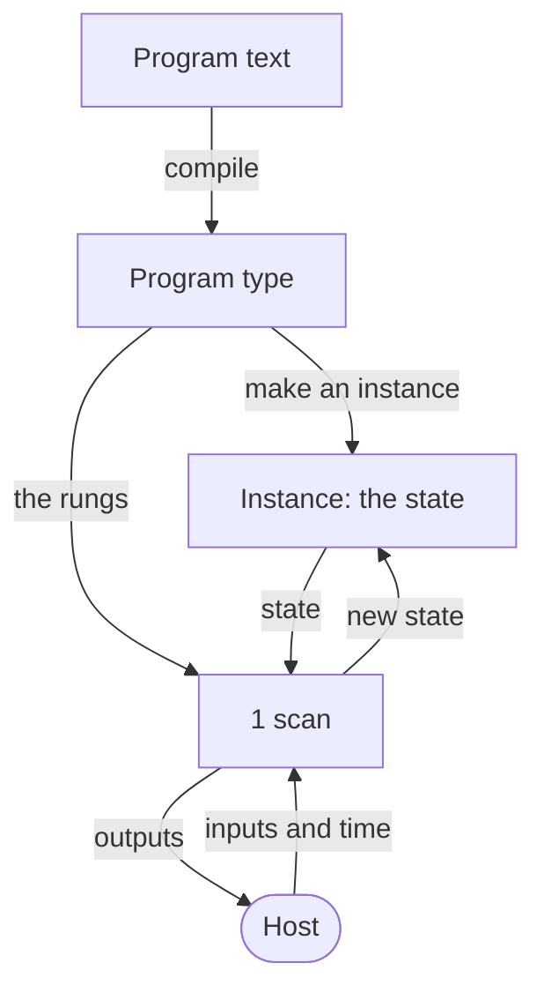
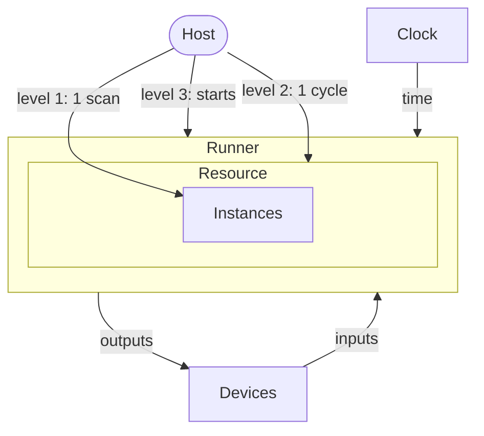

# What logex is

This page is for a reader who wants to know what logex is before they use it. It says
what logex does, and what an Elixir application does with it.

logex is an Elixir library that compiles and runs ladder logic. Ladder logic is a
language for industrial controllers. A ladder
[program](../reference/glossary.md#program) is a list of
[rungs](../reference/glossary.md#rung). Each rung reads values through
[contacts](../reference/glossary.md#contact) and sets values through
[coils](../reference/glossary.md#coil).

The application that calls logex is the [host](../reference/glossary.md#host). The host
gives a ladder program to logex as text. Then, for each run of the program, the host
gives the [inputs](../reference/glossary.md#input) and the time, and logex gives back
the [outputs](../reference/glossary.md#output).

> #### Warning {: .warning}
>
> Do not use logex for a [safety function](../reference/glossary.md#safety-function).
> logex is not a safety controller, and it has no certificate for industrial use. An
> emergency stop must work while logex does not run: after logex stops, after logex
> fails, and if logex never starts. Make each safety function with hardwired circuits or
> with a safety-rated controller. Design and validate it to the functional-safety
> standards that apply: logex makes no claim against any of them. Read
> [Safety and limits](safety-and-limits.md) before you connect logex to a machine.

## Who logex is for

- **An Elixir developer** gets a way to run ladder programs from an Elixir application.
  logex has no dependencies. Start with
  [Your first program](../tutorials/first-program.md).
- **A controls engineer** gets a ladder language as text. Where
  [IEC 61131-3](../reference/glossary.md#iec-61131-3) names an operation, the
  [instruction](../reference/glossary.md#instruction) has that name. Start with
  [The dialect and IEC 61131-3](the-dialect-and-iec.md). If you know a Logix
  controller, then read [How logex differs from Logix](differences-from-logix.md).

Know these 4 limits before you start:

- logex is a library. It has no hardware.
- logex is at an early stage. Its version is 0.1.0, and it has no release. A project
  gets logex from its Git repository.
  [Install logex and run a program](../howto/install-and-run.md) gives the steps.
- logex has no graphical editor. A program is a text file.
- The only [adapter](../reference/glossary.md#adapter) in logex is `Logex.IO.Sim`, for a
  [simulated device](../reference/glossary.md#simulated-device). For each real
  [device](../reference/glossary.md#device), you write the adapter.
  [Write a device adapter](../howto/write-a-device-adapter.md) gives the steps.

## The model: text, program type, instance, scan

A rung is 1 line of text. This line is rung 1 of
[`motor.ld`](../tutorials/first-program.md), a program that starts and stops a motor.

<!-- part of: motor.ld -->
```text
( xic start | xic motor ) xio stop ote motor
```

This drawing shows the same rung.

<!-- rung: motor.ld 1 -->


If `stop` is 0, and `start` or `motor` is 1, the rung sets `motor` to 1. If not, it sets
`motor` to 0. [Your first program](../tutorials/first-program.md) explains each
instruction of the rung.

logex does 2 jobs with a program.

- **It [compiles](../reference/glossary.md#compile) the text.** The result is a
  [program type](../reference/glossary.md#program-type). A program type is plain Elixir
  data with a name. logex makes no Elixir code from a program, and no code for the BEAM,
  the virtual machine of Elixir.
- **It runs the program type.** The host makes an
  [instance](../reference/glossary.md#instance), which is 1 copy of the program type
  with a [state](../reference/glossary.md#state). Then the host asks for 1
  [scan](../reference/glossary.md#scan) at a time. A scan runs each rung 1 time, from
  the first rung to the last.



Figure: from the text of a program to 1 scan. The host gives the program type and the
state to each scan, and each scan returns the state that the next scan gets.

`motor.ld` has 5 rungs, and this page shows only rung 1. The script `scan.exs` is a
small host that compiles `motor.ld` and runs 5 scans. Look at `motor` in each line of
the output.

```elixir
{:ok, motor} = Logex.compile_file("motor.ld")

scan = fn state, label, inputs ->
  state = Logex.Runtime.put_inputs(motor, state, inputs)
  {outputs, state} = Logex.Runtime.scan(motor, state)
  IO.puts("#{label}  #{inspect(outputs)}  fault=#{state.env["fault"]}")
  state
end

Logex.Runtime.instance(motor)
|> scan.("start pressed ", %{"start" => 1})
|> scan.("start released", %{"start" => 0})
|> scan.("overtemp      ", %{"overtemp" => 1})
|> scan.("stop pressed  ", %{"stop" => 1})
|> scan.("cooled, idle  ", %{"stop" => 0, "overtemp" => 0})
```

```console
$ mix run scan.exs
start pressed   %{"motor" => 1, "run_lamp" => 1, "speed_sp" => 1200}  fault=0
start released  %{"motor" => 1, "run_lamp" => 1, "speed_sp" => 1200}  fault=0
overtemp        %{"motor" => 1, "run_lamp" => 1, "speed_sp" => 0}  fault=1
stop pressed    %{"motor" => 0, "run_lamp" => 0, "speed_sp" => 0}  fault=1
cooled, idle    %{"motor" => 0, "run_lamp" => 0, "speed_sp" => 0}  fault=1
```

Each line is 1 scan. In scan 2, `start` is 0 and `motor` stays 1, because the state
holds `motor` from scan 1. The script gives no time, thus each scan gets 0 ms.
`motor.ld` has no timer. The 4 other rungs set `run_lamp`, `fault` and `speed_sp`, and
[Your first program](../tutorials/first-program.md) explains them.

These 3 facts are the model:

- **A program type holds no state.** The host can make many instances from 1 program
  type. Each instance has a separate value for each [tag](../reference/glossary.md#tag)
  of its program. Only a [global](../reference/glossary.md#global), which a program
  declares in the [section](../reference/glossary.md#section) `var_external`, is common
  to the instances that run together.
- **The host keeps the state.** A scan takes a state and returns a new state.
  `Logex.Runtime` keeps nothing between 2 calls.
- **The host gives the time.** `Logex.Runtime` reads no clock. The host says how many
  milliseconds passed before each scan, and a [timer](../reference/glossary.md#timer)
  counts that time. Thus, for the same state, inputs and time, a scan always returns the
  same result.

## What a host does with logex

A host runs programs at 1 of 3 levels. At level 1, the host has only programs. It
compiles each program with a function of `Logex`, for example `Logex.compile_file/1`.

At levels 2 and 3, the host has a
[configuration](../reference/glossary.md#configuration). A configuration is a set of
program instances and [tasks](../reference/glossary.md#task) that run together. A
[resource](../reference/glossary.md#resource) is a configuration while it runs.
`Logex.Configuration` makes a configuration from Elixir data, or from a
[configuration file](../reference/glossary.md#configuration-file) and the programs that
the file names.

| Level | The host gives | logex does |
|---|---|---|
| 1: an instance, with `Logex.Runtime` | The program type, the state, the inputs and the time, for each scan. | It runs the rungs of 1 program 1 time. |
| 2: a resource, with `Logex.Runtime` | A configuration at the start. Then the values of the input [points](../reference/glossary.md#point) and the time, for each [cycle](../reference/glossary.md#cycle). | It runs each task that is due, with the instances of that task. |
| 3: a [runner](../reference/glossary.md#runner), with `Logex.Runner` | A configuration and an adapter for each device. If the host gives no [clock](../reference/glossary.md#clock), the runner reads the clock of the computer. | It runs in [rounds](../reference/glossary.md#round). In each round, it reads the devices, runs 1 cycle and writes the outputs to the devices. |

The [Host contract](../reference/host-contract.md) gives each function of these modules.

- Level 1 is for a host that runs programs with no configuration.
- Level 2 is for a host that runs a [plant](../reference/glossary.md#plant) and gives
  the inputs and the time itself.
- Level 3 is for a host that runs a plant on a clock and through devices.



Figure: the 3 levels, and the part of logex that the host calls at each level. A runner
holds a resource, and a resource holds the instances. A host at level 1 has no resource,
and a host at level 2 has no runner.

At levels 1 and 2, `Logex.Runtime` is a set of functions. It starts no process, and the
host keeps the instance or the resource. At level 3, the runner is a process that the
host starts, and only the runner reads a clock.

[What logex has](what-logex-has.md) lists the parts of logex at each level.

## How it compares with IEC 61131-3 and Logix

A controls engineer can compare the model of logex with an industrial controller, for
example a [Logix](../reference/glossary.md#logix) controller.
[How logex differs from IEC 61131-3](differences-from-iec.md) and
[How logex differs from Logix](differences-from-logix.md) give the differences of the
language and of its behaviour. These things are the same as in a controller:

- A program is a list of rungs, and a scan runs them from the first to the last.
- An instruction such as `ton` or `ctu` has the name of IEC 61131-3. The
  [mnemonics](../reference/glossary.md#mnemonic) of contacts and coils, such as `xic`
  and `ote`, are from the [conventional set](../reference/glossary.md#conventional-set).
- A configuration, a resource, a task and an instance have these names in IEC 61131-3
  also.

These things are different:

- A rung is a line of text in the [dialect](../reference/glossary.md#dialect) of logex.
  logex does not read the text formats of IEC 61131-3 or the export of a vendor.
- A controller reads its own clock and starts its own scans. In logex, the host starts
  each scan and gives the time, or a runner does.
- A configuration has 1 resource, and some rules of a task are different.
  [Tasks and the schedule](tasks-and-scheduling.md) gives them.
- logex runs on the BEAM, on a general-purpose operating system. It is not hard
  real-time. logex gives no limit for how late a round is, or for how much the time
  between 2 rounds changes.

## Why logex does it this way

- **A program is data.** `Logex.Runtime` interprets the program type. Thus an
  [online edit](../reference/glossary.md#online-edit) changes a program while it runs,
  and the Elixir compiler has no part in the change.
  [Programs as data](programs-as-data.md) gives the reasons. The decision record is
  [A program is data](../../docs/adr/0001-a-program-is-data.md).
- **The host gives the time.** A test of a timer of 10 s gives the scans 10000 ms. It
  does not wait 10 s, and it gets the same result each time.
  [The scan, the cycle and time](scan-cycle-and-time.md) gives the reasons. The decision
  record is [The host gives the time](../../docs/adr/0007-the-host-gives-the-time.md).
- **An error in a program is data.** The host gets the
  [diagnostics](../reference/glossary.md#diagnostic) of a compile in 1 list. Thus a host
  can show each error to the person who wrote the program, and the error does not stop
  the host. logex raises an exception only for a wrong argument from the host. The
  decision record is
  [Errors in the source and errors of the host](../../docs/adr/0008-source-mistakes-and-host-mistakes.md).

## See also

- [Your first program](../tutorials/first-program.md): a tutorial that writes and runs
  `motor.ld`.
- [Safety and limits](safety-and-limits.md): what logex is not.
- [What logex has](what-logex-has.md): the parts of logex at each level.
- [Host contract](../reference/host-contract.md): the modules that a host calls.
- [Install logex and run a program](../howto/install-and-run.md): how to add logex to a
  project.
- [Glossary](../reference/glossary.md): the technical words of logex.
