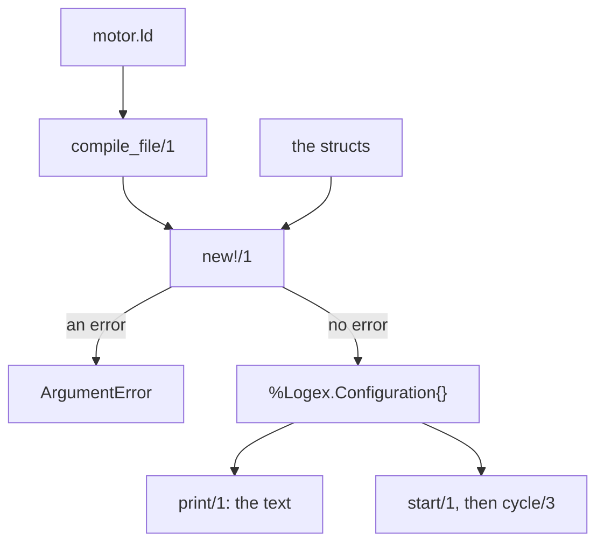

# Build a configuration from Elixir data

This guide is for an Elixir developer. Your application, the
[host](../reference/glossary.md#host), makes the
[configuration](../reference/glossary.md#configuration) of a
[plant](../reference/glossary.md#plant) in code, not in a
[configuration file](../reference/glossary.md#configuration-file). An example is a host
that reads the plant from a database. This guide builds the plant of
[Write a configuration file](write-a-configuration-file.md) as Elixir data with
`Logex.Configuration.new!/1`. Then a script prints the configuration as the text of a
file and runs 7 [cycles](../reference/glossary.md#cycle) of the plant.

> #### Warning {: .warning}
>
> Do not use logex for a safety function, for example an emergency stop. logex can stop
> at any time. Make each safety function with hardwired circuits or with a safety-rated
> controller. [Safety and limits](../explanation/safety-and-limits.md) gives the limits of
> logex.

## Before you start

- You must have a Mix project that has logex.
  [Install logex and run a program](install-and-run.md) gives the steps.
- You must know the lines of a configuration file.
  [Write a configuration file](write-a-configuration-file.md) gives them, with the plant
  of this guide: 2 conveyors. Each conveyor is an
  [instance](../reference/glossary.md#instance) of the
  [program type](../reference/glossary.md#program-type) `motor`, from the file
  `motor.ld`.
- You must have the [program](../reference/glossary.md#program)
  [`motor.ld`](../tutorials/first-program.md) in the root directory of your project.

For each kind of line in a configuration file, Elixir has 1 struct. Each struct is a
module in `Logex.Configuration`, for example `Logex.Configuration.Task`. This table gives
the struct for each line, and the key of `new!/1` that takes a list of the structs.

| Line of a file | Struct | Key of `new!/1` |
|---|---|---|
| A [task](../reference/glossary.md#task) | `Task` | `tasks:` |
| A [global](../reference/glossary.md#global) | `Global` | `globals:` |
| A `program` line: an instance | `Instance` | `instances:` |
| A [connection](../reference/glossary.md#connection) | `Connection` | `connections:` |



Figure: the path of the data in this guide. `new!/1` gives a configuration, or raises 1
`ArgumentError` that lists each error.

The configuration goes to 2 places: to `Logex.Configuration.Text.print/1` as text, and to
`Logex.Runtime.start/1` to run.

## Steps

1. In the root directory of your project, make the file
   `build-a-configuration-from-elixir.exs`. Write part 1: it
   [compiles](../reference/glossary.md#compile) `motor.ld`. The program type gets the
   name of its file, `"motor"`.

<!-- part of: build-a-configuration-from-elixir.exs -->
```elixir
# Part 1: compile the program type. Its name is the name of its file: "motor".
{:ok, motor} = Logex.compile_file("motor.ld")

alias Logex.Configuration
alias Logex.Configuration.{Connection, Global, Instance}
```

2. Write 1 `%Logex.Configuration.Task{}` for each task. Write the
   [interval](../reference/glossary.md#periodic-task) in ms and the
   [priority](../reference/glossary.md#priority) as integers. Write `Configuration.Task`,
   not `Task`. `Task` is a module of Elixir.

<!-- part of: build-a-configuration-from-elixir.exs -->
```elixir
# Part 2: the tasks.
tasks = [
  %Configuration.Task{name: "fast", interval: 10, priority: 1},
  %Configuration.Task{name: "slow", interval: 50, priority: 2}
]
```

3. Write 1 `%Logex.Configuration.Global{}` for each global. Give the
   [type](../reference/glossary.md#type) as an atom, such as `:bool`. Give the
   [point](../reference/glossary.md#point) as a string in `at:`. The string has the
   [device](../reference/glossary.md#device), `i` for an input or `q` for an output, and the address, for example
   `"panel.i.0"`. The function `point` of the script makes each line shorter.

<!-- part of: build-a-configuration-from-elixir.exs -->
```elixir
# Part 3: the globals. Each global is at a point of a device.
point = fn name, type, at -> %Global{name: name, type: type, at: at} end

globals = [
  point.("pb_start_1", :bool, "panel.i.0"),
  point.("pb_stop_1", :bool, "panel.i.1"),
  point.("tt_1", :bool, "panel.i.2"),
  point.("pb_start_2", :bool, "panel.i.3"),
  point.("pb_stop_2", :bool, "panel.i.4"),
  point.("pb_reset", :bool, "panel.i.5"),
  point.("k1", :bool, "panel.q.0"),
  point.("k2", :bool, "panel.q.1"),
  point.("sp_1", :dint, "drive.q.0"),
  point.("sp_2", :dint, "drive.q.1")
]
```

4. Write 1 `%Logex.Configuration.Instance{}` for each instance. Give the name of the
   instance, the name of its program type and the name of its task.

<!-- part of: build-a-configuration-from-elixir.exs -->
```elixir
# Part 4: the instances. The instances of 1 task run in the sequence of this list.
instances = [
  %Instance{name: "m1", type: "motor", task: "fast"},
  %Instance{name: "m2", type: "motor", task: "slow"}
]
```

5. Write 1 `%Logex.Configuration.Connection{}` for each connection. The key is
   `member:`, but its value is a [tag](../reference/glossary.md#tag) of the instance:
   an [input](../reference/glossary.md#input) or an
   [output](../reference/glossary.md#output). `to:` is the name of a global. For an
   input, `to:` can also be a number, such as the integer `0`. You do not give the
   direction of a connection. logex gets it from the
   [section](../reference/glossary.md#section) of the tag.

<!-- part of: build-a-configuration-from-elixir.exs -->
```elixir
# Part 5: the connections. Each pair is a tag of the instance, then a global or a number.
wire = fn instance, pairs ->
  for {tag, to} <- pairs, do: %Connection{instance: instance, member: tag, to: to}
end

connections =
  wire.("m1", [{"start", "pb_start_1"}, {"stop", "pb_stop_1"}, {"overtemp", "tt_1"}]) ++
    wire.("m1", [{"reset", "pb_reset"}, {"motor", "k1"}, {"speed_sp", "sp_1"}]) ++
    wire.("m2", [{"start", "pb_start_2"}, {"stop", "pb_stop_2"}, {"overtemp", 0}]) ++
    wire.("m2", [{"reset", 0}, {"motor", "k2"}, {"speed_sp", "sp_2"}])
```

6. Give the 4 lists to `Logex.Configuration.new!/1`, with 2 more keys. A file has no
   line for them:

   - `name:` is the name of the configuration. A configuration from a file gets the
     name of the file.
   - `programs:` is a list of the program types. A file reads each program type from the
     `.ld` file beside it.

   Then print each [warning](../reference/glossary.md#warning), and the configuration as
   the text of a file.

<!-- part of: build-a-configuration-from-elixir.exs -->
```elixir
# Part 6: build the configuration. new!/1 checks it, and raises an ArgumentError if the
# data has an error. Print each warning, then the configuration as the text of a file.
plant =
  Configuration.new!(
    name: "plant",
    programs: [motor],
    tasks: tasks,
    globals: globals,
    instances: instances,
    connections: connections
  )

Enum.each(plant.warnings, &IO.puts(Logex.Diagnostic.format(&1)))
IO.write(Configuration.Text.print(plant))
```

7. Run the script with `mix run build-a-configuration-from-elixir.exs`. It prints the
   configuration as 26 lines. The first line is `task fast interval 10 priority 1`.

   The first run also prints the messages of Mix as it compiles logex and your project.
   If the data has an error, the script stops with an `ArgumentError`.
   [If it does not work](#if-it-does-not-work) gives the frequent messages.

8. Add part 7 to the end of the file. It runs 7 cycles, 10 ms apart, as in
   [Write a configuration file](write-a-configuration-file.md).

<!-- part of: build-a-configuration-from-elixir.exs -->
```elixir
# Part 7: run 7 cycles. Each line gives the ms since the last cycle, and the input
# points that change before the cycle. An input point keeps its value until it changes.
steps = [
  {0, %{}},
  {10, %{"pb_start_1" => 1, "pb_start_2" => 1}},
  {10, %{"pb_start_1" => 0, "pb_start_2" => 0}},
  {10, %{"tt_1" => 1}},
  {10, %{}},
  {10, %{"pb_start_2" => 1}},
  {10, %{"pb_start_2" => 0}}
]

row = fn cells, ran ->
  IO.puts(Enum.map_join(cells, &String.pad_leading("#{&1}", 6)) <> "  " <> ran)
end

row.(["time", "k1", "k2", "sp_1", "sp_2"], "ran")

Enum.reduce(steps, {Logex.Runtime.start(plant), 0}, fn {ms, changes}, {resource, time} ->
  {resource, out, events} = Logex.Runtime.cycle(resource, ms, changes)
  ran = for {:ran, _task, instance, _time} <- events, do: instance
  row.([time + ms, out["k1"], out["k2"], out["sp_1"], out["sp_2"]], Enum.join(ran, " "))
  {resource, time + ms}
end)
```

9. Compare your file with the whole script.

```elixir
# Part 1: compile the program type. Its name is the name of its file: "motor".
{:ok, motor} = Logex.compile_file("motor.ld")

alias Logex.Configuration
alias Logex.Configuration.{Connection, Global, Instance}

# Part 2: the tasks.
tasks = [
  %Configuration.Task{name: "fast", interval: 10, priority: 1},
  %Configuration.Task{name: "slow", interval: 50, priority: 2}
]

# Part 3: the globals. Each global is at a point of a device.
point = fn name, type, at -> %Global{name: name, type: type, at: at} end

globals = [
  point.("pb_start_1", :bool, "panel.i.0"),
  point.("pb_stop_1", :bool, "panel.i.1"),
  point.("tt_1", :bool, "panel.i.2"),
  point.("pb_start_2", :bool, "panel.i.3"),
  point.("pb_stop_2", :bool, "panel.i.4"),
  point.("pb_reset", :bool, "panel.i.5"),
  point.("k1", :bool, "panel.q.0"),
  point.("k2", :bool, "panel.q.1"),
  point.("sp_1", :dint, "drive.q.0"),
  point.("sp_2", :dint, "drive.q.1")
]

# Part 4: the instances. The instances of 1 task run in the sequence of this list.
instances = [
  %Instance{name: "m1", type: "motor", task: "fast"},
  %Instance{name: "m2", type: "motor", task: "slow"}
]

# Part 5: the connections. Each pair is a tag of the instance, then a global or a number.
wire = fn instance, pairs ->
  for {tag, to} <- pairs, do: %Connection{instance: instance, member: tag, to: to}
end

connections =
  wire.("m1", [{"start", "pb_start_1"}, {"stop", "pb_stop_1"}, {"overtemp", "tt_1"}]) ++
    wire.("m1", [{"reset", "pb_reset"}, {"motor", "k1"}, {"speed_sp", "sp_1"}]) ++
    wire.("m2", [{"start", "pb_start_2"}, {"stop", "pb_stop_2"}, {"overtemp", 0}]) ++
    wire.("m2", [{"reset", 0}, {"motor", "k2"}, {"speed_sp", "sp_2"}])

# Part 6: build the configuration. new!/1 checks it, and raises an ArgumentError if the
# data has an error. Print each warning, then the configuration as the text of a file.
plant =
  Configuration.new!(
    name: "plant",
    programs: [motor],
    tasks: tasks,
    globals: globals,
    instances: instances,
    connections: connections
  )

Enum.each(plant.warnings, &IO.puts(Logex.Diagnostic.format(&1)))
IO.write(Configuration.Text.print(plant))

# Part 7: run 7 cycles. Each line gives the ms since the last cycle, and the input
# points that change before the cycle. An input point keeps its value until it changes.
steps = [
  {0, %{}},
  {10, %{"pb_start_1" => 1, "pb_start_2" => 1}},
  {10, %{"pb_start_1" => 0, "pb_start_2" => 0}},
  {10, %{"tt_1" => 1}},
  {10, %{}},
  {10, %{"pb_start_2" => 1}},
  {10, %{"pb_start_2" => 0}}
]

row = fn cells, ran ->
  IO.puts(Enum.map_join(cells, &String.pad_leading("#{&1}", 6)) <> "  " <> ran)
end

row.(["time", "k1", "k2", "sp_1", "sp_2"], "ran")

Enum.reduce(steps, {Logex.Runtime.start(plant), 0}, fn {ms, changes}, {resource, time} ->
  {resource, out, events} = Logex.Runtime.cycle(resource, ms, changes)
  ran = for {:ran, _task, instance, _time} <- events, do: instance
  row.([time + ms, out["k1"], out["k2"], out["sp_1"], out["sp_2"]], Enum.join(ran, " "))
  {resource, time + ms}
end)
```

10. Run the script again.

```console
$ mix run build-a-configuration-from-elixir.exs
task fast interval 10 priority 1
task slow interval 50 priority 2
var_global pb_start_1 bool at panel.i.0
var_global pb_stop_1 bool at panel.i.1
var_global tt_1 bool at panel.i.2
var_global pb_start_2 bool at panel.i.3
var_global pb_stop_2 bool at panel.i.4
var_global pb_reset bool at panel.i.5
var_global k1 bool at panel.q.0
var_global k2 bool at panel.q.1
var_global sp_1 dint at drive.q.0
var_global sp_2 dint at drive.q.1
program m1 motor with fast
program m2 motor with slow
m1.start pb_start_1
m1.stop pb_stop_1
m1.overtemp tt_1
m1.reset pb_reset
m1.motor k1
m1.speed_sp sp_1
m2.start pb_start_2
m2.stop pb_stop_2
m2.overtemp 0
m2.reset 0
m2.motor k2
m2.speed_sp sp_2
  time    k1    k2  sp_1  sp_2  ran
     0     0     0  1200  1200  m1 m2
    10     1     0  1200  1200  m1
    20     1     0  1200  1200  m1
    30     1     0     0  1200  m1
    40     1     0     0  1200  m1
    50     1     1     0  1200  m1 m2
    60     1     1     0  1200  m1
```

## The result

You have a configuration that you built from Elixir data. The script prints 2 parts:

- The first 26 lines are the configuration as the text of a file. They have the tasks,
  globals, instances and connections of `plant.logex`, with no comment, no indent and no
  empty line. The tasks come first, then the globals, then the instances, then the
  connections.
- The last 8 lines are a table of the cycles. It is the same as the table of
  [Write a configuration file](write-a-configuration-file.md#the-result), which gives
  the reason for each row. At 30 ms, the thermal switch `tt_1` sets the tag `fault` of
  `m1`, and `m1` sets `sp_1` to 0. `m2` does not change.

## Other lines as data

Each item of this list gives the Elixir data for a line of a file. Then it gives the line
that `Logex.Configuration.Text.print/1` prints for the data.

- A [continuous task](../reference/glossary.md#continuous-task) with a
  [watchdog](../reference/glossary.md#watchdog):
  `%Configuration.Task{name: "main", continuous: true, watchdog: 200}` gives
  `task main continuous watchdog 200`.
- An [event task](../reference/glossary.md#event-task):
  `%Configuration.Task{name: "stop_all", single: "estop", priority: 0}` gives
  `task stop_all single estop priority 0`.
- A watchdog on a periodic task:
  `%Configuration.Task{name: "fast", interval: 10, priority: 1, watchdog: 50}` gives
  `task fast interval 10 priority 1 watchdog 50`.
- A global with an [initial value](../reference/glossary.md#initial-value):
  `%Global{name: "hold", type: :bool, initial: 1}` gives
  `var_global hold bool 1`.
- A [retained](../reference/glossary.md#retain) global:
  `Global.new!("total_boxes", :dint, initial: 0, retain: true)` gives
  `var_global retain total_boxes dint 0`.
- A global with the [qualifier](../reference/glossary.md#qualifier) `non_retain`:
  `Global.new!("count", :dint, non_retain: true)` gives
  `var_global non_retain count dint`.
- An [array](../reference/glossary.md#array) global:
  `%Global{name: "temps", type: {:array, :int, [8]}, initial: [1, 2, 3, 4, 5, 6, 7, 8]}` gives
  `var_global temps int[8] 1 2 3 4 5 6 7 8`.
- An array at 8 points:
  `%Global{name: "zone_t", type: {:array, :real, [8]}, at: "card.i.0"}` gives
  `var_global zone_t real[8] at card.i.0`.
- An instance that runs in each cycle, after the other tasks:
  `%Instance{name: "c1", type: "conveyor"}` gives
  `program c1 conveyor`.
- A connection to an [element](../reference/glossary.md#element):
  `%Connection{instance: "m2", member: "speed_sp", to: "speeds[1]"}` gives
  `m2.speed_sp speeds[1]`.

`Logex.Configuration.Global.new!/3` makes a global. When you call it, it refuses the
errors of that global: a wrong option, name, type, location or initial value. First it
refuses each argument that no line of a configuration file can give, such as the name
`"1x"`. Only if there is none does it refuse what a line can give wrong, such as the
value 5 for a `bool`. A global
at a point takes no initial value and no `retain: true`, and `Global.new!/3` refuses
those too. `Logex.Configuration.new!/1` refuses 2 globals of 1 name, and 2 globals at 1
point.

## Other ways to get a configuration

`Logex.Configuration.check/1` gives the errors of a `%Logex.Configuration{}` as a list,
with no exception. Build the struct with `programs:` as a map of names to program types:

<!-- fragment: it uses motor, tasks, globals, instances and connections of parts 1 to 5 -->
```elixir
plant = %Configuration{
  name: "plant",
  programs: %{"motor" => motor},
  tasks: tasks,
  globals: globals,
  instances: instances,
  connections: connections
}

Configuration.check(plant)
```

If the configuration has no error, `check/1` returns `[]`. If it has errors, it returns 1
[diagnostic](../reference/glossary.md#diagnostic) for each error. For an error that only
Elixir data can have, `check/1` raises an `ArgumentError`. `check/1` does not give
warnings. `new!/1` and `Logex.Configuration.compile/3` give them.

> #### Caution {: .error}
>
> Give `check/1` the program types as a map. `new!/1` takes a list, but `check/1` and
> `compile/3` take a map. For a list, `check/1` raises an `ArgumentError`:
> `programs must be a map of program names to %Logex.Program{}, got a list`.

`Logex.Configuration.compile/3` compiles the text of a configuration file that you have
as a string. It reads no file, so give it the program types as a map:
`Logex.Configuration.compile("plant", text, %{"motor" => motor})`. It returns
`{:ok, configuration}`, or `{:error, diagnostics}` with the line of each error.

`Logex.Runtime.start/1` checks the configuration again. If the configuration has an
error, `start/1` raises an `ArgumentError`.

## Another example: the plant of 2 motors

The script `plant.exs` builds the plant of `plant.logex` as Elixir data, with 2 instances
of `motor.ld`. It runs 7 cycles. The last cycle comes 35 ms late. Then the script builds
the same plant with 3 errors.

```elixir
{:ok, motor} = Logex.compile_file("motor.ld")

alias Logex.Configuration
alias Logex.Configuration.{Connection, Global, Instance}

point = fn name, type, at -> %Global{name: name, type: type, at: at} end

wire = fn instance, pairs ->
  for {member, to} <- pairs, do: %Connection{instance: instance, member: member, to: to}
end

fields = [
  name: "plant",
  programs: [motor],
  tasks: [
    %Configuration.Task{name: "fast", interval: 10, priority: 1},
    %Configuration.Task{name: "slow", interval: 50, priority: 2}
  ],
  globals: [
    point.("pb_start_1", :bool, "panel.i.0"),
    point.("pb_stop_1", :bool, "panel.i.1"),
    point.("tt_1", :bool, "panel.i.2"),
    point.("pb_start_2", :bool, "panel.i.3"),
    point.("pb_stop_2", :bool, "panel.i.4"),
    point.("pb_reset", :bool, "panel.i.5"),
    point.("k1", :bool, "panel.q.0"),
    point.("k2", :bool, "panel.q.1"),
    point.("sp_1", :dint, "drive.q.0"),
    point.("sp_2", :dint, "drive.q.1")
  ],
  instances: [
    %Instance{name: "m1", type: "motor", task: "fast"},
    %Instance{name: "m2", type: "motor", task: "slow"}
  ],
  connections:
    wire.("m1", [{"start", "pb_start_1"}, {"stop", "pb_stop_1"}, {"overtemp", "tt_1"}]) ++
      wire.("m1", [{"reset", "pb_reset"}, {"motor", "k1"}, {"speed_sp", "sp_1"}]) ++
      wire.("m2", [{"start", "pb_start_2"}, {"stop", "pb_stop_2"}, {"overtemp", 0}]) ++
      wire.("m2", [{"reset", 0}, {"motor", "k2"}, {"speed_sp", "sp_2"}])
]

print = fn
  nil, _now, _outputs, _events -> :ok
  label, now, out, events ->
    points = "k1=#{out["k1"]} k2=#{out["k2"]} sp_1=#{out["sp_1"]} sp_2=#{out["sp_2"]}"
    IO.puts("t=#{String.pad_leading("#{now}", 3)}  #{label}  #{points}  #{inspect(events)}")
end

cycle = fn {rt, now}, elapsed, inputs, label ->
  {rt, outputs, events} = Logex.Runtime.cycle(rt, elapsed, inputs)
  print.(label, now + elapsed, outputs, events)
  {rt, now + elapsed}
end

{rt, _now} =
  {Logex.Runtime.start(Configuration.new!(fields)), 0}
  |> cycle.(0, %{}, "idle         ")
  |> cycle.(10, %{"pb_start_1" => 1, "pb_start_2" => 1}, "both started ")
  |> cycle.(10, %{}, nil)
  |> cycle.(10, %{}, nil)
  |> cycle.(10, %{}, nil)
  |> cycle.(10, %{}, "held to 50 ms")
  |> cycle.(10, %{"pb_start_1" => 0, "pb_start_2" => 0}, "released     ")
  |> cycle.(10, %{"tt_1" => 1}, "tt_1 trips   ")
  |> cycle.(35, %{}, "35 ms late   ")

IO.inspect(Logex.Runtime.overlaps(rt), label: "overlaps")
IO.inspect(Logex.Runtime.next_due_in(rt), label: "next due in")
IO.inspect(Logex.Runtime.get!(rt, "m1.fault"), label: "m1.fault")

bad =
  Keyword.merge(fields,
    tasks: [
      %Configuration.Task{name: "fast", interval: 10, priority: 1.5},
      %Configuration.Task{name: "slow", interval: 50, priority: 2}
    ],
    instances: [
      %Instance{name: "m1", type: "motor", task: "fast"},
      %Instance{name: "m2", type: "motor", task: "slwo"}
    ],
    connections: fields[:connections] ++ wire.("m2", [{"motor", "pb_stop_1"}])
  )

try do
  Configuration.new!(bad)
rescue
  error in ArgumentError -> IO.puts(error.message)
end
```

```console
$ mix run plant.exs
t=  0  idle           k1=0 k2=0 sp_1=1200 sp_2=1200  [{:ran, "fast", "m1", 0}, {:ran, "slow", "m2", 0}]
t= 10  both started   k1=1 k2=0 sp_1=1200 sp_2=1200  [{:ran, "fast", "m1", 10}]
t= 50  held to 50 ms  k1=1 k2=1 sp_1=1200 sp_2=1200  [{:ran, "fast", "m1", 50}, {:ran, "slow", "m2", 50}]
t= 60  released       k1=1 k2=1 sp_1=1200 sp_2=1200  [{:ran, "fast", "m1", 60}]
t= 70  tt_1 trips     k1=1 k2=1 sp_1=0 sp_2=1200  [{:ran, "fast", "m1", 70}]
t=105  35 ms late     k1=1 k2=1 sp_1=0 sp_2=1200  [{:overlap, "fast", 2}, {:ran, "fast", "m1", 105}, {:ran, "slow", "m2", 105}]
overlaps: %{"fast" => 2, "slow" => 0}
next due in: 5
m1.fault: 1
task `fast`: a priority is 0, the highest, to 65535, found 1.5
no task `slwo` — did you mean `slow`?
`pb_stop_1` is an input point: `m2.motor`, a var_output, cannot drive it
```

| Line | What the line shows |
|---|---|
| 5 | `tt_1` latches the fault of `m1`, and `sp_1` goes to 0. `m2` does not change. |
| 6 | The task `fast` was due at 80 ms and at 90 ms. It runs 1 time, and the event `:overlap` gives the 2 periods that it did not run. |
| 7 to 9 | `overlaps/1`, `next_due_in/1` and `get!/2`. |
| 10 | A priority of 1.5 is a wrong argument, and `new!/1` raises an `ArgumentError` for it first. |
| 11 and 12 | The 2 other errors, in the words of a configuration file. |

## If it does not work

If the data has 1 or more errors, `new!/1` raises 1 `ArgumentError`. Its message has 1
line for each error, and no line number. Correct the error of the first line, then run
the script again.

The message gives first the errors that only Elixir data can have. An example is a
priority of `1.5`, because a file holds only integers. Then the message gives the errors
that a file can also have, in the words of the file.

1 error can give more than 1 line. For example, a connection to the instance `m3`, which
does not exist, gives 2 lines:

<!-- unchecked: a message copied from a run of new!/1 with m1's overtemp connected to m3 -->
```text
no instance `m3`: declare it, as in `program m3 motor`
`m1` leaves its var_input `overtemp` unconnected: connect it to a global, a point or a constant, as in `m1.overtemp 0`
```

A map in place of the struct `%Instance{}` of `m1` gives more lines. The first line gives
the map. Then the message has 1 line `` no instance `m1` `` for each connection of `m1`.
Write the struct.

Each row of the tables gives the start of a message. Many messages then give an example
of a correct line.

### Errors of the script

| What you see | What to do |
|---|---|
| `` ** (MatchError) no match of right hand side value: `` and a diagnostic of `motor.ld` | No `motor.ld` in the directory where you run `mix run`. Put the file there. |
| `` ** (KeyError) key :name not found `` for the struct `Task` | `%Task{}` in place of the struct of logex. Write `Configuration.Task`. |

### Errors that only Elixir data can have

| What you see | What to do |
|---|---|
| `:program is not a field of a configuration` | A key that `new!/1` does not know. Use only the 6 keys of step 6. |
| `` programs: is a list of %Logex.Program{}, as in programs: [motor] `` | 1 program type with no list. Write `programs: [motor]`. |
| `` programs: must be a list of %Logex.Program{} `` and the map | A map in `programs:`. Write a list: `programs: [motor]`. |
| `a configuration needs a name, as in name: "plant"` | No `name:`. Add `name: "plant"`. |
| `` program instance `m1` from Elixir has no line, got: 3 `` | A struct with `line:`. Remove `line:`. |
| `` task `fast`: a priority is 0, the highest, to 65535, found 1.5 `` | A number that is not an integer. Write an integer. |
| `` global `pb_start_1` has type "bool" `` | A type as a string. Write an atom, such as `:bool`. |
| `` `m1.overtemp` is connected to "0" `` | A number as a string. Write the integer `0`. |
| `` unknown option :keep for `total` `` | A wrong option of `Global.new!/3`. Use `initial:`, `at:`, `retain:` or `non_retain:`. |
| `` `retain:` for `total` takes true or false, found "yes" `` | Write `retain: true`. |

### Errors that a file can also have

| What you see | What to do |
|---|---|
| `` no task `fsat` — did you mean `fast`? `` | A spelling error in the name of a task or a global. Write the name that the message gives. |
| `` `m1` runs `motor`, which declares no `mtor` — did you mean `motor`? `` | A spelling error in the name of a tag. Write the name that the message gives. |
| `` unknown program type `pump`: the types given are `motor` `` | A program type that is not in `programs:`. Compile it and add it to `programs:`. |
| `` `m1` leaves its var_inputs `overtemp` and `reset` unconnected `` | A `var_input` tag with no connection. Connect each tag that the message names. |
| `` `m2.motor` is a var_output, which drives a global: it cannot drive the constant `0` `` | An output connected to a number. Connect it to a global. |
| `` `pb_stop_1` is an input point: `m1.run_lamp`, a var_output, cannot drive it `` | An output connected to an input point. Connect it to an output point, or to a global with no `at:`. |
| `` `m1.speed_sp` is a dint, but `k1` is a bool `` | A global with a type that does not agree with the tag. Give the global the type of the tag. |
| `` `k1` is already driven by `m1.motor` `` | 2 outputs that write 1 global. Give each output its own global. |
| `` `panel.I.0` is not a location as written `` | An uppercase `I` or `Q`, or an address with a leading 0. Write `panel.i.0`. |
| `` task `fast` needs a priority `` | A periodic task or an event task with no `priority:`. Add `priority:`. |
| `` `m1.overtemp` is a bool: only 0 or 1 fit, found `2` `` | A number that the type of the tag does not hold. Write a value of the type. |

A warning does not stop `new!/1`. The configuration holds it in the field `warnings`,
and the script prints it first. An example is a global that nothing uses:

<!-- unchecked: a warning copied from a run of new!/1 with an extra global spare -->
```text
warning: `spare` is declared but nothing uses it
```

## See also

- [Configuration file](../reference/configuration-file.md): each line and rule of a
  configuration, and its structs.
- [Host contract](../reference/host-contract.md): the errors that logex raises.
- [Write a configuration file](write-a-configuration-file.md): the same configuration as
  a `.logex` file.
- [Tasks and the schedule](../explanation/tasks-and-scheduling.md): when each task runs,
  and why.
- [Read a diagnostic](read-diagnostics.md): the parts of a diagnostic.
- [Glossary](../reference/glossary.md): the words of this guide.
