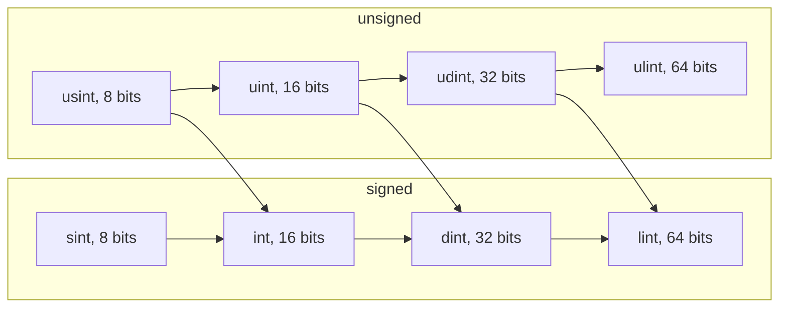

# Choose an integer type and convert values

This guide is for a reader who writes a ladder [program](../reference/glossary.md#program)
with numbers of different sizes, for example the registers of a
[device](../reference/glossary.md#device). It shows how to choose an integer
[type](../reference/glossary.md#type) for a [tag](../reference/glossary.md#tag). It also
shows how to put a value of 1 type into a tag of a different type. Last, it shows what
logex does when the value does not fit.

The power out of an [instruction](../reference/glossary.md#instruction) is the
[power flow](../reference/glossary.md#power-flow) that it gives to the next instruction
on the [rung](../reference/glossary.md#rung).

> #### Warning {: .warning}
>
> If a converted value can move a machine, write the power out of the
> [conversion](../reference/glossary.md#conversion) to a `bool` tag. Use the value only
> while that tag is 1, as step 9 shows. If the type of the destination cannot hold the
> value, a conversion between 2 integer types keeps only the low
> [bits](../reference/glossary.md#bit). Its power out is then false, and logex gives no
> [fault](../reference/glossary.md#fault). Thus 129 becomes -127 in an `sint`.
>
> A conversion to or from a [bit string](../reference/glossary.md#bit-string) type also
> keeps the low bits, but its power out stays true. Compare the source with a limit
> before that conversion.

## Before you start

You must have a Mix project that has logex.
[Install logex and run a program](install-and-run.md) gives the steps.

You must know how to write a rung with `xic` and `ote`.
[Your first program](../tutorials/first-program.md) teaches this.

## Choose the type

logex has 8 integer types. A signed type holds its values in the 2's complement form.

| Signed type | Bits | Range |
|---|---|---|
| `sint` | 8 | -128 to 127 |
| `int` | 16 | -32768 to 32767 |
| `dint` | 32 | -2147483648 to 2147483647 |
| `lint` | 64 | -9223372036854775808 to 9223372036854775807 |

| Unsigned type | Bits | Range |
|---|---|---|
| `usint` | 8 | 0 to 255 |
| `uint` | 16 | 0 to 65535 |
| `udint` | 32 | 0 to 4294967295 |
| `ulint` | 64 | 0 to 18446744073709551615 |

| If the value | Use |
|---|---|
| Comes from a register of a device | The type with the same number of bits as the register. A 16-bit register of 0 to 65535 is a `uint`. If the device gives negative values, use the signed type. |
| Can be negative | A signed type: `sint`, `int`, `dint` or `lint` |
| Is a count or a total | `dint`. Use `lint` if the total can be more than 2147483647. |
| Is the result of arithmetic | A type that holds each result. The instruction calculates in the type of the tag that it writes. Thus `add a b d` writes 32768 if the `int` tags `a` and `b` hold 32767 and 1, and `d` is a `dint`. |
| Is a pattern of bits, not a number | A bit string type. [Use bit strings](use-bit-strings.md) gives the steps. |
| Has a fraction | `real` or `lreal`. [Use real numbers](use-reals.md) gives the steps. |

Know these rules before you choose:

- `Logex.Runtime.put_inputs/3` compares each value with the range of the type of its
  [input](../reference/glossary.md#input). It raises an `ArgumentError` for a value out
  of the range.
- If a device gives a value out of the range of the type of its
  [point](../reference/glossary.md#point), the [runner](../reference/glossary.md#runner)
  [trips](../reference/glossary.md#trip). logex refuses a
  [force](../reference/glossary.md#force) out of the range.
  [Declarations and types](../reference/declarations-and-types.md) gives these rules.
- A type word is not case-sensitive, and it is a
  [reserved word](../reference/glossary.md#reserved-word). No tag can have the name
  `int` or `INT`.
- An [online edit](../reference/glossary.md#online-edit) cannot change the type of a
  tag. The change needs a [restart](../reference/glossary.md#restart). Choose the type
  before the program controls a machine.

> #### Caution {: .error}
>
> If you change the type of a tag, logex does not put the value that it
> [retains](../reference/glossary.md#retain) into the tag. The tag starts at its
> [initial value](../reference/glossary.md#initial-value). Choose the type before you
> retain the values of the tag.

## Choose the instruction that copies the value

An integer type [widens](../reference/glossary.md#widen) into each integer type that
holds each of its values. `move` copies a value into a tag of the same type, or into a
tag of a type that the source widens into. For each other pair of integer types, use a
conversion.



Figure: the integer types. An arrow goes from a type to a wider type.

A type widens into each type that the arrows reach, through 1 arrow or more. Thus a
`uint` widens into a `dint`. No arrow goes from a signed type to an unsigned type, and
no arrow goes to a type of fewer bits. Each unsigned type but `ulint` also widens into
the signed type of the next size, for example `usint` into `int`.

logex has 56 integer conversions: 1 from each integer type into each of the 7 other
integer types. The name is the type of the source, `_to_`, and the type of the
destination, for example `dint_to_sint`.
[Conversions](../reference/conversions.md) gives the rules of each conversion.

| From | Into | Use |
|---|---|---|
| An integer type | A type that the arrows reach | `move`. The value always fits. |
| An integer type | Each other integer type | The conversion `<from>_to_<to>` |
| `bool` | An integer type | 2 rungs: `xic flag move 1 speed` and `xio flag move 0 speed` |
| An integer type | `bool` | A comparison: `ne speed 0 ote flag` |
| An integer type | A bit string type, or back | A conversion. Its power out stays true when it loses bits. [Use bit strings](use-bit-strings.md) gives the steps. |
| An integer type | `real` | `move` from `sint`, `int`, `usint` or `uint`. A conversion from each other type. |
| An integer type | `lreal` | `move` from each type of 32 bits or fewer. A conversion from `lint` or `ulint`. |
| `real` or `lreal` | An integer type | A conversion. [Use real numbers](use-reals.md) gives the steps. |

## Steps

The steps make the file `choose-integer-widths-and-convert/drive.ld`. A drive card gives
the speed of a motor in a 16-bit register, `hz`. The program copies the register into a
`dint` and doubles it in a `uint`. It converts a `dint` level into an `sint` trim, and it
sends the trim to the drive only while the trim is correct.

1. Make the directory `choose-integer-widths-and-convert` in your project, and in it the
   file `drive.ld`.
2. [Declare](../reference/glossary.md#declaration) the register as a `uint` input:
   `var_input hz uint`.
3. Declare the input `level` as a `dint`.
4. Declare the [outputs](../reference/glossary.md#output) in this order, 1 on each line:
   `speed` as `dint`, `twice` as `uint` and `twice_ok` as `bool`.
5. Declare the outputs `trim` as `sint`, `trim_ok` as `bool` and `offset` as `sint`.
   Then put 1 empty line to separate the declarations from the rungs.
6. Copy the register into the `dint`: `move hz speed`. A `uint` widens into a `dint`,
   so `move` needs no conversion.
7. Double the register in the `uint`, and write the power out to `twice_ok`:
   `add hz hz twice ote twice_ok`.
8. Convert the level into the `sint`, and write the power out to `trim_ok`:
   `dint_to_sint level trim ote trim_ok`.
9. Copy the trim to the drive only while `trim_ok` is 1:
   `xic trim_ok move trim offset`.

Make sure that your file is the same as this text:

<!-- file: choose-integer-widths-and-convert/drive.ld -->
```text
var_input hz uint
var_input level dint
var_output speed dint
var_output twice uint
var_output twice_ok bool
var_output trim sint
var_output trim_ok bool
var_output offset sint

move hz speed
add hz hz twice ote twice_ok
dint_to_sint level trim ote trim_ok
xic trim_ok move trim offset
```

This drawing shows the 4 rungs:

<!-- rung: choose-integer-widths-and-convert/drive.ld -->


10. Make the file `choose-integer-widths-and-convert.exs` in the root directory of your
   project, with this text. It runs 3 [scans](../reference/glossary.md#scan) and prints
   6 outputs of each scan. Each `scan.(n, inputs)` gives the inputs that change before
   scan `n`.

```elixir
{:ok, drive} = Logex.compile_file("choose-integer-widths-and-convert/drive.ld")
names = ["speed", "twice", "twice_ok", "trim", "trim_ok", "offset"]

scan = fn state, number, inputs ->
  state = Logex.Runtime.put_inputs(drive, state, inputs)
  {outputs, state} = Logex.Runtime.scan(drive, state)
  IO.puts("#{number}  " <> Enum.map_join(names, "  ", &"#{&1} #{outputs[&1]}"))
  state
end

Logex.Runtime.instance(drive)
|> scan.(1, %{"hz" => 1200, "level" => 100})
|> scan.(2, %{"hz" => 65_535, "level" => 129})
|> scan.(3, %{"level" => -1})
```

11. Run the script:

```console
$ mix run choose-integer-widths-and-convert.exs
1  speed 1200  twice 2400  twice_ok 1  trim 100  trim_ok 1  offset 100
2  speed 65535  twice 65534  twice_ok 0  trim -127  trim_ok 0  offset 100
3  speed 65535  twice 65534  twice_ok 0  trim -1  trim_ok 1  offset -1
```

If logex refuses `drive.ld`, the first line of the script raises a `MatchError`.
[Read a diagnostic](read-diagnostics.md) gives the steps.

## The result

| Scan | What the scan shows |
|---|---|
| 1 | Each type holds its value. `move` copies 1200, `add` writes 2400 and `dint_to_sint` writes 100. `twice_ok` and `trim_ok` are 1, and `offset` gets 100. |
| 2 | `move` copies 65535 into the `dint`. A `uint` does not hold 65535 + 65535, so `twice` [wraps](../reference/glossary.md#wrap) to 65534 and `twice_ok` is 0. An `sint` does not hold 129, so `trim` gets -127 and `trim_ok` is 0. `offset` keeps 100. |
| 3 | An `sint` holds -1, so `trim_ok` is 1 again and `offset` gets -1. `hz` keeps 65535, so `twice_ok` stays 0. |

The conversion of 129 keeps the low 8 bits. In an `sint`, those bits are -127:

| Value | Bits |
|---|---|
| 129 in the `dint` `level` | `0000 0000 0000 0000 0000 0000 1000 0001` |
| -127 in the `sint` `trim` | `1000 0001` |

`ote` is enough for `trim_ok`, because the conversion runs from `level` in each scan.
Thus `trim_ok` is 0 in each scan in which `trim` does not hold the value of `level`. A
total that adds to itself stays wrong after the scan in which it wraps, so
[Do arithmetic and compare values](do-arithmetic.md) latches a
[coil](../reference/glossary.md#coil).

## If it does not work

Each entry in the column **What you see** is a part of the message.
[Conversions](../reference/conversions.md) gives each
[diagnostic](../reference/glossary.md#diagnostic) of a conversion.

### When you compile

| What you see | Cause | What to do |
|---|---|---|
| `` does not widen into `` | The source does not widen into the destination. | Use the conversion that the message names, or give the destination a wider type. |
| `` and logex has no conversion between them `` | `move` copies a `bool` into an integer type, or back. | Use the rungs for `bool` in [Choose the instruction that copies the value](#choose-the-instruction-that-copies-the-value). |
| `` is outside `` | A [literal](../reference/glossary.md#literal) is out of the range of its type. | Use a value in the range, or a wider type. |
| `` reads a dint, but `` | The source does not widen into the type before `_to_`. | Use the conversion after `use` in the message. A `bool` source has no conversion. |
| `` writes an int, but `` | The destination is not of the type after `_to_`. | Use the instruction after `use` in the message. A `bool` destination has no conversion. |
| `` logic must not write an input `` | The destination is an input. | Write to an output or to a `var` tag. |
| `` unknown instruction `dint_to_dint` `` | The 2 types are the same, or 1 type is `bool`. | Use `move` for the same type. For `bool`, use the rungs of [Choose the instruction that copies the value](#choose-the-instruction-that-copies-the-value). |
| `` is a type and cannot name a tag ``, then `` found the type `` | A tag has the name of a type, such as `INT`. | Give the tag a different name. |
| `` is an instruction and cannot name a tag `` | A tag has the name of a conversion, such as `dint_to_int`, in the file of a program or of a [function block](../reference/glossary.md#function-block). | Give the tag a different name. |
| `` its result never changes `` | A [warning](../reference/glossary.md#warning): the source of a conversion is a literal. | The program [compiles](../reference/glossary.md#compile) and runs. Write the value with `move`, or read a tag. |
| `` a tag's type changes only with a restart `` | An online edit changes the type of a tag. | Start a new [instance](../reference/glossary.md#instance) of the new program. [Keep values across a restart](keep-values-across-a-restart.md) gives the steps. |

### When you run the scans

| What you see | Cause | What to do |
|---|---|---|
| `` input `hz` is a uint: 65536 is outside 0 to 65535 `` | The [host](../reference/glossary.md#host) gives an input a value out of the range. | Give the input a wider type, or check the value before `put_inputs/3`. |
| `` :bad_value `` in the trip of the runner | A device gives a value out of the range of its point. | Give the point the type of the register. [Restart after a trip](restart-after-a-trip.md) gives the steps. |
| A value goes to the other end of the range, and the power out is false | A conversion between 2 integer types, or an arithmetic instruction, wraps the value. | Give the destination a wider type. Use the value only while the power out is true, as step 9 does. |
| A value goes to the other end of the range, and the power out is true | A conversion to or from a bit string type wraps the value. | Compare the source with a limit before the conversion. |

## See also

- [Conversions](../reference/conversions.md): each conversion and its rules.
- [Declarations and types](../reference/declarations-and-types.md): each type, its range
  and the types that it widens into.
- [Do arithmetic and compare values](do-arithmetic.md): the arithmetic instructions and
  what they do at a limit.
- [Types and overflow](../explanation/types-and-overflow.md): why a value wraps, and why
  logex calculates in the type of the destination.
- [Glossary](../reference/glossary.md): the words of this guide.
