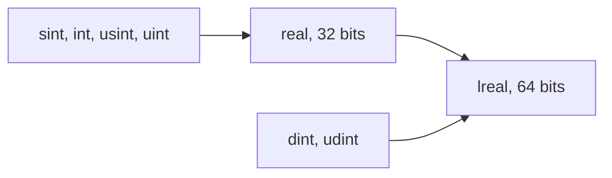

# Convert between real and integer tags

This guide is for a reader who writes a ladder [program](../reference/glossary.md#program)
with real [tags](../reference/glossary.md#tag) and integer tags. It shows how to put a
value of an integer type into a real tag and a real value into an integer tag. It also
shows how to get the next integer up or down.

> #### Warning {: .warning}
>
> If a converted value can move a machine, write the power out of the conversion to a
> `bool` tag. Use the value only while that tag is 1. A result that does not fit its type
> becomes a different value, and logex gives no [fault](../reference/glossary.md#fault).
> Thus `real_to_int` of 36000.0 writes -29536.

## Before you start

- You must know how to declare a real tag and write a real literal.
  [Use real numbers](use-reals.md) gives the steps.
- [Choose integer widths and convert](choose-integer-widths-and-convert.md) gives the
  conversions between 2 integer types.

## Put a value of another type into a real tag

A type that [widens](../reference/glossary.md#widen) into the real type needs no
conversion. Use `move`, or name the tag as an [operand](../reference/glossary.md#operand).



Figure: the integer types and the real types. An arrow goes from a type to a type that
it widens into.

`lint` and `ulint` widen into no real type. For each pair that no arrow joins, use a
conversion:

| From | Conversion |
|---|---|
| `dint` or `udint` into `real` | `dint_to_real`, `udint_to_real` |
| `lint` or `ulint` into `real` | `lint_to_real`, `ulint_to_real` |
| `lint` or `ulint` into `lreal` | `lint_to_lreal`, `ulint_to_lreal` |
| `lreal` into `real` | `lreal_to_real` |
| `bool` or a [bit string](../reference/glossary.md#bit-string) type into a real type | No instruction |

For a bit string, convert it to an integer type first. For example, `word_to_uint w u`
then `move u r` puts the `word` tag `w` into the `real` tag `r`.

For example, an `int` register gives the frequency in units of 0.1 Hz. In `fan.ld` of
[Use real numbers](use-reals.md),
declare `var_input raw int` and change `var_input hz real` to `var hz real`. Then add
the rung `mul raw 0.1 hz` before the other rungs. For 125, `hz` is 12.5 and `speed` is
750.0.

If the register is a `dint`, logex refuses that rung. Declare `var_input raw dint` and
`var raw_hz real`, and use 2 rungs: `dint_to_real raw raw_hz`, then
`mul raw_hz 0.1 hz`.

A conversion into a real type writes the nearest value of the type. Thus `dint_to_real`
of 16777217 writes 16777216.0, and its power out is true. For a value beyond the range
of a `real`, `lreal_to_real` writes the end of the range, and its power out is false.

## Put a real value into an integer tag

A conversion such as `real_to_int` or `lreal_to_dint` writes the nearest integer. A
conversion such as `real_trunc_int` or `lreal_trunc_dint`, a truncation, removes the
fraction toward 0.

| Source | `real_to_int` | `real_trunc_int` |
|---|---|---|
| 2.5 | 2 | 2 |
| 3.5 | 4 | 3 |
| -2.5 | -2 | -2 |
| -2.7 | -3 | -2 |

For a value halfway between 2 integers, `real_to_int` takes the even integer. If the
integer does not fit the destination, both instructions write its low bits, and the
power out is false. [Conversions](../reference/conversions.md) gives each conversion.

## Get the next integer up or down

logex has no instruction that gives the next integer up or the next integer down. Use a
truncation and a comparison.

1. Make the file `round.ld` in the directory `use-reals`, with this text:

<!-- file: use-reals/round.ld -->
```text
var_input x real
var_output up int
var_output down int

real_trunc_int x up
lt up x add up 1 up
real_trunc_int x down
gt down x sub down 1 down
```

2. Make the file `use-reals-round.exs` in the root directory of your project, with this
   text. It gives the program 5 values:

```elixir
{:ok, round} = Logex.compile_file("use-reals/round.ld")

for x <- [2.3, 2.0, -2.3, 0.7, -0.7] do
  state = Logex.Runtime.put_inputs(round, Logex.Runtime.instance(round), %{"x" => x})
  {outputs, _state} = Logex.Runtime.scan(round, state)
  IO.puts("x #{x}  up #{outputs["up"]}  down #{outputs["down"]}")
end
```

3. Run the script:

```console
$ mix run use-reals-round.exs
x 2.3  up 3  down 2
x 2.0  up 2  down 2
x -2.3  up -2  down -3
x 0.7  up 1  down 0
x -0.7  up 0  down -1
```

Rung 2 adds 1 if `up` is less than `x`. Rung 4 subtracts 1 if `down` is more than `x`.
The rungs give the correct values for an `x` from -32768.0 to 32767.0. Out of that
range, the truncation, `add` or `sub` wraps and passes no power. For a larger `x`, use
`real_trunc_dint` and `dint` tags.

## If it does not work

Each entry in the column **What you see** is a part of the message.
[Diagnostics](../reference/diagnostics.md) gives each
[diagnostic](../reference/glossary.md#diagnostic).

| What you see | Cause | What to do |
|---|---|---|
| `` logex has no conversion between `` | A `bool` or a bit string with a real. | For a `bool` tag `b`, use 2 rungs: `xic b move 1.0 r` and `xio b move 0.0 r`. Convert a bit string to an integer type first, as [Put a value of another type into a real tag](#put-a-value-of-another-type-into-a-real-tag) shows. |
| `` does not widen into `` | A `dint` into a `real`, or a `real` into an `int`. | Use the conversion that the message names, or a truncation. |
| `` unknown instruction `` | An instruction such as `round`, `ceil` or `floor`, which logex does not have. | Do the steps of [Get the next integer up or down](#get-the-next-integer-up-or-down). |
| `` reads a literal `` | A warning: a conversion of a literal always writes the same value. | Write that value as a literal. |
| An integer goes to the other end of its range | A conversion wraps the value. | Use the value only while the power out is true, as [Use real numbers](use-reals.md) does in its steps 8 and 9. |

## See also

- [Conversions](../reference/conversions.md): each conversion and truncation, and its
  rules.
- [Use real numbers](use-reals.md): the real types, their literals and their arithmetic.
- [Declarations and types](../reference/declarations-and-types.md#widening): the types
  that each type widens into.
- [Types and overflow](../explanation/types-and-overflow.md): why a real stops at the end
  of its range and an integer wraps.
- [Glossary](../reference/glossary.md): the words of this guide.
