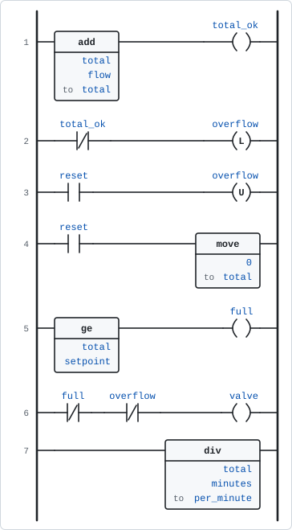
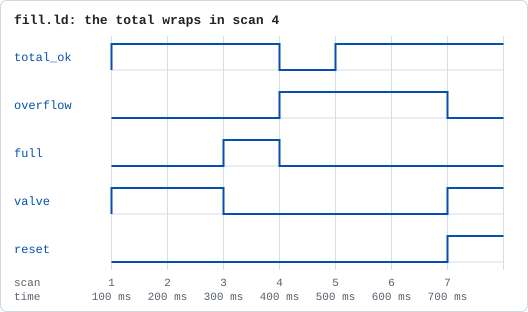

# Do arithmetic and compare values

This guide is for a reader who writes a ladder [program](../reference/glossary.md#program).
It shows how to add, subtract, multiply and divide on a
[rung](../reference/glossary.md#rung), and how to compare 2 values. It also shows what
logex does when a result does not fit its [type](../reference/glossary.md#type).

> #### Warning {: .warning}
>
> If an arithmetic result can move a machine, [latch](../reference/glossary.md#latch) a
> coil when the power out of the
> [instruction](../reference/glossary.md#instruction) is false. Then stop the machine
> while that coil is 1, as steps 6 and 9 show. An integer result that its type cannot
> hold [wraps](../reference/glossary.md#wrap) to the other end of the range, and logex
> gives no [fault](../reference/glossary.md#fault). The power out is false only in the
> scan in which the result wraps.

## Before you start

You must have a Mix project that has logex.
[Install logex and run a program](install-and-run.md) gives the steps.

You must know how to write a rung with `xic` and `ote`.
[Your first program](../tutorials/first-program.md) teaches this.

## Choose the instruction

| You want | Use | It writes to `d` |
|---|---|---|
| To add | `add a b d` | `a + b` |
| To subtract | `sub a b d` | `a - b` |
| To multiply | `mul a b d` | `a * b` |
| To divide | `div a b d` | `a / b`. An integer quotient goes toward 0: `div -7 2 d` writes -3. |
| The remainder of a division | `mod a b d` | The remainder, with the sign of `a`: `mod -7 3 d` writes -1. Integer types only. |
| To change the sign | `neg a d` | `-a`. `d` must be a signed integer type or a real type. |
| The absolute value | `abs a d` | `a` with no sign |
| A square root | `sqrt a d` | [Use real numbers](use-reals.md) gives the steps. |

`a` and `b` are the sources. Each source is a [tag](../reference/glossary.md#tag), an
[element](../reference/glossary.md#element) of an [array](../reference/glossary.md#array), a
[member](../reference/glossary.md#member) or a [literal](../reference/glossary.md#literal).
`d` is the destination: a tag, an element, or the member `pre` or `acc` of a
[timer](../reference/glossary.md#timer) or `pv` of a
[counter](../reference/glossary.md#counter). It cannot be an
[input](../reference/glossary.md#input) or a member of a
[function block](../reference/glossary.md#function-block) instance.

| To pass power if | Use |
|---|---|
| `a` is equal to `b` | `eq a b` |
| `a` is not equal to `b` | `ne a b` |
| `a` is less than `b` | `lt a b` |
| `a` is more than `b` | `gt a b` |
| `a` is less than `b` or equal to it | `le a b` |
| `a` is more than `b` or equal to it | `ge a b` |

A comparison writes no tag. Put a [coil](../reference/glossary.md#coil) after it. On a
[false rung](../reference/glossary.md#false-rung), a comparison passes no power.

The power out of an instruction is the
[power flow](../reference/glossary.md#power-flow) that it gives to the next instruction
on the rung. An arithmetic instruction follows these rules:

- On a [true rung](../reference/glossary.md#true-rung), it writes its result. Its power
  out is false if `d` cannot hold the result or if the divisor is 0.
- On a false rung, it writes nothing and passes no power.
- It calculates in the type of `d`. Each source must have that type, or
  [widen](../reference/glossary.md#widen) into it. Thus 32767 + 1 from 2 `int` sources
  into a `dint` gives 32768.
- It reads its sources before it writes. Thus `add total flow total` adds `flow` to the
  total of the scan before.

[Instructions: arithmetic and comparison](../reference/instructions-arithmetic-and-comparison.md)
gives each rule.

## Steps

The steps make the file `do-arithmetic/fill.ld`. A fill valve stays open until the total
flow gets to the setpoint. In each scan, a flow meter gives the input `flow`. The
program also calculates the flow for each minute.

1. Make the directory `do-arithmetic` in your project, and in it the file `fill.ld`.
2. [Declare](../reference/glossary.md#declaration) the inputs, 1 on each line:
   `flow`, `setpoint` and `minutes` as `dint`, and `reset` as `bool`.
   Example: `var_input flow dint`.
3. Declare the [outputs](../reference/glossary.md#output) with the
   [section](../reference/glossary.md#section) `var_output`: `total` and `per_minute`
   as `dint`, and `valve`, `total_ok` and `overflow` as `bool`.
   Example: `var_output valve bool`.
4. Declare the tag `full` with the section `var`: `var full bool`. Then put 1 empty line.
5. Add the flow to the total, and write the power out to `total_ok`:
   `add total flow total ote total_ok`.
6. Latch `overflow` when the power out is false: `xio total_ok otl overflow`. After a
   wrap, `overflow` stays 1.
7. Clear `overflow` and the total when `reset` is 1. Write 2 rungs:
   `xic reset otu overflow` and `xic reset move 0 total`.
8. Compare the total with the setpoint: `ge total setpoint ote full`.
9. Open the valve while `full` and `overflow` are 0: `xio full xio overflow ote valve`.
10. Divide the total by the minutes: `div total minutes per_minute`.

Make sure that your file is the same as this text:

<!-- file: do-arithmetic/fill.ld -->
```text
var_input flow dint
var_input setpoint dint
var_input minutes dint
var_input reset bool
var_output valve bool
var_output total dint
var_output total_ok bool
var_output per_minute dint
var_output overflow bool
var full bool

add total flow total ote total_ok
xio total_ok otl overflow
xic reset otu overflow
xic reset move 0 total
ge total setpoint ote full
xio full xio overflow ote valve
div total minutes per_minute
```

This drawing shows the 7 rungs:

<!-- rung: do-arithmetic/fill.ld -->


11. Make the file `do-arithmetic.exs` in the root directory of your project, with this
    text. It runs 7 [scans](../reference/glossary.md#scan) and prints 5 outputs and the
    faults of each scan. Each `scan.(n, inputs)` gives the inputs that change before
    scan `n`. The `100` is the time of each scan, 100 ms.

```elixir
{:ok, fill} = Logex.compile_file("do-arithmetic/fill.ld")
names = ["total", "total_ok", "overflow", "valve", "per_minute"]

scan = fn state, number, inputs ->
  state = Logex.Runtime.put_inputs(fill, state, inputs)
  {outputs, state} = Logex.Runtime.scan(fill, state, 100)
  IO.puts("#{number}  " <> Enum.map_join(names, "  ", &"#{&1} #{outputs[&1]}"))
  for fault <- state.faults, do: IO.puts("   fault #{inspect(fault.kind)} at line #{fault.line}")
  state
end

Logex.Runtime.instance(fill)
|> scan.(1, %{"flow" => 400, "setpoint" => 1000})
|> scan.(2, %{"minutes" => 1})
|> scan.(3, %{"minutes" => 2})
|> scan.(4, %{"flow" => 2_147_483_000})
|> scan.(5, %{})
|> scan.(6, %{"flow" => -5})
|> scan.(7, %{"flow" => 0, "reset" => 1})
```

12. Run the script:

```console
$ mix run do-arithmetic.exs
1  total 400  total_ok 1  overflow 0  valve 1  per_minute 0
   fault :divide_by_zero at line 18
2  total 800  total_ok 1  overflow 0  valve 1  per_minute 800
3  total 1200  total_ok 1  overflow 0  valve 0  per_minute 600
4  total -2147483096  total_ok 0  overflow 1  valve 0  per_minute -1073741548
5  total -96  total_ok 1  overflow 1  valve 0  per_minute -48
6  total -101  total_ok 1  overflow 1  valve 0  per_minute -50
7  total 0  total_ok 1  overflow 0  valve 1  per_minute 0
```

If `fill.ld` has an error, the script stops at its first line with a `MatchError`.
[Read a diagnostic](read-diagnostics.md) gives the steps.

## The result

The valve closes at the setpoint. The total wraps in scan 4, and `overflow` keeps the
valve closed until the reset in scan 7. This timing diagram shows the run:

<!-- timing: do-arithmetic-fill.timing.exs -->


| Scan | What the scan shows |
|---|---|
| 1 | `setpoint` is 1000. `minutes` is 0, its [initial value](../reference/glossary.md#initial-value). `div` writes 0 and gives the [minor fault](../reference/glossary.md#minor-fault) `:divide_by_zero`. The other rungs run. |
| 2 | `div` writes 800 / 1 = 800. |
| 3 | The total, 1200, is more than the setpoint. `ge` passes power, and the valve closes. |
| 4 | 1200 + 2147483000 does not fit in a `dint`. The total wraps, and `total_ok` is 0. Rung 2 latches `overflow`, and the valve stays closed. `div` writes half of the wrapped total. |
| 5 | -2147483096 + 2147483000 is -96. `total_ok` is 1 again, but `overflow` stays 1. |
| 6 | A flow of -5 makes the total -101. `div` writes -50 for -101 / 2, because the quotient goes toward 0. |
| 7 | `reset` is 1. Rungs 3 and 4 clear `overflow` and the total. The valve opens for a new fill. |

## What logex does at a limit

| Case and example | `d` gets | Power out and fault |
|---|---|---|
| An integer result out of the range of `d`: `127 + 1` in an `sint`, `0 - 1` in a `usint`, `2147483647 + 1` in a `dint` | It wraps: -128, 255, -2147483648 | False. No fault. |
| `neg` or `abs` of the lowest value of a signed type, or `div` of that value by -1: -2147483648 in a `dint` | -2147483648 | False. No fault. |
| A divisor of 0 in `div` or `mod`: `minutes` is 0 in scan 1 | 0, or 0.0 in a real type | False. The minor fault `:divide_by_zero`. |
| A real result that the type cannot hold exactly: `16777216.0 + 1.0` in a `real` | The nearest value, 16777216.0 | True. No fault. |
| A real result out of the range of the type: `3.0e38 * 10.0` in a `real` | The largest value of the type, with the sign of the result | False. No fault. |

## Divide with no fault

1. Change rung 7 to `ne minutes 0 div total minutes per_minute`. If `minutes` is 0,
   `div` gets no power. It writes nothing and gives no fault.
2. Run the script again. Scan 1 prints no fault line, and `per_minute` stays 0, its
   initial value.

## Find a fault of a division

A minor fault does not stop the scan. The scan runs the next instruction and the other
rungs. The [host](../reference/glossary.md#host) finds the fault here:

| You run | The fault is in |
|---|---|
| An [instance](../reference/glossary.md#instance) with `Logex.Runtime.scan/3` | `state.faults` of the [state](../reference/glossary.md#state) that the scan returns: each `%Logex.Fault{}` of the scan, or `[]` |
| A [configuration](../reference/glossary.md#configuration) with `Logex.Runtime.cycle/3` | An event `{:fault, task, instance, fault}`, after the event `{:ran, task, instance, time}` of the scan |

The fault gives the instruction, the line and the file. The file is `nil` for a program
that `Logex.compile/2` compiled from text. [Faults](../reference/faults.md) gives each
field.

## Compare 2 values

1. Declare a `bool` for the result, for example `var alarm bool`.
2. Write the comparison, then the coil. Use 1 of these forms:
   - The total is the setpoint or more: `ge total setpoint ote alarm`.
   - The total is in a range: 2 comparisons in series,
     `ge total 500 le total 900 ote alarm`.
   - The total is out of a range: 2 comparisons in a
     [branch](../reference/glossary.md#branch), `( lt total 500 | gt total 900 ) ote alarm`.

A comparison compares the values, not the bits. Thus an `sint` of -1 is less than a
`udint` of 0. A `dint` and a `real` do not compare. Convert the `dint` first with
`dint_to_real`, or declare the other tag as an `lreal`.
[Instructions: arithmetic and comparison](../reference/instructions-arithmetic-and-comparison.md)
gives each pair of types that compares.

## If it does not work

Each entry in the column **What you see** is a part of the message. The reference page
[Instructions: arithmetic and comparison](../reference/instructions-arithmetic-and-comparison.md)
gives each [diagnostic](../reference/glossary.md#diagnostic).

### When you compile

| What you see | Cause | What to do |
|---|---|---|
| `` does not widen into `` | A source does not widen into the type of `d`. For example, it is wider, or it has a sign and `d` has none. | Convert the source as the message gives, or change the type of `d`. |
| `` is outside `` | A literal is out of the range of the type. | Use a value in the range, or a wider type. |
| `` holds only integers `` | The instruction has a real literal and an integer type. | Use an integer literal, or a real type. |
| `` divides by the literal `0` `` | The divisor is the literal 0. | Use a tag, and do [Divide with no fault](#divide-with-no-fault). |
| `` missing separator before `-` `` | An [operand](../reference/glossary.md#operand) is a calculation, such as `5-3`. | Write each operand as 1 tag or 1 literal. Use `sub` to subtract. |
| `` is a bit string, not a number `` | A source of an arithmetic instruction is a [bit string](../reference/glossary.md#bit-string). | Convert it as the message gives. |
| `` a bit string compares only with a bit string `` | A comparison has a bit string and an integer tag or member. | Convert 1 of them as the message gives. |
| `` reads a number or a bit string `` | A comparison reads a `bool`. | Read a `bool` with `xic` or `xio`. |
| `` which never holds it `` | A literal in a comparison is out of the range of the other type. | Use a value in the range. |
| `` this rung writes nothing and jumps nowhere `` | The rung has comparisons and no coil. | Put a coil after the comparisons. |
| `` its result never changes `` | A [warning](../reference/glossary.md#warning): each source is a literal, as in `div -7 2 d`. Or a literal is at a limit, as in `ge count 0` with a `usint`. | The program [compiles](../reference/glossary.md#compile) and runs. To remove the warning, change the literal or use a tag. |

### When you run the scans

| What you see | Cause | What to do |
|---|---|---|
| A total jumps to a large negative value | The total wrapped. | Give it a wider type, such as `lint`. Latch a `bool` when the power out is false, as in step 6. |
| `d` is 0, and the scan has the fault `:divide_by_zero` | The divisor was 0. | Do [Divide with no fault](#divide-with-no-fault). |
| A quotient has no fraction | An integer quotient goes toward 0. | Calculate in a real type. |
| `mod` writes a negative value | The remainder has the sign of `a`. | If you must have a remainder of 0 or more, add the absolute value of `b` to a negative result. |

## See also

- [Instructions: arithmetic and comparison](../reference/instructions-arithmetic-and-comparison.md):
  each rule of these instructions, with each case and each message.
- [Choose an integer type and convert values](choose-integer-widths-and-convert.md): the
  integer types and their conversions.
- [Use real numbers](use-reals.md): `real`, `lreal` and `sqrt`.
- [Types and overflow](../explanation/types-and-overflow.md): why a result wraps, and
  why the power out is false.
- [Faults](../reference/faults.md): each fault and its fields.
- [Glossary](../reference/glossary.md): the words of this guide.
