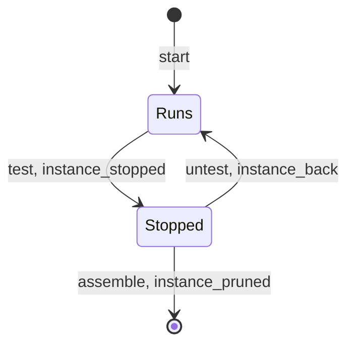

# Edit a running plant without the runner

This guide is for a reader whose [host](../reference/glossary.md#host) runs a
[plant](../reference/glossary.md#plant) with `Logex.Runtime.cycle/3`, and has no
[runner](../reference/glossary.md#runner). It shows how to put a new plant in the place
of the old plant with an [online edit](../reference/glossary.md#online-edit). The host
does no [restart](../reference/glossary.md#restart), and each
[instance](../reference/glossary.md#instance) keeps its
[state](../reference/glossary.md#state).

If a runner runs your plant, go to [Edit a running plant](edit-a-running-plant.md).

> #### Warning {: .warning}
>
> Do not use logex for a safety function, for example an emergency stop. logex can stop
> at any time. Before each step of an edit, make sure that a wrong output cannot cause
> injury or damage. An edit changes the logic while the machine runs.
> [Safety and limits](../explanation/safety-and-limits.md) gives the limits of logex.

## Before you start

You must have:

- a host that runs the [cycles](../reference/glossary.md#cycle) of 1
  [resource](../reference/glossary.md#resource)
- the new plant as files, in a separate directory and with the file names of the old
  plant

You must know:

- the 5 steps of an online edit, which
  [Edit a running program](edit-a-running-program.md#the-steps-of-an-edit) gives
- the changes that an edit cannot do, which
  [Edit a running plant](edit-a-running-plant.md#changes-that-need-a-restart) gives

In a message of logex, `the candidate` is the new plant. `the running configuration` is
the plant that the resource runs at that moment.

## The steps of an edit

Each step is a function of the module `Logex.Configuration.Edit`. The first argument of
the accept is the resource, which is the value that `Logex.Runtime.start/1` returns.

| Step | Function | Returns | A cycle then runs |
|---|---|---|---|
| [Accept](../reference/glossary.md#accept) | `accept(runtime, new_plant)` | `{:ok, edit, forecast}` or `{:error, diagnostics}` | The old plant |
| [Test](../reference/glossary.md#test) | `test(edit, runtime)` | `{edit, runtime, report}` | The new plant |
| [Untest](../reference/glossary.md#untest) | `untest(edit, runtime)` | `{edit, runtime, report}` | The old plant |
| [Assemble](../reference/glossary.md#assemble) | `assemble(edit, runtime)` | `{configuration, runtime, report}` | The new plant. The edit ends. |
| [Cancel](../reference/glossary.md#cancel) | `cancel(edit, runtime)` | `{configuration, runtime, report}` | The old plant. The edit ends. |

A report is a list of entries. An entry gives a change that the step makes, or a fact
for your host. A forecast is the report that the test returns if your host does the test
at that moment.

Your host has these duties:

- Do each step between 2 cycles.
- Keep the edit and the resource that a step returns. Give them to the next step.
- Call `Logex.Runtime.cycle/3` as before the edit. The resource holds the plant that the
  edit selects, and your host selects nothing.
- Do not stop on a kind of entry that your host does not know.
- If time went by after the last cycle, give this time in ms as the third argument of
  the accept, the test and the untest. logex then counts a new interval of a task from
  the moment of the step.

The resource keeps the value of each [input](../reference/glossary.md#input) through an
edit.

## The example

The old plant has 2 instances. The instance `c1` controls the motor of a conveyor in the
[task](../reference/glossary.md#task) `fast`. The instance `snap` runs in the
[event task](../reference/glossary.md#event-task) `trip`, at each
[rising edge](../reference/glossary.md#rising-edge) of the global `estop`. It copies the
value of the contactor `k1` to the global `k1_at_trip`.

> #### Warning {: .warning}
>
> The signal `estop` of this example is an input that a program reads. It is not the
> emergency stop of a machine.

<!-- file: trip.logex -->
```text
// trip.logex -- a conveyor, and a snapshot of its contactor when the e-stop rises
task fast interval 10 priority 1
task trip single estop priority 0

var_global estop      bool at panel.i.7
var_global pb_start_1 bool at panel.i.0
var_global pb_reset   bool at panel.i.2
var_global k1         bool at panel.q.0
var_global k1_at_trip bool

program c1 conveyor with fast
  c1.start pb_start_1
  c1.stop  0
  c1.reset pb_reset
  c1.motor k1

program snap snapshot with trip
  snap.a     k1
  snap.a_was k1_at_trip
```

<!-- file: conveyor.ld -->
```text
var_input start bool
var_input stop bool
var_input reset bool
var_output motor bool
var_external estop bool
var fault bool

xic estop otl fault
xic reset otu fault
( xic start | xic motor ) xio stop xio fault ote motor
```

<!-- file: snapshot.ld -->
```text
var_input a bool
var_output a_was bool

xic a ote a_was
```

The new plant is in the directory `v2`. It has 3 changes:

| Part | Old plant | New plant |
|---|---|---|
| The task `fast` | An interval of 10 ms | An interval of 5 ms |
| The instance `snap` | It runs in the task `trip`. | The plant does not have it. |
| The global `horn` | The plant does not have it. | The instance `c1` sets it while its tag `fault` is 1. |

<!-- file: v2/trip.logex -->
```text
// trip.logex -- the conveyor sounds a horn while it is faulted, checked every 5 ms
task fast interval 5 priority 1
task trip single estop priority 0

var_global estop      bool at panel.i.7
var_global pb_start_1 bool at panel.i.0
var_global pb_reset   bool at panel.i.2
var_global k1         bool at panel.q.0
var_global k1_at_trip bool
var_global horn       bool

program c1 conveyor with fast
  c1.start pb_start_1
  c1.stop  0
  c1.reset pb_reset
  c1.motor k1
```

<!-- file: v2/conveyor.ld -->
```text
var_input start bool
var_input stop bool
var_input reset bool
var_output motor bool
var_external estop bool
var_external horn bool
var fault bool

xic estop otl fault
xic reset otu fault
( xic start | xic motor ) xio stop xio fault ote motor
xic fault ote horn
```

The global `horn` has no [location](../reference/glossary.md#location), because an edit
cannot add a [located global](../reference/glossary.md#located-global).

The example also shows a plant that the accept refuses. In the directory `moved`, the
file `trip.logex` puts the instance `c1` in the task `trip`. The file `conveyor.ld` is a
copy of `v2/conveyor.ld`.

<!-- file: moved/trip.logex -->
```text
// trip.logex -- the conveyor sounds a horn while it is faulted, checked every 5 ms
task fast interval 5 priority 1
task trip single estop priority 0

var_global estop      bool at panel.i.7
var_global pb_start_1 bool at panel.i.0
var_global pb_reset   bool at panel.i.2
var_global k1         bool at panel.q.0
var_global k1_at_trip bool
var_global horn       bool

program c1 conveyor with trip
  c1.start pb_start_1
  c1.stop  0
  c1.reset pb_reset
  c1.motor k1
```

<!-- file: moved/conveyor.ld -->
```text
var_input start bool
var_input stop bool
var_input reset bool
var_output motor bool
var_external estop bool
var_external horn bool
var fault bool

xic estop otl fault
xic reset otu fault
( xic start | xic motor ) xio stop xio fault ote motor
xic fault ote horn
```

## Steps

1. **[Compile](../reference/glossary.md#compile) the new plant.** The name of its
   [configuration file](../reference/glossary.md#configuration-file) must be the name of
   the old file.

<!-- part of: edit_plant.exs -->
```elixir
{:ok, v2} = Logex.Configuration.compile_file("v2/trip.logex")
```

2. **Accept the new plant between 2 cycles.** Give the resource and the new plant.

<!-- part of: edit_plant.exs -->
```elixir
{:ok, edit, _forecast} = Logex.Configuration.Edit.accept(rt, v2)
```

The accept changes nothing. Read the forecast before the test. The script does not use
it.

> #### Warning {: .warning}
>
> If the forecast has a `:held` entry, find the
> [output](../reference/glossary.md#output) before the test. The entry names a
> [global](../reference/glossary.md#global) that no program of the new plant writes. If
> the global is at an output [point](../reference/glossary.md#point), each cycle returns
> the held value for this point. A motor that is on stays on.

3. **Do the test.** Keep the edit and the resource that the test returns.

<!-- part of: edit_plant.exs -->
```elixir
{edit, rt} = step.(Logex.Configuration.Edit.test(edit, rt), "test")
```

In the script, the function `step` prints the report and returns the edit and the
resource. The next cycle runs the new plant.

4. **Run cycles, and make sure that the machine does its work.**

5. **To go back to the old plant, do an untest.** After the untest, a cancel ends the
   edit.

<!-- part of: edit_plant.exs -->
```elixir
{edit, rt} = step.(Logex.Configuration.Edit.untest(edit, rt), "untest")
```

The next cycle runs the old plant. The script does a second test after the untest. It
does no cancel.

6. **To keep the new plant, do an assemble while the edit is under test.**

<!-- part of: edit_plant.exs -->
```elixir
{_line, rt} = step.(Logex.Configuration.Edit.assemble(edit, rt), "assemble")
```

The assemble returns the configuration of the new plant, and the edit ends. Do not use
`edit` after an assemble or a cancel.

7. **Make the files of the new plant the files that your host compiles at its start.**
   If you do not, the old plant runs again after the next start of your host.

### The complete script

The script `edit_plant.exs` runs the old plant for 2 cycles. It then does a test, an
untest, a second test and an assemble, with cycles between them. The last 2 parts show 2
errors: a step with an edit that ended, and the accept of the plant in `moved`.

```elixir
{:ok, line} = Logex.Configuration.compile_file("trip.logex")
{:ok, v2} = Logex.Configuration.compile_file("v2/trip.logex")

cycle = fn rt, elapsed, label, inputs ->
  {rt, out, events} = Logex.Runtime.cycle(rt, elapsed, inputs)
  ran = for {:ran, task, instance, _now} <- events, do: "#{task}:#{instance}"
  # `horn` is a global of the candidate's alone.
  horn = fn
    {:ok, value} -> " horn=#{value}"
    {:error, _reason} -> ""
  end

  IO.puts("#{label}k1=#{out["k1"]} k1_at_trip=#{Logex.Runtime.get!(rt, "k1_at_trip")}#{horn.(Logex.Runtime.get(rt, "horn"))}  ran #{Enum.join(ran, ", ")}")
  rt
end

step = fn {edit, rt, report}, label ->
  IO.puts(label)
  Enum.each(report, &IO.puts("        #{inspect(&1)}"))
  {edit, rt}
end

rt =
  Logex.Runtime.start(line)
  |> cycle.(0, "t=  0  started           ", %{"pb_start_1" => 1})
  |> cycle.(10, "t= 10  released          ", %{"pb_start_1" => 0})

{:ok, edit, _forecast} = Logex.Configuration.Edit.accept(rt, v2)
{edit, rt} = step.(Logex.Configuration.Edit.test(edit, rt), "test")

rt =
  rt
  |> cycle.(5, "t= 15  under test        ", %{})
  |> cycle.(5, "t= 20  e-stop rises      ", %{"estop" => 1})

{edit, rt} = step.(Logex.Configuration.Edit.untest(edit, rt), "untest")

rt =
  rt
  |> cycle.(10, "t= 30  released, reset   ", %{"estop" => 0, "pb_reset" => 1})
  |> cycle.(10, "t= 40  e-stop rises      ", %{"estop" => 1, "pb_reset" => 0})

{edit, rt} = step.(Logex.Configuration.Edit.test(edit, rt), "test")
{_line, rt} = step.(Logex.Configuration.Edit.assemble(edit, rt), "assemble")
_rt = cycle.(rt, 5, "t= 45  assembled         ", %{"estop" => 0})

try do
  Logex.Configuration.Edit.untest(edit, rt)
rescue
  error in ArgumentError -> IO.puts(error.message)
end

{:ok, moved} = Logex.Configuration.compile_file("moved/trip.logex")
{:error, diagnostics} = Logex.Configuration.Edit.accept(Logex.Runtime.start(line), moved)
Enum.each(diagnostics, &IO.puts(Logex.Diagnostic.format(&1)))
```

```console
$ mix run edit_plant.exs
t=  0  started           k1=1 k1_at_trip=0  ran fast:c1
t= 10  released          k1=1 k1_at_trip=0  ran fast:c1
test
        {:added, "horn", 0}
        {:held, "k1_at_trip", 0}
        {:instance_stopped, "snap", "snapshot"}
        {:interval, "fast", {10, 5}}
        {:joined, "c1.horn", {nil, 0}}
        {:next_due, "fast", {20, 15}}
t= 15  under test        k1=1 k1_at_trip=0 horn=0  ran fast:c1
t= 20  e-stop rises      k1=0 k1_at_trip=0 horn=1  ran fast:c1
untest
        {:instance_back, "snap", "snapshot"}
        {:interval, "fast", {5, 10}}
t= 30  released, reset   k1=0 k1_at_trip=0  ran fast:c1
t= 40  e-stop rises      k1=0 k1_at_trip=0  ran trip:snap, fast:c1
test
        {:held, "k1_at_trip", 0}
        {:instance_stopped, "snap", "snapshot"}
        {:interval, "fast", {10, 5}}
        {:joined, "c1.horn", {nil, 1}}
assemble
        {:held, "k1_at_trip", 0}
        {:instance_pruned, "snap", "snapshot"}
t= 45  assembled         k1=0 k1_at_trip=0 horn=1  ran fast:c1
this edit expects the resource at generation 3, but it is at generation 4: the edit has ended, or another edit has stepped since
moved/trip.logex: line 12: `c1` runs with `fast` in the running configuration and with `trip` in the candidate: an instance moves to another task only with a restart
```

## The result

The resource runs the new plant. The instance `c1` keeps its state through each step:
`k1` stays 1 at 15 ms.

| Line of the output | What it shows |
|---|---|
| `{:added, "horn", 0}` | The new global `horn` starts at its [initial value](../reference/glossary.md#initial-value). |
| `{:held, "k1_at_trip", 0}` | No program of the new plant writes `k1_at_trip`. The global keeps its value. |
| `{:instance_stopped, "snap", "snapshot"}` | The new plant does not have `snap`. The resource keeps the state of `snap`, and no cycle runs it. |
| `{:interval, "fast", {10, 5}}` and `{:next_due, "fast", {20, 15}}` | The task `fast` is due at 15 ms, which is the time of the test plus the new interval. |
| `{:joined, "c1.horn", {nil, 0}}` | The instance `c1` reads and writes the global `horn` from its next [scan](../reference/glossary.md#scan). The `nil` tells you that `c1` had no [tag](../reference/glossary.md#tag) `horn`. |
| `t= 20  e-stop rises` | The rising edge of `estop` runs no instance, because the task `trip` of the new plant has none. |
| `{:instance_back, "snap", "snapshot"}` | The untest gives `snap` back with the state that it had at the test. |
| `t= 40  e-stop rises` | The task `trip` runs `snap` at the next rising edge. A test or an untest does not make an edge. |
| `{:joined, "c1.horn", {nil, 1}}` | The second test does not start `horn` again. The resource kept its value 1 while the old plant ran. |
| `{:instance_pruned, "snap", "snapshot"}` | The assemble removes the state of `snap`. |
| `t= 45  assembled` | The cycles run the new plant, and `horn` is 1. |

While the old plant runs, `Logex.Runtime.get/2` returns `{:error, reason}` for `horn`.
The old plant does not declare this global. The script thus prints `horn` only for the
new plant.



Figure: the instance `snap`, which only the old plant has. Each arrow gives a step and
the kind of its entry.

The diagram shows that the state of `snap` is available until the assemble.

## If it does not work

| What you see | Cause | What to do |
|---|---|---|
| `this edit expects the resource at generation 3, but it is at generation 4` | The edit ended, or your host gave an edit or a resource of an earlier step. | Keep the edit and the resource that each step returns. After an assemble or a cancel, do a new accept. |
| `an instance moves to another task only with a restart` | The new plant has a change that an edit cannot do. | Read [Changes that need a restart](edit-a-running-plant.md#changes-that-need-a-restart). |
| `an edit keeps the configuration's name` | The configuration file of the new plant has a different name. | Give the file the name of the old file, in a separate directory. |
| `takes an edit` | The edit is not at the correct stage for this function. | Read the stage with `Logex.Configuration.Edit.stage/1`. |
| A `MatchError` at the accept | The accept returned `{:error, diagnostics}`. | Print each [diagnostic](../reference/glossary.md#diagnostic) with `Logex.Diagnostic.format/1`, as the end of the script does. |

The messages of rows 1, 3 and 4 are the text of an `ArgumentError`. The output of the
script ends with the messages of rows 1 and 2. Each step except the accept adds 1 to the
generation of the resource. Thus logex finds an edit that is not the newest.

A restart with `Logex.Runtime.restart/2` does not end the edit, and the edit keeps its
stage.

## See also

- [Edit a running plant](edit-a-running-plant.md): the edit through the runner, and the
  changes that need a restart.
- [Read the forecast of an edit](read-the-forecast-of-an-edit.md): the kinds of entry.
- [Change what a running plant retains](change-what-a-running-plant-retains.md): an edit
  that adds or removes `retain`.
- [Online edit](../reference/online-edit.md): the rules of each step and each kind of
  entry.
- [The model of an online edit](../explanation/online-edit-model.md): how an edit keeps
  the state.
- [Glossary](../reference/glossary.md): the technical words.
