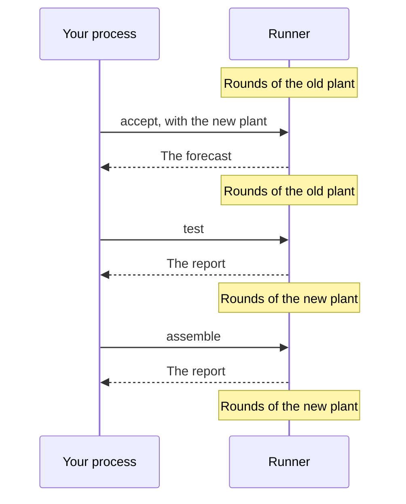

# Edit a running plant

This guide is for a reader whose [runner](../reference/glossary.md#runner) runs a
[plant](../reference/glossary.md#plant). It shows how to put a new plant in the place of
the old plant with an [online edit](../reference/glossary.md#online-edit). The runner
does no [restart](../reference/glossary.md#restart), and each
[instance](../reference/glossary.md#instance) keeps its
[state](../reference/glossary.md#state).

The old plant is the [configuration](../reference/glossary.md#configuration) that the
runner runs, with its [programs](../reference/glossary.md#program). The new plant is the
configuration that you want to run.

- If your [host](../reference/glossary.md#host) runs 1 instance and no configuration,
  go to [Edit a running program](edit-a-running-program.md).
- If your host calls `Logex.Runtime.cycle/3` and has no runner, go to
  [Edit a running plant without the runner](edit-a-plant-without-the-runner.md).

> #### Warning {: .warning}
>
> Do not use logex for a safety function, for example an emergency stop. logex can stop
> at any time. Before each step of an edit, make sure that a wrong output cannot cause
> injury or damage. An edit changes the logic while the machine runs.
> [Safety and limits](../explanation/safety-and-limits.md) gives the limits of logex.

## Before you start

You must have:

- a runner that runs the old plant ([Your first plant](../tutorials/first-plant.md)
  shows how)
- the new plant as files
- a process that has the pid or the name of the runner, for example an IEx shell of
  your host

You must know the 5 steps of an online edit.
[Edit a running program](edit-a-running-program.md#the-steps-of-an-edit) gives them.

To see an edit before you do it on a machine, do
[Try an edit of a plant on a simulated device](try-an-edit-on-a-simulated-device.md)
first.

In a message of logex, `the candidate` is the new plant. `the running configuration` is
the plant that the runner runs at that moment.

## Changes that need a restart

The [accept](../reference/glossary.md#accept) refuses each change of this list. For
such a change, stop the runner and start it with the new plant.

- The new plant adds or removes a [task](../reference/glossary.md#task).
- A task becomes the [continuous task](../reference/glossary.md#continuous-task), or
  the continuous task becomes a [periodic task](../reference/glossary.md#periodic-task)
  or an [event task](../reference/glossary.md#event-task).
- A task gets a [trigger](../reference/glossary.md#trigger), loses its trigger, or gets
  a different trigger.
- An event task gets an interval or loses its interval.
- An instance moves to a different task and keeps its program. An instance with no
  `with` runs in the continuous task.
- A [global](../reference/glossary.md#global) gets a different
  [type](../reference/glossary.md#type). The size of an
  [array](../reference/glossary.md#array) is a part of its type.
- The new plant adds, removes or moves a
  [located global](../reference/glossary.md#located-global).
- A global gets a [location](../reference/glossary.md#location) or loses its location.
- A [tag](../reference/glossary.md#tag) of a program gets a different type.

The list has the most frequent changes. The accept also refuses some
[connections](../reference/glossary.md#connection) of an
[output](../reference/glossary.md#output) that no
[rung](../reference/glossary.md#rung) writes.

An edit can do these changes, for example:

- a new rung
- a new instance
- a new global with no location
- a different interval, [priority](../reference/glossary.md#priority) or
  [watchdog](../reference/glossary.md#watchdog) of a task

## The steps of an edit

The runner holds 1 edit. Each step is a function of `Logex.Runner`. The runner does the
step between 2 [rounds](../reference/glossary.md#round), and the next round runs the
plant that the step selects.

| Step | Function | Stage before the step | The rounds then run |
|---|---|---|---|
| Accept | `accept/2` | No edit | The old plant |
| [Test](../reference/glossary.md#test) | `test/1` | `:accepted` or `:untested` | The new plant |
| [Untest](../reference/glossary.md#untest) | `untest/1` | `:testing` | The old plant |
| [Assemble](../reference/glossary.md#assemble) | `assemble/1` | `:testing` | The new plant. The edit ends. |
| [Cancel](../reference/glossary.md#cancel) | `cancel/1` | `:accepted` or `:untested` | The old plant. The edit ends. |

The accept returns `{:ok, forecast}` or `{:error, diagnostics}`. Each other step
returns `{:ok, report}`. A forecast is the report that the test returns if you do the
test at that moment.

`Logex.Runner.status/1` returns the stage under the key `edit`, or `nil` if the runner
holds no edit.



Figure: an edit through the runner. The runner does each step between 2 rounds.

The diagram shows that the rounds do not stop during an edit. They run the new plant
from the test.

## Steps

> #### Caution {: .error}
>
> Let only 1 person or 1 process do an edit at a time. The runner holds 1 edit. A second
> accept replaces the first edit, and logex gives no error. If the first edit is under
> test, the rounds continue to run its new plant. You then cannot go back to the old
> plant with an untest.

The blocks of the steps are parts of the script `edit-a-running-plant.exs`.
[Try an edit of a plant on a simulated device](try-an-edit-on-a-simulated-device.md)
shows the script, its files and its output. In the blocks, `Runner` is `Logex.Runner`,
and `runner` is the pid of the runner. `print` is a function of the script. In an IEx
shell, use `IO.inspect/1` in its place.

In the example, the old plant sets a lamp at 3 boxes. The new plant sets the lamp at 5
boxes, and it gives the task `fast` a smaller watchdog.

1. **Put the files of the new plant in a separate directory.** Give each file the name
   of the file that it replaces. Copy also each program file that has no change.

The name of a configuration is the name of its file, and an edit keeps this name.

2. **[Compile](../reference/glossary.md#compile) the new plant.**

<!-- part of: edit-a-running-plant.exs -->
```elixir
{:ok, new_plant} = Logex.Configuration.compile_file("edit-a-running-plant/packing.logex")
```

If the result is `{:error, diagnostics}`, correct the files.
[Read a diagnostic](read-diagnostics.md) shows how.

3. **Accept the new plant.**

<!-- part of: edit-a-running-plant.exs -->
```elixir
{:ok, forecast} = Runner.accept(runner, new_plant)
print.(forecast, "forecast")
```

The accept changes nothing, and the stage is `:accepted`. For a large plant, the accept
is not immediate. Your process waits, and the rounds do not wait.

4. **Read the forecast before you do the test.**
   [Read the forecast of an edit](read-the-forecast-of-an-edit.md#the-entries-of-a-plant)
   gives the kinds of entry that you find most frequently.

An entry such as `{:watchdog, "fast", {50, 30}}` gives a smaller watchdog for a task.
This watchdog applies from the test. If the task then runs longer than the new value,
the runner [trips](../reference/glossary.md#trip).

If the forecast shows a change that you do not want, do a cancel with
`Runner.cancel(runner)`. A cancel of an accepted edit changes nothing.

> #### Warning {: .warning}
>
> If the forecast has a `:held` entry, do not do the test until you know that its value
> is safe. The entry names a global or an output that no program of the new plant
> writes. It gives the value that the global or the output keeps. If the global is at
> an output [point](../reference/glossary.md#point), the runner continues to write this
> value to the [device](../reference/glossary.md#device). A motor that is on stays on.
>
> If the value is not safe, do a cancel. Then change the new plant so that a program
> writes the global.

5. **Do the test.**

<!-- part of: edit-a-running-plant.exs -->
```elixir
{:ok, report} = Runner.test(runner)
print.(report, "test")
```

The next round runs the new plant. The stage is `:testing`. If rounds ran between the
accept and the test, the report can be different from the forecast.

6. **Make sure that the machine does its work.** Read values with
   `Logex.Runner.get!/2` and `Logex.Runner.status/1`.

<!-- fragment: 2 readings during the test; the names are those of edit-a-running-plant.exs -->
```elixir
Runner.get!(runner, "b1.count")
Runner.status(runner).runs
```

In the example, the first line returns `3` after box 3. The second line returns
`%{"fast" => {0, 30}, "main" => {0, 200}}`. It gives the longest run and the watchdog of
each task in ms. The test has no time limit.

7. **To keep the new plant, do an assemble.** To go back, go to
   [Go back to the old plant](#go-back-to-the-old-plant).

<!-- part of: edit-a-running-plant.exs -->
```elixir
{:ok, report} = Runner.assemble(runner)
print.(report, "assemble")
```

The edit ends. `Logex.Runner.status/1` returns `nil` under the key `edit`.

8. **Put the files of the new plant in the place of the files of the old plant.** Keep
   a copy of the files of the old plant.

> #### Caution {: .error}
>
> The runner does not write an edit to a file. If you do not replace the files, the
> next start of your host runs the old plant. A runner with a
> [store](../reference/glossary.md#store) then gives a warning of the store 1 time only.
> [A warning of the store at the next start](#a-warning-of-the-store-at-the-next-start)
> shows it.

> #### Tip {: .tip}
>
> An untest is not possible after an assemble. To go back then, do a new edit with the
> files of the old plant as the new plant.

### Go back to the old plant

In the place of the assemble, do an untest and then a cancel. A cancel is not possible
while the edit is under test.

An untest can change an output in the next round. In the example, the count is 3 and
the lamp is off under test. An untest then returns 4 entries:

| Entry | What it shows |
|---|---|
| `{:dn_rises, "b1.boxes", {3, 3}}` | The count 3 is not less than the old [preset](../reference/glossary.md#preset) 3. The next round of the old plant sets the lamp. |
| `{:preset, "b1.boxes", {5, 3}}` | The preset goes back to 3. The count stays at 3. |
| `{:interval, "fast", {5, 10}}`, `{:watchdog, "fast", {30, 50}}` | The task `fast` gets its old values. |

<!-- fragment: the 2 functions that go back to the old plant; the names are those of edit-a-running-plant.exs -->
```elixir
{:ok, report} = Runner.untest(runner)
{:ok, report} = Runner.cancel(runner)
```

After the untest, the rounds run the old plant, and the stage is `:untested`. After the
cancel, the edit ends.

## The result

The runner runs the new plant, and it did no restart. Each instance keeps its state.

[Try an edit of a plant on a simulated device](try-an-edit-on-a-simulated-device.md#the-result)
shows the output of each step for the example.

## If it does not work

### A `MatchError` at step 2 or step 3

logex returned `{:error, diagnostics}`. Print each
[diagnostic](../reference/glossary.md#diagnostic) with `Logex.Diagnostic.format/1`.

| Words of the diagnostic | What to do |
|---|---|
| `unknown program type`, at step 2 | Copy each program file to the directory of the new plant, also a file that has no change. |
| `with a restart`, at step 3 | Find the change in [Changes that need a restart](#changes-that-need-a-restart). Remove it, or stop the runner and start it with the new plant. |

### A function raises an `ArgumentError`

| Words of the message | What to do |
|---|---|
| `an edit keeps the configuration's name` | Give the [configuration file](../reference/glossary.md#configuration-file) of the new plant the name of the old file. |
| `the runner holds no edit` | Do the accept. No accept came before this function, or the edit ended. |
| `takes an edit` | Do a step that is possible at this stage. [The steps of an edit](#the-steps-of-an-edit) gives the stage for each step. |

In a message, `under test` is the stage `:testing`. An example is
`assemble takes an edit under test, but this one is accepted`.

### The runner trips during the test

`Logex.Runner.status/1` gives the cause under the key `trip`. To go back to the old
plant, do an untest. Then do the restart, as
[Restart after a trip](restart-after-a-trip.md) shows.

After a trip, the runner does each step of an edit as before. A restart does not end
the edit, and the edit keeps its stage.

### A warning of the store at the next start

After a start, `Logex.Runner.status(runner).retain.warning` holds a message with the
words `the store was written by another program than the one this start was given`.

The files of the start are not the files of the plant that the rounds ran last. The
runner runs the plant of the files. It starts with the values that the store holds.

The warning comes 1 time only. When this runner writes the store, a later start with
the same files gives no warning. A start with `start: :cold` also gives no warning.

To run the new plant, stop the runner. Then do step 8 of [Steps](#steps), and start the
runner again.

## See also

- [Edit a running plant without the runner](edit-a-plant-without-the-runner.md): the
  edit for a host that calls `Logex.Runtime.cycle/3`.
- [Change what a running plant retains](change-what-a-running-plant-retains.md): an edit
  that adds or removes `retain`.
- [Read the forecast of an edit](read-the-forecast-of-an-edit.md): the kinds of entry.
- [Online edit](../reference/online-edit.md) and [Runner](../reference/runner.md): the
  rules.
- [The model of an online edit](../explanation/online-edit-model.md): how an edit keeps
  the state.
- [Glossary](../reference/glossary.md): the technical words.
