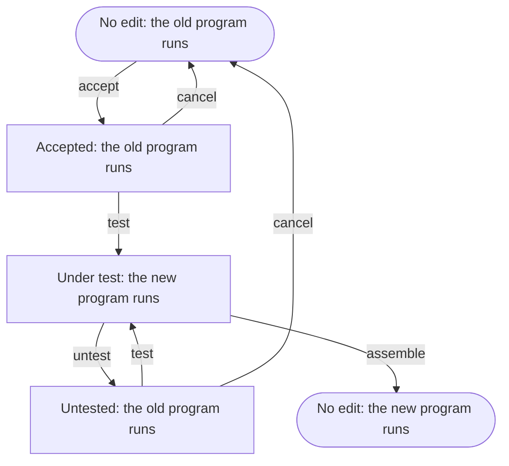
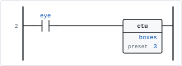

# Edit a running program

This guide is for a reader whose [host](../reference/glossary.md#host) runs 1
[instance](../reference/glossary.md#instance) of a
[program](../reference/glossary.md#program) with `Logex.Runtime`. It shows how to put a
new program in the place of the old program with an
[online edit](../reference/glossary.md#online-edit). The instance keeps its
[state](../reference/glossary.md#state), and the host does no
[restart](../reference/glossary.md#restart).

If a [runner](../reference/glossary.md#runner) runs your
[plant](../reference/glossary.md#plant), go to
[Edit a running plant](edit-a-running-plant.md).

> #### Warning {: .warning}
>
> Do not use logex for a safety function, for example an emergency stop. logex can stop
> at any time. Before each step of an edit, make sure that a wrong output cannot cause
> injury or damage. An edit changes the logic while the machine runs.
> [Safety and limits](../explanation/safety-and-limits.md) gives the limits of logex.

## Before you start

You must have:

- a host that runs the [scans](../reference/glossary.md#scan) of 1 instance
  ([Your first program](../tutorials/first-program.md) shows how)
- the new program as a file

If an online edit is new to you, do the tutorial
[Change a running program](../tutorials/change-a-running-program.md) first.

An online edit cannot change the [type](../reference/glossary.md#type) of a
[tag](../reference/glossary.md#tag). A change of type needs a restart.

The messages of logex have 2 names that this guide does not use. `the candidate` is the
new program. `the running program` is the old program, also while the new program is
under test.

## The steps of an edit

An edit has 5 steps. Each step is a function of the module `Logex.Edit`, and your host
calls it between 2 scans. Each step returns a report. A report is a list of entries. An
entry gives a change that the step makes to the state, or a fact for your host. An
example of a fact is a change that occurs in a later scan.



Figure: the 5 steps of an online edit. Each box names the program that your host scans.

The diagram shows that only an assemble keeps the new program. A cancel is possible only
while your host scans the old program.

| Step | Stage of the edit before the step | Your host then scans |
|---|---|---|
| [Accept](../reference/glossary.md#accept), `accept/3` | No edit | The old program |
| [Test](../reference/glossary.md#test), `test/2` | Accepted or untested | The new program |
| [Untest](../reference/glossary.md#untest), `untest/2` | Under test | The old program |
| [Assemble](../reference/glossary.md#assemble), `assemble/2` | Under test | The new program. The edit ends. |
| [Cancel](../reference/glossary.md#cancel), `cancel/2` | Accepted or untested | The old program. The edit ends. |

`Logex.Edit.stage/1` returns the stage of an edit: `:accepted`, `:testing` or
`:untested`.

## The example

A conveyor moves boxes past a photo-eye. A photo-eye is a sensor. The
[input](../reference/glossary.md#input) `eye` is 1 while a box is in front of it. The
program `boxes.ld` counts the boxes. At 3 boxes, a case is full and the lamp comes on.
The lamp is the [output](../reference/glossary.md#output) `full_lamp`.

<!-- file: boxes.ld -->
```text
var_input eye bool
var_input reset_pb bool
var_output full_lamp bool
var_output count dint
var boxes ctu

xic reset_pb ote boxes.r
xic eye ctu boxes 3
xic boxes.q ote full_lamp
move boxes.cv count
```

The 3 on [rung](../reference/glossary.md#rung) 2 is the
[preset](../reference/glossary.md#preset) of the
[counter](../reference/glossary.md#counter) `boxes`. The
[member](../reference/glossary.md#member) `boxes.q` is 1 when the count is not less than
the preset.

<!-- rung: boxes.ld 2 -->


The new program is `boxes_v2.ld`. It puts 5 boxes in a case. Only rung 2 is different.

<!-- file: boxes_v2.ld -->
```text
var_input eye bool
var_input reset_pb bool
var_output full_lamp bool
var_output count dint
var boxes ctu

xic reset_pb ote boxes.r
xic eye ctu boxes 5
xic boxes.q ote full_lamp
move boxes.cv count
```

<!-- rung: boxes_v2.ld 2 -->


In the example, the host does the edit while box 3 is at the photo-eye and the lamp is
on.

## Steps

> #### Caution {: .error}
>
> Give each call of `Logex.Edit` the edit that the call before it returned. Scan only
> the program that `Logex.Edit.running/1` returns. If your host uses an old edit or
> scans the other program, logex does not always give an error. The values in the state
> can then be wrong.

1. **[Compile](../reference/glossary.md#compile) the new program with the name of the
   old program.** An edit keeps the name of a program.

<!-- part of: recount.exs -->
```elixir
{:ok, boxes} = Logex.compile_file("boxes.ld")
# A case of five, not three: boxes_v2.ld is boxes.ld with `ctu boxes 5`.
{:ok, v2} = Logex.compile(File.read!("boxes_v2.ld"), name: "boxes")
```

The first line compiles the old program, which your host has. `Logex.compile_file/1`
gives a program the name of its file. For `boxes_v2.ld`, that name is `boxes_v2`, and
the accept then raises an `ArgumentError`. Thus the block gives the name with
`Logex.compile/2`. A file `boxes.ld` in a different directory is a second way.

2. **Accept the new program.** Give the old program, the new program and the state of
   the instance.

<!-- part of: recount.exs -->
```elixir
{:ok, edit, _forecast} = Logex.Edit.accept(boxes, v2, state)
```

The accept returns `{:ok, edit, forecast}`. It changes nothing. A forecast is the report
that the test returns if your host does the test before the next scan. The script does
not use the forecast.

3. **Read the forecast before you do the test.**
   [Read the forecast of an edit](read-the-forecast-of-an-edit.md) shows how.

In the example, the forecast has the 2 entries that the test prints in
[The complete script](#the-complete-script). A forecast can be the empty list `[]`. The
test then has nothing to report.

If the forecast shows a change that you do not want at this moment, do a cancel with
`Logex.Edit.cancel(edit, state)`. A cancel of an accepted edit changes nothing. Do the
accept again later.

If your host runs scans between the accept and the test, the report of the test can be
different from the forecast.

4. **Do the test.** Keep the edit and the state that the test returns.

<!-- part of: recount.exs -->
```elixir
{edit, state, report} = Logex.Edit.test(edit, state)
```

Your host then scans the new program. In the example, the report is the same as the
forecast: `{:dn_drops, "boxes", {3, 5}}` and `{:preset, "boxes", {3, 5}}`.

5. **Read the report.** For an `:input`, `:unread` or `:held` entry, your host has a
   duty.

[Edit the inputs and outputs of a running program](edit-inputs-and-outputs.md) gives
each duty. The report of this example has no such entry. A report has the kinds of entry
of a forecast.

6. **Run scans with the program that `Logex.Edit.running/1` returns.** Make sure that
   the machine does its work.

<!-- fragment: the calls of 1 scan during an edit; the script of edit-inputs-and-outputs.md runs these calls -->
```elixir
program = Logex.Edit.running(edit)
state = Logex.Runtime.put_inputs(program, state, inputs)
{outputs, state} = Logex.Runtime.scan(program, state, elapsed)
```

Send only the inputs that this program declares. In the example, a scan under test
returns `%{"count" => 3, "full_lamp" => 0}`. The edit stays under test until your host
does an assemble or an untest. There is no limit of time. The script does no scan
between the test and the assemble.

7. **To keep the new program, do an assemble.** To go back to the old program, go to
   [Go back to the old program](#go-back-to-the-old-program).

<!-- part of: recount.exs -->
```elixir
{boxes, state, _report} = Logex.Edit.assemble(edit, state)
```

The assemble returns the new program, and the edit ends. Give this program to each scan
after the edit. Do not use `edit` after an assemble or a cancel.

Make the new program the file that your host compiles at its start. If you do not, the
old program runs again after the next start of your host.

### Go back to the old program

In the place of the assemble, do an untest and then a cancel. A cancel is not possible
while the edit is under test.

<!-- fragment: the 2 calls that go back to the old program; the script of edit-inputs-and-outputs.md runs these calls -->
```elixir
{edit, state, _report} = Logex.Edit.untest(edit, state)
{boxes, state, _report} = Logex.Edit.cancel(edit, state)
```

After the untest, your host scans the old program. The cancel returns the old program,
and the edit ends.

In the example, an untest straight after the test returns the report
`[{:preset, "boxes", {5, 3}}]`. The preset goes back to 3. The next scan returns
`%{"count" => 3, "full_lamp" => 1}`.

### The complete script

The script `recount.exs` does steps 1, 2, 4 and 7, and it prints the report of the test.
It counts 3 boxes before the edit and 2 boxes after it. Put `boxes.ld`, `boxes_v2.ld`
and `recount.exs` in the root of your Mix project.

```elixir
{:ok, boxes} = Logex.compile_file("boxes.ld")
# A case of five, not three: boxes_v2.ld is boxes.ld with `ctu boxes 5`.
{:ok, v2} = Logex.compile(File.read!("boxes_v2.ld"), name: "boxes")

scan = fn state, program, label, inputs ->
  state = Logex.Runtime.put_inputs(program, state, inputs)
  {outputs, state} = Logex.Runtime.scan(program, state, 10)
  IO.puts("#{label}  #{inspect(outputs)}")
  state
end

state =
  Logex.Runtime.instance(boxes)
  |> scan.(boxes, "start      ", %{})
  |> scan.(boxes, "box 1      ", %{"eye" => 1})
  |> scan.(boxes, "eye clear  ", %{"eye" => 0})
  |> scan.(boxes, "box 2      ", %{"eye" => 1})
  |> scan.(boxes, "eye clear  ", %{"eye" => 0})
  |> scan.(boxes, "box 3      ", %{"eye" => 1})

{:ok, edit, _forecast} = Logex.Edit.accept(boxes, v2, state)
{edit, state, report} = Logex.Edit.test(edit, state)
IO.puts("test, with box 3 still on the eye")
Enum.each(report, &IO.puts("        #{inspect(&1)}"))
{boxes, state, _report} = Logex.Edit.assemble(edit, state)

state
|> scan.(boxes, "still box 3", %{})
|> scan.(boxes, "eye clear  ", %{"eye" => 0})
|> scan.(boxes, "box 4      ", %{"eye" => 1})
|> scan.(boxes, "eye clear  ", %{"eye" => 0})
|> scan.(boxes, "box 5      ", %{"eye" => 1})
```

```console
$ mix run recount.exs
start        %{"count" => 0, "full_lamp" => 0}
box 1        %{"count" => 1, "full_lamp" => 0}
eye clear    %{"count" => 1, "full_lamp" => 0}
box 2        %{"count" => 2, "full_lamp" => 0}
eye clear    %{"count" => 2, "full_lamp" => 0}
box 3        %{"count" => 3, "full_lamp" => 1}
test, with box 3 still on the eye
        {:dn_drops, "boxes", {3, 5}}
        {:preset, "boxes", {3, 5}}
still box 3  %{"count" => 3, "full_lamp" => 0}
eye clear    %{"count" => 3, "full_lamp" => 0}
box 4        %{"count" => 4, "full_lamp" => 0}
eye clear    %{"count" => 4, "full_lamp" => 0}
box 5        %{"count" => 5, "full_lamp" => 1}
```

## The result

The instance runs the new program, and it keeps its count.

| Line of the output | What it shows |
|---|---|
| `box 3` | The count is 3 and the preset is 3. The lamp is on. |
| `{:dn_drops, "boxes", {3, 5}}` | The count 3 is less than the new preset 5. Thus `boxes.q` goes to 0 when the counter runs again. |
| `{:preset, "boxes", {3, 5}}` | The test moves the preset of the counter from 3 to 5. The count stays at 3. |
| `still box 3` | The lamp is off. The `:dn_drops` entry is the forecast of this. The counter does not count box 3 a second time. |
| `box 5` | The lamp comes on at 5 boxes. |

## If it does not work

### A `MatchError` at step 1 or step 2

The blocks of the steps match on `{:ok, ...}`. If logex returns `{:error, diagnostics}`,
Elixir raises a `MatchError` that shows a list of `%Logex.Diagnostic{}`. To print each
[diagnostic](../reference/glossary.md#diagnostic), match on the error:

<!-- fragment: the accept of step 2 with a new program that it refuses; the names are those of recount.exs -->
```elixir
{:error, diagnostics} = Logex.Edit.accept(boxes, v2, state)
Enum.each(diagnostics, &IO.puts(Logex.Diagnostic.format(&1)))
```

| What you see | Cause | What to do |
|---|---|---|
| A `MatchError` at step 1 | The new program does not compile. | Correct the source text. [Read diagnostics](read-diagnostics.md) shows how. |
| `type changes only with a restart` at step 2 | The 2 programs give 2 types to 1 tag, or to 1 member of a [function block](../reference/glossary.md#function-block). | Keep the type. For a value of a new type, declare a tag with a new name. |

Examples of 2 types are `count` as a `dint` and as an `lint`, and `boxes` as a `ctu` and
as a `ctd`. The diagnostic gives the line of the
[declaration](../reference/glossary.md#declaration) in the new program. If
`Logex.compile_file/1` made the new program, the diagnostic also gives the file.

### A call raises an `ArgumentError`

| What you see in the message | Cause | What to do |
|---|---|---|
| `keeps the program's name` | The new program has a different name. | Do step 1 of [Steps](#steps) again. |
| `takes an edit` | The edit is not at the correct stage for this call. | Read the table of [The steps of an edit](#the-steps-of-an-edit). |
| `is not declared` | Your host sent an input that the program that it scans does not declare. | Send only the inputs of the program that `Logex.Edit.running/1` returns. |

An example of the second message is
`assemble takes an edit under test, but this one is accepted`.

### No call raises an error, but the machine does not do its work

| What you see | Cause | What to do |
|---|---|---|
| The preset does not change. | The report has a `:preset_kept` entry. A rung wrote the preset. | Change the value that the rung writes. |
| An output or a count is not the value that a report gave. | Your host used an old edit, or it scanned the other program. | Do a [cold restart](../reference/glossary.md#cold-restart), as the text after this table shows. |

For the cold restart, give the program that `Logex.Edit.running/1` returns for the edit
of the last call:

<!-- fragment: a cold restart during an edit, with the program that the host scans -->
```elixir
state = Logex.Runtime.restart(Logex.Edit.running(edit), state, :cold)
```

If the edit ended, give the program that the assemble or the cancel returned. Each tag
that is not an input starts again at its
[initial value](../reference/glossary.md#initial-value). Thus the instance does not keep
its count. The inputs keep their values. The restart does not end the edit, and the edit
keeps its stage.

## See also

- [Read the forecast of an edit](read-the-forecast-of-an-edit.md): each kind of entry,
  and the moment of the test.
- [Edit the inputs and outputs of a running program](edit-inputs-and-outputs.md): the
  duties of a host, and an untest and a cancel in a complete script.
- [Online edit](../reference/online-edit.md): the rules of each step and each kind of
  entry.
- [The model of an online edit](../explanation/online-edit-model.md): how an edit keeps
  the state.
- [Edit a running plant](edit-a-running-plant.md): an online edit through the runner.
- [Glossary](../reference/glossary.md): the technical words.
