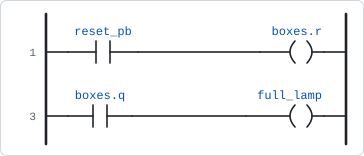
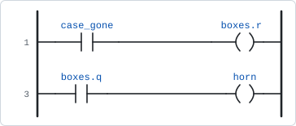

# Edit the inputs and outputs of a running program

This guide is for a reader who does an [online edit](../reference/glossary.md#online-edit)
of 1 [instance](../reference/glossary.md#instance), as
[Edit a running program](edit-a-running-program.md) shows. The new
[program](../reference/glossary.md#program) adds or removes an
[input](../reference/glossary.md#input) or an [output](../reference/glossary.md#output).

The guide gives the duties of your [host](../reference/glossary.md#host) for these
inputs and outputs. It also shows how to go back to the old program with an
[untest](../reference/glossary.md#untest) and a [cancel](../reference/glossary.md#cancel).

> #### Warning {: .warning}
>
> Do not use logex for a safety function, for example an emergency stop. logex can stop
> at any time. [Safety and limits](../explanation/safety-and-limits.md) gives the limits
> of logex.

## Before you start

You must have:

- a new program
- a host that sends the inputs to the instance and writes the outputs to the
  [points](../reference/glossary.md#point) of the machine

You must know the steps of [Edit a running program](edit-a-running-program.md).

If a [runner](../reference/glossary.md#runner) runs your
[plant](../reference/glossary.md#plant), the runner does these duties. Go to
[Edit a running plant](edit-a-running-plant.md).

## The duties of your host

> #### Warning {: .warning}
>
> Make sure that the machine is safe with each held output at the value that the report
> gives. A held output is an output that the program that your host scans does not
> write. It keeps its last value. If that value is 1, the output stays on.

Each step of an edit returns a report. During an edit, your host has these duties:

| Moment, or entry of a report | Duty of your host |
|---|---|
| Each call of `Logex.Runtime` that takes a program | Give the program that `Logex.Edit.running/1` returns. Examples of these calls are `Logex.Runtime.scan/3` and `Logex.Runtime.restart/3`. |
| Each [scan](../reference/glossary.md#scan) | Send only the inputs that this program declares. logex refuses each other name. |
| `{:input, name, value}` | Send the real value of this input before the next scan. The [state](../reference/glossary.md#state) holds `value` for it. |
| `{:unread, name, value}` | Do not send this input again. |
| `{:held, name, value}` | Keep the point of this output at `value`. A scan does not return a held output that the program does not declare. |
| An entry of a different kind | Do nothing. If your host does not know a kind, it must not stop. |

## The example

The old program is `boxes.ld`. It counts the boxes on a conveyor. At 3 boxes, the lamp
`full_lamp` comes on. The push button `reset_pb` sets the count to 0. Get
[`boxes.ld`](edit-a-running-program.md) and put it in the root of your Mix project.

<!-- rung: boxes.ld 1 3 -->


In the new program, a sensor `case_gone` is in the place of the push button. A horn is
in the place of the lamp. Thus [rungs](../reference/glossary.md#rung) 1 and 3 and their
2 [declarations](../reference/glossary.md#declaration) are different.

The new program is a second file with the name `boxes.ld`. Make the directory
`edit-inputs-and-outputs` in the root of the project and put the file in it.
`Logex.compile_file/1` gives a program the name of its file. Thus the new program has
the name of the old program.

<!-- file: edit-inputs-and-outputs/boxes.ld -->
```text
var_input eye bool
var_input case_gone bool
var_output horn bool
var_output count dint
var boxes ctu

xic case_gone ote boxes.r
xic eye ctu boxes 3
xic boxes.q ote horn
move boxes.cv count
```

<!-- rung: edit-inputs-and-outputs/boxes.ld 1 3 -->


## Steps

The script of the example is `edit-inputs-and-outputs.exs`. Each step shows a part of
it.

1. **Keep 2 values in your host: the names of the inputs that it sends, and the held
   points.**

<!-- part of: edit-inputs-and-outputs.exs -->
```elixir
host = %{send: ["eye", "reset_pb"], held: %{}}
```

Before the edit, the list has the inputs of the old program.

2. **Write a function that does the duty for 1 entry of a report.**

<!-- part of: edit-inputs-and-outputs.exs -->
```elixir
duty = fn
  {:input, name, _value}, host -> %{host | send: [name | host.send]}
  {:unread, name, _value}, host -> %{host | send: host.send -- [name]}
  {:held, name, value}, host -> %{host | held: Map.put(host.held, name, value)}
  _entry, host -> host
end
```

The last clause does nothing for an entry of a different kind.

3. **Call the function for each entry of the report of each step.**

<!-- part of: edit-inputs-and-outputs.exs -->
```elixir
step = fn {edit, state, report}, host, label ->
  IO.puts(label)
  Enum.each(report, &IO.puts("        #{inspect(&1)}"))
  {edit, state, Enum.reduce(report, host, duty)}
end
```

The function `step` takes the result of a step of the edit. It prints the report and
returns the new value of `host`.

4. **In each scan, send the inputs of the list.** Then write the outputs and the held
   points.

<!-- part of: edit-inputs-and-outputs.exs -->
```elixir
scan = fn state, program, host, label ->
  inputs = Map.take(points, host.send)
  state = Logex.Runtime.put_inputs(program, state, inputs)
  {outputs, state} = Logex.Runtime.scan(program, state, 10)
  IO.puts("#{label}  sends  #{inspect(Map.keys(inputs))}")
  IO.puts("             writes #{inspect(Map.merge(host.held, outputs))}")
  state
end
```

The map `points` has the value of each input point. The call
`Map.merge(host.held, outputs)` gives the value of each output point. If a scan returns
an output, its value replaces the held value.

5. **Do the [test](../reference/glossary.md#test), and run scans with the program that `Logex.Edit.running/1`
   returns.**

<!-- part of: edit-inputs-and-outputs.exs -->
```elixir
{edit, state, host} = step.(Logex.Edit.test(edit, state), host, "test")
state = scan.(state, Logex.Edit.running(edit), host, "under test ")
```

6. **To go back to the old program, do an untest and then a cancel.** A cancel is not
   possible while the edit is under test.

<!-- part of: edit-inputs-and-outputs.exs -->
```elixir
{edit, state, host} = step.(Logex.Edit.untest(edit, state), host, "untest")
state = scan.(state, Logex.Edit.running(edit), host, "untested   ")
{boxes, state, host} = step.(Logex.Edit.cancel(edit, state), host, "cancel")
```

The cancel returns the old program. Give this program to each scan after the edit.

### The complete script

In the script, the map `points` is the machine: it holds the value of each input point.
The script counts 3 boxes first. Box 3 stays at the photo-eye, and the lamp is on.

```elixir
{:ok, boxes} = Logex.compile_file("boxes.ld")
# The file of the new program is a boxes.ld also, so the new program has the name `boxes`.
{:ok, new} = Logex.compile_file("edit-inputs-and-outputs/boxes.ld")

# The input points of the plant. Box 3 stays at the photo-eye.
points = %{"eye" => 1, "reset_pb" => 0, "case_gone" => 0}

# The duty of the host for each entry of a report.
duty = fn
  {:input, name, _value}, host -> %{host | send: [name | host.send]}
  {:unread, name, _value}, host -> %{host | send: host.send -- [name]}
  {:held, name, value}, host -> %{host | held: Map.put(host.held, name, value)}
  _entry, host -> host
end

step = fn {edit, state, report}, host, label ->
  IO.puts(label)
  Enum.each(report, &IO.puts("        #{inspect(&1)}"))
  {edit, state, Enum.reduce(report, host, duty)}
end

# 1 scan. The host sends the inputs of its list. It writes the outputs and the held points.
scan = fn state, program, host, label ->
  inputs = Map.take(points, host.send)
  state = Logex.Runtime.put_inputs(program, state, inputs)
  {outputs, state} = Logex.Runtime.scan(program, state, 10)
  IO.puts("#{label}  sends  #{inspect(Map.keys(inputs))}")
  IO.puts("             writes #{inspect(Map.merge(host.held, outputs))}")
  state
end

# 3 boxes go past the photo-eye.
state =
  Enum.reduce([0, 1, 0, 1, 0, 1], Logex.Runtime.instance(boxes), fn eye, state ->
    state = Logex.Runtime.put_inputs(boxes, state, %{"eye" => eye})
    elem(Logex.Runtime.scan(boxes, state, 10), 1)
  end)

host = %{send: ["eye", "reset_pb"], held: %{}}
state = scan.(state, boxes, host, "old program")

{:ok, edit, _forecast} = Logex.Edit.accept(boxes, new, state)
{edit, state, host} = step.(Logex.Edit.test(edit, state), host, "test")
state = scan.(state, Logex.Edit.running(edit), host, "under test ")
{edit, state, host} = step.(Logex.Edit.untest(edit, state), host, "untest")
state = scan.(state, Logex.Edit.running(edit), host, "untested   ")
{boxes, state, host} = step.(Logex.Edit.cancel(edit, state), host, "cancel")
scan.(state, boxes, host, "old program")
```

```console
$ mix run edit-inputs-and-outputs.exs
old program  sends  ["eye", "reset_pb"]
             writes %{"count" => 3, "full_lamp" => 1}
test
        {:added, "horn", 0}
        {:held, "full_lamp", 1}
        {:input, "case_gone", 0}
        {:unread, "reset_pb", 0}
under test   sends  ["case_gone", "eye"]
             writes %{"count" => 3, "full_lamp" => 1, "horn" => 1}
untest
        {:held, "horn", 1}
        {:input, "reset_pb", 0}
        {:unread, "case_gone", 0}
untested     sends  ["eye", "reset_pb"]
             writes %{"count" => 3, "full_lamp" => 1, "horn" => 1}
cancel
        {:held, "horn", 1}
        {:pruned, "case_gone", 0}
        {:pruned, "horn", 1}
old program  sends  ["eye", "reset_pb"]
             writes %{"count" => 3, "full_lamp" => 1, "horn" => 1}
```

## The result

The instance runs the old program again, and it keeps its count. The table shows what
the host does after each step.

| Step | What the host does | What you see |
|---|---|---|
| Test | It sends `case_gone` and does not send `reset_pb`. It holds the lamp at 1. | The lamp and the horn are on. |
| Untest | It sends `reset_pb` and does not send `case_gone`. It holds the horn at 1. | The old program writes the lamp again. The horn stays on. |
| Cancel | It holds the horn at 1. | The horn stays on after the edit. |

The cancel removes `case_gone` and `horn` from the state. Each `:pruned` entry gives the
value that the [tag](../reference/glossary.md#tag) had.

No program writes the horn after the cancel. Thus only your host can change the point of
the horn. In the example, this line makes the host write 0 to that point in each later
scan:

<!-- fragment: the host of the example changes the value of a held point; the value is the decision of the reader -->
```elixir
host = %{host | held: %{host.held | "horn" => 0}}
```

The correct value for a point of your machine is your decision.

An [assemble](../reference/glossary.md#assemble) in the place of the untest keeps the new program. Its report has the entry
`{:held, "full_lamp", 1}`. The lamp then stays on after the edit, and only your host can
change its point.

## If it does not work

| What you see | Cause | What to do |
|---|---|---|
| An `ArgumentError` with `is not declared` | Your host sent an input that the program that it scans does not declare. | Do the duty for each `:unread` entry. Send only the inputs of the program that `Logex.Edit.running/1` returns. |
| An `ArgumentError` with `cancel takes an edit` | The cancel came before the untest. The edit is under test. | Do an untest first. |
| A new input stays at its [initial value](../reference/glossary.md#initial-value) | Your host sends an input only when its value changes. | Do the duty for each `:input` entry: send the value before the next scan. |
| An output stays on after the edit, and no scan returns it | The output is a held output. | Read the `:held` entries of each report. Let your host write a value to the point. The correct value for a point of your machine is your decision. |

## See also

- [Edit a running program](edit-a-running-program.md): the steps of an online edit.
- [Read the forecast of an edit](read-the-forecast-of-an-edit.md): each kind of entry of
  a report.
- [Online edit](../reference/online-edit.md): the rules of each step and each kind of
  entry of a report.
- [Host contract](../reference/host-contract.md): what `Logex.Runtime` and `Logex.Edit`
  refuse.
- [Edit a running plant](edit-a-running-plant.md): an online edit through the runner,
  which does these duties.
- [The model of an online edit](../explanation/online-edit-model.md): why an output
  keeps its last value.
- [Map tags to I/O points](map-io-points.md): the points of a plant.
- [Glossary](../reference/glossary.md): the technical words.
