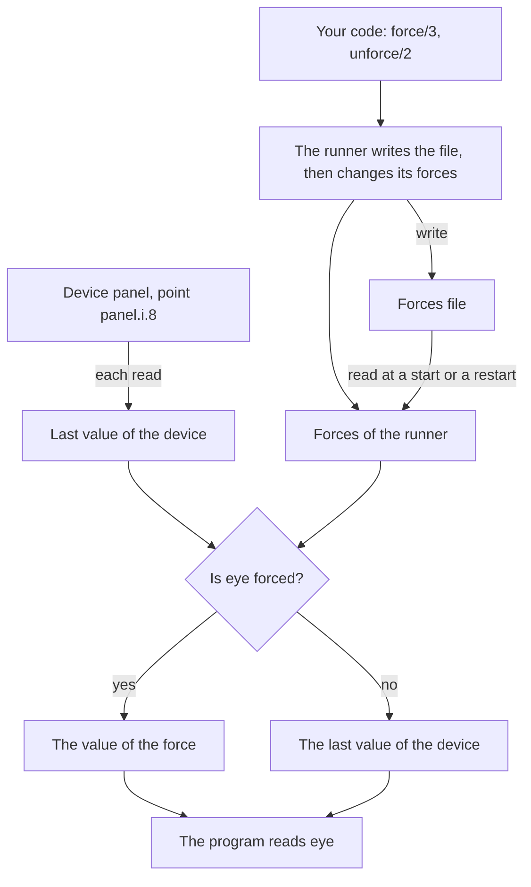
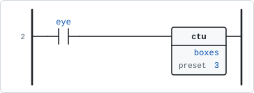

# Force an input point

This guide is for you if your [runner](../reference/glossary.md#runner) runs a
[plant](../reference/glossary.md#plant), for example while you commission a machine. It
shows how to [force](../reference/glossary.md#force) an input
[point](../reference/glossary.md#point) to a value, see the force and remove it. It also
shows how the [forces file](../reference/glossary.md#forces-file) keeps each force.

While a point has a force, the [program](../reference/glossary.md#program) reads the
value of the force. It does not read the value from the
[device](../reference/glossary.md#device). Only the runner, `Logex.Runner`, forces a
point. `Logex.Runtime` has no forces. [Forcing](../reference/forcing.md) gives each rule.

> #### Warning {: .warning}
>
> Make sure that the machine is safe before you force an input point. While the force
> holds, the program does not see a change of the real sensor. The force stays after a
> [restart](../reference/glossary.md#restart), a crash and a fresh start of the runner,
> until you remove it. Do not use a force to stop a safety function. Do not use logex for
> a safety function. [Safety and limits](../explanation/safety-and-limits.md) gives the
> limits of logex.

> #### Note {: .info}
>
> logex forces input points only. It cannot force an output point, and it cannot force a
> [tag](../reference/glossary.md#tag) of an
> [instance](../reference/glossary.md#instance), such as `b1.eye`.

This diagram shows the value that the program reads for the global `eye`.



Figure: the value of a forced input point. The runner reads the forces file only at a
start or a restart.

## Before you start

- You must have a Mix project that has logex.
  [Install logex and run a program](install-and-run.md) gives the steps.
- You must have the packing line of the tutorial
  [Your first plant](../tutorials/first-plant.md). Get
  [`conveyor.ld`](../tutorials/first-plant.md#step-1-write-the-conveyor-program) and
  [`packing.logex`](../tutorials/first-plant.md#step-2-write-the-configuration-file) from
  that tutorial. Get
  [`boxes.ld`](../tutorials/timers-and-counters.md#step-3-write-the-counter-program) from
  the tutorial A timer and a counter. Put the 3 files in the root directory of your
  project.
- You must know how to start a runner.
  [Run a plant on the clock](run-on-the-clock.md) gives the steps.

The script of this guide runs the plant on the manual
[clock](../reference/glossary.md#clock), with a
[simulated device](../reference/glossary.md#simulated-device). Thus its output is the
same at each run. [On your plant](#on-your-plant) shows the same calls on a runner that
runs a plant.

The guide forces the [global](../reference/glossary.md#global) `eye`, which is at the
input point `panel.i.8`. The [configuration](../reference/glossary.md#configuration) connects the global `eye` to the
[input](../reference/glossary.md#input) `eye` of the instance `b1`.
[Rung](../reference/glossary.md#rung) 2 of `boxes.ld` reads that input. A force of the
global gives the [contact](../reference/glossary.md#contact) its value.

<!-- rung: boxes.ld 2 -->


## Steps

1. Make the file `force-inputs.exs` in the root directory of your project. Put these
   lines at its top. They [compile](../reference/glossary.md#compile) the plant and name
   the forces file.

<!-- part of: force-inputs.exs -->
```elixir
alias Logex.Runner
alias Logex.Runner.Clock.Manual
alias Logex.IO.Sim

{:ok, plant} = Logex.Configuration.compile_file("packing.logex")
forces_file = Path.expand("packing.forces")      # a full path
File.rm(forces_file)
```

   Give the forces file as a full path. With a relative path, the runner must read the
   working directory when it starts. If the file system does not answer, the start fails.

> #### Caution {: .error}
>
> Give `forces:` when you start the runner. You cannot add it to a runner that runs. To
> add it, you must stop the runner. The stop writes 0 to each output, and the plant
> stops.

2. Add a function that starts the runner with `forces:`. A runner with no `forces:`
   takes no force.

<!-- part of: force-inputs.exs -->
```elixir
start = fn ->
  {:ok, clock} = Manual.start_link()
  {:ok, panel} = Sim.start_link(reports: true, clock: clock)

  {:ok, runner} =
    Runner.start_link(
      configuration: plant,
      io: %{"panel" => {Sim, sim: panel}},
      clock: {Manual, clock},
      forces: forces_file                         # the runner keeps its forces here
    )

  {runner, clock, panel}
end
```

   The start reads the forces file. If the file does not exist, the runner starts with no
   force.

3. Add a function that shows the forces. `Logex.Runner.status/1` gives a map. Its key
   `forces` holds each force in effect, by the name of the point.

<!-- part of: force-inputs.exs -->
```elixir
show = fn runner, label ->
  %{now: now, forces: forces} = Runner.status(runner)
  eye = Runner.get!(runner, "eye")
  boxes = Runner.get!(runner, "b1.count")
  IO.puts("t=#{now} #{label}: eye=#{eye} boxes=#{boxes} forces=#{inspect(forces)}")
end
```

   `b1.count` is the [output](../reference/glossary.md#output) `count` of `b1`, the count of the counter `boxes`.

> #### Caution {: .error}
>
> If the point is the [trigger](../reference/glossary.md#trigger) of an
> [event task](../reference/glossary.md#event-task), make sure that it is safe for that
> task to run immediately. A force or an unforce that changes the value of a trigger runs a
> round before the call returns. If the trigger rises, the event task runs in that round.

4. Add these lines, which start the runner and force `eye` to 1. Name the point by its
   global, `"eye"`, not by its address.

<!-- part of: force-inputs.exs -->
```elixir
{runner, clock, panel} = start.()
show.(runner, "start")

:ok = Runner.force(runner, "eye", 1)              # the photo-eye forced to 1
Manual.advance(clock, 2)
show.(runner, "eye forced")
```

   `Logex.Runner.force/3` writes all the forces to the forces file. Then it returns `:ok`.
   The program reads the force from the next [round](../reference/glossary.md#round).
   Step 10 shows this as the line `eye forced`.

5. Add these lines. The real eye goes to 1 for 1 round, then back to 0. Then the lines
   read the forces file.

<!-- part of: force-inputs.exs -->
```elixir
Sim.set(panel, "panel.i.8", 1)                    # the real eye: 1 for 1 round
Manual.advance(clock, 1)
Sim.set(panel, "panel.i.8", 0)                    # then 0
Manual.advance(clock, 2)
show.(runner, "eye moved")
IO.inspect(File.read!(forces_file), label: "packing.forces")
```

   Step 10 shows this as the lines `eye moved` and `packing.forces`.

6. Add these lines, which stop the runner and start a fresh runner on the same file.

<!-- part of: force-inputs.exs -->
```elixir
:ok = Runner.stop(runner)                         # a fresh runner on the same file
{runner, clock, _panel} = start.()
show.(runner, "fresh start")
```

   Step 10 shows this as the line `fresh start`.

7. Add these lines, which remove the force with `Logex.Runner.unforce/2`.

<!-- part of: force-inputs.exs -->
```elixir
:ok = Runner.unforce(runner, "eye")               # the last value of the device, 0
Manual.advance(clock, 1)
show.(runner, "eye unforced")
```

   From the next round, the program reads the last value of the device again. Step 10
   shows this as the line `eye unforced`.

8. Add these lines, which force 2 points and then remove each force with
   `Logex.Runner.unforce_all/1`.

<!-- part of: force-inputs.exs -->
```elixir
:ok = Runner.force(runner, "eye", 1)
:ok = Runner.force(runner, "pb_reset", 0)         # the reset button held at 0
Manual.advance(clock, 1)
show.(runner, "2 forces")
:ok = Runner.unforce_all(runner)                  # each force removed
Manual.advance(clock, 1)
show.(runner, "unforce_all")
IO.inspect(File.read!(forces_file), label: "packing.forces")

:ok = Runner.stop(runner)
File.rm(forces_file)
```

   Step 10 shows this as the last 3 lines.

9. Make sure that the file has this text.

```elixir
alias Logex.Runner
alias Logex.Runner.Clock.Manual
alias Logex.IO.Sim

{:ok, plant} = Logex.Configuration.compile_file("packing.logex")
forces_file = Path.expand("packing.forces")      # a full path
File.rm(forces_file)

start = fn ->
  {:ok, clock} = Manual.start_link()
  {:ok, panel} = Sim.start_link(reports: true, clock: clock)

  {:ok, runner} =
    Runner.start_link(
      configuration: plant,
      io: %{"panel" => {Sim, sim: panel}},
      clock: {Manual, clock},
      forces: forces_file                         # the runner keeps its forces here
    )

  {runner, clock, panel}
end

show = fn runner, label ->
  %{now: now, forces: forces} = Runner.status(runner)
  eye = Runner.get!(runner, "eye")
  boxes = Runner.get!(runner, "b1.count")
  IO.puts("t=#{now} #{label}: eye=#{eye} boxes=#{boxes} forces=#{inspect(forces)}")
end

{runner, clock, panel} = start.()
show.(runner, "start")

:ok = Runner.force(runner, "eye", 1)              # the photo-eye forced to 1
Manual.advance(clock, 2)
show.(runner, "eye forced")

Sim.set(panel, "panel.i.8", 1)                    # the real eye: 1 for 1 round
Manual.advance(clock, 1)
Sim.set(panel, "panel.i.8", 0)                    # then 0
Manual.advance(clock, 2)
show.(runner, "eye moved")
IO.inspect(File.read!(forces_file), label: "packing.forces")

:ok = Runner.stop(runner)                         # a fresh runner on the same file
{runner, clock, _panel} = start.()
show.(runner, "fresh start")

:ok = Runner.unforce(runner, "eye")               # the last value of the device, 0
Manual.advance(clock, 1)
show.(runner, "eye unforced")

:ok = Runner.force(runner, "eye", 1)
:ok = Runner.force(runner, "pb_reset", 0)         # the reset button held at 0
Manual.advance(clock, 1)
show.(runner, "2 forces")
:ok = Runner.unforce_all(runner)                  # each force removed
Manual.advance(clock, 1)
show.(runner, "unforce_all")
IO.inspect(File.read!(forces_file), label: "packing.forces")

:ok = Runner.stop(runner)
File.rm(forces_file)
```

10. Run the script.

```console
$ mix run force-inputs.exs
t=0 start: eye=0 boxes=0 forces=%{}
t=2 eye forced: eye=1 boxes=1 forces=%{"eye" => 1}
t=5 eye moved: eye=1 boxes=1 forces=%{"eye" => 1}
packing.forces: "eye 1\n"
t=0 fresh start: eye=1 boxes=0 forces=%{"eye" => 1}
t=1 eye unforced: eye=0 boxes=0 forces=%{}
t=2 2 forces: eye=1 boxes=1 forces=%{"eye" => 1, "pb_reset" => 0}
t=3 unforce_all: eye=0 boxes=1 forces=%{}
packing.forces: ""
```

## The result

You forced an input point, saw the force and removed it. Each line of the output tells
you 1 thing:

| Line | What it shows |
|---|---|
| `eye forced` | `eye` changes from 0 to 1, which is a [rising edge](../reference/glossary.md#rising-edge). The [counter](../reference/glossary.md#counter) counts 1 box. |
| `eye moved` | The real eye went to 1 for a round, then back to 0. The program read the force, 1, at each round. Thus it saw no rising edge and counted no box. |
| `packing.forces` | The file holds 1 line for each force: the name of the point, 1 space and the value. |
| `fresh start` | The fresh runner read the file, and its first round read the force. The count is 0 again, because this runner keeps no [store](../reference/glossary.md#store). The first round is the [first scan](../reference/glossary.md#first-scan), and no counter counts on the first scan. |
| `eye unforced` | The program reads the last value of the device, 0. |
| `2 forces` | `eye` changes from 0 to 1 again, and the counter counts 1 box. |
| `unforce_all` | The call removed both forces, and the file is empty. The count stays 1. |

A force stays after each of these: a crash or a kill of the runner, a
[trip](../reference/glossary.md#trip), and `Logex.Runner.restart/2`. The next start reads
the file.

## On your plant

Start your runner with `forces:` and `name:`.
[Run a plant under a supervisor](run-under-a-supervisor.md) gives the steps. Then give
the same calls with the name of the runner, for example `Packing`:

<!-- fragment: calls on a runner that a supervisor started with name: Packing -->
```elixir
:ok = Logex.Runner.force(Packing, "eye", 1)
Logex.Runner.status(Packing).forces
# %{"eye" => 1}
:ok = Logex.Runner.unforce(Packing, "eye")
```

On your operator panel, show the key `forces` of `Logex.Runner.status/1`. If the key
`forces_unread` or `forces_unknown` is not `nil`, show an alarm.
[The status names a problem](#the-status-names-a-problem) gives the cause. On a slow
disk, a force takes effect only after the runner writes the forces file.

## Force an element of an array

A [located global](../reference/glossary.md#located-global) can be an
[array](../reference/glossary.md#array), for example `var_global zone_t real[8] at
card.i.0`. To force 1 [element](../reference/glossary.md#element), name it with its
[subscript](../reference/glossary.md#subscript). To force each element, name the array
and give a list of its values. An unforce of the array removes the force of each element.

<!-- fragment: calls on a runner with the name Oven, for a configuration with zone_t real[8] at card.i.0 -->
```elixir
:ok = Logex.Runner.force(Oven, "zone_t[3]", 250.0)
:ok = Logex.Runner.force(Oven, "zone_t", [170.0, 170.0, 170.0, 170.0, 190.0, 190.0, 190.0, 190.0])
:ok = Logex.Runner.unforce(Oven, "zone_t")
```

The status and the forces file give each forced element by its name, for example
`zone_t[3]`. [Example: an array of temperatures](../reference/forcing.md#example-an-array-of-temperatures)
gives the rules for an array.

## Change the forces file when no runner runs

Change the forces file only while no runner uses it. A runner reads the file at a start
and at a restart, and writes it at each force and unforce.

1. Stop the runner.
2. Write the forces file. Write the name of the point, 1 space and the value on each
   line.

<!-- unchecked: the form of a forces file that holds 2 forces -->
```text
eye 1
pb_reset 0
```

   Do not write a blank line or a comment. Give a `bool` the value 0 or 1. To remove each
   force, delete the file.

3. Start the runner. `forces` in `Logex.Runner.status/1` shows the forces of the file.

A line can end with LF or CRLF. If a line is wrong, the runner does not start.
[The runner does not start](#the-runner-does-not-start) gives the messages.

## If it does not work

### A call raises an `ArgumentError`

`Logex.Runner.force/3`, `Logex.Runner.unforce/2` and `Logex.Runner.unforce_all/1` raise
the error in your process. The forces do not change.

| What you see | Cause | What to do |
|---|---|---|
| ``the runner keeps no forces file, so a force would not survive a crash: start it with forces: a path`` | The runner has no `forces:`. You cannot add it to a runner that runs. | Stop the runner, and start it with `forces:`. |
| ``is an output point, at `panel.q.0`: only an input point is forced`` | The name is of an output point. | Force the input point that the program reads. |
| ``is no input point of `packing` — did you mean `eye`?`` | The name has an error. | Use the name that the message gives. |
| ``is no input point of `packing` `` | The name is an address such as `panel.i.8`, a tag of an instance such as `b1.eye`, or a name with an error. | Use the name of the global. |
| ``a force names an input point by its name, a string, as in "eye_1", got: :eye`` | The name is not a string. | Write `"eye"`. |
| ``is a bool, forced to 0 or 1, got: 2`` | The [type](../reference/glossary.md#type) of the point does not hold the value. | Give a value of its type. A `bool` takes 0 or 1, not `true`. |

### A call returns an error

The runner option `write_limit:` gives the limit of the write time.

| What you see | Cause | What to do |
|---|---|---|
| `{:error, {:forces, :timeout}}` | The disk did not complete the write in the limit of the write time. The force is not in effect, but the disk can still complete the write. | Force or unforce the point again. |
| `{:error, {:forces, reason}}` from a force or an unforce | The write failed, for example `:eisdir` for a directory in the place of the file. The forces do not change. | Correct the path. |
| `{:error, {:forces, reason}}` from a stop of the runner | The start did not read the file, and the stop did not write the forces of the runner over it. | Correct the path, and look at the file before the next start. |

### The runner does not start

`Logex.Runner.start_link/1` raises an `ArgumentError` with these words:

| What you see | Cause | What to do |
|---|---|---|
| ``is no force: a line holds an input point's name and its value`` | A line of the forces file has a wrong form. The message gives the path, and the number and text of each wrong line. | Correct the lines, or delete the file. |
| ``is an output point, at `panel.q.0`: only an input point is forced`` | A line of the forces file names an output point. | Remove the line. |
| `the runner's forces: is the path of the file its forces are kept in, a string` | `forces:` is not a string, or it is an empty string. | Give the path as a string. |
| `names the forces file of another runner of this VM` | A different runner uses the file. | Give each runner its own forces file. |
| `the forces file cannot be located` | The path is relative, and the runner did not read the working directory. | Give a full path. |

[The answers of a start](../reference/runner.md#the-answers-of-a-start) gives each other
message of a start.

### The status names a problem

| What you see | Cause | What to do |
|---|---|---|
| `forces_unread: {path, :eisdir}` | The start or the restart did not read the file. A fresh start then has no force, and a restart keeps the forces of the runner. | Correct the file. The next force or unforce that succeeds writes the forces of the runner over the file, and the key is then `nil`. An orderly stop also writes them. |
| `forces_unknown: %{"eye" => 1}` | A write did not end in the limit of the write time. The file can hold these forces or the old forces. | Force or unforce a point to write the file again. |

## See also

- [Forcing](../reference/forcing.md): each rule of a force, the forces file and the
  [4 keys of the status](../reference/forcing.md#status).
- [Runner](../reference/runner.md): the options of a runner, its status, its events and
  [its files](../reference/runner.md#files).
- [Run a plant on the clock](run-on-the-clock.md): start and stop a runner.
- [Run a plant under a supervisor](run-under-a-supervisor.md): a runner with a name.
- [Use an event task](use-an-event-task.md): a task that a trigger runs.
- [Safety and limits](../explanation/safety-and-limits.md): what logex is not.
- [Glossary](../reference/glossary.md): the words of this guide.
