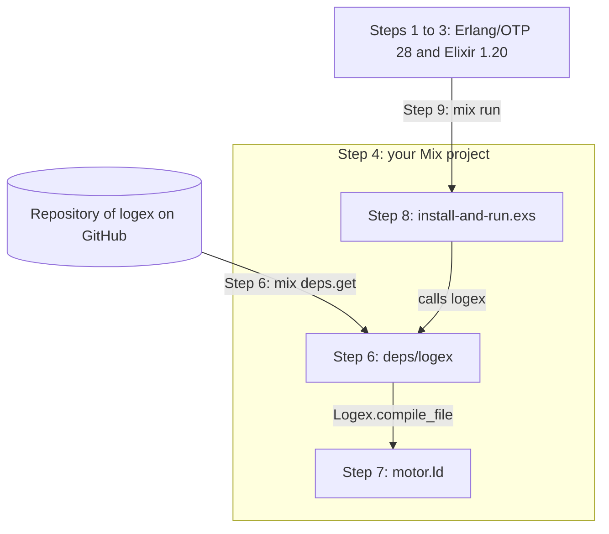

# Install logex and run a program

This guide is for a reader who wants to run a ladder
[program](../reference/glossary.md#program) with logex on a computer. It shows how to
install the toolchain, add logex to a Mix project,
[compile](../reference/glossary.md#compile) a program file and run 1
[scan](../reference/glossary.md#scan).

logex is a library for Elixir. The toolchain is Erlang/OTP and Elixir. Mix is the build
tool of Elixir. A Mix project is a directory that has a file `mix.exs`.

> #### Warning {: .warning}
>
> Do not use logex for a safety function, for example an emergency stop. logex can stop
> at any time. Make each safety function with hardwired circuits or with a safety-rated
> controller. [Safety and limits](../explanation/safety-and-limits.md) gives the limits
> of logex.

## Before you start

You must have:

- Git, and access to GitHub
- 1 of the version managers asdf, mise or Nix. A version manager installs the versions
  of a toolchain that a file names. If the computer has Elixir 1.20 on Erlang/OTP 28, a
  version manager is not necessary.
- a directory for your project: a new directory, or the root directory of a Mix
  project. This guide uses the name `plant`. Do the steps in this directory.

logex needs Elixir 1.20 or a later version 1.x, for example 1.21. The checks of the
repository run only on Elixir 1.20.4 and Erlang/OTP 28.

> #### Note {: .info}
>
> logex has no release. Its version is `0.1.0`. It is not in Hex, the package
> repository of Elixir. Mix gets logex from its Git repository. Thus your project uses
> 1 commit of that repository.

logex has no dependencies. Erlang/OTP and Elixir are sufficient. On Debian or Ubuntu,
the package `erlang-parsetools` is not necessary.

## Steps

The steps have 3 parts. This diagram shows what the steps make on your computer.



Figure: the toolchain and your project after the steps. Mix runs the script, and the
script calls the copy of logex in `deps/logex` to compile `motor.ld`. With `path:` in
step 5, that copy is your clone of the repository.

| Part | Steps | Do not do this part if |
|---|---|---|
| [Install the toolchain](#install-the-toolchain) | 1 to 3 | The command `elixir --version` shows Elixir 1.20 and Erlang/OTP 28. |
| [Add logex to your project](#add-logex-to-your-project) | 4 to 6 | The command `mix deps` shows logex and the line `ok`. |
| [Compile a program file and run 1 scan](#compile-a-program-file-and-run-1-scan) | 7 to 9 | |

### Install the toolchain

| Version manager | File that it reads | What you get |
|---|---|---|
| asdf or mise | `.tool-versions` | Erlang/OTP 28.5.0.6 and Elixir 1.20.4 |
| Nix | `flake.nix`, which uses `shell.nix` | A shell that has Erlang/OTP 28 and Elixir 1.20 |

1. For asdf or mise, make the file `.tool-versions` in your directory, with these 2
   lines. For Nix, go to step 2.

<!-- unchecked: the 2 lines of the file .tool-versions of the repository, which the reader writes -->
```text
erlang 28.5.0.6
elixir 1.20.4-otp-28
```

The file `.tool-versions` of the repository has the same 2 lines. asdf and mise use
these versions in your directory and in each directory in it.

2. Install the toolchain with the commands of your version manager.

With asdf, the build of Erlang/OTP from its source text is long and uses a C compiler:

```console
$ asdf plugin add erlang
$ asdf plugin add elixir
$ asdf install
```

With mise:

```console
$ mise install
```

With Nix, these commands make a clone of the repository beside your directory and open
a shell that has the toolchain. Do the last command and each later step in that shell.
The first time, `nix develop` also changes the file `flake.lock` of the clone. This is
not an error. Git then shows the file as changed.

```console
$ git clone https://github.com/rellen/logex.git ../logex
$ cd ../logex
$ nix develop
$ cd ../plant
```

3. Make sure that the toolchain is correct.

```console
$ elixir --version
```

The last line of the output starts with `Elixir 1.20` and ends with `Erlang/OTP 28)`.

### Add logex to your project

4. If your directory has no file `mix.exs`, make a Mix project in it.

```console
$ mix new . --app plant
```

The output has the line `Your Mix project was created successfully.`

5. In the file `mix.exs`, add this entry to the list of dependencies. A project of
   `mix new` has the list in the function `deps`.

<!-- fragment: the function deps of the project file that the reader changes; the suite does not run it -->
```elixir
defp deps do
  [
    {:logex, github: "rellen/logex"}
  ]
end
```

To get logex from a clone of the repository on your computer, write
`{:logex, path: "../logex"}`. Use `path:` if the computer cannot get to GitHub, or if
you want to change logex. The path starts at the root directory of your project and
goes to the clone.

6. Get logex and compile your project.

```console
$ mix deps.get
$ mix compile
```

With `github:`, the first command makes the directory `deps/logex` and the file
`mix.lock`. With `path:`, it prints nothing and makes no file. The output of the second
command has the line `Generated logex app`.

### Compile a program file and run 1 scan

7. Make the file `motor.ld` in the same directory, with this text.

<!-- file: motor.ld -->
```text
var_input start bool
var_input stop bool
var_input overtemp bool
var_input reset bool
var_output motor bool
var_output run_lamp bool
var_output speed_sp dint 1200
var fault bool

( xic start | xic motor ) xio stop ote motor
xic motor ote run_lamp
xic overtemp otl fault
xic reset otu fault
xic fault move 0 speed_sp
```

The name of a program file ends in `.ld`.
[Your first program](../tutorials/first-program.md#step-2-write-the-ladder-program)
explains each line of this program.

8. Make the file `install-and-run.exs` in the same directory, with this text.

```elixir
run = fn
  {:ok, program} ->
    Enum.each(program.warnings, &IO.puts(Logex.Diagnostic.format(&1)))
    state = Logex.Runtime.instance(program)
    state = Logex.Runtime.put_inputs(program, state, %{"start" => 1})
    {outputs, _state} = Logex.Runtime.scan(program, state)
    IO.puts("#{program.name} compiles")
    IO.inspect(outputs, label: "outputs of scan 1")

  {:error, diagnostics} ->
    Enum.each(diagnostics, &IO.puts(Logex.Diagnostic.format(&1)))
end

run.(Logex.compile_file("motor.ld"))
```

9. Run the script with Mix.

```console
$ mix run install-and-run.exs
motor compiles
outputs of scan 1: %{"motor" => 1, "run_lamp" => 1, "speed_sp" => 1200}
```

## The result

Your project compiles a program file and runs 1 scan of it. The script prints 2 lines:

- The first line shows that the text of `motor.ld` has no error. logex takes the name of
  the [program type](../reference/glossary.md#program-type) from the name of the file:
  `motor.ld` gives `motor`.
- The second line shows each [output](../reference/glossary.md#output) after 1 scan.
  The [input](../reference/glossary.md#input) `start` is 1 in that scan.

logex compiles a program that has a [warning](../reference/glossary.md#warning). The
script prints each warning before it runs the scan.

For your program, change the name of the file and the map of the inputs. A key of the
map is the name of an input, as a string. The value of a `bool` input is 0 or 1.
[Your first program](../tutorials/first-program.md) runs 5 scans of `motor.ld` and
explains the functions of the script.

To compile text in a string, more than 1 program file or a
[configuration file](../reference/glossary.md#configuration-file), see
[Host contract](../reference/host-contract.md).

## Run an example of the documentation

Each example of this documentation is a file in the directory `examples` of the
repository. That directory is a Mix project that uses the logex of the clone.

1. Make a clone of the repository, if you have none.

```console
$ git clone https://github.com/rellen/logex.git
```

2. Go into the directory `examples` of the clone.
3. Run the command `mix run scan.exs`.

The first time, Mix compiles logex. Then the script prints the 5 lines that
[Your first program](../tutorials/first-program.md) shows. Each other script runs in
the same way.

## Get a newer logex

> #### Caution {: .error}
>
> Read [`CHANGELOG.md`](../../CHANGELOG.md#what-changes-a-running-programs-outputs)
> before you get a newer logex for a [plant](../reference/glossary.md#plant) that runs.
> A newer commit can change the outputs of a program. The changelog lists these changes.

No version number tells you which logex your project uses. With `github:`, the file
`mix.lock` holds the commit, and Mix uses that commit until you change it.

1. Get the newest commit of the repository with the command of this table.

| Dependency | Command |
|---|---|
| `github:` | `mix deps.update logex`, in your project |
| `path:` | `git pull`, in the clone |

2. With `github:`, run the command `mix deps`. The line `locked at` shows the commit.

To name the commit in `mix.exs`, add the option `ref:`, for example
`{:logex, github: "rellen/logex", ref: "263fc95"}`. Then do step 6 of
[Add logex to your project](#add-logex-to-your-project) again.

## If it does not work

Each step number in these tables is a step of [Steps](#steps).

### When you install logex or compile the project

| What you see | Cause | What to do |
|---|---|---|
| `experimental Nix feature 'nix-command' is disabled` | The features `nix-command` and `flakes` of your Nix are off. | Run `nix --extra-experimental-features "nix-command flakes" develop`. |
| `it supports only Elixir ~> 1.20`, and Mix stops | You ran Mix in the root directory of a clone of logex, on an Elixir older than 1.20. | Do steps 1 to 3. Do not change the line `elixir: "~> 1.20"` in `mix.exs`. |
| `warning: the dependency :logex requires Elixir "~> 1.20"` | Your project uses an Elixir older than 1.20. Mix prints the warning and then compiles logex. | Do not use this build. Do steps 1 to 3. |
| `the dependency is not available, run "mix deps.get"` | Mix does not have the files of logex. | Do step 6. |
| `warning: missing dependency logex`, or `the dependency is not available` with no command after it | The path after `path:` does not go to a clone of logex. | Correct the path in `mix.exs`. The path starts at the root directory of your project. |

### When you run the script

| What you see | Cause | What to do |
|---|---|---|
| `Cannot execute "mix run" without a Mix.Project` | The directory has no file `mix.exs`. | Go into the root directory of your project. |
| `module Logex is not available` | You ran the script with the command `elixir`, or the project does not have logex. | Use `mix run`. If the message stays, do steps 5 and 6. |
| `` is not a `.ld` file `` | The name of the file does not end in `.ld`. The name `motor.LD` is not correct. | Change the name of the file. |
| `cannot be read: no such file or directory` | No file is at the path. A relative path starts at the directory in which you run Mix. | Correct the path. |
| A line that starts with the file and a line number, such as `motor.ld: line 11:` | The text of the program has an error. Each line is 1 [diagnostic](../reference/glossary.md#diagnostic). | Go to [Read a diagnostic](read-diagnostics.md). |
| An `ArgumentError` with a message that starts with `input` | The map of the inputs has a wrong name or a wrong value. The message names the input. | Correct the map of `Logex.Runtime.put_inputs/3`. |

## See also

- [Your first program](../tutorials/first-program.md): the tutorial that explains
  `motor.ld` and runs 5 scans.
- [Read a diagnostic](read-diagnostics.md): how to read an error or a warning that
  logex reports.
- [Host contract](../reference/host-contract.md): the rules of each function that a
  [host](../reference/glossary.md#host) calls.
- [Write a function block](write-a-function-block.md): a program that uses a
  [function block](../reference/glossary.md#function-block) from a different file.
- [Write a configuration file](write-a-configuration-file.md): more than 1 program in 1
  plant.
- [Run a plant on the clock](run-on-the-clock.md): a
  [runner](../reference/glossary.md#runner) that runs a plant against time.
- [What logex is](../explanation/what-logex-is.md): the parts of logex and its limits.
- [Toolchain](../../docs/contributing/toolchain.md): the toolchain and the checks for a
  person who changes logex.
- [Glossary](../reference/glossary.md): the technical words.
