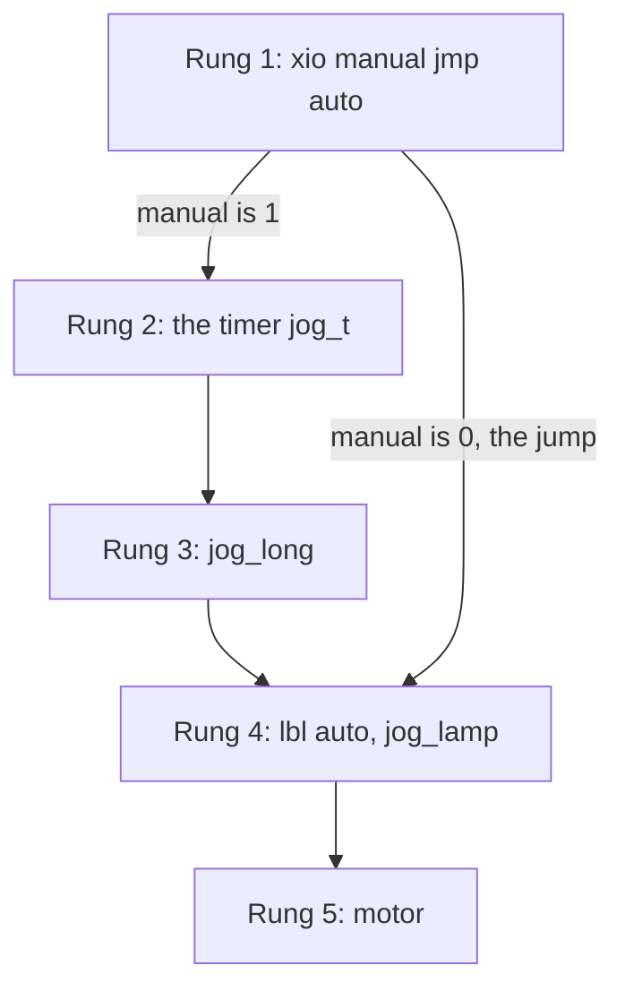

# Jump over rungs

This guide is for a reader who writes a ladder [program](../reference/glossary.md#program).
It shows how to skip a group of [rungs](../reference/glossary.md#rung) with the
[instructions](../reference/glossary.md#instruction) `jmp` and `lbl`. For example, a
conveyor has a manual mode and an auto mode. In auto, the tag `manual` is 0, and the
program skips the rungs of the manual mode. The guide also tells you what a skipped rung
keeps.

> #### Warning {: .warning}
>
> Do not put the stop of a machine on a rung that a [jump](../reference/glossary.md#jump)
> can skip. A skipped rung writes nothing. An [output](../reference/glossary.md#output)
> that is 1 stays 1, and a motor that runs continues to run. Put each stop on a rung that
> each [scan](../reference/glossary.md#scan) runs. Do not use logex for a safety function.

## Before you start

- You must have a Mix project that has logex.
  [Install logex and run a program](install-and-run.md) gives the steps.
- You must know how a script sets [inputs](../reference/glossary.md#input) and runs scans.
  [Your first program](../tutorials/first-program.md) shows this.
- The example has a `ton` [timer](../reference/glossary.md#timer).
  [Use timers](use-timers.md) shows how a `ton` counts.

## What a skipped rung keeps

A `jmp` on a [true rung](../reference/glossary.md#true-rung) jumps forward to the rung
that `lbl` and its [label](../reference/glossary.md#label) start. The scan does not run
the rungs between them. A skipped rung reads nothing and writes nothing. A
[false rung](../reference/glossary.md#false-rung) is different: on it, an `ote` writes 0
and a `ton` resets.

| On a skipped rung | What it keeps |
|---|---|
| An instruction that writes a [tag](../reference/glossary.md#tag), for example `ote`, `otl`, `otu`, `move` or `add` | The tag keeps its value. |
| A timer | It keeps its [members](../reference/glossary.md#member). If the timer counted time at its last run, its next run adds all the time since that run, up to its [preset](../reference/glossary.md#preset). |
| A [counter](../reference/glossary.md#counter) | It keeps its count. If its input rises and then falls while the jump skips its rung, the counter does not count that [rising edge](../reference/glossary.md#rising-edge). |
| A [one-shot](../reference/glossary.md#one-shot) or a [pulse coil](../reference/glossary.md#pulse-coil) | It gives no pulse. A [pulse bit](../reference/glossary.md#pulse-bit) that is 1 stays 1. |
| A `div` or `mod` with the divisor 0, a `sqrt` of a negative number, or a [subscript](../reference/glossary.md#subscript) or a bit number out of range | The scan gets no [fault](../reference/glossary.md#fault), [minor](../reference/glossary.md#minor-fault) or [major](../reference/glossary.md#major-fault). |
| `cal` | The [function block](../reference/glossary.md#function-block) does not run. Its outputs keep their values. |
| `jmp` | It does not jump. |

> #### Caution {: .error}
>
> Write a timer that must start again from 0 after a skip on a rung after the label.
> When its rung runs again, a skipped timer adds the time of the skip, and its `.dn` can
> come on in that scan. Step 4 shows how.

## Steps

The example is the program `jog.ld`. In auto, the motor runs while `run_pb` is 1. In
manual, the motor runs while the operator holds the button `jog_pb`, and the lamp
`jog_long` comes on after 3 s. The timer stays on a skipped rung, so that the run in
step 8 shows the risk that the Caution gives.

1. Put the rungs that the jump must skip one after the other. In `jog.ld`, these are
   rungs 2 and 3, the rungs of the manual mode.
2. On the rung before them, write the condition, then `jmp` and a label. The rung
   `xio manual jmp auto ote auto_lamp` jumps when `manual` is 0. The scan runs the rest
   of the rung first, then jumps. The `jmp` passes its
   [power flow](../reference/glossary.md#power-flow) on, so `auto_lamp` is 1 in auto.
3. Start the first rung after them with `lbl` and the same label: `lbl auto`. `lbl`
   passes on its power flow, so the rest of the rung runs as usual. If no rung comes
   after them, write `lbl auto` alone as the last rung.
4. Find each output that must go to 0 in auto. Write it on a rung after the label, with
   the mode in its condition: `lbl auto xic manual xic jog_pb ote jog_lamp`. Do the same
   for a timer that must start again from 0: `xic manual xic jog_pb ton jog_t 3000`.
5. If both modes control an output, write the output on 1 rung after the label. Give the
   rung 1 [leg](../reference/glossary.md#leg) of a [branch](../reference/glossary.md#branch) for each
   mode: `( xic run_pb xio manual | xic manual xic jog_pb ) ote motor`.
6. In the root directory of your project, make the directory `jump-over-rungs`. In it,
   make the file `jog.ld` with this text:

<!-- file: jump-over-rungs/jog.ld -->
```text
var_input manual bool
var_input jog_pb bool
var_input run_pb bool
var_output auto_lamp bool
var_output jog_lamp bool
var_output jog_long bool
var_output motor bool
var jog_t ton

// in auto, jump over the manual rungs
xio manual jmp auto ote auto_lamp
xic jog_pb ton jog_t 3000
xic jog_t.dn ote jog_long
lbl auto xic manual xic jog_pb ote jog_lamp
( xic run_pb xio manual | xic manual xic jog_pb ) ote motor
```

A label is not a tag. Do not declare it. A label and a tag can have the same name.

7. In the root directory of your project, make the file `jump-over-rungs.exs` with this
   text. It runs 12 scans of 500 ms and prints the values after each scan.

```elixir
{:ok, jog} = Logex.compile_file("jump-over-rungs/jog.ld")
names = ["manual", "jog_pb", "run_pb", "auto_lamp", "jog_lamp", "jog_t.acc", "jog_long", "motor"]

row = fn cells ->
  ["scan" | names]
  |> Enum.zip(cells)
  |> Enum.map_join("  ", fn {name, cell} -> String.pad_leading("#{cell}", String.length(name)) end)
  |> IO.puts()
end

scan = fn inputs, {number, state} ->
  state = Logex.Runtime.put_inputs(jog, state, inputs)
  {_outputs, state} = Logex.Runtime.scan(jog, state, 500)
  row.([number | Enum.map(names, &get_in(state.env, String.split(&1, ".")))])
  {number + 1, state}
end

row.(["scan" | names])

[
  %{"run_pb" => 1},
  %{"run_pb" => 0, "manual" => 1},
  %{"jog_pb" => 1},
  %{},
  %{"manual" => 0},
  %{"jog_pb" => 0},
  %{},
  %{},
  %{"manual" => 1, "jog_pb" => 1},
  %{"manual" => 0},
  %{"jog_pb" => 0},
  %{"manual" => 1}
]
|> Enum.reduce({1, Logex.Runtime.instance(jog)}, scan)
```

8. Run the script. The first time, Mix also compiles logex before it prints the table.

```console
$ mix run jump-over-rungs.exs
scan  manual  jog_pb  run_pb  auto_lamp  jog_lamp  jog_t.acc  jog_long  motor
   1       0       0       1          1         0          0         0      1
   2       1       0       0          0         0          0         0      0
   3       1       1       0          0         1          0         0      1
   4       1       1       0          0         1        500         0      1
   5       0       1       0          1         0        500         0      0
   6       0       0       0          1         0        500         0      0
   7       0       0       0          1         0        500         0      0
   8       0       0       0          1         0        500         0      0
   9       1       1       0          0         1       3000         1      1
  10       0       1       0          1         0       3000         1      0
  11       0       0       0          1         0       3000         1      0
  12       1       0       0          0         0          0         0      0
```

If logex cannot compile `jog.ld`, the first line of the script stops with a `MatchError`.
The error shows each diagnostic. [Read a diagnostic](read-diagnostics.md) gives the steps.

## The result

This ladder drawing shows the 5 rungs. It does not show the jump. The diagram after it
shows the path of a scan.

<!-- rung: jump-over-rungs/jog.ld -->




Figure: the rungs of `jog.ld` in a scan. In auto, the scan goes from rung 1 to rung 4.

In this timing diagram, `jog_t.acc` stays 500 from scan 5 to scan 8 and goes to 3000 in
scan 9.

<!-- timing: jump-over-rungs-jog.timing.exs -->


| Scans | What the table shows |
|---|---|
| 1 | Auto. `run_pb` is 1, so the motor runs, and `auto_lamp` is 1. |
| 2 | Manual. `jog_pb` is 0, so the motor stops. |
| 3 and 4 | Manual. The operator holds `jog_pb`. The motor runs, and the timer counts. |
| 5 to 8 | Auto. The scan skips rungs 2 and 3. `jog_pb` goes to 0 in scan 6, and the timer does not see it. `jog_lamp` is 0, because rung 4 runs. |
| 9 | Manual. The timer adds the 2500 ms since scan 4 and gets to its preset. `jog_long` comes on after 1 scan of `jog_pb`. |
| 10 and 11 | Auto. `jog_long` stays 1, because rung 3 does not run. |
| 12 | Manual. Rung 2 is a false rung, so the timer resets, and `jog_long` goes off. |

## If it does not work

In the first 2 tables, **What you see** gives words of the message that logex gives when
you [compile](../reference/glossary.md#compile) the program. In the third table, it gives
what the values show. [Diagnostics](../reference/diagnostics.md) gives each
[diagnostic](../reference/glossary.md#diagnostic), and [Warnings](../reference/warnings.md)
gives each [warning](../reference/glossary.md#warning).

### Diagnostics when you compile

| What you see | Cause | What to do |
|---|---|---|
| `` jumps back, to the rung on line `` or `` jumps to its own rung `` | The label is on the rung of the `jmp` or on an earlier rung. A jump goes forward only. | Move the `lbl` to a later rung. |
| `` names no label `` | No rung of the same [routine](../reference/glossary.md#routine) starts with `lbl` and this label. The program is 1 routine, and each function block body is 1 routine. The message can give a similar label after `did you mean`. | Spell the label the same in the `jmp` and in the `lbl`. Labels are case-sensitive. Put the `jmp` and its `lbl` in the same file. |
| `` expects 1 operand (a label) `` or `` takes a label `` | The label is missing, has a `.` or a subscript, or is a [reserved word](../reference/glossary.md#reserved-word) such as `xic` or `var`. | Write a plain name that is not a reserved word. |
| `` is not first on its rung `` | An instruction or a branch comes before the `lbl`. | Put `lbl` and its label at the start of the rung. |
| `` already labels the rung on line `` or `` differ only in case `` | 2 rungs have the same label, or labels that are the same except for upper case and lower case. | Give each rung a label that is different in more than case. |
| `` is a second `jmp` in this rung `` | The rung has 2 `jmp` instructions, also when they are in different legs. | Put the second `jmp` on a different rung. |
| `` this rung writes nothing and jumps nowhere `` | The rung is a label alone, and no `jmp` names the label. Or the rung is a label and [contacts](../reference/glossary.md#contact) only. | If the rung is a label alone: write a `jmp` that names the label, or remove the rung. If the rung is a label and contacts: put an output at the end of the rung, or write the label alone (`lbl done`). |

### Warnings when you compile

| What you see | Cause | What to do |
|---|---|---|
| `` labels this rung, but no `jmp` names it `` | No `jmp` names the label. | Remove the `lbl`, or write the `jmp`. |
| `` already has an `ote` on line `` | 2 rungs write the same output with `ote`, for example 1 rung in each mode. The check does not know which rungs a jump skips. | Write the output on 1 rung after the label, as step 5 shows. |

### When you run the scans

| What you see | Cause | What to do |
|---|---|---|
| An output of the skipped rungs stays 1 after the mode changes | A skipped rung writes nothing. | Write the output after the label, with the mode in its condition, as step 4 shows. |
| An output that reads the `.dn` of a timer, such as `jog_long`, comes on in the scan after auto ends | The timer adds the time of the skip. | Write the timer's rung after the label, as step 4 shows. |
| A counter does not count a part that came while the jump skipped its rung | A skipped counter sees no edge. | Put the counter on a rung that the jump does not skip. |

## See also

- [Instructions: jump and call](../reference/instructions-jump-and-call.md): each rule of
  `jmp` and `lbl`, and each instruction on a skipped rung.
- [Source syntax](../reference/source-syntax.md): the form of a label, and the reserved
  words.
- [Execution model](../reference/execution-model.md): the sequence in which a scan runs
  the rungs.
- [The scan, the cycle and time](../explanation/scan-cycle-and-time.md): why a jump goes
  forward only, and why a timer adds the time when its rung runs again.
- [Online edit](../reference/online-edit.md): an online edit of a skipped rung.
- [Use one-shots and pulse coils](use-one-shots-and-pulse-coils.md): a one-shot on a
  skipped rung.
- [Glossary](../reference/glossary.md): the words of this guide.
