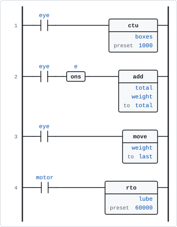

# Keep values across a restart

This guide is for a reader who runs a ladder [program](../reference/glossary.md#program)
from Elixir. It shows how to keep a count, a total or a time when the program restarts.
You give [tags](../reference/glossary.md#tag) the
[qualifier](../reference/glossary.md#qualifier) `retain` and do a
[warm restart](../reference/glossary.md#warm-restart).

The guide gives 3 procedures:

- [Keep the values of 1 program](#keep-the-values-of-1-program)
- [Keep the values of a plant](#keep-the-values-of-a-plant)
- [Tell a warm restart from a cold restart](#tell-a-warm-restart-from-a-cold-restart)

To start a new version of the program with these values, see
[Carry retained values to a new version](carry-retained-values-to-a-new-version.md).

> #### Warning {: .warning}
>
> Do not keep a value of a safety function in logex. A cold restart discards each
> retained value. A person can edit the [store](../reference/glossary.md#store). After a
> crash, a value can go back to an earlier value. Examples of such values are the lockout
> of a burner, a tag that an open guard sets and a count of trips.

## Before you start

You must have:

- a Mix project that has logex. [Install logex and run a program](install-and-run.md)
  gives the steps.
- a program that you run with `Logex.Runtime.instance/1`, `Logex.Runtime.put_inputs/3`
  and `Logex.Runtime.scan/3`, as in [Your first program](../tutorials/first-program.md).
- for a plant, a [configuration file](../reference/glossary.md#configuration-file), as in
  [Write a configuration file](write-a-configuration-file.md).

## Keep the values of 1 program

The program `shift.ld` counts boxes at a photo-eye. It adds the weight of each box to a
total, and it times the motor for its lubrication. The tag `last` holds the weight of the
last box.

1. Select the values that must stay after a
   [restart](../reference/glossary.md#restart). Here they are the
   [counter](../reference/glossary.md#counter) `boxes`, the tag `total` and the
   [timer](../reference/glossary.md#timer) `lube`. A retained counter or timer keeps
   each of its [members](../reference/glossary.md#member).
2. Leave out a value that the next [scan](../reference/glossary.md#scan) writes again,
   such as `last`.
3. Write `retain` straight after the [section](../reference/glossary.md#section) word of
   each [declaration](../reference/glossary.md#declaration) that you selected. Write it
   on a `var` or a `var_output`. A `var_input` and a `var_external` do not take it.
   Save the file as `shift.ld`:

<!-- file: shift.ld -->
```text
var_input eye bool
var_input weight dint
var_input motor bool
var_output retain total dint
var_output last dint
var retain boxes ctu
var retain lube rto
var e bool

xic eye ctu boxes 1000
xic eye ons e add total weight total
xic eye move weight last
xic motor rto lube 60000
```

The drawing shows the 4 rungs. Rung 1 writes `boxes`, rung 2 writes `total` and rung 4
writes `lube`. These 3 tags have `retain`. Rung 3 writes `last`, which has no `retain`.

<!-- rung: shift.ld -->


4. [Compile](../reference/glossary.md#compile) the program with
   `Logex.compile_file("shift.ld")`. The result is `{:ok, program}`.

> #### Warning {: .warning}
>
> Before a warm restart, find each [output](../reference/glossary.md#output) that a
> [rung](../reference/glossary.md#rung) writes from a retained value. The warm restart can
> set that output to 1 in the first scan, with no action of an operator. Make sure that
> the machine is safe when that output is 1 at the start, or do a cold restart. logex
> warns only of a retained `var_output` that drives an output point of a configuration.

> #### Caution {: .error}
>
> Look at each retained `tof`. If it was on at the stop and its rung is false in the
> first scan, the warm restart gives no off-delay. Its `dn` is 0 in the first scan.
> A `tof` that was in its delay at the stop continues the delay.

5. Do a warm restart and a [cold restart](../reference/glossary.md#cold-restart) of the
   same [state](../reference/glossary.md#state). Save this script as
   `keep-values-across-a-restart.exs`, and run it. It counts 2 boxes. The second box
   stays at the eye. Then the script calls `Logex.Runtime.restart(shift, state, :warm)`,
   and then the same call with `:cold`.

```elixir
alias Logex.Runtime

{:ok, shift} = Logex.compile_file("shift.ld")

show = fn state, label ->
  env = state.env
  boxes = env["boxes"]["cv"]
  lube = env["lube"]["acc"]
  IO.puts("#{label}  boxes=#{boxes}  total=#{env["total"]}  lube=#{lube}  last=#{env["last"]}")
  state
end

# Each scan is 10 ms after the last. The host gives that time.
scan = fn state, inputs ->
  state = Runtime.put_inputs(shift, state, inputs)
  {_outputs, state} = Runtime.scan(shift, state, 10)
  state
end

# The motor runs, and 2 boxes pass the eye. The second box stays at the eye.
state =
  Runtime.instance(shift)
  |> scan.(%{"motor" => 1})
  |> scan.(%{"eye" => 1, "weight" => 12})
  |> scan.(%{"eye" => 0})
  |> scan.(%{"eye" => 1, "weight" => 15})
  |> show.("2 boxes     ")

Runtime.restart(shift, state, :warm)
|> show.("warm restart")
|> scan.(%{})
|> show.("first scan  ")

Runtime.restart(shift, state, :cold)
|> show.("cold restart")
|> scan.(%{})
|> show.("first scan  ")
```

```console
$ mix run keep-values-across-a-restart.exs
2 boxes       boxes=2  total=27  lube=30  last=15
warm restart  boxes=2  total=27  lube=30  last=0
first scan    boxes=2  total=27  lube=40  last=15
cold restart  boxes=0  total=0  lube=0  last=0
first scan    boxes=0  total=0  lube=0  last=15
```

## The result

| Tag | Warm restart | Cold restart |
|---|---|---|
| `boxes`, `total` and `lube`, with `retain` | Keep their values | [Initial value](../reference/glossary.md#initial-value) |
| `last`, with no qualifier | Initial value | Initial value |
| `eye`, `weight` and `motor`, the [inputs](../reference/glossary.md#input) | Keep the value of the [host](../reference/glossary.md#host) | Keep the value of the host |

- After the warm restart, `last` is 0 until the next scan writes it.
- In the [first scan](../reference/glossary.md#first-scan) after each restart, the
  second box is still at the eye. The first scan finds no
  [rising edge](../reference/glossary.md#rising-edge). The counter does not count the
  box, and the [one-shot](../reference/glossary.md#one-shot) `ons e` does not add its
  weight to `total` again.
- After the warm restart, `lube` adds only the 10 ms of the first scan. A retained timer
  does not count the time of the stop.
- After the cold restart, `lube` is 0. It adds time from the second scan.

A program that has no tag with `retain` restarts warm exactly as it restarts cold.

## Keep the values of a plant

A [plant](../reference/glossary.md#plant) runs as a
[configuration](../reference/glossary.md#configuration). A configuration that runs is a
[resource](../reference/glossary.md#resource). A
[global](../reference/glossary.md#global) of the configuration can have `retain` also.

1. Write `retain` straight after `var_global` on the line of each global that must keep
   its value.
2. In each program, write `retain` on each tag that must keep its value.
   [Keep the values of 1 program](#keep-the-values-of-1-program) gives the steps.
3. If a `var_output` drives a retained global, write `retain` on the `var_output` also.
   If you do not, the first cycle writes over the global.
4. Do the restart with `Logex.Runtime.restart(resource, :warm)`.

`tally.ld` counts boxes in a retained counter and adds 1 for each box to the global
`total_boxes`. It latches `full` at 3 boxes. Save it as `tally.ld`:

<!-- file: tally.ld -->
```text
var_input eye bool
var_output retain full bool
var_external total_boxes dint
var retain boxes ctu
var e bool

xic eye ctu boxes 3
xic eye ons e add total_boxes 1 total_boxes
xic boxes.q otl full
```

Save the configuration as `tally.logex`:

<!-- file: tally.logex -->
```text
// tally.logex -- a box counter whose count and total survive a warm restart
var_global eye_1              bool at panel.i.0
var_global retain total_boxes dint 0
var_global case_full          bool

program t1 tally
  t1.eye  eye_1
  t1.full case_full
```

Save this script as `keep-values-across-a-restart-plant.exs`, and run it. It counts 4
boxes, restarts the resource warm and counts 2 more boxes. Then it restarts the resource
of the 4 boxes cold. At the end, it starts a new resource from the
[retained image](../reference/glossary.md#retained-image) of the 4 boxes.

```elixir
alias Logex.Runtime

{:ok, plant} = Logex.Configuration.compile_file("tally.logex")

names = ["total_boxes", "t1.boxes.cv", "t1.full", "case_full"]

show = fn resource, label ->
  values = Enum.map_join(names, "  ", &"#{&1}=#{Runtime.get!(resource, &1)}")
  IO.puts("#{label}  #{values}")
  resource
end

# Each box is 1 cycle with the eye on and 1 cycle with the eye off, 10 ms each.
boxes = fn resource, n ->
  Enum.reduce(1..n, resource, fn _box, resource ->
    {resource, _outputs, _events} = Runtime.cycle(resource, 10, %{"eye_1" => 1})
    {resource, _outputs, _events} = Runtime.cycle(resource, 10, %{"eye_1" => 0})
    resource
  end)
end

# The first cycle is the first scan, which finds no rising edge.
# Run it before the first box comes.
{resource, _outputs, _events} = Runtime.cycle(Runtime.start(plant), 0, %{})
resource = resource |> boxes.(4) |> show.("4 boxes     ")

resource
|> Runtime.restart(:warm)
|> show.("warm restart")
|> boxes.(2)
|> show.("2 more boxes")

resource |> Runtime.restart(:cold) |> show.("cold restart")

image = Runtime.retained(resource)
{fresh, dropped} = Runtime.start(plant, image)
show.(fresh, "from image  ")
IO.inspect(dropped)
```

```console
$ mix run keep-values-across-a-restart-plant.exs
4 boxes       total_boxes=4  t1.boxes.cv=4  t1.full=1  case_full=1
warm restart  total_boxes=4  t1.boxes.cv=4  t1.full=1  case_full=0
2 more boxes  total_boxes=5  t1.boxes.cv=5  t1.full=1  case_full=1
cold restart  total_boxes=0  t1.boxes.cv=0  t1.full=0  case_full=0
from image    total_boxes=4  t1.boxes.cv=4  t1.full=1  case_full=0
[]
```

- The warm restart keeps the global `total_boxes`, the counter `t1.boxes` and the
  output `t1.full`.
- The global `case_full` has no `retain`. It is 0 until the first
  [cycle](../reference/glossary.md#cycle) copies `t1.full` to it.
- Of the 2 boxes after the warm restart, the counter and `total_boxes` count 1. The
  first box comes in the first scan, which finds no rising edge.
- `Logex.Runtime.retained/1` gives the retained image of the resource.
  `Logex.Runtime.start/2` starts a new resource from it, and returns the values that it
  did not keep. Here that list is empty.

A global at a [point](../reference/glossary.md#point) takes no `retain`. logex reads an
input point again at each start. An output point is 0 until the program writes it.

### Restart a runner

A [runner](../reference/glossary.md#runner) keeps the retained values in memory across
`Logex.Runner.restart(runner, :warm)`. This call restarts only a runner that has a
[trip](../reference/glossary.md#trip). [Restart after a trip](restart-after-a-trip.md)
gives the steps.

To keep the values after the host stops or crashes, give the runner a store.
[Keep retained values on disk](keep-values-on-disk.md) gives the steps. To restart a
runner that runs, stop it and start it again with the same store. A start from a store
is warm, unless you give the option `start: :cold`.

## Tell a warm restart from a cold restart

logex gives a program no tag that is 1 in the first scan. A program can tell a warm
restart from a cold restart with 2 tags, `first` and `ran`.

1. Declare `var first bool 1`. `first` has no `retain`, so each restart sets it to 1
   again.
2. Write `otu first` on the last rung.
3. Declare `var retain ran bool`. Write `otl ran` on a separate rung, after each rung
   that reads `ran`. If `otl ran` comes first, a cold restart reads as a warm restart.
4. In the first scan, read `ran`. It is 1 after a warm restart and after a start from a
   retained image. It is 0 after a cold restart and in a new
   [instance](../reference/glossary.md#instance).

Save this program as `keep-values-across-a-restart/start_bits.ld`:

<!-- file: keep-values-across-a-restart/start_bits.ld -->
```text
var_output cold_start bool
var_output warm_start bool
var first bool 1
var retain ran bool

xic first xio ran ote cold_start
xic first xic ran ote warm_start
otl ran
otu first
```

Save this script as `keep-values-across-a-restart-start.exs`, and run it:

```elixir
alias Logex.Runtime

{:ok, bits} = Logex.compile_file("keep-values-across-a-restart/start_bits.ld")

scan = fn state, label ->
  {outputs, state} = Runtime.scan(bits, state)
  IO.puts("#{label}  #{inspect(outputs)}")
  state
end

restart = fn state, mode -> Runtime.restart(bits, state, mode) end

Runtime.instance(bits)
|> scan.("first scan  ")
|> scan.("second scan ")
|> restart.(:warm)
|> scan.("warm restart")
|> restart.(:cold)
|> scan.("cold restart")
```

```console
$ mix run keep-values-across-a-restart-start.exs
first scan    %{"cold_start" => 1, "warm_start" => 0}
second scan   %{"cold_start" => 0, "warm_start" => 0}
warm restart  %{"cold_start" => 0, "warm_start" => 1}
cold restart  %{"cold_start" => 1, "warm_start" => 0}
```

`cold_start` or `warm_start` is 1 for 1 scan after each start. A rung can read it to do
the work of that start.

## If it does not work

### When you compile

| What you see | Cause | What to do |
|---|---|---|
| `` which takes no `retain` `` | The section of the tag does not take `retain`. | Remove `retain`. Each restart keeps an input. A global takes `retain` on its `var_global` line. |
| `` comes straight after `` | `retain` is after the name, the [type](../reference/glossary.md#type) or the initial value. | Write it straight after the section word, for example `var_global retain`. |
| `` not both `` | 1 line has `retain` and `non_retain`. | Keep 1 of them. |
| `` a located global takes no `` | `retain` is on a global at a point. | Remove `retain`. |
| `` is retained and drives the output `` | A [warning](../reference/glossary.md#warning): a retained `var_output` drives an output point. The first [round](../reference/glossary.md#round) after a warm restart writes the kept value to the point. | Make sure that the output is safe after a warm restart, or remove `retain`. |
| `` is retained but driven by `` | A warning: a `var_output` with no `retain` drives a retained global. The first round writes over the global. | Add `retain` to the `var_output`, or remove `retain` from the global. |

### When you restart

| What you see | Cause | What to do |
|---|---|---|
| A tag is 0 after a warm restart | The tag has no `retain`. | Add `retain` to its declaration. |
| The counter does not count a box at the eye after a restart | The box is at the eye in the first scan, which finds no rising edge. | Do the restart when no box is at the eye. |
| A global is 0 after a warm restart, but the output that drives it is not | The global has no `retain`. | Read it after the first cycle, or add `retain` to the global. |
| The `dn` of a retained `tof` goes to 0 in the first scan, with no off-delay | The `tof` was on at the stop, and its rung is false in the first scan. | logex gives no off-delay in this case. Make sure that the machine is safe when the output goes to 0. |
| `` the runner is running `` | The runner has no trip. | Stop the runner, and start it again with its store. |

## See also

- [Retained values](../reference/retained-values-and-store.md) and [The store](../reference/store.md): each rule
  of `retain`, of the retained image and of the store. It gives the rules of `retain` in
  a [function block](../reference/glossary.md#function-block).
- [Warm and cold restarts](../explanation/warm-and-cold-restarts.md): what each restart
  keeps, and why.
- [Carry retained values to a new version](carry-retained-values-to-a-new-version.md):
  start a new version of the program with the retained values.
- [Keep retained values on disk](keep-values-on-disk.md): keep the values after the host
  stops.
- [Restart after a trip](restart-after-a-trip.md): restart a runner warm or cold.
- [The limits of retained values](../explanation/limits-of-retained-values.md): what a
  retained value does not give.
- [Safety and limits](../explanation/safety-and-limits.md): what logex is not.
- [Glossary](../reference/glossary.md): the words of this guide.
