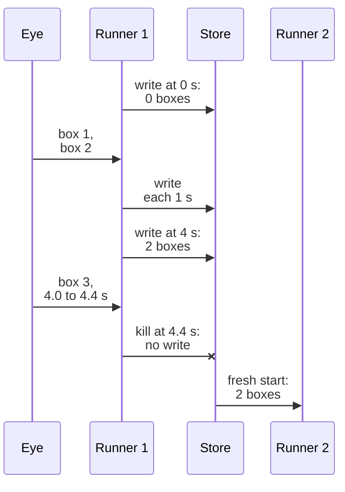

# Keep retained values on disk

This guide is for a reader who runs a [plant](../reference/glossary.md#plant) on a
[runner](../reference/glossary.md#runner). It shows how to give the runner a
[store](../reference/glossary.md#store), so that the values of the
[tags](../reference/glossary.md#tag) with
[`retain`](../reference/glossary.md#retain) stay after the runner stops or crashes. The
store is a text file on the disk of the [host](../reference/glossary.md#host). Then the
guide kills the runner, to show what a crash loses.
[The store](../reference/store.md#what-a-crash-loses) gives the rule.

> #### Warning {: .warning}
>
> Do not keep a value of a safety function in the store. Examples of such values are the
> lockout of a burner and a count of trips. The store is not battery-backed memory and
> not safety memory. A crash loses each change since the last write of the store. A
> [cold start](../reference/glossary.md#fresh-start) and a
> [cold restart](../reference/glossary.md#cold-restart) discard each retained value. A
> person can edit the store.

> #### Warning {: .warning}
>
> Make sure that the machine is safe if an output
> [point](../reference/glossary.md#point) comes on at a fresh start. A fresh start of a
> runner with a store is warm. A [rung](../reference/glossary.md#rung) that reads a
> retained value can set a [coil](../reference/glossary.md#coil) in the first
> [round](../reference/glossary.md#round). Thus an output point can come on immediately,
> with no person at the machine. The configuration warns only when a
> [connection](../reference/glossary.md#connection) wires a retained `var_output` directly
> to an output point. If the machine is not safe, start cold.

## Before you start

You must have:

- a Mix project that has logex. [Install logex and run a program](install-and-run.md)
  gives the steps.
- a [configuration](../reference/glossary.md#configuration) whose tags have `retain`.
  [Keep values across a restart](keep-values-across-a-restart.md) gives the steps.
- a runner that runs the configuration, as in
  [Run a plant on the clock](run-on-the-clock.md).

This guide uses the box counter of
[Keep the values of a plant](keep-values-across-a-restart.md#keep-the-values-of-a-plant).
Put its [`tally.ld`](keep-values-across-a-restart.md#keep-the-values-of-a-plant) and
[`tally.logex`](keep-values-across-a-restart.md#keep-the-values-of-a-plant) in the root
directory of your project. The [global](../reference/glossary.md#global) `total_boxes`, the
[counter](../reference/glossary.md#counter) `t1.boxes` and the tag `t1.full` have
`retain`. The configuration connects `t1.full` to the global `case_full`.

The script of this guide uses the manual [clock](../reference/glossary.md#clock) and a
[simulated device](../reference/glossary.md#simulated-device), so that its output is the
same at each run. [On your plant](#on-your-plant) shows a runner of a plant.

## Steps

1. Select a path for the store. Use the rules of this table.

| Rule | Example or result |
|---|---|
| The directory of the store must exist. | `tally.retain` in the root directory of the project |
| The store must be a file, not a symbolic link. | Give the path of the file that the link names. |
| The store and the [forces file](../reference/glossary.md#forces-file) must be 2 files. | `retain: "tally.retain"`, `forces: "tally.forces"` |
| Give each runner its own store. | A second runner of the same Erlang VM on the same store does not start. |
| logex cannot find a runner of a different Erlang VM, or 2 paths to 1 file through a linked directory. | The 2 runners write over each other. A crash can start a runner with the values of the other. |
| The runner resolves a relative path 1 time, at the start. | A later `File.cd/1` does not move the store. |

2. Make the file `keep-values-on-disk.exs` in the root directory of your project. Put
   these lines at its top. They [compile](../reference/glossary.md#compile) the plant,
   delete an old store, and start the manual clock and the simulated device.

<!-- part of: keep-values-on-disk.exs -->
```elixir
alias Logex.IO.Sim
alias Logex.Runner
alias Logex.Runner.Clock.Manual

{:ok, plant} = Logex.Configuration.compile_file("tally.logex")
File.rm("tally.retain")                           # start with no store

# The manual clock, its wall clock 2026-10-30T14:00:00Z.
{:ok, clock} = Manual.start_link(now: 1_793_368_800_000)
{:ok, panel} = Sim.start_link(clock: clock)
```

3. Add the options of the runner. `retain:` gives the path of the store.
   `retain_period:` gives the time between 2 writes.

<!-- part of: keep-values-on-disk.exs -->
```elixir
opts = [
  configuration: plant,
  io: %{"panel" => {Sim, sim: panel}},
  clock: {Manual, clock},
  retain: "tally.retain",                         # the path of the store
  retain_period: 1000                             # a write each 1000 ms
]
```

   These options of `Logex.Runner.start_link/1` control the store:

| Option | Value |
|---|---|
| `retain:` | The path of the store, a string. With no `retain:`, the runner has no store. |
| `retain_period:` | The time between 2 writes: 100 ms to 3,600,000 ms. The default is 1000 ms. |
| `start:` | `:warm` reads the store. `:cold` writes the [initial values](../reference/glossary.md#initial-value) over it. The default is `:warm`. |
| `write_limit:` | The limit of real time for each read and write of the store: 1 ms to 2,147,483,647 ms. The default is 5000 ms. |

4. Add 3 functions. `show` prints the 3 retained values. `box` moves 1 box past the
   photo-eye. `written` waits for a write of the store, for at most 5 s.

<!-- part of: keep-values-on-disk.exs -->
```elixir
show = fn runner, label ->
  IO.puts(
    "#{label}  total_boxes=#{Runner.get!(runner, "total_boxes")} " <>
      "t1.boxes.cv=#{Runner.get!(runner, "t1.boxes.cv")} " <>
      "case_full=#{Runner.get!(runner, "case_full")}"
  )
end

# 1 box: the eye is on for half_ms, then off for half_ms.
box = fn half_ms ->
  Sim.set(panel, "panel.i.0", 1)
  Manual.advance(clock, half_ms)
  Sim.set(panel, "panel.i.0", 0)
  Manual.advance(clock, half_ms)
end

# Waits until the last write of the store is at the time time_of_write.
# After 5 s with no such write, it gives nil.
written = fn runner, time_of_write ->
  Stream.repeatedly(fn ->
    Process.sleep(10)
    Runner.status(runner).retain.written_at
  end)
  |> Stream.take(500)
  |> Enum.find(&(&1 == time_of_write))
end
```

5. Add these lines, which start the runner. If no store exists, the start writes a store
   of initial values. `Logex.Runner.status/1` gives the time of the last write in
   `written_at`. Step 11 shows this as the line `first write`.

<!-- part of: keep-values-on-disk.exs -->
```elixir
{:ok, runner} = Runner.start_link(opts)
IO.inspect(Runner.status(runner).retain.written_at, label: "first write")
```

6. Add these lines, which count 3 boxes. The runner writes the store each second. The
   third box comes after the write at 14:00:04. Step 11 shows this as the lines
   `2 boxes`, `3 boxes` and `last write`.

<!-- part of: keep-values-on-disk.exs -->
```elixir
# 2 boxes in 4 s. The runner writes the store each second.
box.(1000)
box.(1000)
show.(runner, "2 boxes     ")

# A third box, in 400 ms, after the write at 14:00:04.
box.(200)
show.(runner, "3 boxes     ")
IO.inspect(written.(runner, ~U[2026-10-30 14:00:04Z]), label: "last write")
```

7. Add these lines, which kill the runner, as a crash does. Then they print the store.
   Step 11 shows this as the line `runner: :killed` and the 15 lines of the store.

<!-- part of: keep-values-on-disk.exs -->
```elixir
# A crash: kill the runner. It writes nothing. The kill also stops the
# process of the device panel. This line hides the report of the logger.
Logger.configure(level: :none)
# The runner is linked to this script. Unlink it, so that the script runs on.
Process.unlink(runner)
ref = Process.monitor(runner)
Process.exit(runner, :kill)

receive do
  {:DOWN, ^ref, :process, _pid, reason} -> IO.inspect(reason, label: "runner")
end

IO.write(File.read!("tally.retain"))
```

   Without the line `Logger.configure(level: :none)`, the logger can write a report of
   the stopped process into the output.

8. Add these lines, which start a new runner with the same options. This
   [fresh start](../reference/glossary.md#fresh-start) is warm: it reads the store. Then
   `Logex.Runner.stop/1` stops the runner, writes the store and gives `:ok`. Step 11 shows
   this as the lines `fresh start` and `stop`.

<!-- part of: keep-values-on-disk.exs -->
```elixir
# A fresh start reads the store: it is warm.
{:ok, runner} = Runner.start_link(opts)
show.(runner, "fresh start ")
IO.inspect(Runner.stop(runner), label: "stop")
```

9. Add these lines, which do a cold start. `Keyword.put/3` sets `start: :cold` in the
   options. Step 11 shows this as the line `start: :cold`.

<!-- part of: keep-values-on-disk.exs -->
```elixir
# A cold start writes the initial values over the store.
{:ok, runner} = Runner.start_link(Keyword.put(opts, :start, :cold))
show.(runner, "start: :cold")
:ok = Runner.stop(runner)
```

10. Make sure that the file has this text.

```elixir
alias Logex.IO.Sim
alias Logex.Runner
alias Logex.Runner.Clock.Manual

{:ok, plant} = Logex.Configuration.compile_file("tally.logex")
File.rm("tally.retain")                           # start with no store

# The manual clock, its wall clock 2026-10-30T14:00:00Z.
{:ok, clock} = Manual.start_link(now: 1_793_368_800_000)
{:ok, panel} = Sim.start_link(clock: clock)

opts = [
  configuration: plant,
  io: %{"panel" => {Sim, sim: panel}},
  clock: {Manual, clock},
  retain: "tally.retain",                         # the path of the store
  retain_period: 1000                             # a write each 1000 ms
]

show = fn runner, label ->
  IO.puts(
    "#{label}  total_boxes=#{Runner.get!(runner, "total_boxes")} " <>
      "t1.boxes.cv=#{Runner.get!(runner, "t1.boxes.cv")} " <>
      "case_full=#{Runner.get!(runner, "case_full")}"
  )
end

# 1 box: the eye is on for half_ms, then off for half_ms.
box = fn half_ms ->
  Sim.set(panel, "panel.i.0", 1)
  Manual.advance(clock, half_ms)
  Sim.set(panel, "panel.i.0", 0)
  Manual.advance(clock, half_ms)
end

# Waits until the last write of the store is at the time time_of_write.
# After 5 s with no such write, it gives nil.
written = fn runner, time_of_write ->
  Stream.repeatedly(fn ->
    Process.sleep(10)
    Runner.status(runner).retain.written_at
  end)
  |> Stream.take(500)
  |> Enum.find(&(&1 == time_of_write))
end

{:ok, runner} = Runner.start_link(opts)
IO.inspect(Runner.status(runner).retain.written_at, label: "first write")

# 2 boxes in 4 s. The runner writes the store each second.
box.(1000)
box.(1000)
show.(runner, "2 boxes     ")

# A third box, in 400 ms, after the write at 14:00:04.
box.(200)
show.(runner, "3 boxes     ")
IO.inspect(written.(runner, ~U[2026-10-30 14:00:04Z]), label: "last write")

# A crash: kill the runner. It writes nothing. The kill also stops the
# process of the device panel. This line hides the report of the logger.
Logger.configure(level: :none)
# The runner is linked to this script. Unlink it, so that the script runs on.
Process.unlink(runner)
ref = Process.monitor(runner)
Process.exit(runner, :kill)

receive do
  {:DOWN, ^ref, :process, _pid, reason} -> IO.inspect(reason, label: "runner")
end

IO.write(File.read!("tally.retain"))

# A fresh start reads the store: it is warm.
{:ok, runner} = Runner.start_link(opts)
show.(runner, "fresh start ")
IO.inspect(Runner.stop(runner), label: "stop")

# A cold start writes the initial values over the store.
{:ok, runner} = Runner.start_link(Keyword.put(opts, :start, :cold))
show.(runner, "start: :cold")
:ok = Runner.stop(runner)
```

11. Run the script.

```console
$ mix run keep-values-on-disk.exs
first write: ~U[2026-10-30 14:00:00Z]
2 boxes       total_boxes=2 t1.boxes.cv=2 case_full=0
3 boxes       total_boxes=3 t1.boxes.cv=3 case_full=1
last write: ~U[2026-10-30 14:00:04Z]
runner: :killed
logex retain 3
configuration tally written 2026-10-30T14:00:04Z
resource 013cc059392445fdcc1e84c9b0de6118
program tally bd882e28a8159d8e8a4ea56ade7b36b6
global total_boxes dint 2
instance t1 tally
t1.boxes ctu
t1.boxes.cu bool 0
t1.boxes.cv dint 2
t1.boxes.ov bool 0
t1.boxes.pv dint 3
t1.boxes.q bool 0
t1.boxes.r bool 0
t1.full bool 0
end 15 lines
fresh start   total_boxes=2 t1.boxes.cv=2 case_full=0
stop: :ok
start: :cold  total_boxes=0 t1.boxes.cv=0 case_full=0
```

## The result

The runner keeps the retained values in `tally.retain`. A fresh start reads them. The
crash lost only the changes after the last write.



Figure: the run of `keep-values-on-disk.exs`, with the photo-eye, the store and 2 runners.
The kill comes after the last write. Thus the new runner does not get the third box.

| Line | What it shows |
|---|---|
| `first write` | No store existed. The start wrote a store of initial values. |
| `2 boxes` | The runner wrote the store each second. The write at 14:00:04 holds 2 boxes. |
| `3 boxes` | The third box came after the last write. |
| `runner: :killed` | The crash wrote nothing. |
| `logex retain 3` to `end 15 lines` | The store holds 2 boxes, from the write at 14:00:04. |
| `fresh start` | The new runner has 2 boxes. The crash lost the third box and the [latch](../reference/glossary.md#latch) of `t1.full`, which `case_full` shows. |
| `start: :cold` | Each retained value is its initial value again. |

[The lines of the store](../reference/store.md#the-lines-of-the-store) gives each
line of the store.

## On your plant

Give `retain:` to the runner of your plant, with a path that only this runner uses. Here,
`plant` is your configuration and `devices` is your map of devices:

<!-- fragment: the options of the runner of a plant, with a store -->
```elixir
{:ok, runner} =
  Logex.Runner.start_link(
    configuration: plant,
    io: devices,
    retain: "/var/lib/plant/line_1.retain",
    retain_period: 1000
  )
```

Stop the runner before you stop the Erlang VM, because a stop writes the store. The child
spec of a runner is `restart: :temporary`. Thus a supervisor does not start the runner
again after a crash, unless you give your own `restart:`.
[Run a plant under a supervisor](run-under-a-supervisor.md) gives the steps and the risk.

## What a crash loses

A runner writes nothing when it crashes or a process kills it. The next fresh start reads
the last write.

| While | A crash loses |
|---|---|
| The writes succeed | The changes of at most 1 `retain_period:`, and the write that the crash stops |
| The disk is slower than the period | More than 1 period |
| The writes fail, for example on a full disk | Each change since the last good write |
| The runner has a [trip](../reference/glossary.md#trip) and you do steps of an [online edit](../reference/glossary.md#online-edit) | The changes of those steps, until the [restart](../reference/glossary.md#restart) |
| The power fails immediately after a write | Possibly that write also |

A shorter `retain_period:` loses less. But it writes to the disk more frequently, because
each write writes the whole store.

These events also write the store:

- a trip.
- a stop: `Logex.Runner.stop/1`, the shutdown of a supervisor, `GenServer.stop/1`, or a
  `:normal` exit of the parent process.
- a cold restart and a cold start.
- a fresh start when no store exists.

A warm start from a store that exists does not write it. A
[warm restart](../reference/glossary.md#warm-restart) does not write it.

## Start cold

> #### Caution {: .error}
>
> Copy the store before a cold start if you need its values later. A cold start writes
> the initial values over a good store, and keeps no copy. If a warm start refuses the
> store, the cold start first copies it to the next `<store>.dropped.<n>`, for example
> `tally.retain.dropped.1`.

1. Stop the runner.
2. Copy the store, for example to `tally.retain.bak`.
3. Start the runner with `start: :cold` in its options.

<!-- fragment: the option of a cold start, from step 9 -->
```elixir
{:ok, runner} = Runner.start_link(Keyword.put(opts, :start, :cold))
```

## Watch the writes

`Logex.Runner.status(runner).retain` is a map. This table gives 5 of its keys.
[The store](../reference/store.md#the-status-of-the-store) gives each key.

| Key | Value |
|---|---|
| `written_at` | The time of the last write that is complete |
| `failed` | The reason of the last write that failed, or `nil` |
| `unknown` | The path of a file that a late write can still change, or `nil` |
| `warning` | The warning of the fresh start if a different program wrote the store, or `nil` |
| `copy` | The copy that the fresh start made of a refused store, or `nil` |

On your operator panel, show `written_at`. Show an alarm if `failed` or `unknown` is not
`nil`.

To get the events of the store as messages, subscribe to `:retain`:

<!-- fragment: a subscription to the events of the store -->
```elixir
:ok = Logex.Runner.subscribe(runner, [:retain])
# A failed write sends {Logex.Runner, runner, {:retain, {:error, :enoent}}}.
# A warning sends {Logex.Runner, runner, {:retain, {:warning, message}}}.
```

## If it does not work

### `start_link/1` returns an error

| What you see | Cause | What to do |
|---|---|---|
| `{:error, {:retain, :enoent}}` | The directory of the store does not exist. | Make the directory. |
| `{:error, {:retain, :timeout}}` | The store was not read, used or written in the write limit. | Give a longer `write_limit:`, or repair the disk. |

### `start_link/1` raises an `ArgumentError`

The runner does not start. Each message is longer than the part that this table gives.

| What you see | Cause | What to do |
|---|---|---|
| `the runner keeps no store, so retain_period: 1000 has none to write` | `retain_period:` with no `retain:`. | Give `retain:`. |
| `the runner keeps no store, so start: :cold has none to start from` | `start: :cold` with no `retain:`. | Give `retain:`. |
| `a whole number of ms from 100 to 3600000, got: 50` | `retain_period:` is out of its range. | Give 100 to 3600000. |
| `retain: is the path of the file its retained values are kept in, a string, got: ""` | The path is empty or is not a string. | Give a path as a string. |
| `takes each option once, got :start more than once` | The options have `start:` 2 times. | Use `Keyword.put/3`. |
| `is a symbolic link` | The store is a symbolic link. | Give the path of the file that the link names. |
| `the store and the forces file are two files` | `retain:` and `forces:` name 1 file. | Give 2 paths. |
| `names the store of another runner of this VM` | A different runner has the store. | Stop that runner, or give a different path. |
| `the store cannot be read: the disk did not answer within the write limit` | A warm start did not read the store in the write limit. | Give a longer `write_limit:`, or repair the disk. |
| `the store cannot be read: illegal operation on a directory` | The path names a directory. | Give the path of a file. |
| `line 2: the store is of configuration` | The store is of a different configuration. | [Recover from a refused store](recover-a-refused-store.md). |
| `line 1: the store is empty` | The store is empty. | [Recover from a refused store](recover-a-refused-store.md). |
| `is the store's last line, and no end line` | The store is cut short. | [Recover from a refused store](recover-a-refused-store.md). |
| A different message that starts with the path of the store and a line number | A warm start refused the store. | [Recover from a refused store](recover-a-refused-store.md). |

### After a fresh start

| What you see | Cause | What to do |
|---|---|---|
| `the store was written by another program than the one this start was given` in `warning` | The files of the [program](../reference/glossary.md#program) or of the configuration changed. Or an online edit did not get to the files. The runner runs with the values of the store, by name and type. | If the files are correct, do nothing. If not, write the edit to the files, then stop and start the runner. That start warns 1 time more. |
| After a crash, a value is older than before the crash | The crash lost each change since the last write. | Give a shorter `retain_period:`. |

### While the runner runs

| What you see | Cause | What to do |
|---|---|---|
| `{:retain, {:error, :enoent}}`, and `failed: :enoent` in the status | A write failed. The store keeps the last good write. | Repair the disk or the directory. |
| `{:retain, {:error, :timeout}}`, and `unknown` in the status | A write did not end in the write limit. | Give a longer `write_limit:`, or use a faster disk. |
| A stop gives `{:error, {:retain, :enoent}}` | The write of the stop failed. The runner stopped all the same. The store holds the last good write. | Repair the disk. |

## See also

- [The store](../reference/store.md): each rule
  of the store, its lines, its writes and its refusals.
- [Warm and cold restarts](../explanation/warm-and-cold-restarts.md): what each start
  keeps, and why.
- [Keep values across a restart](keep-values-across-a-restart.md): select the tags with
  `retain`.
- [Recover from a refused store](recover-a-refused-store.md): start after a refusal.
- [Edit the store by hand](edit-the-store-by-hand.md): change a value in the store.
- [Take back a deploy](take-back-a-deploy.md): start from a copy of the store.
- [Run a plant under a supervisor](run-under-a-supervisor.md): start the runner again
  after a crash.
- [Safety and limits](../explanation/safety-and-limits.md): what logex is not.
- [Glossary](../reference/glossary.md): the words of this guide.
